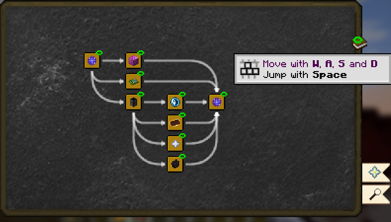
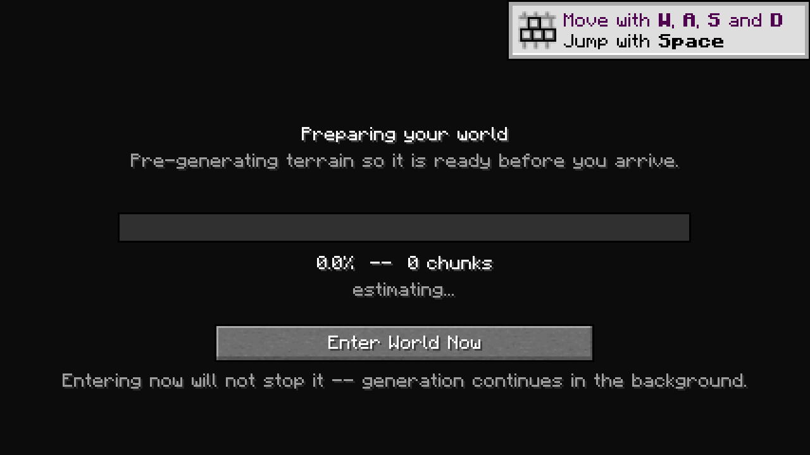

# Create Galore

A big, long-term Minecraft modpack built around the Create mod. Think "Minecraft, but better, plus Create": airships, submarines, trains, roller coasters and rockets to the Moon, with survival layers (thirst, temperature, pollution, seasons), homesteading and a lot of new world to explore.

| | |
|---|---|
| **Version** | 0.4.83 |
| **Minecraft** | 1.21.1 |
| **Loader** | NeoForge **21.1.262** (pinned, don't update it, see [Known issues](#known-issues)) |
| **Mods** | 232 from Modrinth + the pack's own Create Galore Bridge (1.97.0), Create Galore Fishing (0.3.17) and Lag Watch (1.1.0) + Twilight Forest added by hand, plus 4 shader packs and the Fresh Animations resource pack |
| **Full mod list** | [MODS.md](MODS.md) |
| **In-game help** | The Create Galore Field Guide, a searchable book every player gets on first join |

## Install (players)

1. Download `Create-Galore-0.4.83.mrpack` from the [latest release](https://github.com/emresahin0906-code/Create-Galore/releases/latest). The older `.mrpack` files in the repo's top folder are past versions; don't import those.
2. Import it:
   - **Prism Launcher:** Add Instance → Import → pick the `.mrpack`.
   - **Modrinth App:** drag the `.mrpack` onto the window (or File → Import).

   The launcher downloads every mod at its pinned version (about 860 MB) and unpacks the pack's configs and datapacks.
3. **Add Twilight Forest by hand.** It isn't on Modrinth, so it can't be inside the pack file. Put `twilightforest-1.21.1-4.8.3345-universal.jar` (CurseForge, version 4.8.3345) into the instance's `mods` folder.
4. Give the game its memory and Java flags in the instance's Java settings: **12 GB with Generational ZGC** on a PC with 32 GB or more, **8 GB with G1** on a 16 GB laptop. Set minimum and maximum memory to the same value. The exact lines to paste for Prism and the Modrinth App, the benchmark behind them and the upper limits are in **[docs/java-flags.md](docs/java-flags.md)**.
5. Optional shaders are already in the `shaderpacks` folder: **Complementary Reimagined + Euphoria Patches** (recommended), Bliss, Photon and Solas (lightest). Turn one on in Options → Video Settings → Shader Packs. For Bliss or Photon, pick the copy whose name ends in **+ Clrwl** (Colorwheel Patcher makes it at launch), so Create contraptions get shaded properly. Experimental and optional: **Photon v1.3a + DLAA** (made at launch from Photon + Clrwl) swaps Photon's anti-aliasing for NVIDIA DLAA or AMD FSR 3.1, at full resolution or with a render resolution below 100% for more frames (Quality, Balanced, Performance, Ultra Performance or Custom; see [What's different](#whats-different-from-the-stock-mods)). Its settings are behind the **DLAA...** button in the shader pack menu; DLSS needs your own `nvngx_dlss.dll` (not part of the pack, the screen links NVIDIA's copy).

6. Optional: give the instance the pack icon. Download `Create-Galore-icon.png` from the release and pick it in the launcher (Prism: click the instance icon; Modrinth App: instance settings). A `.mrpack` can't carry an icon, so launchers show their default one.

Don't let the launcher update NeoForge past 21.1.262.

## Install (server)

**On Windows, use the Server Setup app.** Download `Create-Galore-Server-Setup-<version>.exe` from the [latest release](https://github.com/emresahin0906-code/Create-Galore/releases/latest) and run it. Pick a folder and the memory, drop in the Twilight Forest jar (it shows a green check when it's the right version), tick the EULA and press Install. It installs NeoForge, downloads the server-side mods (or copies them from a mods folder you drop in, skipping client-only ones), applies the pack's configs, memory and whitelist, and writes a `start-server.bat`, which checks for pack updates each start and asks before applying them. If your PC has no Java 21 it downloads one into the server folder. Run a newer version of the app on the same folder to update the server (see [Updating](#updating)).

**Or use the script** (any OS). A dedicated server takes one script plus two manual steps (add Twilight Forest, accept the EULA). The full guide, including hosting on your own PC vs Exaroton, memory, whitelisting and moving the world between the two, is in **[docs/server-setup.md](docs/server-setup.md)**.

```
cd server
install-server.bat C:\CreateGaloreServer        (Windows)
./install-server.sh ~/CreateGaloreServer        (Linux / macOS)
```

The server gets 190 mods, the pack's Create Galore Bridge, Fishing and Lag Watch, and Twilight Forest. The 42 client-only mods (Sodium, Iris, Distant Horizons, map add-ons, the ambiance layer and so on) are skipped automatically. Players still install the full `.mrpack`. Far terrain for Distant Horizons is sent from the server by Chunksmith, so Distant Horizons itself stays off the server.

The server opens a small window with a live memory graph and the player list, and warns in chat when TPS stays under 15, recording a spark profile you can open later. See [Lag alerts and profiles](docs/server-setup.md#lag-alerts-and-profiles).

## Updating

You don't have to reinstall the pack for a new version. Both the game and the server can update in place: only mods and configs that changed are downloaded or replaced, mods that left the pack are removed, and everything else (Minecraft, NeoForge, every unchanged mod, your worlds) stays as it is. The full `.mrpack` stays the way to make a new instance.

There are two modes. Pick one by adding or removing `--clean`:

| Mode | Command ends with | Configs | Use it while |
|---|---|---|---|
| **Soft update** | `create-galore-updater.jar` | Your edits are kept unless the pack changed that file | playing a world you care about |
| **Clean** ⚠️ | `create-galore-updater.jar --clean` | **Every config is deleted and reset to the pack's on every launch**: `config/`, `defaultconfigs/`, `options.txt` (keybinds, video settings) and each world's `serverconfig/`. Distant Horizons, Subtle Effects and all other settings go back to the pack's or the mod's defaults | hunting bugs and want a clean slate |

Neither mode deletes or re-downloads mods that didn't change, and neither touches Minecraft, NeoForge or your worlds. `--clean` keeps world folders on purpose: a world's own data (terrain, structures, mod saved data) can't be rebuilt from the pack, so for a fully clean world just make a new one. It resets only each world's config folder.

**Game (Prism Launcher), one-time setup.** The pack ships a small updater built on [packwiz-installer](https://packwiz.infra.link/tutorials/installing/packwiz-installer/) that updates the instance from the pack on GitHub each time you press Play.

1. If the instance's `minecraft` folder (Prism: right-click the instance → Folder) has no `create-galore-updater.jar`, download `Create-Galore-Updater.zip` from the [latest release](https://github.com/emresahin0906-code/Create-Galore/releases/latest) and unzip its three jars there. Instances imported from a release that already has the updater have them.
2. Edit the instance → Settings → Custom commands, tick the box and paste this as the **pre-launch command** (add ` --clean` at the end for the clean mode):
   ```
   "$INST_JAVA" -jar create-galore-updater.jar
   ```
3. Press Play. A small window checks the pack. The first run on an instance you already have just checks the files and downloads nothing if they match the latest release. After that, soft launches with no pack change take a couple of seconds. Clean launches fetch the pack's configs (a few hundred small files) each time.

The command reads the pack from GitHub, which only works while the repo is public. To update from a local copy instead (a private repo, or no internet), unzip the release's `Create-Galore-<version>-server-kit.zip` somewhere and put the path of its `pack\pack.toml` after the jar, for example `"$INST_JAVA" -jar create-galore-updater.jar C:\CreateGalorePack\Create-Galore-<version>-server-kit\pack\pack.toml --clean`. Unzip a newer kit over it to update.

If the pack can't be read, the updater stops before changing anything. `--clean` moves the configs aside first and puts them back if the update fails, so a failed launch never leaves the instance without configs.

The updater also keeps NeoForge on the pack's pinned version. In Prism, when an update moves NeoForge (0.2.1 moves it from 21.1.259 to 21.1.262), the updater changes the instance's NeoForge and then stops that launch, because Prism has already picked the old version for it: Prism says the pre-launch command failed (exit code 4). Press Launch again and the game starts on the new NeoForge. The Modrinth App doesn't let the updater change NeoForge: set it by hand in the instance's settings (Installation → NeoForge version). To freeze the instance on its current version, clear the pre-launch command. If GitHub can't be reached, the window offers to continue without updating.

**What the soft update keeps.** Files the pack doesn't ship are never touched: map and minimap data, `servers.dat`, your worlds, shaders' settings, the Twilight Forest jar and the Elytra switch. Your keybinds and video settings (`options.txt`), Distant Horizons' settings, Subtle Effects' `blocks.toml` and Inventory Profiles Next's settings are kept forever (if the pack ships one of them it is marked `preserve`), so the pack only writes them when they're missing. Any other config you edit stays until the pack itself changes that file; then the pack's version wins, because that's usually a fix. `--clean` throws all of this away, the Elytra switch included.

**Before the first switch**, update the instance to the latest release once if it's older (import the new `.mrpack` as usual). The updater only removes mods it knows it installed, so mods dropped before the switch would linger. Tested with a real 0.1.5 instance (227 files, edited keybinds and Subtle Effects, a Distant Horizons config, a world): the switch checked every file in about 4 seconds, downloaded nothing and changed nothing; an update then removed a dropped mod, fetched one changed and one new config, kept the edited files and moved NeoForge in the instance to the pack's version. A `--clean` run then deleted the configs and the world's `serverconfig/`, put back the pack's 293 config files, downloaded no mods and left the world in place.

**Modrinth App:** instance → Settings → Launch hooks → Pre-launch, the same command with `java` (or the full path to a Java 21 `java.exe`) in place of `"$INST_JAVA"`, after putting the three jars in the instance folder. Prism is the tested route.

**Server.** `start-server` checks for a newer pack every time it starts and asks in the console: no, yes, or back up the world first and then update. It never updates on its own. Details in [docs/server-setup.md](docs/server-setup.md#update-check-at-start). To update by hand, run the newer Server Setup app on the same folder; its button reads "Update server" when it finds one there. It keeps mods whose checksum still matches, downloads the changed ones, removes the ones the pack dropped and keeps config edits the pack didn't change. Tick **Reset all configs to the pack's** for the clean mode: it deletes `config/`, `defaultconfigs/` and the world's `serverconfig/` before installing, and keeps the world, `server.properties`, memory, whitelist and ops. The scripts do the same: run `install-server` again from the new server kit, with `--clean` after the folder for the clean mode. They also reinstall NeoForge if the pack moves to a new version. Details in [docs/server-setup.md](docs/server-setup.md#updating-the-pack).

## The Field Guide

Every player gets the **Create Galore Field Guide** on first join, and you can craft another from a Book and Andesite. It's a wiki, not a quest book: 16 sections and about 220 entries on how things work and how the mods connect, written for someone who has never played Create.

A new player should open **Start Here > Your First Days** first: how to drink, where to find clean water, food and staying warm, the things that can kill you before you know the pack.

Not sure what to eat? **Food in Your First Days** (a node beside Your First Days in Start Here, and in Food and Farming) goes area by area (beach, ocean, desert, savanna, jungle, plains, forest, taiga, snow, mountains, swamp, caves) through what you can forage, hunt, fish and cook with only a campfire, with the early-spring start and thirst in mind.

**Fishing** has its own section: casting and the bite, rods and tackle, bait, where and when each fish bites, lava and void fishing, the journal, crates and what fish are for.

Each section is a map. Entries are nodes, and the arrows show what comes first, so to reach something you follow its lines back (the six prizes all lead into the Stellar Core, for example). Everything is open from the start, with no locks, tasks or rewards. The magnifying glass on the right searches the text of every page. Editing notes: [docs/guidebook.md](docs/guidebook.md).

Long entries open with a **Key points** page (the must-know part, marked with a key icon) and push niche detail behind an **In depth** marker (a magnifying glass), so you can stop reading there. Purple words open a short definition in **Words to Know**, the guide's glossary of Create and survival jargon; blue words open the full entry; hovering an item name shows its tooltip. Small icons flag dangers (**Watch out**) and tricks (**Tip**), a few pages show diagrams, and the classic Create builds (crushing wheels, press, heated mixer, steam engine) have rotating 3D previews with a button that shows the build as a ghost in your world. The icons and pictures come from a small built-in resource pack, `create-galore-guide`, that is always on.

**Ask the Book.** On a home server whose owner saved an Anthropic API key, the **Ask the Book** ribbon (the speech bubble on the guide's right edge, above the bookmarks) or `/askbook` opens pages where you ask questions in your own words: how something is made on this server, why a machine won't run, the best way to mine something with what you carry, what to do next. The book answers from the guide, the server's real recipes, what is on your screen (the blocks and creatures in view, with the one under your crosshair), what you carry and stand in, the chests you have opened within 50 blocks (their contents count as yours), what each block really drops with each tool (rolled from its loot table, Silk Touch and Fortune included), and how far you are from an item: its whole recipe tree down to raw materials against what you have, have ever had and the machines you have made. Advancements only tell it what you have done. Answers are written onto the page as they come, laid out like a chat with headings, bullets, item icons and the actual recipes (crafting grids and Create machines), and the book draws a small pixel diagram (with real item icons) when a picture helps or when you ask for one. When the third dimension matters (how shafts and gearboxes connect, which way blocks face) it builds a 3D model out of real blocks instead, and it can show a whole build up to 32 blocks a side (a boat, a cottage, a bridge) that you can copy or take ideas from: it tries each build first, looks at pictures of it and fixes what looks off before showing it. A boat, submarine, airship or car it designs is checked with the ship mods' own force rules before you see it: whether it floats upright or lifts off, whether it sits level at rest or leans bow down, stern down or to one side (and how much weight to move to level it), how an airship hangs under its balloon, how high it can climb, its top speed and turn rate, and whether it is quick and nimble enough to be of use (a boat that does one block a second counts as not working). A plane is checked the same way: wings and Create sails lift the way they face, more the faster the ship goes, so a winged draft gets its take-off speed, ceiling and drag from its wings, a short flight of it shows whether it stays level, and a failing draft gets a fix in numbers (how far to move the wings, or how fast an Aeroworks Gyroscope has to turn). It also designs for the person at the controls (where you stand to steer, how you get aboard, nothing that makes you fall off) and builds out of the blocks you carry and have around you, using the material you have most of. Those checks were measured against real ships on a server: a plank boat with a Boat Engine ran 16.4 blocks a second where the check said 17.4, and six test boats and three balloon ships sat or hung within 0.4° of the angle the check gave. So asking for a balanced ship gets one that really sits level. Ask about a vehicle you built and it reads the same numbers off your build. Drag a model to turn it, middle-drag to move it, scroll over it to zoom. Right-click any drawing or model to keep it as a page of its own. Ask why a build won't work ("why doesn't my water wheel turn?") and the book finds it: it looks up the blocks players placed in the chunks the server simulates around you (any player's, which is why this suits cooperative play), follows the build block by block with coordinates, and reads its rotation speed, stress, fluids and Goggle info, and runs Create's own rules on its machines (how far a fan's air really reaches, what it processes and whether items on the belt stay in the air long enough). When more than one build fits, it asks which one you mean. Ask it to improve or fix a build and it copies your build into a 3D model and shows the changes outlined (green to add or change, red to take out), with where each one goes. Where moving is a part's job (windmill sails, a drawbridge on a bearing, a turntable, a piston wall, a rope lift, a gantry) it suggests the Create mover, works out what comes along, its speed and its stress the way Create does, and animates it on the model (Move / Stop moving). It only sees blocks players placed, so it can't find ores, loot or structures. Builds made before 0.2.24 can be added by an operator with `/fieldguide builds add <from> <to>`. It names the guide entry to read for more, and it won't give out map locations or play the game for you. Each player has their own pages; start a new page for a new topic. The book can answer on up to three of your pages at once: an answer that lands on a page you aren't reading, or while the book is closed, brings a notice, and that page glows green under All pages until you open it. Until then the Field Guide item glows green in your hotbar and inventory, and so does the Ask the Book ribbon, even after you rejoin. Without a key (Exaroton, singleplayer) the button says the voice is off. Setup: [docs/server-setup.md](docs/server-setup.md#the-field-guides-voice-your-own-api-key).

**Book builds as schematics.** Every 3D model the book shows has a **Save as schematic** button: it writes the model into your own `schematics` folder as a Create schematic, with no Litematica needed. Load it like any schematic (an Empty Schematic in a Schematic Table), place it with the Schematic in your main hand, then move the Schematic to your off hand: the build stays shown where you placed it while you build, each block drops out of it once the right block is in its spot, a wrong block gets a red outline, and a line above the hotbar counts what is left. Each player saves and uploads their own copy, so it works on a dedicated server with several players.

**Pinned schematics.** Sneak-right-click a placed Create Schematic and press **Pin for everyone** (or use `/schematic pin` while holding it): the build stays standing where it was placed as faint blocks with nothing in your hands, every player on the server sees it, and the right block placed over a faint one simply fills its spot. Details in the [changelog](CHANGELOG.md) under 0.4.51.

In a world started before the guide moved to Modonomicon, the old Patchouli Field Guide no longer opens it. The pack's Bridge mod takes old copies out of every player's inventory and ender chest by itself (on join, and when one is picked up later) and hands over the current book if the player has none.



## What's different from the stock mods

Everything below ships as plain config files or a datapack in `pack/` (no mod jars are stored), so a fresh import plays exactly as tested.

**One item per material.** Where several mods added the same thing, one version is now the real one and every other mod's recipes make and use it. Leftover items convert 1:1 in a crafting grid.

| Material | Canonical mod |
|---|---|
| Steel | TFMG |
| Bronze | Alloyed |
| Lead (and lead ore) | Create Nuclear |
| Copper wire | Create Crafts & Additions |
| Sulfur dust | TFMG |
| Salt, cocoa butter, cocoa powder | Create Ratatouille |

Tools too: Berries and Cherries' Iron Knife is merged into Farmer's Delight's. Its cherry pitting recipe takes any knife, and old Berries and Cherries knives in inventories, chests and backpacks turn into the Farmer's Delight one (damage, enchantments and names kept). A knife used in a crafting grid comes back one point more worn instead of being used up.

Copper spools stay separate: TFMG's spool lays TFMG cable and is the only kind its Winding Machine takes, so TFMG and Crafts & Additions each keep their own.

**Duplicates trimmed.**
- Naturalist's 9 sea creatures that Hybrid Aquatic already has don't spawn, and their fish items are hidden from JEI. Naturalist's whales, clams and land animals are unchanged.
- Critters and Companions' otter, Dumbo Octopus and Sea Bunny are off (Hybrid Aquatic covers them).
- Create Connected's copycats are off in favour of Create: Copycats+. The rest of Create Connected stays.
- Animal Husbandry's truffle (pigs dig it up) and Fungi Delight's truffle are interchangeable: either one makes Animal Medicine and the Fungi Delight dishes.

**Every crop has seasons.** Serene Seasons only knows the crops some mod lists, so a few grew all year. The pack gives them their real-world seasons: Create Cafe coffee (summer) and cassava (summer, autumn), Garnished bok choy (spring, autumn) and nut trees (almond spring and summer, cashew and pistachio summer, the rest summer and autumn), Aeronautics Winds cotton (summer, autumn), and Berries and Cherries strawberries and cherries (spring, summer), blueberries (summer), raspberries and grapes (summer, autumn). Tropical biomes grow summer crops all year.

**You travel by building.** Trains, airships, submarines, cars and hypertubes are the way around, so shortcuts that make them pointless are off. Sidegrades that cost something (Ender Pearls, a double jump, short Aether flights, the air-limited Jetpack) stay.
- **No Elytra.** End City ships no longer get one, BetterEnd and Dungeons and Taverns loot gives Shulker Shells instead, and Incendium's paratroopers stop dropping theirs. If one still reaches a player in survival (old chunks, a mod we missed), it crumbles into 2 Phantom Membrane with a chat message. The Create Jetpack recipe takes a Shulker Shell where it used to take an Elytra. Iron's Spells' Angel Wings (Elytra flight as a spell) is off too.
- **Iron's Spells:** Portal (permanent two-way teleport links) and Recall (home from anywhere) are off, and Portal Frames and Create Wizardry's Hither-Thither Wand can't be crafted. The spell switches live in `config/irons_spellbooks_spell_config/irons_spellbooks/`. Iron's applies them as soon as the first player joins a world, with no reload needed.
- **Artifacts:** the Warp Drive (endless free Ender Pearls) no longer appears in loot and does nothing if you have one.
- **Alex's Caves:** the Subterranodon, a tamed flyer with no real limit on level flight, doesn't spawn. The Hullbreaker no longer drops the Enigmatic Engine, so its fuel-free Submarine can't be built (wrecks in the Abyssal Chasm ruins can still be repaired).

**Want Elytra back?** It's one switch for the whole world, set by whoever runs it (the singleplayer instance or the server). Stop the game or server, then move the folder `config/paxi/optional/create-galore-with-elytra` into `config/paxi/datapacks/`, and start again. It loads after `create-galore-no-elytra` and puts every original file back: Elytra return in End Cities you haven't explored yet and in loot, the old Jetpack recipe comes back, and nothing gets removed from inventories. Angel Wings stays off. Pack updates don't undo it, because the updater leaves folders it didn't install alone. To turn Elytra off again, delete that folder from `datapacks/`. The other travel switches stay off either way. `tools/build_no_elytra.py` rebuilds both folders from the mod jars after mod updates.

**Space is the capstone.** Rockets and space ships come last. Every way off the planet (the Northstar Rocket Station, the Dimensional Drive and the Stellar Navigator) is built around a **Stellar Core**, the pack's own item, made in a 5x5 Mechanical Crafter from one prize per branch of the world:
- an Immortal Embryo (a Hullbreaker in Alex's Caves' Abyssal Chasm, deep under the ocean)
- 4 Fiery Ingots (Twilight Forest's Hydra or Ur-Ghast)
- 4 Enchanted Gravitite (the Aether)
- a Nether Star (the Wither)
- 4 Dragonskin (the Ender Dragon, via Iron's Spells)
- 2 TFMG Circuit Boards (oil, plastic and acid industry)
- plus a Hardened Precision Mechanism and 4 Titanium Plates

Nothing on the list comes from space, every prize can be found again, and nothing on Earth needs a space item, so there's no dead end. The Field Guide's **The Road to the Stars** section explains why each prize is needed and where to get it, and an advancement tab of the same name ticks them off. One core builds one station or drive, and those are reused for every trip.

**One accessory screen.** Curios, Accessories and The Aether each had their own accessory screen and inventory button. The pack replaces all three with one Accessories screen (the ring button by your player in the inventory, or G) that puts each item into its own mod's slot behind the scenes, so every effect works as before. It limits what one person can wear: one hat, one pair of goggles, one mask, up to 3 necklaces, one cape, backpack and body piece, two hands (a pair of gloves fills both), one shield accessory, up to 10 rings, one belt, quiver and spellbook, one pair of shoes, up to 3 charms and 3 gadgets; no two of the same necklace, charm or gadget, at most 2 of the same ring or hand item. A small eye on each worn item shows or hides it on your character. Look-only cosmetic slots are gone. Accessories worn before 0.4.40 that don't fit go to the inventory, or, when it's full, wait behind a one-time chat button that shows at every join until used. The groups live in the Bridge mod (`wear/WearGroups.java`), and `/wear report` (op) lists every real slot and item with its group after a mod update.

**Graves and backups.** Dying leaves a GraveStone grave with everything you carried, accessories included (some come back as normal items to put on again in the Accessories screen); anyone can break it, so a friend can fetch it. The obituary paper goes away when you break the grave. Simple Backups zips the world every 2 hours while someone is online and keeps 10 (details in [docs/server-setup.md](docs/server-setup.md#automatic-backups)). The Field Guide covers both under Survival → Death and Graves and Start Here → Playing Together.

**Boss compasses.** Structures are spread out, so the Twilight Forest boss lairs on the way to the core each have a compass, made from a Compass and drops you have by then: the **Naga Compass** (Raven Feather, Torchberries), **Lich Compass** (2 Naga Scales), **Minoshroom Compass** (Exanimate Essence from the Lich) and **Hydra Compass** (Raw Meef, Maze Slimeball). Right-click one in the Twilight Forest: chat shows the X and Z of the nearest lair within 1600 blocks, and the needle points there from then on. The other prize bosses need none (the Wither is summoned, an Eye of Ender finds the Dragon's Stronghold, a Cave Biome Map finds the Hullbreaker's biome). The Field Guide has a **Boss Compasses** page in The Road to the Stars.

**Gentler where it should be, harsh where it should be.**
- Cataclysm and Mowzie's bosses have 70% health and 75% damage. All their structures still spawn.
- Hostile Skies airship raids are rarer (every 25 minutes instead of 15, 5% starting chance instead of 10%). A captain kill only counts when a player hurt the captain in its last 30 seconds; a captain that dies by accident says so and counts for nobody. Ops can reset kills with `/hostileskies resetkills <players>`.
- Cold Sweat runs at 0.6x speed and deals half the temperature damage. You're comfortable down to about 45 °F (default 50 °F), and the seasons' cold side is halved: Mid Winter takes about 13 °F off instead of 27 °F, the start of Spring and end of Autumn about 4 °F instead of 9 °F. The hot side is halved the same way: Mid Summer adds about 13 °F instead of 27 °F, so temperate plains peak near 94 °F at a summer noon instead of 107 °F, while a desert noon is still about 115 °F and dangerous. On a temperate beach a bare player starts freezing a few minutes into a Mid Winter night, and one lit campfire a few blocks away is enough to stay warm. A campfire gives off a gentle +15 °F (at most +30 °F from several), less than a furnace or open fire (0.4.67). Snowy biomes still need warm clothes, and the altitude cold above y 192 still needs a closed cabin (0.2.8).
- Thirst no longer touches healing (0.2.12). Health regenerates from food and saturation exactly as in vanilla, whatever your water level, and healing doesn't use up water. Water is its own resource: at 3 droplets or less you can't sprint, and at zero you take half a heart of damage every 2 seconds until you drink, which kills you on Normal. Before, Thirst Was Reclaimed's defaults stopped all healing below 19 of 20 water and only healed quickly with a completely full bar.
- Thirst: you can drink straight from water by crouching and right-clicking it with both hands empty (Thirst Was Reclaimed has this off by default). Raw water still makes you sick, so bottles and boiling stay the real answer. Drinking rain also works: stand under open sky in the rain and look straight up, with anything in your hands.
- Pollution is real smog you can see (Pollution of the Realms) and is left punishing on purpose. See **Exhaust systems** below.
- Structures are spread out so each find counts (0.2.0): about twice vanilla's density on the surface, three times vanilla underground (mineshafts keep their own rate) and under the sea, and the sky as dense as vanilla's surface. Every kind of structure gets an equal share, so a mod with ten kinds turns up five times as often as one with two; boss lairs and the dungeons with the best loot stay rarer. Before this the pack placed about 15 times vanilla's surface density. How each layer was decided: `docs/structure-thinning/`.
- Inventory Profiles Next auto-refill is off and the backpack magnet is one block shorter, so the game doesn't play itself.

**Exhaust systems (0.4.29).** Smog is gas blocks from Pollution of the Realms: grey carbon, yellow sulfur and dust. It rises, fills rooms from the ceiling down and gathers in a cloud over the chunk that made it; a thick cloud poisons, slows and blinds what is under it, and wind moves it only slowly. Advanced Chimneys adds vents, ducts, pumps and chimneys to carry it to filter frames. The pack's Create Galore Bridge adds:
- **Pressure.** Smog shut in a room presses on the filter frames in its ceiling and is forced through them without a pump, as fast as the frames filter, faster the fuller the room. A sealed space with nowhere to vent blows up the machine inside (a full fan casing explodes).
- **Filtered Exhaust.** A filter lets out a pale, harmless haze that is not pollution. It rises through the filter stack and chimneys and only thins away under the open sky (or in a space of over 2,048 blocks), so filtering into a closed room just fills it. A filter whose top is closed off lets nothing through.
- **Sealed belts.** A Create belt with Andesite or Brass Casing on it carries items through a wall but stops smog and exhaust, so a bulk smelter can be boxed in with a belt in and a belt out and a filter on top.
- **Sealed shafts and pipes.** A shaft with Andesite or Brass Casing on it (an Encased Shaft) and a fluid pipe with Copper Casing on it carry power and fluid through a wall but stop smog and exhaust, like gearboxes, chain drives, clutches, gearshifts, encased cogwheels and fans. Bare shafts, cogwheels and pipes leak.
- **Pumps on Create power.** An Advanced Chimneys pump runs off an Encased Fan right under it, blowing up or down at 16 RPM or more, so the fan's stress is the pump's cost. A pump moves about 1.5 units a second.
- **Filters with no upkeep.** Every filter frame catches carbon, sulfur and dust and needs nothing put in it: iron filters 2 units a second, gold 4, diamond 8 (right-click a frame to see its rate). Smog that comes faster waits below the stack; none slips through unfiltered. Frames show filter media inside. Leaves, wool, paper and Smog's cartridges are respirator filters only.
- **Off:** Smog's Air Scrubber, Flue, Respirator and Aerometer recipes (Pollution of the Realms' respirator, aerometer and Advanced Chimneys' parts are used instead; scrubbers already placed stay as decoration). Acid rain changes plants and soil only, never your builds. Pollution of the Realms' gas ignition, lava-and-water smog and eating, feeding and fan-processing smog are off (fans have the per-item rule above).

**One fair route per item.** Where two mods make the same thing and one way gives far more for far less work, that way is cut or toned down, so the Create machine route stays worth building. A better yield that costs a bigger build (TFMG's blast furnace makes 2 steel per raw iron, a mixer makes 1 per ingot) is left alone. All of it is recipe and tag overrides in `create-galore-tweaks`; the Field Guide lists them under How Things Connect → Balance Changes.
- **Metals.** Steel always needs heat: Create Nuclear's coal-dust steel mix is heated now, and the Alloyed Forge no longer makes steel or bronze (its tools and armor are unchanged). Big Cannons' cheaper bronze mixes are off, so bronze comes from Alloyed's mixer recipe. BetterEnd's smelter no longer turns 2 ancient debris into 3 scrap. Ancient debris deposits now need a Netherite Drill, 500 mB lava per cycle and 2,048 SU (they were 33x faster than Ore Excavation's own netherite vein with any drill).
- **Recipe clashes.** Five mods had a crushing recipe for plain Limestone and only one can run, which could hide TFMG's Limesand (the steel flux). Limestone now crushes to Limesand only; Northstar's rutile still comes from sand and Venus gravel, Create Nuclear's nitrate from crushing cut or polished limestone, and Garnished's crushed salt from milling. Create Nuclear's faster raw copper and zinc crushing (with free lead) is off, so Create's own recipe runs.
- **Parts.** Alloyed's one-press steel sheet is off, so steel plates are TFMG's 3-press Heavy Plate. Flight Control's ion vector thrusters can't be made by converting a plain thruster in the grid (that skipped 3 accumulators). Copper wire comes from the Rolling Mill, not 2 per ingot at the stonecutter. Copycat Wings stonecut 1:1 instead of 1:4.
- **Food and farming.** Ratatouille's composter no longer triples dough, its kernel milling gives about 1.25 flour instead of 3 (wheat still gives about twice Create's plain mill), and popsicle molds take 250 mB of melon juice instead of 100. Delightful Creators' tomato sauce takes 2 tomatoes per 250 mB instead of 1 per 333. My Nether's Delight can't stretch blaze powder with pepper powder, and channeling a sponge gives exactly one wet sponge (it was an endless 1.25x loop).
- **Missing ingredient.** Fungi Delight's Truffle Pasta, Creamy Morel Soup and Steak with Mushrooms asked for a milk tag no mod fills, so they couldn't be cooked. Any milk (bucket or Farmer's Delight bottle) works now.
- **Fuel.** Garnished Peanut Oil burns 5,000 ticks a bucket in the Crafts & Additions burner too (it was 24,000, a cheap superheat fuel next to Bioethanol).
- **Loops.** Garnished stone slabs (3 blocks make 6) no longer stonecut back into full blocks or crush for ore, which doubled unstable stone and zultanite and their gold, zinc, iron and copper.
- Create Wizardry's Create recipe for Iron's Portal Frame is off as well, matching the travel rules.
- **Productive Bees.** Bees still make honey, wax, plain metals (iron, copper, gold, zinc, lead, nickel), gems and cheap mob drops. The combs that skipped whole progression chains give nothing from the centrifuge: steel, brass, constantan, rose quartz, titanium, tungsten, platinum, uranium, netherite, mithril, ender pearls, blaze and breeze rods, ghast tears, echo shards, wither skull chips, draconic dust, sulfur and saltpeter.
- **Ore deposits.** Deposit drills mine diamonds, emeralds, quartz and glowstone at Ore Excavation's own speed (1,200 ticks, 512 SU for gems). Metals stay fast.
- **Twilight Forest:** the Uncrafting Table no longer reverses recipes (`disableUncrafting = true`), since stonecutter recipes let it multiply copper, bronze and Create Deco metal up to 4x. It still repairs and does its special recipes.
- **Create Propulsion:** Solid and Liquid Burners can't heat mixers or superheat boilers. They still heat boilers to normal level and run thrusters and Stirling engines.
- **Pollution:** furnaces, smokers and blast furnaces make 1 carbon and 0.1 sulfur per coal; Blaze Burners, boilers and stoves about 1 carbon a minute while fuelled; Crushing Wheels about 4 dust a minute; TFMG engines, coke ovens and blast furnaces for the fuel they burn. Fan bulk smelting puffs out smog right where each finished item is: 1 carbon per item blasted plus 1 sulfur per 5, and 1 carbon per item smoked over fire or a campfire; the fan blowing through lava by itself makes none. Jade names any gas block you look at and how thick it is (crouch to look through it).
- **Smaller ones:** Farmer's Delight melon juice and apple cider hydrate like a water bottle (6 and 8 instead of 8 and 13). Create Wizardry's Mana Siphon never turns an arcane ingot into netherite. Ferrets dig up an emerald instead of a Totem of Undying. Crushing granite gives uranium powder 10% of the time instead of 50%. A Biomass Pellet takes 2 Biomass.

**Fixes.**
- The Northstar–Aeronautics Dimensional Drive recipe no longer asks for a chip Northstar removed (it now takes a Stellar Core, see above), so ships can be launched to the planets again.
- 19 broken recipes from Thirst, Create: Framed (radon lamps) and Create Deco (white placard) are rewritten in the current format.
- TFMG's diesel, gasoline, kerosene, naphtha and heavy oil can be piped into a Blaze Burner again, and napalm superheats it (TFMG used Create Liquid Fuel's old file name).
- Create Cafe's fruit teas work with the pack's fruits. Fruits Delight, Berries and Cherries, Twilight Forest and Northstar fruits now count for 16 teas (orange, lemon, kiwi, lychee, mango, peach, persimmon, pineapple, fig, durian, blueberry, raspberry, blackberry, strawberry, cherry, grape) plus the raspberry and strawberry syrups. Blood Orange comes from haunting an orange with an Encased Fan, and Mana Berries from filling sweet berries with 25 mB of liquid experience from Create: Enchantment Industry. Before, both needed Blood Magic or Botania.
- My Nether's Delight adds its loot to bastion treasure and hoglin stable chests again (golden eggs, hoglin trophies, strider eggs and so on).
- The chest in Aeronautics Structures' engineering house is no longer empty; its leather uniform is now navy blue instead of a random colour.
- 20 kinds of structure chest and barrel are no longer empty. Their mods point them at loot tables that don't exist (old or misspelled names), so they opened with nothing inside: Dungeons Arise Illager Forts, Bandit Towers and Mushroom Houses, Dungeons and Taverns Illager Hideouts and piglin pots, Towns and Towers forest ruins, birch forest, swamp and Iberian villages, Cataclysm's occupied desert village, LTAB sand houses and Incendium castle towers. The pack's datapack adds each missing name and hands it the matching table from the same structure (or the vanilla village table it was meant to use).
- Nine kinds of treasure map found in structure chests now lead somewhere. They named a structure group that doesn't exist, so the chest gave a blank Empty Map instead: Dungeons Arise Keep Kayra maps (Foundry, Bandit Towers, Shiraz Palace) and Monastery maps (Infested Temple), Iron's Spells Citadel and Mountain Tower maps (Ancient Battleground, Impaled Icebreaker), Dungeons and Taverns End Castle maps (End Lighthouse), LTAB rare-loot maps (its big plains structures) and Hopo's underwater ruin maps (buried treasure). The pack's datapack adds each missing group.
- Alex's Caves no longer tells operators to update to 1.1.2 when they join (`config/codxlib.json`, `updateNotifications`). The pack pins 1.1.1 on purpose: 1.1.2 generates none of the cave biomes, which blocks the Hullbreaker and the Stellar Core.
- **Magnetic Caves and Forlorn Hollows generate again.** With Terralith and Tectonic together, the world's "how far inland" value (continentalness) stays below 0.6 everywhere (a 16 km wide sample peaked between 0.5 and 0.6), and Alex's Caves only places these two biomes at 0.6 or more, so they never appeared anywhere: a Cave Biome Map searched about 11 km and found nothing. The pack now lets them start at 0.5, the same as Toxic Caves and Candy Cavity (`config/alexscaves_biome_generation/magnetic_caves.json` and `forlorn_hollows.json`). The other four biomes are unchanged. Existing worlds get them only in chunks generated after the update.
- **Quieter chat on join.** Eight kinds of notice no longer fill chat when you join: Creat Aeronautics Structures' Telegram channel ad (`config/cr_aero_structures-client.toml`); Alex's Caves' warning that its world generation clashes with Tectonic (`warn_generation_incompatibility` in `config/alexscaves-general.toml`; the one real clash it warns about, Magnetic Caves and Forlorn Hollows never generating, is fixed below); Terralith's welcome message (`config/terralith.json`); one "Discovered ... at ..." line per ore deposit, about 50 in a new world (`discovery_chat` in `config/coedeposits-common.toml`; the deposits still show as map markers); and Distant Horizons' "Alex's Cave detected" and G1 garbage collector notes (`config/DistantHorizons.toml`). DH's file is `preserve`, so existing instances keep their DH settings: switch both off under DH settings → Advanced → Logging. The fix DH asks for is shipped too: Alex's Caves' coloured ambient light in toxic caves is off (`biome_ambient_light_coloring` in `config/alexscaves-client.toml`), because it stops DH from drawing far terrain. Create Train Utilities (its v4 rename) and Create Aeronautics: Transmission & Linkage (a Toolgun recommendation) have no setting, so the pack's Create Galore Bridge 1.4.0 drops just those two lines on the client.
- **Name tags stay readable with shaders.** Bliss and Photon light the world in a later pass, and name tags went through it too: the name came out black on a solid black plate wherever a block was behind it, indoors and in caves (reported upstream as [Bliss-Shader#346](https://github.com/X0nk/Bliss-Shader/issues/346) and [photon#569](https://github.com/sixthsurge/photon/issues/569)). With a shader pack on, the pack's Create Galore Bridge (1.9.0) now draws player and mob name tags after the shader has finished the frame, with the game's own text shader and the scene's depth, so they look the way they do without shaders with every pack. Name tags also no longer cast shadows. Nothing to set; with shaders off nothing changes.
- **Key rebinds reach updated games** (Bridge 1.12.0). The pack ships `options.txt` as a kept file, so the soft update never touches your keys, but that also meant the nine rebinds added in 0.2.1 (Alex's Caves ability, Aether accessories, TFMG engine keys, Twilight Forest zoom, hotbar swap and map cycle) never reached a game installed before 0.2.1: G still opened Curios and fired the cave armour ability, I opened two screens, and V, C, B and Z did two things at once. On the first launch with Bridge 1.12.0, each of those nine keys that's still on its mod's default moves to the pack's key; a key you set yourself stays. It runs once (`config/create_galore_bridge-keys-0.2.1.done`; delete it to run it again).
- **Every Field Guide section can be reached at any window size** (Bridge 1.12.0). Modonomicon stacks up to 13 section tabs down the side of the book whatever the screen size, so at the default GUI scale of a 1080p or 1440p screen the last tabs ran off the bottom and hid the scroll arrow: Food and Farming and Home, Storage and Maps couldn't be clicked. Now the book shows only the tabs that fit, and the arrows above and below them scroll through the rest.
- **The Flight Control tool gun no longer covers your hearts** (Bridge 1.12.0). Its status line ("No block selected  Saved selections: 0") was drawn right over the health and hunger bars while the tool gun was in hand; it now sits above the thirst, air and mana rows.
- **No advancement spam on a player's first join.** Create Train Utilities' four door and platform advancements used a pre-1.21 item check that the game reads as "any item", so the first item anyone picked up (the starter kit) announced Modern Age!, A first Draft!, Component Warehouse and Is this the REALITY? in chat. The tweaks datapack gives them the 1.21 form, so they unlock when you actually get a platform block, a door part, a door or a prototype door.
- **The glider camera pulls back again** (Bridge 1.12.0). Aeronautics Winds centres the third-person camera on a Wind Rider pilot and pulls it back while gliding (`gliderThirdPersonDistance`, 5 blocks by default, in `config/aeronauticswinds-client.toml`), but that part of the mod never loaded on Minecraft 1.21.1 because it names camera methods with the wrong number types. The camera stayed at the normal third-person distance and the three glider camera options did nothing. The Bridge now does the same thing with the right methods, so the options work.
- **Berry picking no longer hurts, and picked fruit stays** (Bridge 1.15.0). Berries and Cherries took 1.5 hearts for every grape, blueberry, strawberry, raspberry or cherry picked by hand without shears, and its bushes hurt everything inside them that wasn't a player or villager, dropped items too. Picked fruit spawns just above the plant and falls into it, so it was usually destroyed within a quarter second. Picking never hurts now, items in a bush are safe, and only raspberry bushes still prick living things that walk through them without armor. Grapevines, blueberry and strawberry bushes and cherry leaves have no thorns.
- **Fishing is Create Galore Fishing** (since 0.3.9, now 0.3.17), the pack's own mod (source and handover in [`tools/fishing-mod/`](tools/fishing-mod/)). Rods are built from parts (blank, reel, line, leader, hook, float, sinker or lure) at a Tackle Bench that shows the rod's stats, the fish it suits and its weak link. Hold use to cast, lift the rod (left click) to strike when the float dips, then fight the fish against the drag (scroll, or `]` and `[`) while three stress bars show how hard the line, reel and rod are working (0.4.12), pumping heavy fish in (lift, then reel as the rod comes down, 0.4.8): lines snap only when the drag is set above their test, toothy fish fray line with no steel leader, rods crack above their load, a slack line lets the hook come loose, and cranking while line runs out grinds the reel (faster the higher the drag) until it seizes and loses the fish (0.4.0). Every part also wears a little each fight, so nothing lasts for ever (0.4.1); a rod, reel or line worn through breaks mid-fight and loses the fish (0.4.2). A lost fish says in chat what broke and why (0.4.12). Walking or sailing away tows a small fish and makes a big one take line. Landed fish have real weights and lengths, are held up for a Keep or Release choice (release pays a quarter more XP), and go in the Fishing Journal. Fish bite by water, biome, depth, time, weather, moon and Serene Seasons' season, and by the bait or lure, hook size, line visibility and chum; catches tire a spot for a while.
  - **Create all the way through.** Tackle is made from Create parts and TFMG steel, plastic and rubber; a fan washing dirt or mud turns up worms and leeches, a mixer makes maggots, boilies and chum; a Cleaning Table (worked by a Deployer) cuts fish into fillets, steaks, roe, bones, scraps and shark skin; fish 3 kg and up have to be cleaned before cooking; scraps mill into fish meal and press into fish oil, a Blaze Burner fuel. Rod Holders and Basic, Geared and Fuel Reel Drives fish on shafts or their own engine, cost stress against a pulling fish, and troll from Aeronautics ships, so the big sea fish come to boats. Aquarium tanks show fish at their real size and breed baitfish for live bait. A Fish Cleaner (0.4.26) takes fish from a belt, chute or hopper and cleans the ones too big to use whole, and an Iron Leader (0.4.18) is the early leader that teeth can't cut.
  - **Tide-era worlds carry over.** Tide 2's 90 fish, the Fishing Journal (progress kept), crates, gadgets, special rods, Fish Displays (now Trophy Mounts) and foods live on under their old `tide:` ids. Tide's plain rods become the matching new rods (enchantments, name, damage and bait kept, with the line, hook and float from the Angling Table, plus a reel), the Angling Table becomes the Tackle Bench, and the vanilla Fishing Rod and Alloyed's Steel Fishing Rod become the Wooden and Steel rods. The twelve duplicate species still resolve to Aquaculture's or Hybrid Aquatic's fish, as before.
  - **Travel rule:** the Voidseeker stays folded into Hybrid Aquatic's Darkness Eater, the Elytra in Purpur Crates stay Shulker Shells, and nothing in the mod teleports. The Enchanted Pocket Watch can't freeze any boss (`#c:bosses`).
  - **Fishy Business** still unlocks for vanilla cod, salmon, pufferfish and tropical fish, so worlds that had it keep it.
- **Airships no longer freeze the server over new land** (Bridge 1.17.0, 0.2.17). Aeronautics Discovery's flyover airships cruise across the sky on their own, far from any player, and two things made the server generate the land under them on the spot and wait: building a flyover waited for its chunks inside the server tick (up to 13 s in a test), and every flying ship with nobody aboard loaded every chunk it touched the same way (up to 14 s). The server froze, players rubber-banded, and blocks they had just mined came back as ghost blocks until it caught up. Now those chunks load in the background like a player's do; an unmanned ship simply waits for them, and a ship with a player aboard still waits for its terrain as before. Two checks that run on every ship also waited for that unfinished land: Create Offroad's wheel mounts feeling for the ground (airplanes with landing gear, 6 s) and Create Deep Seas' "is this boat afloat" check (1 to 3 s, over and over); both now treat land that isn't ready as empty air for that tick. Sable (the physics behind every ship) did the same while anyone explored: when water settled in freshly generated land at the edge of the loaded area, it updated that block's collision by reading the next chunk over, which was still generating, and that chunk's water then pulled in the next one (freezes up to 16 s in a test). Those neighbours now count as air for that one update. One test server also never finished "Stopping the server" after airships had crossed new land, spinning on a chunk unload that could no longer happen; the Bridge now ends that retry. The same fix stops Critters and Companions' lush cave mob spawns and Create Simulated's neighbour check for a kinetic block starting up from loading chunks at the edge of the loaded area. The Soaring Trader also no longer offers mineshaft maps: mineshafts are everywhere, and searching for one froze the server for up to 6 s.
- **Lag Watch names the mod behind a freeze** (Lag Watch 1.1.0, 0.2.17). Its TPS alert lets a single long freeze through (one 8 s stall barely moves the average), so now a freeze of 2 s or more writes what the server was stuck on to `logs/lagwatch.log`, and chat says when it is over. How to read it: [docs/server-setup.md](docs/server-setup.md#lag-alerts-and-profiles).
- **Sheep are as common as in plain Minecraft again** (0.2.16). Naturalist's small animals (snails, rats, moles, hedgehogs, snakes, birds) and other mods' critters share the farm-animal spawn pool, which made sheep 2 to 15 times rarer than vanilla (meadows and cherry groves worst, forests about 4 times). The pack adds extra sheep spawns in the 60 biomes that have sheep, sized so each one is back near its vanilla odds (`create_galore/neoforge/biome_modifier/more_sheep_*.json` in the create-galore-tweaks datapack). Existing worlds get it in land generated from now on. Savanna and swamp still have none (Naturalist replaces farm animals there on purpose).
- **Orcas no longer leave the sea full of dead fish** (Bridge 1.16.0, 0.2.15). Hybrid Aquatic's hunters only look for prey while hungry, but orcas and predatory fish never got full, so an orca pod killed every fish around it without a break. Its own fish drop nothing when its animals kill them, but vanilla cod, salmon, tropical fish and turtles still dropped theirs, and the raw fish floated to the surface. A kill now fills the hunter for about 45 seconds, as Hybrid Aquatic's sharks, squid and otters already do, and prey killed by any Hybrid Aquatic animal drops nothing. Fish killed by players drop as before.
- **Otters leave hermit crabs alone** (Bridge 1.28.0, 0.3.4). Hybrid Aquatic's otters share the sandy beaches with hermit crabs and count every crab as food, picking a new one each time they get hungry (about every 3 minutes). A hermit crab has 3 health and dies to one bite, and only a handful spawn near you, so a pair of otters kept a beach empty of them. Hermit crabs are now off every Hybrid Aquatic hunter's menu (otters, octopuses, cuttlefish, wrasses, stingrays and the other crab eaters), through the Bridge's `create_galore_bridge:never_hunted` entity tag. Hunters still eat every other crab, shrimp and fish, and a fishing net still catches hermit crabs.
- **Rain comes in proper spells again** (Bridge 1.20.0 and 1.29.0, 0.2.20 and 0.3.5). Aeronautics Winds keeps its own map of weather regions (rain, storms, snow, fog) and copied the weather of the wettest region any player stood in onto the normal rain every 3 seconds. That copy switched off any rain it didn't start, so normal and seasonal rain stopped after a second or two (fixed in 0.2.20: Winds can now start and keep up rain, but never end it). Its region map also scrolled faster the longer the world had existed: its drift was multiplied by the world's age instead of added up, so after a day or two of a server running the weather at one spot changed every few seconds and its rain came in 20-40 s bursts. The Bridge now moves the map at the steady speed it was built for, so a Winds rain spell lasts minutes at any world age and the share of rainy weather stays the same. Its storms, lightning, snow and puddles calm down with it. Rain was then too frequent (0.4.39): every Winds drizzle switched on full rain over the whole world, and Serene Seasons' default winter rained or snowed 42% of the time. Only Winds' real rain, storms and snow bring rain now, and `config/sereneseasons/seasons.toml` sets the gap between spells per season: it rains about 24% of the time in spring, 16% in summer and 20% in autumn and winter.
- **No freezes near old dungeons and ruins** (Bridge 1.32.0, 0.3.8). Most structure files from other mods were saved by older Minecraft versions and were upgraded on the server thread the first time a chunk needed them, and Steam 'n' Rails and Brewin' and Chewin' each ran a second full upgrade pass over every one, so loading land near a When Dungeons Arise keep or Incendium's sanctum froze the server for 5 to 20 s. Those passes now skip files without any of their blocks, and the server upgrades all old structure files once in the background after starting (about 3 minutes the first time, kept in `cache/create_galore`). A keep's chunks went from a 21.3 s freeze to 2.3 s in a test.
- **The same animal from two mods gives the same things** (Bridge 1.31.0, 0.3.7). Naturalist's snails and dragonflies become Critters and Companions' ones as they appear (also in old worlds), so every snail and dragonfly can be tamed and every snail gives Snail Slime in a bottle; Critters' snails drop Naturalist's snail shells and its dragonflies leave Naturalist's froglass when a frog eats them. Hybrid Aquatic's scalyfoot snail and Northstar's Moon snail give Snail Slime too, Hybrid Aquatic's sea slug gives Sea Bunny Slime (Critters' sea bunny is off), and Hybrid Aquatic's otters crack Critters clams for pearls (Critters' otter is off). Twilight Forest deer drop Naturalist's venison and antlers, its boars fat and hide, its helmet crabs raw crab.
- **Blocks you mine give themselves back** (0.2.14). 159 blocks dropped nothing when broken because their mods ship no loot table for them (or ship it in the old 1.20 folder): Garnished's ritualistic stone and zultanite set, nut and sepia windows and their slabs, BetterEnd's hanging signs and crystal moss cover, 38 Create Framed glass and cardboard windows, Hybrid Aquatic wall fans, Naturalist froglass panes, Alloyed's bronze encased shaft and cogwheels, Cataclysm's obsidian fence and polished sandstone, Create Propulsion's thruster, platinum casing and cable relay, Animal Husbandry's feeding trough, brushing post and chicken nest, the Serene Seasons season sensor, three Productive Bees nests, and every Create Coaster Seats seat (the crafted Securable Seat places a restrictor seat block, which had none). Glass-like blocks need Silk Touch, as similar blocks in their own mods do, and crystal moss cover needs shears, like glow lichen. The tables live in the tweaks datapack.
- **Double slabs drop two slabs** (0.2.14). 215 slabs from Garnished, TFMG, BetterEnd, Macaw's Roofs, Naturalist, Design n' Decor, Alex's Caves and Cataclysm gave back a single slab when you broke a double slab.
- **Five recipes that could never be made now work** (0.2.14). They asked for a tag no installed mod fills: Create Coaster Seats' Securable Seats (`c:planks`), Delightful Creators' horse feed (`c:bale`), BetterEnd's three berry jellies (an old water-bottle format) and MushroomQuest's Artist Conk (`c:dyes`).
- **Picking fruit from leaves keeps the fruit** (Bridge 1.11.0). Right-clicking or walking through ripe fruit leaves (Fruits Delight, Farmer's Delight addons) deleted the fruit, because Create Dupe Fix treated every block change on the server as a ship being taken apart. It now only steps in when a ship mod really is doing the work.
- **Nature Heal speeds up food healing** (Bridge 1.11.0). Cataclysm's Nature Heal attribute (from its gear) did nothing for natural regeneration, because healing from food goes through Thirst Was Reclaimed's code. It now multiplies that healing as its tooltip says.
- **Missing textures fixed in three mods.** A small always-on resource pack, `create-galore-fixes`, gives Create Power Loader's Andesite and Brass Chunk Loaders their shaft texture in hand and in the inventory (they showed the purple and black missing texture), gives Create Coaster Seats' lap-bar seats an item model (they were missing-model cubes), and makes Hybrid Aquatic's shark plushies and the coaster lap bar break into proper particles instead of purple and black ones.
- **Bliss and Photon work with Colorwheel.** Colorwheel (Create contraptions under shaders) only supports shader packs that carry its patch, so Bliss and Photon showed a red "not compatible" alert. Colorwheel Patcher now writes a patched copy of each at launch, named `... + Clrwl_1.0.5.zip`; pick that one. Photon is held at **v1.3a**, the newest version the patcher knows (v1.3b only fixed a setting on Minecraft 1.21.11). Complementary + Euphoria Patches and Solas support Colorwheel on their own.
- Chunksmith no longer pre-generates a 4096-block radius every time you enter a world. Use its commands to pregenerate when you want.
- **No more server freezes while flying into new terrain.** Every 5 seconds Aeronautics Winds put snow, sand and puddles in random spots up to 32 blocks around each player, and looked up the ground height there even when that chunk wasn't generated yet. The server then generated it on the spot and waited, which froze it for up to 20 seconds and rubber-banded fast fliers, worst while Chunksmith was pregenerating. The pack's Create Galore Bridge (1.2.0) now skips that round until the area around the player is loaded; it simply runs again 5 seconds later.
- **Rain can't freeze you after a swim.** Cold Sweat stops rain from soaking you past a light chill (about 9 °F colder), but only if you start dry: get out of the water into rain and the rain kept making you wetter, without limit (one player ended up about 100 °F colder and froze beside a campfire). Bridge 1.10.0 lets rain bring you back to that light chill instead, at the rate rain soaks you.
- **A mined Large Transformer gives its parts back.** TFMG's Large Transformer is built in place from two wound Large Coils, a Laminated Magnetic Alloy Block, a Block of Steel and Lubrication Oil, but mining it dropped nothing, so the coils and the steel were lost. Bridge 1.14.0 makes each half drop the coil it was built from, with its turns, plus the steel (the oil is used up). Transformers built before this update drop unwound coils.
- **Caves are warm again in winter** (0.2.13). Cold Sweat: Altitude switched off Cold Sweat's underground temperatures at every overworld height, so a cave 40 blocks down was as cold as the surface: 25 °F on a Mid Winter night and 93 °F at a Mid Summer noon. Now Cold Sweat handles depth again: about 20 blocks down it stays near 60 °F all year, and a roof overhead evens out heat and cold a little. Above ground nothing changes, so the altitude bands read exactly as before (open platform at y 150 and y 200, same readings to the hundredth of a degree). Files: `config/coldsweat_altitude-server.toml` and a `cold_sweat:default` temperature region in the tweaks datapack that keeps Cold Sweat's own height cooling off above ground.
- **A fuelled Hearth heats** (0.2.13). Cold Sweat's Hearth, Boiler and Icebox did nothing without a redstone signal on their side, which nothing in the game or the Field Guide mentioned. They now switch on by themselves when someone nearby is too cold or too hot and only burn fuel then (Automatic Hearth, Boiler and Icebox in `config/coldsweat/world.toml`).
- **The Aether isn't hotter than the Nether** (0.2.13). Cold Sweat adds 32 °F to the whole Aether by default, which made every Aether noon 122 °F, enough to overheat a bare player. The offset is 0 now: 45 to 90 °F, like a temperate forest.
- **Rain counts as rain again.** Aeronautics Winds draws rain only under its clouds, but the clouds drift separately on the server and on each client, so on a server the rain you saw often wasn't rain to the game: you couldn't drink it and cauldrons didn't fill. `config/aeronauticswinds-common.toml` turns that off (`rainOnlyBeneathClouds = false`), so rain falls and counts wherever the normal weather rains. Wind, storms and weather regions are unchanged.
- **Boats float on a dedicated server.** Deep Seas 3.4.0 checks its boats once per dimension, but all dimensions share one list and each pass forgets the boats it didn't find in its own dimension. On a server with ships in another dimension (the Northstar orbits) that wiped every Overworld boat each tick before its hold was measured, so wooden hulls got no lift and sank; singleplayer was fine. The pack's Create Galore Bridge (1.7.2) gives each dimension its own list. Tested on the dedicated server: a 9x13 open plank hull and a lidded one now float (they sank to the sea floor before), and a hull with a Boat Engine carried a player 400 blocks at 20 TPS.
- **Ships built in the water leave no hole in the sea** (Bridge 1.41.0, 0.4.16). Sable assembles a ship by moving its blocks into the ship and writing plain air where they stood, without telling the water next to them, so the sea never flowed back: a hull built with its planks in the water left a ship-shaped hole that stayed through restarts. While the boat sat over that hole, Deep Seas measured the water surface at the bottom of the hole, so the boat floated about 2 blocks too low, leaned (about 18 degrees in a test with the hull half over the hole) and could flood its hold over the rim and sink. The Bridge now gives the water around every emptied spot its update, so the sea flows back within a few seconds. Holes from before 0.4.16 stay until filled, for example with `/fill <from> <to> minecraft:water replace minecraft:air` from the bottom of the hole to the water surface.
- **Water isn't glued into ships** (Bridge 1.41.0, 0.4.16). Create Simulated gathers a ship through its own search, which, unlike Create's contraptions, took every block a glued face reached, plain water included: super glue over a hull built in the sea brought the sea along as floating water blocks under and beside the boat, and inside its hold, where Deep Seas counted them as flooding. Plain water and lava are now skipped.
- **Boat Engines push through the boat's centre of mass** (Bridge 1.60.0, 0.4.30). The Deep Seas Boat Engine pushes with 36 blocks/s² times the whole boat's mass (over three times its weight), always level with the world, from the bottom of its own block at the stern. With that much push, the point it pushes at decided the boat's trim more than the hull did: once the boat pitched, the stern dropped (and the push lifted the bow further) or rose (and drove the bow down). A plank boat with its engine low on the stern reared up onto its end within 6 s of full throttle, and the same boat with a hull two blocks deeper than the engine dug its bow in 18 degrees and crawled at 2.4 blocks/s with its propeller half out of the water. The Bridge applies the push at the centre of mass, at the height of the centre of the submerged hull blocks (where Sable's water drag acts), so push and water drag line up. The boat mod's own hull drag acts at the centre of mass, above the push, so a boat lifts its bow a few degrees as it speeds up, like a boat driven from the stern. Steering is unchanged (it still turns from the propeller).
- **Slab floors lift a boat like the rest of its hold** (Bridge 1.63.0, 0.4.33). Deep Seas floats a boat on the air in its hold: every empty cell boxed in by the hull lifts 1.5 times its weight once it is under water. A cell holding a slab, stair, trapdoor or other partial block counted as hull, so the air above a slab floor displaced nothing. That air is usually in the middle and bow, while a solid stern kept all its lift (Sable floats wood by volume), so slab-floored boats sat bow-down: a test boat, with a bottom-slab floor and a solid stern behind its engine, floated 2.4 degrees bow-down. The Bridge lifts the open part of each partial block that opens onto a dry hold cell, at that part's centre and by how much of it is under water, the same way the hold's own cells are lifted. A partial block whose open part also reaches open air outside the hold (a trapdoor in the hull's skin, a slab on the gunwale) and a waterlogged one lift nothing. Ask the Book's vehicle check counts the same air.
- **Waterlogged blocks go aboard dry** (Bridge 1.55.0, 0.4.23). Sable moved a waterlogged block (a stair, slab or fence on a hull built in the sea) into the ship with its water, and that water could flow out across the deck as a thin sheet that sailed with the boat. Waterlogged blocks now go aboard dry and leave their water in the sea, as on Create's own contraptions, and taking a ship apart in water waterlogs the blocks that land in it. Ships assembled before 0.4.23 are cleaned once, the first time each loads: every loose fluid block on the ship is removed and every waterlogged block is dried (ships the 0.4.16 clean already went over get this pass too, since water could spread past their glue). Ships assembled or split since are marked clean, so water put on a ship later and Deep Seas' flooding are never touched.
- **Water and ice look right with shader packs again** (Bridge 1.56.0, 0.4.25). Create Deep Seas binds its submarine hull culling textures to texture units 8 and 9 while the terrain draws. Up to 3.4.1 it kept those two units free in every Iris shader program; since 3.4.2 only the programs that read the hull textures keep them free, so a shader pack's own textures could sit on 8 and 9 and get swapped for the hull textures. With Complementary or Bliss the sea drew as flat grey without reflections and ice in it looked like dark glass sinking into the water. Units 8 and 9 stay free in every program again, unless a program has no room for two more textures (what 3.4.2 fixed for very heavy packs on graphics cards with few units).
- **One glue box glues a whole ship, and you can see what goes aboard** (Bridge 1.57.0, 0.4.27). Create Simulated's Physics Assembler gathers a ship by walking from the block on its sticky face to every neighbour by a face or an edge (18 directions, the same ones Sable uses to decide whether a ship splits) that is glued to it, and it counted two blocks as glued only when one single Super Glue or Honey Glue box held both. Where two boxes met, side by side or overlapping, the ship was cut, so blocks plainly inside the glue outline stayed behind and players stacked many overlapping boxes. Every glue box the search reaches now joins the ship's glue together with every box overlapping it or sharing a face with it, and two neighbours inside that glue are glued whichever box each sits in (a Swivel Bearing still leaves the ship's glue around it out and does not spread into boxes next to its own). Blocks touching only at a corner or not at all still stay behind, as Sable would split them off. While a player holds glue near an assembler (or looks at one wearing Goggles) the server runs the same search without assembling and the client outlines what goes aboard (blue) and what stays behind inside the glue (red).
- **A propeller on a Swivel Bearing keeps its power** (Bridge 1.53.0). A swivel on a ship gathers what it turns with Create Simulated's own search, which leaves out the ship's Honey Glue around the bearing but not its Super Glue. With the ship glued in Super Glue, the swivel took the whole ship except the bearing, and the engine behind the bearing ended up on the turned side: a steerable propeller went from 256 su to 0 su the moment the Steering Wheel moved. The Physics Assembler also left any smaller glue box inside the ship's glue behind in the world, so the swivel's own glue never came aboard and it turned only the block on its face. Super Glue around the bearing now stays with the ship, and every glue box inside a ship's blocks comes aboard with it.
- **Logging back in on a new ship keeps you aboard** (Bridge 1.50.0). Logging out on a ship saves where you stood on it, plus a pointer to the ship's last save. A ship built since the last world save has no such pointer yet, and once the ship had unloaded (any world save unloads it when nobody is near), Sable put you back at the bare spot in the sky where the ship had been and let you fall: a player who logged out at y 288 fell 225 blocks. You are now held in place until the ship loads and then put back on its deck where you stood, as Sable already did for ships that had been saved.
- **Flyover airships and their traders no longer freeze the server** (Bridge 1.50.0). When an Aeronautics Discovery flyover despawned, Discovery loaded the land under it on the spot to clear its crew, often land nobody had generated yet (freezes of 2 to 14 s). That land now loads in the background like the land under a new flyover. Each flyover's Soaring Trader also searched for its map's structure all at once the first time its trades were read, usually by the next autosave (a 6 s freeze per trader in a test); that search now runs a little at a time between ticks and the map joins its trades when it is found, with the same structures, price and nearest find as before.
- **Logging back in keeps you in your seat** (Bridge 1.52.0). Logging out while sitting on a seat on a ship, a car or a coaster cart brought you back standing beside the seat: to put you back on the ship, Sable drops the seat from your saved data. Seats on Create contraptions (a turning platform on a bearing, a cart, a gantry, a train carriage) were never saved at all, so you came back standing at the contraption's middle. You now sit back down on the same seat once you and the ship or contraption are loaded, as long as the seat is still free. A train that drove on while you were away takes you with it: you are put back on your seat wherever the train is now in that dimension (Bridge 1.52.1; before, you were left where you logged out and dropped onto the track, a real fall on a viaduct). If the contraption is gone you stay where you logged out, and with no ground under you, you fall slowly.
- **Hypertubes have a name in Jade** (Bridge 1.52.0). Looking at a tube between two tube blocks showed `block.create_hypertube.tube_path`; it now reads Hypertube.
- **Using items from a ship seat aims where you look.** Sitting on a seat on an airship, boat or sub that had turned, a bucket, block or tool used on a dedicated server acted along the ship's unturned direction: aim at the deck of a ship turned 90 degrees and the water went nowhere. Sable turns your view with the ship only in the client, so the server never did. The pack's Create Galore Bridge (1.13.0) does the same turn on a dedicated server; singleplayer was already fine.
- **Chunksmith pregeneration yields to players.** Its defaults let a pregen run slow the server to 150 ms per tick (about 7 TPS) and keep 200 chunks in flight, so anything else that needed a chunk waited behind them. Now it backs off above 54 ms per tick (60 at most), keeps at most 32 chunks in flight, and pauses itself after 30 seconds of struggling (`config/chunksmith/config.json`). For a faster run while nobody plays, see [docs/java-flags.md](docs/java-flags.md#things-you-might-not-have-thought-of).
- **10-bit monitors and NVIDIA.** On an NVIDIA card the driver treats a game window that fills the screen as exclusive fullscreen, so a 10-bit or HDR monitor switches to 8-bit on Alt-Tab and the Snipping Tool kicks you out. Fix it once in the NVIDIA Control Panel: Manage 3D settings → Program Settings → add `javaw.exe` from the Java your launcher uses (or use Global Settings) → **Vulkan/OpenGL present method** → **Prefer layered on DXGI Swapchain** → Apply, then restart the game. **Catch:** with shaders on, this setting held an RTX 4080 Super at about 55% GPU use (100-140 FPS where 200 was expected); setting it back to Auto gave 100% GPU use again. The pack no longer ships Borderless Window (see [Mods removed](#mods-removed-or-swapped-and-why)); F11 is the game's normal fullscreen. The pack's Bridge mod also has an experimental 10-bit game window (set `tenBitWindow=true` in `config/create_galore_bridge-display.properties`; it turns off NeoForge's early loading screen). The driver gave it a 10-bit window on an RTX 4080 Super but still switched the monitor to 8-bit, so it's off by default.
- **Perfect Presentation (experimental, Windows, off by default).** This fixes both problems above at once. The game still draws with OpenGL, but each frame is shown through a DirectX swap chain, the way DirectX games do it. Fullscreen becomes a borderless window that runs as fast as exclusive fullscreen, Alt-Tab is instant, and a 10-bit monitor never drops to 8-bit, so leave NVIDIA's present method on Auto. Turn it on with `perfectPresentation=true` in `config/create_galore_bridge-display.properties` and restart twice: the first launch turns off NeoForge's early loading screen, which it needs. The game log says `Perfect Presentation: DXGI swap chain ready` when it works. On NVIDIA, also set **Power management mode** to **Prefer maximum performance** for the game's `javaw.exe` (NVIDIA Control Panel, Manage 3D settings, Program Settings; Task Manager's *Open file location* on javaw.exe shows which one the launcher uses). Without it the driver judges the game by the window it shows, where only the small DirectX copy runs, and keeps the GPU clocks low: on an RTX 4080 Super that was 117 FPS at 170 W instead of 205 FPS at 270 W. With it, Perfect Presentation ran at 198 FPS against 204 without it, with better 1% lows. If the DirectX side can't start, the game falls back to a normal window and logs why. MSI Afterburner's overlay (RivaTuner) shows nothing with it on, while NVIDIA's overlay works. It is a port of [Perfect Presentation](https://github.com/sidit77/perfect_presentation) by **sidit77** (MIT license) from Fabric to NeoForge, built into the pack's Bridge mod; see [Credits](#credits).
- **DLAA, DLSS and FSR 3.1 for Photon (experimental, optional, off until you pick it).** At launch the pack makes a second copy of Photon, **Photon v1.3a + DLAA**, built from Photon + Clrwl so Create contraptions stay shaded right. Pick it under Shader Packs and Photon's own anti-aliasing (TAA) is replaced by NVIDIA DLAA or AMD FSR 3.1, which gives a much sharper picture with far less shimmer on leaves, fences, water and anything that moves, including mobs, the held item, contraptions, trains and ships. Only Photon is supported; the other shader packs are unchanged. Everything is set behind the **DLAA...** button at the top of the shader pack menu (also Mods, Create Galore Bridge, Config):
  - **Anti-aliasing:** Auto (NVIDIA DLAA on an RTX card, else FSR 3.1), NVIDIA DLAA, AMD FSR 3.1, or Off. The screen shows what runs right now and why DLAA is off when it is. FSR 3.1 needs nothing and runs on any graphics card with OpenGL 4.5.
  - **Render resolution:** Native (100%) is DLAA at full size. Quality (67%), Balanced (58%), Performance (50%), Ultra Performance (33%) or Custom (a slider from 25% to 100% of the window's width and height) make Photon draw the scene smaller and let DLSS or FSR 3.1 build the window-sized picture, for more frames. With the anti-aliasing set to Off, Photon's own upscaler (TAAU) does it. On a test PC with an RTX 4080 Super at 2560x1440, DLSS at Quality looked the same as full resolution and ran about as fast as Photon's own TAA (5.28 against 5.21 ms a frame in a forest view); FSR 3.1 holds up at Quality but not below it, so cards without DLSS do best there.
  - **DLSS preset:** Default (which is K), J, K, L, M, or a letter you type. K is the default at every render resolution. L and M are made for RTX 40 and 50 cards and are worth trying from Balanced down; RTX 20 and 30 cards lack FP8, so they cost more there, and the screen says to go back to K if the frame rate drops.
  - **Bring your own DLSS:** DLSS needs `nvngx_dlss.dll`, which isn't part of the pack. The screen links NVIDIA's copy (Get from NVIDIA), opens the folder it goes in (Open DLSS folder) and has a **Find on this PC** button that copies the newest `nvngx_dlss.dll` from where the NVIDIA app keeps its DLSS downloads (`C:\ProgramData\NVIDIA\NGX\models\dlss`) into the pack's DLSS folder; it looks only there, and only when pressed. The screen also shows the version it found next to the one this was tested with (310.9.16).
  - When DLAA can't run (no NVIDIA RTX card for DLSS, no `nvngx_dlss.dll`, a Photon option it doesn't cover), a notice says why once and Photon keeps its own anti-aliasing. The log says which graphics card, engine and preset it uses, on lines starting with `DLAA:`.
  - **If Photon's frame rate is limited by the CPU, turn off Entity Shadows** (Shader Packs → Photon settings → Lighting → Shadows → Entity Shadows). The game draws every entity a second time for the shadow map, which weighs on the CPU. On a test laptop (RTX 3070, CPU-limited) it took Photon from about 40 FPS to 60-70, sometimes 80, with few mobs around. The trade-off: mobs, animals and dropped items stop casting sun shadows. This applies to Photon and its DLAA copy alike.
  - **Photon's Low and Medium profiles are good options if High feels too aggressive.** Low keeps Photon's lighting and dynamic shadows but drops a lot of the screen-space effects (screen-space ambient occlusion and reflections), which are the noisiest ones, so you get a crisp vanilla-plus look with realistic lighting. Photon's settings can be changed freely; only High has been explicitly validated with DLAA, and Low and Medium worked in testing with no problems seen but are not validated. On an RTX 4080 Super with DLAA: about 100 FPS on High, 130 on Medium and 150 to 160 on Low.
  - **Distant Horizons is optional and heavy on the CPU.** Many players like it, so this is a choice. It is client-only, so turning it off is safe for you and for a server: the server never runs it. If you don't like seeing distant terrain (LODs) change, or you need CPU headroom, turn off its rendering in its own settings (Mods → Distant Horizons → Config). Beyond your view distance the world then simply fades out, as in plain Minecraft. On an RTX 3070 laptop, without it the pack reached about 100 FPS with DLAA at Photon Low. Taking its jar out of the instance's `mods` folder works too, but an update may put it back.
- **Distant Horizons draws from closer in** (Overdraw Prevention 0.1 instead of auto), so terrain the server hasn't sent yet shows as far terrain instead of a hole. This ships in `config/DistantHorizons.toml` only for new instances; existing ones keep their DH settings (set it under DH settings → Advanced → Graphics → Culling).
- **Fences join diagonally** (Diagonal Fences, 0.4.62). A fence you place also joins a fence one block away across a clear corner: wood fences join wood fences of any kind, and stone and metal fences join each other. Ask the Book's models and pinned or traced schematics treat a fence and its diagonal twin as the same block.
- **Flyover planes avoid sky islands** (Bridge 1.77.0, 0.4.53). Aeronautics Discovery's flyover planes now plan a route around floating islands and other structures, and climb over or bank around anything solid ahead, instead of crashing and dropping their cargo.
- **Shaders no longer crash the client when the block texture sheet is lost** (Bridge 1.80.0, 0.4.56). The game's block and model texture sheets can't be removed or replaced while it runs, and a missing one is put back on the next frame.
- **No freezes while sailing into new terrain** (Bridge 1.76.0 and 1.79.0, 0.4.52 and 0.4.55). Water flowing, and Advanced Chimneys' smoke search, at the edge of the loaded world used to make the server wait for unfinished chunks (up to 28 s in testing). They now wait until the chunks around are loaded.
- **Smoother frame rate around dropped items** (0.4.61). Subtle Effects only sparkles items that are uncommon or rarer.
- **Ships stay dry and look right** (0.4.54, 0.4.63, 0.4.65, 0.4.70). Walking through a cabin doorway or logging in on a ship doesn't soak you, the sea no longer shows on a deck from some angles, bubbles pop under a hull instead of piling up, and fire and other animated blocks on a ship keep animating.
- **Frosty breath only where it's cold.** Subtle Effects showed breath in every biome, deserts included, from late autumn to early spring of Serene Seasons, and new worlds start in early spring. It now follows the biome only (snowy biomes and high peaks).
- **No water droplets running down the screen.** Cold Sweat drew trickling droplets over your view every time you came out of water. That overlay is off now; wet players still drip water particles (`config/coldsweat/client.toml`, Show Water Effect 1).
- The Deep Seas setup prompt and the BetterX welcome screen are switched off.
- The title screen shows the pack's own panorama again. Aquamirae's themed menu was drawn over it (`config/obscuria/aquamirae-early.json`).

**Key rebinds** (only these keys are changed): Backpack J, Jetpack toggle N, Mobile Packages stock ticker `.` and networks `;`, Accessories screen G, Cataclysm abilities Home/End/Insert/Delete, Aether invisibility `=`, Supplementaries quiver `` ` ``, Iris shader reload F8, Railways Navigator overlay options `\`, Alex's Caves special ability `'`, TFMG engine start `-`, gear up/down right/left arrow and custom button F6, Twilight Forest zoom F7, hotbar swap F9 and map display cycle F12. The Curios, Accessories and Aether accessory keys are unbound (G opens the one Accessories screen). With these, no two in-world keys share a key. A game set up before 0.2.1 gets the last nine of these once, on its first launch with Bridge 1.12.0, for each key still on its mod's default.

## Ambiance (client only)

A set of sound and small-visual mods that make the world feel more alive without changing how anything plays. All of them are client-only, so the dedicated server is untouched.

| Mod | What you notice |
|---|---|
| Sound Physics: Aeronautics | Echo in caves and halls, muffled sound through walls. It's the fork of Sound Physics Remastered built for this pack's mods: Create machines, trains and Aeronautics ships block and carry sound too, with a Doppler effect on passing craft. |
| AmbientSounds | Wind, birds, insects, water and cave ambience that follow biome, time and weather. |
| Presence Footsteps (+ Sable compat) | Footsteps that match the block and the mob, also on Aeronautics ships. |
| Sounds | Small UI, item and block sounds (inventory, hotbar, bow pull, cake and more). |
| Drip Sounds | Water and lava drips make a sound when they land. |
| Subtle Effects | Sparks from fires, waterfall mist, fireflies, steam, dust clouds, snoring, and more small particles. |
| Falling Leaves | Leaves drift from trees, more in autumn (reads Serene Seasons). |
| Make Bubbles Pop | Underwater bubbles rise and pop at the surface. |
| LambDynamicLights + Contraption Lights | Held torches and glowing items light up the area; lights on Create contraptions and Aeronautics ships move with them. |
| Not Enough Animations | Third-person animations for eating, maps, ladders and more. |
| Create Galore title screen | The pack's own menu backdrop: a spinning pixel-art scene with a Create town, a train on a viaduct, a submarine, a farm and airships. It's a small built-in resource pack (`create-galore-menu`), on by default; sources in [tools/art](tools/art).; [screenshot](docs/title-screen.png) |
| EMF + ETF + Fresh Animations | Livelier vanilla mob animations (blinking, breathing, head turns). Fresh Animations is turned on by default in the resource pack list. |

**Kept from doubling up.** Subtle Effects' chest and barrel underwater bubbles and its cake-eating sound are turned off (`pack/config/subtle_effects/blocks.toml`), because Make Bubbles Pop and Sounds already do them.

**Looked at and left out.** Particle Rain (shaders already draw rain and snow, and Serene Seasons switches them), Continuity (needs Sinytra Connector on NeoForge), Fancy World Animations (Supplementaries already swings lanterns, and it would also animate modded doors), Better Clouds (shaders and Distant Horizons draw the sky), Cool Rain and Euphonium (AmbientSounds covers them). Wakes, Visuality, Eating Animation and the original Falling Leaves have no NeoForge 1.21.1 build. Sodium Dynamic Lights was swapped for LambDynamicLights because it predates this pack's Sodium 0.8.

**Tips.** Sound Physics: Aeronautics runs a medium quality preset; turn it down in its config on the laptop if sound stutters. With a shader that has its own handheld light (Complementary + Euphoria Patches has one), you can switch one of the two off if held torches look too bright.

## Mods removed or swapped, and why

| Change | Why |
|---|---|
| Thirst Was Taken → **Thirst Was Reclaimed 3.0.6** | Drop-in replacement that works with Cold Sweat. Fruits Delight juices still count as drinks. |
| Create: AeroStar → **Create: Northstar–Aeronautics Compatibility** | AeroStar crashed with Northstar 0.6. The compat mod does the same job. |
| Removed **Create: Interiors** | Its cushions duplicated Handcrafted's. |
| Removed **Mama's Herbs and Harvest** | Its crops and foods duplicated the Delight mods. |
| Removed **Abyss** | A second abyss dimension next to the one Create: Deep Seas ships (which is off in normal play). |
| Removed **Create: Aeronautics Structures** (small one) | Creat Aeronautics Structures covers it with 12 structures instead of 2. |
| Removed **Create: Diesel Generators** | Overlaps TFMG's oil and diesel chain. |
| Removed **Smarter Contraption Storage** | Crashed alongside Sophisticated Backpacks' own Create integration, which does the same job. |
| Removed **Chunky** | Crashes Distant Horizons at world creation. Chunksmith replaces it. |
| Removed **Create: Ballast** | Its jar refuses NeoForge 21.1.227+, which Aeronautics needs. Deep Seas has ballast tanks for subs. |
| Removed **Create: Northstar Structures** | Built for the old Northstar 0.5. The world won't load with Northstar 0.6. |
| Left out **Create: Northstar Chemistry** | 1.0.0 crashes on startup with Northstar 0.6.6. Add it back when it updates. |
| Removed **Create: Threaded Trains** | Its train worker thread read blocks next to a station (a Station Powered wait), which deadlocked the server: the world froze with no crash and no watchdog. Trains tick normally without it. |
| Aquaculture's rods and tackle, then **Tide 2** → **Create Galore Fishing** | Fishing first moved to Tide 2 (0.2.18), then to the pack's own Create Galore Fishing (0.3.9): Tide's fish, journal and extras are kept inside it under their old ids, and the rods, tackle, bait, cleaning and rod machines are built around Create. Aquaculture's own rods and tackle recipes stay off; its fish, worms, leeches, fillets and fish bones are the pack's canonical ones. Tide 2 and Tide Extra Compatibility are out; the fishing mod refuses to start next to them. |
| Removed **Borderless Window** | It did nothing on NVIDIA: the driver still treated its window as exclusive fullscreen, and the NVIDIA present setting below keeps a 10-bit monitor at 10-bit with or without it. One less mod to suspect when something goes wrong. |
| Pinned **Animal Husbandry 0.4.2** | 0.5.0 crashes dedicated servers. |
| **Cold Sweat 2.4.4 + Altitude 0.8.1** | Altitude 0.8.x crashed on join with Cold Sweat 2.4.3.1, so it was pinned to 0.7.0 until both updated together in 0.2.1. |

## Known issues

None of these stop the game.

- **NeoForge is pinned to 21.1.262.** Until 0.2.0 the pack had to stay on 21.1.259, because on 262 The Aether's bundled Accessories library kicked players on join. owo-lib 0.12.15.6 fixed that (0.2.1 joins, plays and dies on 262 with Aether accessories equipped). Check The Aether before moving to a newer NeoForge.
- **Animal Husbandry is on 0.4.2**, so 0.5.0's rabbit genetics and Angora armor are missing until a fixed version ships.
- **First launch:** Deep Seas' photosensitivity question still shows once. Minecraft's accessibility prompt is turned off by the shipped `options.txt`. Re-importing a `.mrpack` over an instance overwrites `options.txt` and resets the key rebinds above; the in-place updater (see [Updating](#updating)) keeps it. If the Deep Seas warning's button sits off-screen in a small window, press Tab then Enter.
- **Letters missing after opening the resource pack screen.** On an RTX 4080 Super, leaving the resource pack screen once left most letters blank in every menu. ImmediatelyFast's font atlas resizing is turned off in `config/immediatelyfast.json` to stop it. If it ever happens anyway, restart the game and the letters come back.
- **Log noise:** a few recipes and many loot tables log errors because they point at mods that aren't installed (Dye Depot colours for Design n' Decor and Create Connected, Steam 'n' Rails tracks for other wood mods, Botania, Blood Magic, Mekanism and so on). Sable also warns about a few copycat blocks that don't exist, and TFMG still ships its Blaze Burner fuel list under Create Liquid Fuel's old name (the pack's datapack adds it under the new one). All of this was checked line by line: none of those mods would add anything worth having, and the leftover lines are harmless.
- **Levitite and some shader packs.** IrisVeil, which lets Aeronautics' own shaders run under Iris, can't build the levitite shader for every shader pack: player logs show it failing in Bliss's main pass and in the shadow pass of Complementary + Euphoria Patches and Solas (`IrisVeilCompat: failed to create Iris shader for 'aeronautics:levitite/levitite'`). With those packs levitite may look plainer or cast no shadow; nothing else is affected and there is no setting for it. On the Mesa test client Solas built the shader and levitite looked normal, so it depends on the GPU driver too.
- **Black strobing with the DXGI present method (some GPUs and drivers).** After setting NVIDIA's Vulkan/OpenGL present method to Prefer layered on DXGI Swapchain (see 10-bit monitors and NVIDIA above), the whole screen can strobe black. Seen on an RTX 4080 Super; it may not happen on your card or driver. It only happens with VSync (or adaptive VSync) on **and** Max Framerate set to Unlimited. Any one of these fixes it:
  - Turn VSync off and keep Max Framerate at Unlimited.
  - Keep VSync on and set Max Framerate in Video Settings to your monitor's refresh rate or lower.
  - Keep Max Framerate at Unlimited, VSync off, and cap FPS with an external limiter such as RivaTuner Statistics Server. Minecraft's own limiter can stutter and may not reach its cap, so this gives the smoothest frame times.
- **First world creation is slow** (about 45 s for the spawn area on the test machine) because of all the world-gen mods. Normal after that.

## What was tested

All tests ran headless in a cloud machine (4 cores, 16 GB RAM, no GPU), so speed numbers are pessimistic.

| Test | Result |
|---|---|
| Dedicated server built by `server/install-server.sh` boots | ✅ About 2-2.5 min, clean shutdown |
| World generation in the Overworld, Moon, Mars, Nether, End and Twilight Forest | ✅ No errors |
| Full client joins that server and visits the Overworld, Moon, Nether, Aether and Twilight Forest | ✅ No mod mismatch, 20 TPS |
| Singleplayer: client boots and plays in a world | ✅ |
| Ambiance mods: client boots into a world with a sound device, Sound Physics' EFX starts, a running Create fan, animals, villager and held torch render and play with no new errors | ✅ |
| Field Guide from a fresh `.mrpack` import: handed out, opens, search and links work, recipe shows in JEI | ✅ |
| 0.1.2 travel changes on a dedicated server with a client joined: End City ship generates without its Elytra, mod loot and Lootr give Shulker Shells, the Hullbreaker drops no Enigmatic Engine, an Elytra given to a survival player crumbles into Phantom Membrane, 527 random spell scrolls with no Portal, Recall or Angel Wings, the opt-in folder brings Elytra back, Field Guide opens on the new Getting Around page | ✅ |
| Combined 0.1.2 (ambiance and travel changes together) on a fresh dedicated server with the full client joined and sound on: a `/reload` while playing with Sound Physics running causes no errors, an Elytra crumbles by default, the opt-in folder keeps Elytra after a restart, Field Guide opens | ✅ |
| Without the automatic `/reload`: on a fresh dedicated server, after a restart, after a manual `/reload` and in a new singleplayer world, about 1,100 random spell scrolls per run once a player has joined, none of them Portal, Recall or Angel Wings, and the client receives the same switches | ✅ |
| Log-noise fixes on a dedicated server, boot and two `/reload`s: 22 more recipes load (16 Create Cafe teas, 2 syrups, blood tea, mana tea, Blood Orange, Mana Berries), and the My Nether's Delight, Aeronautics Structures, blood tea and syrup errors are gone. In-world, a pump feeds TFMG diesel into a Blaze Burner and it burns, while water is refused | ✅ |
| 0.1.3 balance pass on a dedicated server: boots clean, 37 fewer recipes load (22,338 together with the log-noise fixes), configs load without corrections, no recipe, tag or Field Guide errors, Garnished stone tags list no slabs | ✅ |
| Create Galore Bridge on a dedicated server, over 20 s per check: an idle regular engine and an idle large engine add no smog; a large engine running on diesel (shaft at 128 RPM, fuel draining) adds smog, and stops adding it once its air runs out with diesel still in the tank; a blast furnace adds smog while smelting and none once the charge stops | ✅ |
| 0.1.4 Blaze Burner smog on a dedicated server: a burner with no fuel adds no smog, a fuelled one adds 16 per second and a superheated one 32 | ✅ |
| 0.1.4 Field Guide in-world: the book loads with all 13 categories and no errors of its own, the changed pages show the new text | ✅ |
| 0.1.4 title screen: the Create Galore panorama shows instead of Aquamirae's menu | ✅ |
| 0.1.5 space gate on a dedicated server with the full client joined: the Stellar Core, Rocket Station, Dimensional Drive and Stellar Navigator recipes load (JEI shows the core in all four, and the Rocket Station has no other recipe), a Hullbreaker's loot gives an Immortal Embryo, a killed Ender Dragon drops Dragonskin, all 8 Road to the Stars advancements unlock (each prize, the core, and arriving on the Moon), the Field Guide loads with all 14 sections and the new pages render | ✅ |
| Lag Watch on a dedicated server, with lag forced by summoning thousands of zombies: under 15 TPS for 10 s gives the chat alert with an entity count ("15,162 Zombie in the Overworld"), a 60 s spark profile of only the slow ticks is saved to `config/spark/lagwatch-*.sparkprofile` and spark's background profiler restarts after it, `logs/lagwatch.log` gets the snapshot, and the all-clear comes once TPS is back over 18. `/lagwatch test` works at full speed. The server window (memory graph, player list) opens on start | ✅ |
| Field Guide on Modonomicon in a new singleplayer world: handed out on join, all 14 section maps draw with their arrows, search finds page text, entry links open, a `/reload` picks up edited pages | ✅ |
| 0.1.6 playtest fixes on a dedicated server with the full client joined and flying in creative while `/cs start` pregenerates: with 0.1.5's settings the server froze for 20 s (Aeronautics Winds loading chunks on the main thread) and kicked the player back with "moved too quickly"; with Bridge 1.2.0 and the gentler Chunksmith settings there was no rubber-banding and Winds no longer shows up in the stalls (worst hitch 8.4 s right at join on a 4-core test box running server and client together, then 2.5 to 5.5 s). Borderless Window, the Distant Horizons overdraw setting and the frosty-breath setting load in the client and keep their values | ✅ |
| Update check at server start, on a server built with `install-server.sh` (182 mods, Twilight Forest, a generated world): with the pack on GitHub changed it showed the N/Y/B prompt; N started the server unchanged; B zipped the world, mods and configs (776 MB) into `backups/`, updated to 0.1.7 with packwiz-installer, and the updated server booted the same world. Up to date, offline and no-console runs start the server without asking; a failed update stops the start. The app's new `--update` (what app servers run) kept memory, port, Elytra and an edited config | ✅ |
| Field Guide pass in the full client (singleplayer, NeoForge 21.1.259): Bridge 1.3.0's title mixin applies to Modonomicon, the text box stays clear of the spine and page edges (same Tankard page as the bug report), paragraph gaps show, Your First Days opens from Start Here, and crouch + right-click on water with empty hands raised thirst 6 → 15 | ✅ |
| 0.1.8 join chat in the full client (singleplayer, fresh world): Colorwheel Patcher writes `Bliss_v2.1.2_(Chocapic13_Shaders_edit) + Clrwl_1.0.5.zip` and `photon_v1.3a + Clrwl_1.0.5.zip` at launch; Bridge 1.4.0 removes the Train Utilities and Toolgun notices; the Telegram ad, Alex's Caves Tectonic warning, Terralith welcome, deposit lines and DH Alex's Caves note are gone; only advancements remain. Alex's Caves on a dedicated server, same seed with and without Tectonic: `/locate biome` found 3 of the 6 cave biomes each time | ✅ |
| 0.1.9 Field Guide readability pass in the full client (singleplayer, NeoForge 21.1.259): the icon font shows in Modonomicon's text in colour, Key points and In depth pages render, purple glossary links and blue entry links open their entries, item links show tooltips on hover, the ore doubling, washing and water purity diagrams are readable at book size, and the crushing wheels, press, heated mixer and steam engine 3D previews render and can be placed with Visualize | ✅ |
| 0.1.10 boss compasses and old guide cleanup on a dedicated server with the full client joined: `/locate` and all four compasses find their Twilight Forest lairs (Naga Courtyard 248 blocks, Lich Tower 232, Labyrinth 373, Hydra's Lair 554 on seed 12345); right-click puts the coordinates in chat and the needle turns to face the lair, and keeps pointing after a relog; outside the Twilight Forest it says where it works; an old Patchouli Field Guide is swapped for the current book when the player has none, removed when they do, and taken out of the ender chest on join, while Iron's Spells' Patchouli book stays; the Boss Compasses guide entry and its four recipe pages render | ✅ |
| 0.2.0 structure thinning audit with Structure Scan on two fresh seeds (128 km²) against vanilla on ten seeds: surface 1.07× its target (2× vanilla per km² of land), underground 0.96× (3×, mineshafts not counted), underwater 0.96× (3× per km² of ocean), sky 1.00× (vanilla's surface rate); rare kinds stay below ordinary ones; real generation matches the scan 130 of 130; a new world on a dedicated server boots cleanly and `/locate` finds all four Twilight boss lairs and the Abyssal Chasm. Details: `docs/structure-thinning/audit.md` | ✅ |
| 0.2.1 on a dedicated server with one client on NeoForge 21.1.262 (189 server mods + Twilight Forest, 274 on the client): joined and played about 25 minutes with deaths, a kick and a rejoin, no packet-codec kick with Aether gloves and pendant equipped; Cold Sweat 2.4.4 with Altitude 0.8.1 fine on join. Graves: `/kill` with full inventory, armour, offhand, Curios backpack, necklace and charm plus Aether accessories left a grave and nothing on the ground, breaking it gave everything back (Curios into their slots); void death put the grave at y −60, lava death in the lava. Simple Backups ran on first join and on command (34 MB world, 1.2 s, 26 MB zip). No new errors from the updated or added mods | ✅ |
| 0.2.2 overnight playability check (seven areas in parallel on headless servers and clients, findings in the project's playability-check notes): Create and TFMG machine chains, trains, airships, submarines and boats, the space route from Stellar Core to the Moon, Mars and Venus and the Dimensional Drive, Twilight Forest, Aether and boss damage, survival systems and graves, farming, cooking and animals, two players on one server, backups and restore, and updating 0.2.0 servers and instances to NeoForge 262. Fixed: Alex's Caves cave biomes missing on 1.1.2 (back to 1.1.1, which blocked the Hullbreaker and Stellar Core), a Primordial Caves worldgen crash, Deep Seas boats sinking on servers, the Dimensional Drive jumping the wrong ship, Fungi Delight milk dishes, one sleeper skips the night, and Field Guide corrections. Final combined run on a fresh world: cave biomes locate, Primordial Caves generate with a player inside at 20 TPS | ✅ |
| 0.2.4 tool fix on a dedicated server: Create Deep Seas 3.4 lists six Abyss blocks it never adds, so vanilla dropped `minecraft:mineable/pickaxe`, `mineable/axe`, `mineable/shovel`, `minecraft:logs` and about 15 tags built on them (no tool counted as the right tool, leaves decayed). With Bridge 1.7.4 the server log shows only those six entries skipped, and stone, sand, dirt and oak logs are back in their mineable tags | ✅ |
| 0.2.6 iron knife merge on a dedicated server: a chest holding a Berries and Cherries Iron Knife (damage 7, custom name) loads it as the Farmer's Delight Iron Knife with damage and name kept; a dropped one turns into it too. A Crafter with a Farmer's Delight knife and cherries makes Pitted Cherries and gives the knife back one point more worn. No new tag errors in the server log | ✅ |
| 0.2.7 name tags under shaders, full client on a dedicated server (Mesa software rendering, Photon doesn't compile there): a named villager in a closed oak room showed a black plate and no name with Bliss on Bridge 1.8.0 and with only Iris and Sodium installed; with Bridge 1.9.0 the name is readable on a faint plate with Bliss and with Complementary + Euphoria Patches, and white on its plate in daylight against a wall; the normal name stays hidden behind blocks | ✅ |
| 0.2.8 cold retune on a dedicated server with one client, bare player on a beach at midnight: before, Early Spring 42 °F and Mid Winter 23 °F; after, Early Spring 45 °F and Mid Winter 39 °F with body temperature falling 0.25 a second (damage starts at −100). A lit campfire two blocks away lifts Mid Winter to 54 °F and warms the player back up. Open platform at y 200 at Mid Summer noon: −2 °F, body −18 in 10 s, so the altitude cold still needs a cabin. The updated `world.toml` replaces an existing server's generated one when `install-server.sh` is run again | ✅ |
| 0.2.10 rain after a swim on a dedicated server with one client: in an Aeronautics Winds rain region, a player soaked to −1.0 by water went to −2.8 in 40 s on Bridge 1.9.0; on Bridge 1.10.0 the same player eased back to −0.2 within 15 s and stayed there while it rained, then dried completely within 30 s of `aeroweather clear`. The client shows the rain the server counts (`rainOnlyBeneathClouds = false`) | ✅ |
| 0.2.12 healing without full water, NeoForge 262 dedicated server with Thirst Was Reclaimed 3.0.6 + Cold Sweat 2.4.4 and one client joined, full food, 10 of 20 health, water 8 of 20: with the old config health stayed at 10 for 20 s; with the new one it reached 20 in 6 s on saturation and water stayed at 8. At zero water with full food and saturation the player first heals, then loses health once saturation runs out and dies of dehydration about 70 s later (old config: dead in 20 s, no healing at all) | ✅ |
| 0.2.13 temperature sweep on a NeoForge 262 dedicated server with one client, plains, before and after: a sealed pocket 43 blocks underground read 25 / 46 / 67 / 93 °F (Mid Winter night, Mid Winter noon, Mid Summer night, Mid Summer noon) before and 59 / 61 / 60 / 62 °F after. Open platforms with nothing overhead, switching Altitude's suppress setting back and forth: y 150 63.08 °F and y 200 −7.69 °F both ways (Mid Summer noon). A player-placed Hearth with coal in a closed room at a Mid Winter night: 33 °F before (needed redstone), 63 °F after with no redstone, fuel only draining while the player is inside. Aether at noon 122.5 °F before, 90.5 °F after | ✅ |
| Berry picking on main after 0.2.13 (Bridge 1.15.0), NeoForge 262 dedicated server with the full client joined: before, picking dark grapes by hand took 3 health and the grapes vanished within 0.5 s in 3 of 4 picks without reaching the inventory; a summoned apple over the vine vanished too. After, picking dark grapes, green grapes, strawberries, blueberries and raspberries took no health and every fruit stayed on the ground or went to the inventory; standing in a grapevine, strawberry or blueberry bush without armor for 3 s took no health, a raspberry bush still did, and an apple dropped into each one survived | ✅ |
| Client and UI scan on 0.2.13, NeoForge 262 dedicated server with the full client joined (Mesa software rendering): an `options.txt` from before 0.2.1 (five keys unsaved, three on the mod defaults G/V/C, Twilight Forest zoom set to X by hand) got the pack's keys on the first Bridge 1.12.0 launch and kept X; the Key Binds screen showed `-` and F6 for the TFMG keys, G opened Curios, and the keys were still there after the game saved its options. At 1280x720 (GUI scale 3, the same 240-pixel-high GUI as auto scale on a 1440p screen) the Field Guide shows 8 tabs and a down arrow that scrolls to Home, Storage and Maps, which opens; before, at 1600x900, the 13th tab covered the arrow and the last two sections had no tab on screen. The Flight Control tool gun's status line sits above the HUD bars. Picking up dirt no longer grants the Train Utilities advancements, and a Transistor still grants Component Warehouse. Also checked, no change needed: thirst, air, mana and mount health stack without overlapping; JEI search and the remaining shared keys (all GUI-only or need a held item); Complementary + Euphoria and Solas in Aeronautics Winds rain and snow, under water and with spinning Create cogs; Chunksmith sent 138 chunks to Distant Horizons. Gliding with a Wind Rider in third person, the camera sat close behind the canopy at `gliderThirdPersonDistance = 3` and about 10 blocks back, pilot centred, at 10; the Winds camera mixin still fails in the log and the Bridge one applies with no warning. Chunk Loaders, lap-bar seats and a shark plushie render in the hotbar, and the model warnings for them are gone from the client log after a resource reload | ✅ |
| Bug scan 2, ship seats on a dedicated server with one client: seated on a white seat on a 7x11 airship turned 90 degrees, a water bucket aimed at a stone on the deck stayed full without the fix (Bridge 1.10.0) and placed water with it; untouched at 0 degrees, and with the fix it also works at 180 degrees. |
| Bug scan 2 data check (`tools/datacheck-mod`, `/datacheck`) on 0.2.13: 22,894 recipes, 82 unmakeable (now 61: optional compat outputs and one Supplementaries and one Iron's recipe whose items aren't in the pack), 11,571 blocks with an item, 264 dropping nothing with any tool (now 105, all checked: drops from code, cakes and pies eaten in place, technical blocks), 215 double slabs dropping one (now 0). Then on a dedicated server with the full client, broken by the player with the right tool: Garnished slabs and windows, BetterEnd hanging sign and crystal moss cover, season sensor, obsidian fence, bronze shaft (gives a Create shaft), nut window and froglass pane with Silk Touch, restrictor, lap bar and crafted Securable seats, sugarbag and crimson nests all drop; a double slab gives two. Ripe pear leaves right-clicked: no pear on Bridge 1.10.0, a pear on 1.11.0. Health 10 to 20 at full food: 10 to 14 in 2 s with Nature Heal 0, 10 to 20 with 300 | ✅ |
| 0.2.14 combined retest on a fresh world, NeoForge 262 dedicated server built with `install-server.sh --clean` and the full client joined: clean boot log apart from the known optional compat lines, and the Field Guide loads every entry; `/datacheck` gives 61 unmakeable recipes, 105 blocks dropping nothing and 0 double slabs dropping one. As the player in survival: a Garnished and a TFMG double slab give two slabs, a crafted Securable Seat, a BetterEnd hanging sign, the season sensor, a Propulsion platinum casing (iron pickaxe), a Cataclysm obsidian fence and a nut window with Silk Touch drop themselves, a bronze encased shaft gives a Create shaft; right-clicking ripe pear leaves drops a pear, and picking dark and green grapes by hand costs no health and the grapes stay on the ground | ✅ |
| Orca hunting on main after 0.2.14 (Bridge 1.16.0), NeoForge 262 dedicated server: a 32x32x10 water pool with 25 cod, 10 salmon, 10 tropical fish, 10 mackerel and 2 orcas. Before, the orcas' hunger stayed at 0 and they killed all 55 fish in 2 minutes, leaving 49 items floating at the surface. After, hunger went to 1200 after each kill, they killed 8 fish in 3 minutes and no item was left; a cod killed with `/damage` still dropped one | ✅ |
| 0.2.17 freeze fixes on a NeoForge 262 dedicated server (4-core test box) with one client, 3 to 5 Discovery flyovers summoned over unexplored land while the player crossed new terrain at 16 blocks/s, eight runs: before the fixes Lag Watch 1.1.0 caught 13 s and 14 s freezes inside Discovery's flyover assembly and Sable's chunk tickets for unmanned ships, plus 1 to 6 s ones in Critters and Companions' lush cave spawns, Create Simulated's kinetic neighbour check, Create Offroad's wheel mounts, Create Deep Seas' afloat check and Sable's terrain collision updates; after them none of these appear, flyovers still spawn and fly, and every Bridge 1.17.0 mixin is applied (checked in the mixin export). The leftover waits are plain chunk generation on the slow box (the teleporting test player and water settling in fresh chunks). 5 server stops after flyovers finished in 5 s; one earlier run hung on "Stopping the server", which the unload retry guard addresses (that hang did not recur, so the guard itself is untested against it). The Soaring Trader config loads without corrections | ✅ |
| 0.3.9 Create Galore Fishing on a dedicated server with two clients: a played 0.3.8 Tide world (real Tide catches, journal, advancements, Tide items in every kind of container, a Create contraption, a Sable ship, item frames, villagers, a far chunk left unloaded, a player mid-cast) upgraded with `install-server.sh` and packwiz, then restarted: nothing lost (828 of 830 Tide entries identical after the restart, the other two wild fish that despawned), 0 self-test failures. A fresh world played by both players: rods built at the Tackle Bench, simultaneous fights, line snaps, keep and release, journal, fan-washed bait, mixer bait, fish oil in a Blaze Burner, the 3 kg cooking limit, the Cleaning Table by hand and by Deployer, the Rod Holder, the three Reel Drives on a water wheel (including overstress), trolling from a Sable boat, an aquarium with breeding, lava fishing and all 21 Field Guide fishing entries. An 8x8x8 aquarium with 52 fish and 20 Fuel Reel Drives on a ship cost no measurable server time at rest | ✅ |
| 0.4.16 assembly hole fix on a dedicated server: a 7x11 open plank boat (floor and the lower wall row in the water, hold drained) assembled with `/sable assemble`. Before the fix its footprint stayed air after it was moved away and after a restart, it sat at y 61.2 on its build spot instead of 63.2, and teleported half over the hole it settled 1.5 blocks low with an 18 degree lean; with Bridge 1.41.0 the footprint and drained hold refill with source water within 5 s and the boat floats at y 63.2 on its build spot. Filling an old hole with `/fill ... water replace air` levelled the leaning boat at once. Glued water: the Physics Assembler's own assembly code (called directly) with super glue one block wider than the same boat took 197 water blocks along (242 with an undrained hold); with the fix none. Two such ships made before the fix lost exactly those blocks the first time they loaded, kept every solid block and floated level; a ship assembled after the fix was recorded as clean. A 0.4.13 client (Bridge 1.40.0, one release behind at test time) joined the 0.4.16 server and played next to the cleaned ships without errors | ✅ |
| Bridge 1.50.0 airships pass on a dedicated server with a headless survival client (pack 0.4.17 base): a balloon ship built with Super Glue and a Physics Assembler lever climbs to y 288; logging out on it and back in after a world save held the player about 18 s while the ship loaded and put them back on the deck (before the fix they fell 223 to 226 blocks); a two-part ship (Swivel Bearing) came back whole after the player went 600+ blocks away and after a server restart; a Solid Fuel Thruster ship flew at about 4 blocks/s at y 290 for a minute with the player staying aboard, and a Wrench-opened thruster pulled coal from a chest at its intake end; a seated player rode a Dimensional Drive jump to Earth Orbit and back; a Big Cannons cast iron cannon assembled and fired from a ship's deck by lever (the ship recoiled); Supplementaries' turntable and bellows ran on a ship at 20 TPS with no errors; held Simulated handles broke 5 times without a hang; the Soaring Trader fix: a save right after a flyover arrived took 0.5 s (6.1 s before) and the trader still offered a Trail Ruins map; flyovers despawned with no freeze, and both Discovery hooks are applied (checked in the mixin export) | ✅ |
| 0.4.30 Boat Engine trim on a dedicated server: the Ask the Book boat from a player's photos (7x11 plank hull with double side walls, a pointed bow, the Boat Engine at the stern) rebuilt and assembled with the Physics Assembler's own code, its throttle raised to full over 1 s. Before the fix, with the engine level with the hull bottom, the bow rose past 40 degrees within 5 s and the boat stood on its end; with a hull two blocks deeper than the engine (as in the photos) it sat 2.5 degrees bow-down and dug in to 18 degrees at 2.4 blocks/s. With Bridge 1.60.0 the flat hull runs 2.6 degrees bow-up at 17.4 blocks/s and the deep hull runs 4 degrees bow-up while speeding up, then about 1 degree at 19.2 blocks/s; reverse runs 1.4 degrees bow-down at 3.9 blocks/s. An overloaded boat (30 iron blocks in the hold) still sank to the seabed | ✅ |
| 0.4.33 hold floors on a dedicated server with a player's world: a slab-floored plank boat (14x3x7, bottom-slab floor, solid stern of planks and double slabs behind the Boat Engine) assembled with the Physics Assembler's own code where it was built. Before the fix it sat 2.4 degrees bow-down at rest and 1.3 bow-down at 16.0 blocks/s; with Bridge 1.63.0 it sits 1.5 degrees bow-down and 0.07 blocks higher at rest and runs 0.6 bow-down at 16.6 blocks/s. Two iron blocks in the stern well bring it to 0.2 degrees. With its hold filled with 23 iron blocks it still sank to the seabed. Ask the Book's vehicle check on the unassembled boat: 1.5 blocks under water (measured 1.54) | ✅ |
| 0.4.35 book builds as schematics on a dedicated server with a headless client: the book (a stand-in for the API) answered with a 7x6x7 cottage model; Save as schematic wrote `schematics/little_cottage.nbt`, the Schematic Table listed it and uploaded it (server: `schematics/uploaded/Tester/little_cottage.nbt`), the Schematic placed with Create's deploy tool. With it in the off hand and planks in the main hand the cottage stayed shown; filling its floor over RCON took the count from 185 to 136 with the filled blocks gone from the ghost, a dirt block in a wall spot got a red outline, and a plank placed by hand dropped it to 135. Turned 90 degrees and mirrored, the off-hand ghost matched Create's own main-hand hologram block for block | ✅ |
| 0.4.38 animal breeding on a dedicated server with a headless client, tamed sheep in fenced pens: a ram and a ewe at happiness 85 fell in love by themselves and she got pregnant, and a lamb was born at the end of her pregnancy; two ewes at 85 never did, and the glass on one said no tame male within 8 blocks; six sheep in one pen lost 1 happiness about every 30 s while bunched (and a lone ram next to their fence too), the glass warning Crowded: 6 animals within 4 blocks; a day passing added 8 (sky + grooming). Fertility Potion: two ewes refused with the same-sex message, the first ewe's pick gone once her 30 s ran out; a ram and a ewe at happiness 40 paired with it, she got pregnant (keeping her pick), his pick cleared, lamb born | ✅ |
| 0.4.23 waterlogged blocks on a dedicated server: the 7x11 plank boat with a waterlogged oak stair in its stern wall, glued and assembled with the Physics Assembler's own assembly code. With Bridge 1.54.0 the stair went aboard waterlogged and its spot in the sea stayed empty; a ship cleaned by 0.4.16 with water set on its deck spread to 43 water blocks. After updating to Bridge 1.55.0 both ships were cleaned the first time they loaded (43 water blocks removed, 1 stair dried), kept every solid block and floated level. A ship assembled with 1.55.0 carried the stair dry, the sea spot held source water, and the boat floated level at y 63.2; taken apart over a water source the stair landed waterlogged, and taken apart above the water it landed dry. A 0.4.21 client (Bridge 1.54.0) joined the updated server and played next to the cleaned ships without errors | ✅ |
| 0.4.25 shader water on a dedicated server with a headless client (Mesa llvmpipe), cold ocean at seed 12345 (292 62 -250) with a checkerboard of ice blocks at sea level: with Deep Seas 3.4.4 and Complementary Reimagined r5.9.3 the sea drew flat grey and the ice dark; still the same with the Vortex Engine switched off; the same spot with Deep Seas 3.4.0 looked right. With Bridge 1.56.0 and Deep Seas 3.4.4 water and ice look like 3.4.0 under Complementary, Bliss and Solas, and plain without shaders (Photon could not be checked: llvmpipe has too little compute shared memory for it, so Iris turned it off) | ✅ |
| 0.4.27 ship glue on a dedicated server with a headless client: a 5x5 deck with a Physics Assembler, a block one gap away, a block touching only at a corner, a block touching by an edge, a 10-block row running from one Super Glue box into a second box that only touches it, a third box one block away and a bedrock block in the glue. Before the fix the search took 32 blocks (the row stopped at the seam); with Bridge 1.57.0 the glue check said 37 aboard and 12 left (gap block, corner block, bedrock, the third box's 9), and the real assembly made exactly one ship of those 37 with the 12 left in the world. A Swivel Bearing inside the ship's glue with its own 3-block box next to another touching box still took only its 3 blocks. On the client, glue in hand drew the blue and red outlines on a 10x5 two-box hull with a floating plank | ✅ |
| Bridge 1.53.0 steering helm on a dedicated server with a headless survival client: a 5x6 plank deck on fence legs with a creative motor on top of a Swivel Bearing, a gearbox and a Wooden Propeller under it, a cogwheel and a Steering Wheel beside it; the gearbox and propeller glued in their own small box, the whole ship in one big Super Glue box (corner clicks), assembled with the Physics Assembler lever. Before the fix: turning the wheel moved the whole ship (22.25 kpg) into the swivel and left the bearing alone (0.75 kpg); the propeller read 0 su. With only the enclosing-glue fix the small glue box was still left in the world and the propeller stayed on the ship, 0 su. After both fixes: both glue boxes go aboard, the swivel group is the gearbox and propeller (2.25 kpg), the wheel turns it 75 degrees and the propeller keeps 256 su and 62.7 pN of thrust. |
| Bridge 1.52.0 ground vehicles pass on a dedicated server with a headless survival client (pack 0.4.19 base): a Create Offroad car built with tires, a Portable Engine and a Physics Assembler, driven 80+ blocks across chunk borders and into water; Simulated Coasters track, cart, Lapbar and Restrictor seats (lock holds the rider) and a chain lift that pulls a cart up a 4-block climb (spun the other way it drives the cart down); a 71-block Hypertube line at 16 and 64 RPM (11 to 15 blocks/s, relog mid-tube leaves you beside the tube); a Create Jetpack refilled from a shaft on its top, flown, hovered (about 1 air/s) and run dry; a Supplementaries bellows and turntable running on the car with no errors and no tick time change. Relogging while seated on the car, a coaster cart (also with the seat locked) and a turning bearing platform, and restarting the server while seated, all came back seated (before the fix: standing beside the seat); with the contraption gone the player is left standing. Bridge 1.52.1: seated on a train carriage, logged out and came back 350 blocks away and 100 blocks up (the carriage unloaded meanwhile): fell slowly while the client loaded, then was taken to the carriage and seated, slow fall removed. |
| 0.4.42 resting trim in the vehicle check on a dedicated server: six plank boats with a Boat Engine assembled in a pool (a plain 5x11 hold, 3 iron blocks at the bow, 3 along one side, 3 at the stern, a bottom-slab floor, a 7x17 two-deck hull with a cabin aft) and three balloon ships hovering at their ceiling (plain, 3 iron blocks at one end, 2 hung off one side). Measured from each ship's orientation against the check: boats stern 0.73° down (check 0.7), bow 4.13° (4.3), 7.1° to starboard and bow 0.6° (7.3 and 0.6), stern 3.86° (4.0), level (level), stern 2.01° (2.0); balloon ships end down 7.05° (7.2), 38.9° (39.2), side 22.5° and end 0.8° (22.4 and 0.8); ceilings y 231, 177 and 200 as the check said | ✅ |
| 0.4.67 campfire heat on a dedicated server with `/temp get` at a temperate beach (seed 12345, 320 64 96), Mid Winter midnight: bare 38 °F; one lit campfire 2 blocks away 50 °F (58 °F before, at +25 °F), 4 blocks away 46 °F (comfortable from about 45 °F); two campfires 62 °F; a lit furnace 60 °F. Mid Summer noon in the open: 78 °F, 90 °F next to a campfire, 101 °F next to a furnace | ✅ |
| 0.4.73 heat sources with a real player (headless client seated on a marker armor stand so wind can't move it; `/temp get Tester world`), seed 12345 beach, Mid Winter midnight: open sand 45 °F bare, campfire 2 blocks 57 °F, 4 blocks 53 °F, two campfires 70 °F, furnace 2 blocks 68 °F, 3 blocks 65 °F; sealed stone room 42 °F bare, furnace 2 blocks 65 °F, campfire 2 blocks 55 °F. Mid Summer noon: 79 °F open and in the room, 102 °F 2 blocks from a furnace in the room | ✅ |
| Real FPS, shaders, Distant Horizons visuals, gameplay feel | ❌ Needs a real PC with a GPU |

**Memory:** about 9.3 GB of process memory on the server and 8-9.6 GB on the client with an 8 GB heap. A laptop with 16 GB can play but shouldn't host and play at the same time. A garbage collector benchmark on the server (pack's G1 flags vs Java defaults, Generational ZGC and Shenandoah, plus a 6 GB run) is in [docs/java-flags.md](docs/java-flags.md).



## Repo layout

- `Create-Galore-0.1.*.mrpack`: old versions kept for reference. The current `.mrpack` is only on the [latest release](https://github.com/emresahin0906-code/Create-Galore/releases/latest), built from `pack/` by the release workflow
- `pack/`: [packwiz](https://packwiz.infra.link/) source, one `.pw.toml` per mod or shader, plus configs (`pack/config/`), the datapacks (`pack/config/paxi/datapacks/create-galore-tweaks`, always on, `create-galore-no-elytra`, and the opt-in `config/paxi/optional/create-galore-with-elytra`) the Field Guide (a Modonomicon book inside `create-galore-tweaks`) and its resource pack `pack/config/paxi/resourcepacks/create-galore-guide` (icon font and diagram pictures, always on), and `pack/config/paxi/resourcepacks/create-galore-fixes` (model and texture fixes for other mods, always on)
- `MODS.md`: full mod list with versions and sides
- `server/`: server install scripts, memory settings and a starting `server.properties`
- `docs/`: server guide, Field Guide editing notes, screenshots
- `tools/`: scripts to extract item and recipe IDs from mod jars, check the Field Guide and rebuild the no-Elytra datapack
- `tools/updater/`: the pre-launch updater (`create-galore-updater.jar`, plain Java): runs packwiz-installer against the pack on GitHub, and with `--clean` resets every config first
- `tools/bridge-mod/`, `tools/fishing-mod/`, `tools/lagwatch-mod/`: source and build scripts for the pack's three own mods (Create Galore Bridge, Create Galore Fishing and Lag Watch)
- `tools/structscan-mod/`: Structure Scan, a tuning tool (not in the pack) that finds every structure from the seed without generating chunks and reports density per layer and per mod. See its README
- `tools/structure-thinning/`: scripts that turn a Structure Scan into structure spacing for one layer (`plan.py`), write it into the mods' configs (`apply.py`) and check the result per biome and against vanilla (`biome_check.py`, `final_check.py`, and `audit.py` for all four layers at once). The decisions for each layer are in `docs/structure-thinning/`
- `tools/server-setup/`: the Windows Server Setup app (C#, .NET Framework 4.8, so it needs nothing installed). `tools/build_server_bundle.py` turns `pack/` into the mod list and config bundle the app carries, so the app always matches the pack it was built with
- `.github/workflows/release.yml`: builds the GitHub release (the `.mrpack`, the Server Setup app, a server kit zip with the scripts and docs, and this README) whenever the pack, server files, app or docs change on `main-6fi2ef`. The release is tagged with the pack version; pushing again without a version bump replaces that release's files

To rebuild the `.mrpack` after changing `pack/`:

```
cd pack
packwiz refresh
packwiz modrinth export -o ../Create-Galore-<version>.mrpack
```

The release workflow then adds `packwiz-installer-bootstrap.jar` and `packwiz-installer.jar` (pinned, hash-checked) and `create-galore-updater.jar` (built from `tools/updater/` by `tools/updater/build.sh`) to the `.mrpack`'s `overrides/` so new instances can use the pre-launch updater. A config players are expected to tweak in game gets `preserve = true` under its entry in `pack/index.toml` (`packwiz refresh` keeps the flag), so the updater never overwrites it.

## Credits

- **Perfect Presentation** by [sidit77](https://github.com/sidit77) ([source](https://github.com/sidit77/perfect_presentation), [Modrinth](https://modrinth.com/mod/perfect-presentation)). The Bridge mod's `perfectPresentation` option is a NeoForge port of its 1.0 Fabric release for 1.21.1: the same hidden OpenGL context, WGL_NV_DX_interop2 texture sharing, DXGI flip-model swap chain and blit shader, with its Java 22 Windows API calls rewritten for Java 21. MIT license, Copyright (c) 2025 sidit77; the full license ships in the Bridge jar as `LICENSE-perfect_presentation.txt` and next to the ported source in `tools/bridge-mod/src/main/java/dev/creategalore/bridge/present/`.
