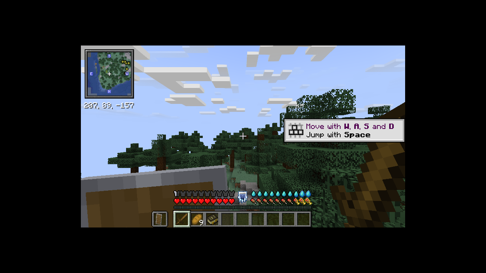

# Running a Create Galore server

This guide covers the two servers the pack is meant to run on:

| Who is playing | Where the world runs | Why |
|---|---|---|
| Emre (alone or together) | **Local dedicated server** on Emre's PC | Fastest CPU, no cost, plenty of RAM (64 GB) for server and game side by side |
| Only the second player | **Exaroton**, 8 GB to start (try 6 GB later) | Her laptop has 16 GB and the pack needs about 8 GB per side, so it can't host and play at once |

Never host on the laptop while also playing on it. Use Exaroton for that.

The world is one folder, so it can move between the two (see [Moving the world](#moving-the-world-between-your-pc-and-exaroton)).

## What the server runs

The server gets **182 mods from the pack plus Twilight Forest**. The 42 client-only mods are skipped automatically because they're tagged `client` in `pack/`. That's the ambiance layer (Sound Physics, AmbientSounds, Sounds, Drip Sounds, Presence Footsteps and its Sable add-on, Subtle Effects, Falling Leaves, Make Bubbles Pop, LambDynamicLights, Contraption Lights, Not Enough Animations, EMF, ETF, plus their libraries CreativeCore, Fzzy Config and MRU) and these: Sodium, Sodium Extra, Iris, Euphoria Patches, Iris Veil Compat, Colorwheel, Distant Horizons, Borderless Window, Entity Culling, ImmediatelyFast, Controlling, Mouse Tweaks, Searchables, Inventory Profiles Next (+ libIPN), LibTooltips, Create JEI Compat, Create: Nowheel, Create Smart Bounds, Create - Xaero's map, Xaero Train Map, Jade Sable Compat, Guide Shelf, Aeronautics Hot Air Fix, Better Farming Right Click. Players still need the full pack (the `.mrpack`) on their own PC.

**Distant Horizons stays off the server on purpose.** The pack's Chunksmith mod already sends far-away terrain (LODs) from the server to each player's Distant Horizons, without Distant Horizons on the server. Putting DH on the server as well makes Chunksmith complain and doubles the work.

Versions that must match on the server and on every player's PC: Minecraft **1.21.1**, NeoForge **21.1.259** (not newer, The Aether breaks on 21.1.262), and the same pack version.

## Part 1: Local dedicated server (Emre's PC)

### Easiest: the Server Setup app (Windows)

Download `Create-Galore-Server-Setup-<version>.exe` from the [latest release](https://github.com/emresahin0906-code/Create-Galore/releases/latest) and run it. Windows SmartScreen may warn because the app isn't signed: **More info → Run anyway**.

1. **Where the server goes:** for example `C:\CreateGaloreServer`. Pointing it at an existing server updates it.
2. **Memory:** the app suggests 10 GB on a PC with 32 GB or more, 8 GB otherwise. 6 to 10 GB all tested fine; more than 12 GB doesn't help.
3. **Mods:** nothing to do, the 182 server mods download from Modrinth at the pack's exact versions. If you already have the pack installed, you can drop your instance's `mods` folder on the box: mods that match the server list byte for byte are copied instead of downloaded, and client-only mods are ignored. Twilight Forest is picked up from that folder too.
4. **Twilight Forest:** drop `twilightforest-1.21.1-4.8.3345-universal.jar` on the box. A green check means it's the right file.
5. **Players and settings:** your Minecraft name (whitelisted and made operator), other players (whitelisted), port, and the Elytra switch.
6. Tick the EULA and press **Install server**. When it's done, **Start server** opens the console and the server window with its live memory graph and player list.

It does the same as the script below: NeoForge 21.1.259, the server mods, the pack's configs and datapacks, `server.properties` with `allow-flight=true`, and `user_jvm_args.txt` with the chosen memory. If no Java 21 is found it downloads Eclipse Temurin 21 into the server folder's `java` folder, and the `start-server.bat` it writes uses that. Your world, whitelist, ops and other `server.properties` edits are kept when you run it again. Files the app installed that a newer pack drops are removed; mods you added yourself are left alone.

### Or with the script

You need **Java 21** (for example [Microsoft Build of OpenJDK 21](https://learn.microsoft.com/java/openjdk/download) or [Adoptium Temurin 21](https://adoptium.net/)) and a copy of this repo (the `server-kit` zip from the latest release, or on GitHub: **Code → Download ZIP**, then unzip).

#### Build the server folder (one command)

Open a terminal in the repo's `server` folder and run:

```
install-server.bat C:\CreateGaloreServer
```

(On Linux or macOS: `./install-server.sh ~/CreateGaloreServer`.)

The script:
1. Installs the NeoForge 21.1.259 server into that folder.
2. Downloads every server-side mod and the pack's configs and datapacks at the exact pinned versions (about 830 MB), using `packwiz-installer` with the pack in this repo.
3. Copies in the pack's memory settings (`user_jvm_args.txt`, 8 GB) and starting `server.properties` the first time. Later runs keep your edits.

Then two manual steps (the app does both for you):
1. Copy `twilightforest-1.21.1-4.8.3345-universal.jar` (CurseForge, same jar as the client) into `C:\CreateGaloreServer\mods`.
2. Read the [Minecraft EULA](https://aka.ms/MinecraftEULA) and put `eula=true` in `C:\CreateGaloreServer\eula.txt` (the file appears after the first start; you can also create it yourself).

### Start it

Double-click `start-server.bat` in the server folder (Linux and macOS: `./start-server.sh`). It first checks for a newer pack (see [Update check at start](#update-check-at-start)), then starts the server. `run.bat` (made by NeoForge) starts it without the check. The first start creates the world and takes a few minutes; later starts are faster. It's ready when the console says `Done (...)! For help, type "help"`.

Stop it by typing `stop` in the console. Don't close the window, or the last few minutes might not be saved.

The server also opens its own small window: a live **memory graph** with "Memory use" and "Avg tick" (milliseconds per tick, under 50 is full speed), the **player list**, and a copy of the log with a box to type commands. It's on by default. Closing that window stops the server cleanly. If you'd rather have only the console, start with `start-server.bat nogui`. On Exaroton there is never a window; the web console does the same job.

### First-time settings

If you entered the names in the app, this is already done. Otherwise type these in the server console once:

```
whitelist add <your Minecraft name>
whitelist add <her Minecraft name>
op <your Minecraft name>
```

The shipped `server.properties` turns the whitelist on, keeps `online-mode=true` (real Minecraft accounts, so player data matches on Exaroton too), sets view distance 12 and simulation distance 10 (see below), and sets `allow-flight=true`. That last one matters: without it the server kicks players for "flying" when they ride airships, jetpacks or contraptions.

### View and simulation distance

- **Your PC (9950X3D), two players:** view distance 12, simulation distance 10. This is what the shipped `server.properties` uses.
- **Exaroton (6 to 8 GB):** view distance 10, simulation distance 8. Set these in Exaroton's **Options** after uploading, because the uploaded `server.properties` carries the PC values.

Simulation distance is how far around each player machines, farms, mobs and crops keep running; view distance is how far the server sends real chunks. Distant Horizons draws everything past view distance from Chunksmith's LOD data, so a bigger view distance mostly costs chunk loading and network, not looks. No mod in the pack needs a minimum: Create trains keep running on their tracks even through unloaded chunks, and on a contraption or Aeronautics ship the riders load chunks around themselves like any player. What a low simulation distance does change is that a factory, farm or parked contraption freezes once every player is further away than that. For a train station or base that must run while you're away, use Create: Power Loader, not a higher distance.

Benchmark (2026-10-16, the 4-core cloud test box, fresh world, two players' areas force-loaded 1,600 blocks apart, 6 GB heap): tick time 18 ms at simulation 6, 26 ms at 8 and 34 ms at 10, out of a 50 ms budget. Memory stayed at 7.3 GB for the whole process at every setting. Your 9950X3D should be roughly twice as fast per core (an estimate, not measured), so 10 leaves plenty of room for big Create builds; on Exaroton's shared CPU 8 is the safer pick. If the server falls behind (`/neoforge tps` above 50 ms per tick), lower simulation distance first.

Servers installed with older versions of the app or script got view 8 / simulation 6. Installing again raises those to 12 / 10, unless you changed them yourself.

### Elytra (off unless you switch them on)

Elytra are off in this pack so trains, airships and submarines stay worth building. To allow them on your server, stop it, move `config/paxi/optional/create-galore-with-elytra` into `config/paxi/datapacks/`, and start it again. Re-running the install script doesn't undo this. Delete that folder from `datapacks/` to turn them off again. Details are in the README under "You travel by building".

### Joining

- **On the same PC:** Multiplayer → Add Server → address `localhost`.
- **Another PC at home:** use your PC's local address, for example `192.168.1.23`. Find it with `ipconfig` (the "IPv4 Address" line). When Windows asks whether Java may use the network, allow **Private networks**.
- **From outside your home:** not needed for this plan. It would need port forwarding of TCP 25565 on your router, or a tool like Tailscale.

Optional: Chunksmith also opens TCP **25566** for faster LOD downloads. Allowing it through the Windows firewall helps Distant Horizons fill in faster for the second PC; everything works without it.

### Memory

`user_jvm_args.txt` gives the server 8 GB (`-Xms8G -Xmx8G`); the Server Setup app suggests 10 GB on a PC with 32 GB or more. On your 64 GB PC use 10G for both, and don't go past 12G: the pack only keeps about 2.5 GB in use, so more makes nothing faster. Your own game gets 12 GB in the launcher (16 GB at most), so server plus game uses about 26 GB in total.

The file also carries tuned garbage collector flags. They won a benchmark against Java's defaults, Generational ZGC and Shenandoah; the numbers, the game's launcher flags and a few other tips (pre-generating the world, CPU halves on the 9950X3D) are in [java-flags.md](java-flags.md).

## Part 2: Exaroton (when she plays alone)

Exaroton bills by RAM per hour while the server runs, and can start the server when a whitelisted player tries to join. These steps follow Exaroton's documented features; their exact screens weren't tested from here, so names in the panel may differ slightly.

1. **Build the server folder on your PC first** (Part 1). Exaroton gets a copy of it.
2. Create a server on Exaroton. Under **Software**, choose **NeoForge**, Minecraft **1.21.1**, NeoForge **21.1.259**. Custom uploads need bought credits; the free trial can't do it.
3. Set **RAM to 8 GB**. After a few sessions, try 6 GB: the benchmark in [java-flags.md](java-flags.md) ran fine at 6 GB. Ignore `user_jvm_args.txt` there, the panel's RAM setting replaces it.
4. In the **Files** section, upload from your server folder: `mods/`, `config/` (it holds the Field Guide too) and `server.properties`. Then upload the world folder (`world/`) if you want to continue your world (see the next section).
5. In **Options**, set view distance 10 and simulation distance 8, keep online mode on, whitelist both accounts and op yourself. Turn on **auto-start** for whitelisted players if she should be able to start it by joining, and **auto-stop** after a few empty minutes so it doesn't run up credits.
6. She adds the Exaroton address (shown on the server page, like `yourname.exaroton.me`) in Multiplayer.

The storage limit is 10 GB per server. The mods are about 0.8 GB and a fresh world is small, but it grows as you explore. Chunksmith's LOD store (`world/chunksmith/lod/`) is optional and can be left out of uploads to save space.

## Moving the world between your PC and Exaroton

Only one copy is "live" at a time. Always **stop the server before copying** in either direction, and keep a zip of the old copy until the new one has started fine.

- **PC → Exaroton:** stop your local server, stop the Exaroton server, upload your server's `world/` folder in Exaroton's file manager (replace the old one).
- **Exaroton → PC:** stop the Exaroton server, download its `world/` folder, replace `C:\CreateGaloreServer\world` with it.

Skip `session.lock` and anything named `*.old`. Both sides must run the same pack version; if the pack changed, update both servers first (next section).

## Updating the pack

### Update check at start

Every time `start-server` runs, before the server starts, it asks GitHub whether the pack changed since this server was installed or last updated. If it did, the console shows:

```
=========================================================================
  Create Galore update available: 0.1.6 -> 0.1.7.
  The server hasn't started yet, so nothing has been changed.
=========================================================================
  N  No, start the server without updating
  Y  Yes, update, then start the server
  B  Back up the world first (into the backups folder), then update and start
=========================================================================
Update? [N/Y/B] (no answer in 2 minutes = N):
```

- **N** (or no answer within 2 minutes, or no internet) starts the server as it is. It asks again at the next start.
- **Y** updates the same way as the steps below, then starts the server.
- **B** first zips the world, `mods/`, `config/`, `defaultconfigs/`, `server.properties`, memory settings, whitelist and ops into `backups/world-<date>_<time>-before-<version>.zip` in the server folder, then updates and starts. To go back: stop the server, delete `world/`, `mods/` and `config/`, and unzip the backup into the server folder (the zip has a `RESTORE.txt` saying the same). Backups are never deleted automatically; remove old ones yourself when the disk fills up. If there isn't enough free space for the backup, nothing is changed and the server doesn't start, so you can free space or start again and choose N.

It never updates without an answer. If the update fails halfway (for example the internet drops), the server doesn't start, because a half-updated server can lose blocks and items from the world: start again to retry, or put the backup back. Servers from the app update with the app of the newest release (downloaded into `.galore-update/` and run as `--update`, which keeps the memory, port, Elytra choice and your config edits). Servers from the scripts update with packwiz-installer straight from the pack on GitHub. When an update moves NeoForge, script servers are told to run `install-server` from the new server kit instead; app servers update NeoForge too and ask you to run `start-server` once more. The check is in `create-galore-updater.jar` next to `start-server`; servers set up before 0.1.7 get it the next time you update them by hand.

Players still update their own game with the pre-launch updater (README, *Updating*); both sides need the same pack version.

### Updating by hand

When the pack in this repo changes:

1. Stop the server. With the app: download the new `Create-Galore-Server-Setup` from the latest release, point it at the same folder and press **Update server**. With the script: download the new server kit (or `git pull`) and run `install-server.bat C:\CreateGaloreServer` again.
2. Either way it updates in place. Mods whose checksum still matches stay, changed ones are downloaded (or copied from a mods folder you drop into the app), and mods that left the pack are removed. NeoForge is reinstalled only when the pack moves to a new version. Your world, whitelist, ops, `server.properties`, memory settings and the Twilight Forest jar are kept.
3. Configs: a config you edited on the server is kept as long as the pack didn't change that file. When the pack changes it, the pack's version replaces yours (the app's log lists every config it kept, and the script's packwiz-installer does the same), so redo the edit if you still want it. The app remembers the pack's checksums in `.galore-installed.txt` and the scripts in `packwiz.json`; don't delete them, or the next update treats every file as new and rewrites the configs.
4. For Exaroton: run the update on a local copy first, then upload the new `mods/` folder (delete Exaroton's old one first so dropped mods go) and the `config/` folder. Edited configs on Exaroton itself are overwritten by that upload, so make edits in the local copy.
5. **Clean slate for bug hunting:** tick **Reset all configs to the pack's** in the app (or add `--clean`: `install-server.bat C:\CreateGaloreServer --clean`). This deletes `config/`, `defaultconfigs/` and each world's `serverconfig/` and puts the pack's configs back, so every edit made on the server is gone. Mods aren't downloaded again. The world, `server.properties`, memory, whitelist and ops are kept; for a fresh world, delete or rename `world/` yourself.
6. Players update their game with the pre-launch updater (README, *Updating*) or import the new `.mrpack`.

Back up `world/` before updates that add or remove mods (the start-up check's **B** does it for you). Blocks and items from removed mods disappear from the world.

## Lag alerts and profiles

The server runs **Create Galore Lag Watch**, a small mod made for this pack. It only does anything on a dedicated server (your PC or Exaroton); in singleplayer it stays off, and players don't need anything for it.

**What it does.** Once a second it checks the real tick rate (TPS, 20 is full speed). If TPS stays **under 15 for 10 seconds**, everyone on the server sees this in chat:

```
[Lag Watch] Server is lagging: 9.4 TPS (106 ms per tick) for 10 s. Recording a 60 s spark profile.
[Lag Watch] Most entities: 9,992 Zombie in the Overworld, 282 Item in the Overworld, 15 Skeleton in the Overworld
```

A minute later it says where the profile went (`Profile saved: config/spark/lagwatch-2026-10-16_14.10.30.sparkprofile`), and when TPS is back above 18 for 10 seconds it says `Back to 19.7 TPS after 59 s. Lowest was 7.9.` It stays quiet for the first 2 minutes after a start, because world loading is always slow.

It records at most one profile every 10 minutes, so a long lag spell doesn't fill the disk, and it keeps the newest 30 Lag Watch profiles (profiles you save yourself with spark are never deleted). Each alert also goes into `logs/lagwatch.log` in the server folder, with the TPS, which dimensions had how many chunks and entities loaded, and **where every player was standing**. That last part usually tells you whose base was lagging.

**Commands** (operators only):
- `/lagwatch` shows the current TPS and milliseconds per tick, and whether a lag spell is going on.
- `/lagwatch test` fires a test alert right now and records a profile, so you can see that it all works. A test doesn't count toward the 10-minute limit.

**Reading a profile.**
1. Get the file: it's in the server folder under `config/spark/` (on Exaroton: Files → `config` → `spark`, then download it).
2. Open [spark.lucko.me](https://spark.lucko.me/) in a browser and drag the `.sparkprofile` file onto the page. Nothing is uploaded; it opens on your PC.
3. The profile only holds the **slow ticks** (over 50 ms), so everything in it is what was making the server lag.
4. Open `Server thread` and click down the biggest percentages. Ignore `waitForNextTick`/`sleep` lines, they're idle time. You're looking for the first line that names a mod or a game system, for example:
   - `ServerLevel.tickNonPassenger` or `EntityTickList` → too many mobs or items (the chat census already names the type).
   - `LevelChunk...tickBlockEntities` → machines and block entities. Expand it; Create contraptions, kinetic networks, TFMG and storage mods show up by their package name (`com.simibubi.create`, `com.drmangotea.tfmg`...).
   - `ChunkMap`, `ServerChunkCache` or `worldgen` → new chunks being generated (someone flying or sailing fast into new land).
   - `GarbageCollector` time in the top bar → memory pressure; raise the server RAM.
5. The search box on the page finds a mod by name, and the **Sources** button groups the time by mod.

The spark commands still work by hand too: `/spark tps` and `/spark health` for a quick look, `/spark profiler open` to see the last few minutes from spark's always-on background profiler.

**Changing it.** Edit `config/create_galore_lagwatch-common.toml` in the server folder and restart: the TPS that counts as lag (`alertTps`), how long it has to last (`alertAfterSeconds`), whether everyone or only operators see the alert (`tellEveryone`), the profile length, the 10-minute limit and how many profiles to keep. `enabled = false` turns it off.

## What was tested (2026-10-15)

On a cloud test machine (4 CPU cores, 16 GB RAM, no GPU) with this pack (0.1.1, 181 server mods + Twilight Forest):

| Test | Result |
|---|---|
| Server folder built from `pack/` with `packwiz-installer -s server` | ✅ Exactly the 181 server mods, client-only mods skipped |
| Dedicated server first boot and world creation, 6 GB heap | ✅ Clean, 83 s, about 7 GB of process memory |
| Restart with a 4.5 GB heap | ✅ 33 s, about 5.6 GB of process memory with one player |
| Player joins from the full client pack (Distant Horizons, Sodium, Iris and all client mods) | ✅ No mod mismatch, Field Guide handed out on join, server at 20 TPS |
| Player moved through Overworld, Moon, Nether, Aether and Twilight Forest on the server | ✅ Stayed connected in every dimension |
| Without `allow-flight=true` | ❌ Player was kicked ("Flying is not enabled on this server") while falling into a dimension, so the shipped settings turn it on |
| `install-server.sh` on an empty folder, then first boot with the shipped 8 GB settings | ✅ World created in 67 s, about 9 GB of process memory |
| Chunksmith sends LOD data to the joining client's Distant Horizons | ✅ Client log: "the server has LOD data for [minecraft_overworld, northstar_moon]" |
| Server Setup app (2026-10-16, pack 0.1.2, run on Linux under Mono since there's no Windows test machine): fresh install into an empty folder, then first boot | ✅ NeoForge installed, 181 mods downloaded and checksum-checked, Twilight Forest check passed, whitelist and op written, world created in 68 s with a 5 GB heap |
| App run again on the same folder with Elytra ticked and new memory and port | ✅ 181 mods kept as up to date, Elytra datapack switched on, memory and port changed, world kept, a mod dropped from the pack was removed and a hand-added mod was kept |
| App on a new folder with a mods folder dropped in | ✅ 181 of 181 server mods copied, nothing downloaded, Twilight Forest picked up from the same folder |
| App on Windows (GitHub Actions, every pull request) | Builds, loads its pack data, and installs a full server on a clean Windows machine including the Java download |



Real performance on your PC and on Exaroton's hardware wasn't measured. Use `/spark tps` and `/spark health` on the server while playing to check, and see [Lag alerts and profiles](#lag-alerts-and-profiles) for what the server reports on its own.

## Troubleshooting

- **"Mod rejections" or "missing registry" when joining:** the player's pack and the server's mods don't match. Update both to the same pack version.
- **"Failed to encode packet" right after joining:** NeoForge is newer than 21.1.259. Reinstall the server with the script (it pins the version) and check the launcher hasn't updated NeoForge.
- **Kicked for flying:** set `allow-flight=true` in `server.properties`.
- **Rubber-banding, "moved too quickly" or "Can't keep up" in the console:** the server thread is stuck waiting for chunks. Check `cs progress` in the console; if a Chunksmith pregen is running, `cs pause` it while you play and `cs continue` later. The pack's Chunksmith settings already make it yield to players (see [java-flags.md](java-flags.md#things-you-might-not-have-thought-of)), so if it still happens with no pregen running, `/spark profiler` for a minute while it lags shows what's blocking.
- **Server crashes with `java.lang.OutOfMemoryError`:** raise the RAM (the `-Xmx` value, or the Exaroton RAM slider).
- **Animal Husbandry is on 0.4.2 on purpose.** Version 0.5.0 crashes dedicated servers. Don't let anything update it.
