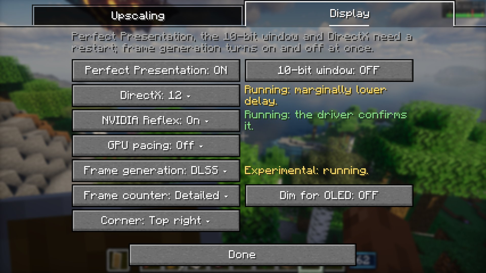
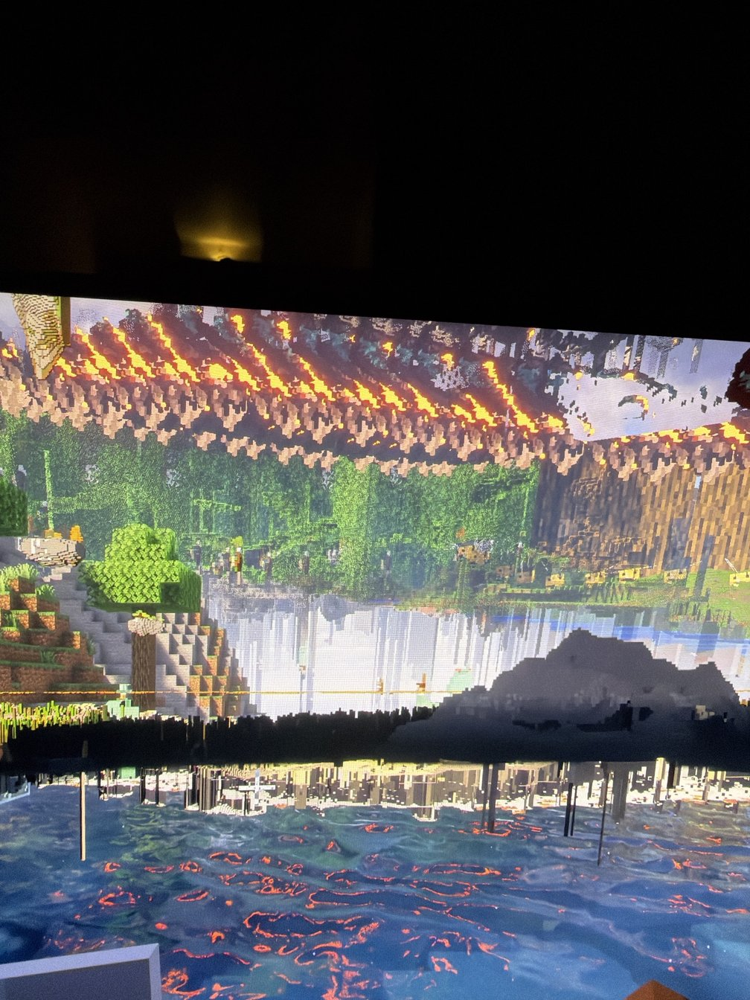
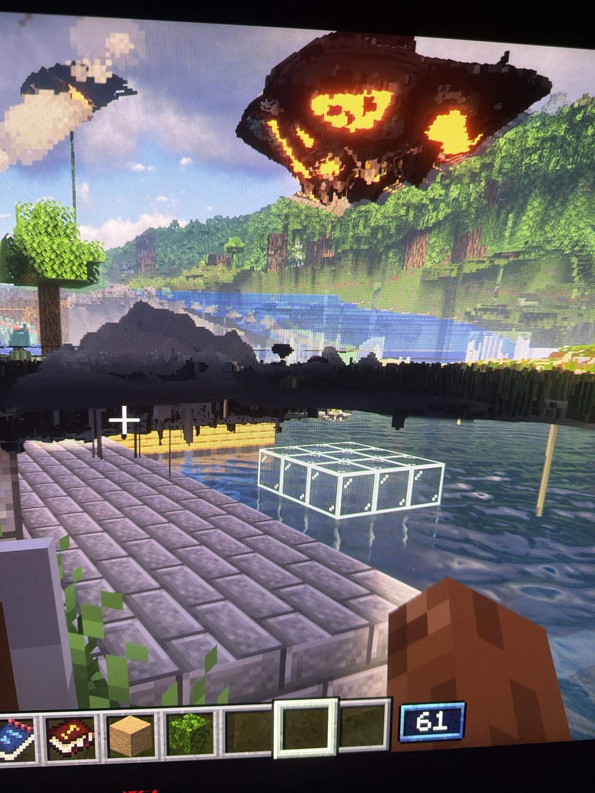

# Frame generation 2 on the RTX 4080 SUPER: DLSS against FSR

A PC session on 2026-10-26, 22:24–23:28, run by a Claude Code session in `C:\Users\coolm\Documents\Claude\MC-CREATE`
(`$T`).
- **What it followed:** "Frame generation 2" in `tools/dlss-testkit/PC-RUNBOOK.md` at `fd8bd190`, with Bridge 1.122.0
  (pack 0.5.14) and the test kit from that commit.
- **Steps 1–4** were run with Emre at the keyboard.
- **Step 5** ran on its own. Its launch 3 had to be run three times (see "Step 5's launch 3").
- **Setup:** Photon v1.3a + DLAA, DLSS at full resolution (preset K), 2560x1440 full screen, Perfect Presentation on
  DirectX 12, on Emre's ASUS XG27AQDMES (240 Hz, G-SYNC).

## Summary

- **Everything the runbook asked to check started and ran.**
  - **DLSS frame generation:** Streamline 2.14.16, with the instance's own `nvngx_dlssg.dll` 310.9.16.
  - **FSR 3.1 frame generation:** FidelityFX SDK 2.0.0.
  - **Both** showed 2 frames per rendered one, and turned off and on without a restart.
  - **Find on this PC** found the dlssg model in NVIDIA's folder and copied it.
  - **Starting with frame generation off** worked: Streamline started with DLSS-G unloaded, and DLSS turned on later.
  - **No `eErrorDuplicatedConstants`** anywhere, in the game log or Streamline's.
- **DLSS-G 1's findings, one by one.**
  - **Shader reload: fixed.** The first frame after a reload still has garbage motion vectors (66,000–80,000 px).
    Frame generation now skips it, and frames 2 and 3 are `camera ok`.
    - With FSR, one frame 2 also disagreed (180 px). It was skipped too.
  - **Second present: handled.** It now logs `a frame was presented twice in one game frame ... From: ...` once per
    world load, and that frame goes out without a generated one.
  - **Resize: not fixed.** `Frame generation was on when the swap chain resized` came 12 times with DLSS (DLSS-G 1: 4)
    and once with FSR. Each one is in the same millisecond as the `off, the window is resizing` line, so frame
    generation turns off on the resize's own frame, not the frame before.
  - **Minimise: fixed.** `off, the window is minimized` comes at once, with no `Flip queue is empty` during it.
    - The flip-queue errors left came from two full-screen resizes: 256 in the game log (DLSS-G 1: 357) and 1,877 in
      Streamline's (16,658).
    - The measured DLSS launch in step 5 had none.
- **New problem: the game can't leave full screen any more.** F11 shows a flicker of a small window and goes back to
  full screen, with DLSS and with FSR. That also stopped Emre minimising at first. In DLSS-G 1 it worked.
- **Not new: Distant Horizons left over the world.** A full-screen toggle can leave Distant Horizons' terrain drawn
  upside down over the world until a shader reload. Emre has seen it since the first frame generation build, and it
  happens with FSR too.
- **The command suggestions: FSR clean, DLSS not.**
  - With DLSS the chat's command suggestions still garble for one frame when they appear. `frameGenUi=false` (the HUD
    in the picture) makes no difference.
  - With FSR they are clean: "The chat command suggestions here look perfect. The fix for FSR clearly works."
- **Emre on the picture.**
  - DLSS against DLSS-G 1: no visual regression other than full screen; "Smoothness feels the same".
  - FSR against DLSS, both at 60 rendered → 120 shown: "The quality is basically identical". DLSS garbles a bit more
    on very fast motion, FSR doubles images a bit more. On pacing "DLSS wins": FSR has "little hiccups sometimes" and
    a jitter on steady pans.
- **The frame cap counts different frames.** Reflex through Streamline (DLSS) caps the frames shown, so Emre's 120 cap
  gave 60 rendered → 120 shown. Reflex on NVAPI (FSR) caps the frames rendered, so the same cap gave about 100 rendered
  → 200 shown. Worth deciding which one a cap should mean with FSR.
- **Step 5, the cost (uncapped, `lat-reflex`, shore / canopy).**
  - **DLSS** renders **28% fewer frames** than none: 117 / 109 against 164 / 152 fps, about +2.4 / +2.6 ms per
    rendered frame.
  - **FSR** renders **33% fewer:** 110 / 102 fps, about +3.0 / +3.2 ms. So on this card FSR costs about 6% more rendered
    frames than DLSS.
  - **Latency (input to the rendered frame's GPU end):** DLSS +3.0 / +2.7 ms. FSR the same as none (9.6 / 10.1 against
    9.7 / 11.0 ms), because FSR leaves the GPU almost no queue. What FSR holds back to show the generated frame first
    comes after that point, and the driver's report fails its unit check under FSR. So this session has no
    like-for-like latency to the screen for FSR.
- **What the screen gets:** 234 / 219 shown frames per second with DLSS, 220 / 205 with FSR, 164 / 152 without:
  **+43% with DLSS, +34% with FSR**.
- **Pacing: FSR doesn't double tap here.**
  - **Frame to frame, DLSS alternates short and long more.** Its pair ratio is 1.34–1.39, p90 2.7–3.1, with 19–21% of
    pairs at 2x or more. FSR's is 1.27–1.32, p90 1.75–2.0, with 3–10%.
  - **Over a few frames, FSR is less even.** Take the time 8 shown frames take, p90 over p10: DLSS 1.11–1.13, FSR
    1.17–1.19, none 1.05–1.14.
  - **What that means:** DLSS's unevenness sits inside each real-and-generated pair and evens out within two frames.
    FSR's lasts longer, which fits the jitter Emre felt on steady pans.
- **The pacer** (`lat-reflex-pacing-on` against `lat-reflex`):
  - **with DLSS** it keeps the frame rate (+1.6% / +0.1%) and lowers latency a little (−0.4 / −0.6 ms);
  - **without frame generation** it keeps the frame rate (+1.6% / −0.1%) and lowers latency by 0.7 / 1.1 ms, as in
    DLSS-G 1 and Pacer 3;
  - **with FSR** it never waits (0.0 ms), because the queue is already empty. It changes nothing (−0.8% / +1.4%,
    +0.1 / −0.3 ms).
- **Step 5's launch 3 crashed once, at mod loading:** Hybrid Aquatic hit an `ArrayIndexOutOfBoundsException` during
  NeoForge's parallel mod construction. It isn't the Bridge's; see the crash section.

## Steps 1 to 4, with Emre

### Update and settings

- **Repo and jars.**
  - Pulled `claude/project-thread-u2wmhh` (runbook at `fd8bd190`) and copied `create-galore-bridge-1.122.0.jar`
    (3,250,985 bytes) into the instance in place of 1.117.0.
  - The test kit is the branch's dist jar (56,165 bytes), which has DLSS-G 1's NaN fix.
- **Display settings.**
  - The runbook's values: `dlaa=dlss`, `perfectPresentation=false`, `presenter=dx11`, `reflex=off`, `gpuPacing=off`,
    `fpsCounter=detailed`, `frameGen=off` and `frameGenCheck=true`, with no `frameGenType` line.
  - The old values (`dlaa=true`, `perfectPresentation=false`) are backed up with the other settings files in
    `$T\fg2\*.before`.
- **The old dlssg DLL.** The instance's `nvngx_dlssg.dll` (copied there by DLSS-G 1's start) is moved aside to
  `$T\tools\nvngx_dlssg-dlssg1.dll`.
- **Shader pack:** Photon v1.3a + DLAA, 2560x1440, Distant Horizons at the instance's 32 threads.

### 1. The setting and the model

- **Upscaling tab.**
  - **Find on this PC worked.** The log has `DLAA: copied nvngx_dlssg.dll 310.9.16 from
    C:\ProgramData\NVIDIA\NGX\models\dlssg\versions\20318480\files\160_E658700.bin into
    $T\instance\create-galore-dlss`, and the file is there.
  - **What the line under the buttons said afterwards:** `NVIDIA's folder: DLSS 310.9.16, yours (310.9.16) is as new;
    frame generation 310.9.16 copied.`
  - Emre on that line: "this sentence is hard to follow, tho the tool worked, everything else looks ok".
  - Every later start logs `nvngx_dlssg.dll 310.9.16 (tested with 310.9.16) from ...\create-galore-dlss`, the
    instance's own copy, as the runbook asks.
- **Display tab.**
  - **Picking DLSS** turned Perfect Presentation on, DirectX to 12 and NVIDIA Reflex to On.
  - **The settings file** then had `frameGen=dlss`, `frameGenType=dlss`, `perfectPresentation=true`, `presenter=dx12`
    and `reflex=on`.
  - **Toast:** shown ("closed it, toast showed").
  - **The Reflex warning the runbook expects:** `Reflex: can't run, it needs Perfect Presentation, which starts after a
    restart` (WARN).
- **After the restart.** The tab shows `Experimental: running.` beside Frame generation, `Running: marginally lower
  delay.` beside DirectX and `Running: the driver confirms it.` beside Reflex. The header reads `Perfect Presentation,
  the 10-bit window and DirectX need a restart; frame generation turns on and off at once.`

### 2. Play with DLSS

- **Start.**
  - `Frame generation: NVIDIA DLSS Frame Generation through Streamline 2.14.16 from
    ...\create-galore-dlss\streamline-2.14.16; nvngx_dlssg.dll 310.9.16 (tested with 310.9.16) from
    ...\create-galore-dlss, on`.
  - Then `Frame generation: ready in the DirectX 12 presenter on NVIDIA GeForce RTX 4080 SUPER, on; Reflex goes through
    Streamline`.
  - Then `Reflex: started through Streamline, as DLSS Frame Generation needs (Streamline, low latency available, latency
    report available)`. There is no `though set to` line.
- **Loading the world.**
  - **The present-twice line,** whole: `Frame generation: a frame was presented twice in one game frame; the extra one
    goes out on its own, without generated frames. From:
    Minecraft.wrapOperation$mln000$create_galore_bridge$blitToSwapChain < Minecraft.runTick < Minecraft.run <
    Main.main < DirectMethodHandleAccessor.invoke < CommonLaunchHandler.runTarget < CommonLaunchHandler.clientService <
    CommonClientLaunchHandler.runService`.
  - It is followed by `Frame generation: off, a second present in one game frame`. It shows once per world load, in
    every launch of this session (steps 2 to 5).
  - **No `eErrorDuplicatedConstants` anywhere,** in the game log or in Streamline's logs, in any step.
- **The checks after loading.**
  - Checks 1 and 2 (frames 1 and 2 after the pipeline was made) are `camera reset this frame`.
  - **Check 3 (frame 3, the loading screen still up, frame generation not yet on): `CAMERA DISAGREES`,** off by 1.709
    px median (90%: 924.8) over 68,996 pixels; motion 38.86 px median where the camera says 66.43. It is the only
    `CAMERA DISAGREES` on a frame 3 or later in the session. It is small, and it came before frame generation was on.
- **F8 three times (22:34:21, :27, :31), turning each time.**
  - Each reload: `Frame generation: off, the shaders were just loaded`, then `on, 1 generated per rendered frame, the
    HUD apart`.
  - **Frame 1 of each: `CAMERA DISAGREES`,** with motion vectors of 66,268 / 69,784 / 79,835 px median, labelled
    `frame generation skips it, the upscaler started over`.
  - Frames 2 and 3 of each: `camera ok` (0.05–0.48 px).
  - **So DLSS-G 1's finding is handled:** the garbage motion target is still there for one frame after a reload, but
    frame generation now skips that frame. Four more resizes later in the step rebuilt the pipeline and behaved the same
    (frame 1 disagrees and is skipped; frames 2 and 3 `camera ok` or too little motion).
- **The chat and the command suggestions.**
  - **DLSS, `frameGenUi` as shipped (HUD apart).** Emre: "It still looks garbled. There's no issue with the actual
    written text, but as commands pop up, they garble for a single frame."
  - **With `frameGenUi=false` (the HUD in the picture),** the log shows `on, 1 generated per rendered frame, the HUD in
    the picture`. Emre: "I can't really tell a difference from my perspective. The HUD outside of the chat looks about
    the same, and the chat still has that garbling on the first frame a new command is suggested." So it is the same
    both ways, and the rest of the HUD stays clean with `false`. The line was removed again.
  - **Later:** "It's not a blocker. It's totally functional. It's just a lack of polish while all the other HUD
    elements are so perfect. So it stands out."
- **Resizing** (dragging the edge, maximise and restore, Alt-Tab, F11).
  - Each resize logged `Frame generation: off, the window is resizing`, then `on`. That was 13 resizes; the pipeline
    rebuilds after them were skipped as above.
  - **But the fix for DLSS-G 1's warning doesn't hold.** `Frame generation was on when the swap chain resized: it is
    turned off one frame before a resize` (WARN, logged under `Frame generation (native)`) came **12 times**, against 4
    in DLSS-G 1.
    - Each one is in the same millisecond as an `off, the window is resizing` line (22:38:15.640 / .641, 22:38:17.627 /
      .628, ...): 12 of the 13 resizes. Only the restore after the minimise didn't warn.
    - So the "off" and the resize land in the same frame, rather than the frame before going out without frame
      generation.
- **F11: new in this build.** From full screen, F11 shows a flicker of a smaller window and then goes back to full
  screen, so the game can't be made windowed (and Win+D or minimising snapped back too, at first).
  - Emre: "the moment I press F10, it kicked me back into full screen. I see a flicker of a smaller window and then
    back into full screen." (He meant F11.)
  - In DLSS-G 1 he could leave full screen.
- **Distant Horizons left as an overlay: not new.** Toggling full screen can leave the picture with Distant Horizons'
  terrain drawn upside down over the world, until a shader reload (photo below).
  - Emre: "It looks like Distant Horizons just kind of stays and becomes an overlay. ... It's always fixed by a shader
    reload though."
  - He has seen it before: "that weird distant horizons thing actually happened to me while I was playing with ... the
    first version of DLSS frame generation ... It's been there with frame generation from the first patch."
  - It happened with FSR too (step 4), so it isn't Streamline's.
- **Minimising.**
  - Once he could (Win+D, about 10 s), the log had `Frame generation: off, the window is minimized` at once, then `on`
    after he came back.
  - **No `Flip queue is empty` during the minimise.**
  - **The flip-queue errors this step came from the full-screen resizes:**
    - `RSYNC: Flip queue is empty!!!`: **256 in the game log** (against 357 in DLSS-G 1);
    - **1,877 in Streamline's log** (against 16,658), in two bursts: 1,360 at 22:38:38 and 517 at 22:40:01, both
      right after a resize to or from full screen.
- **Off and on without a restart, three times** (22:43:03 / 22:43:27, 22:43:44 / 22:44:03, 22:44:19 / 22:44:31).
  - Each time: `Frame generation: turned off`, then `off, turned off`; `turned on`, then `running, 2 frames shown per
    rendered one (most it can generate: 1, smallest size 100)`.
  - **Streamline's log during the toggles:** 3 WARN `Repeated slDLSSGSetOptions() call for the frame N. A redundant
    call or a race condition with Present().` (one at each turn-off) and 3 WARN `FC feedback: 1`. No ERROR.
  - Emre saw nothing wrong in the picture ("Everything else looks just as good").
- **Playing a few minutes, against DLSS-G 1.** Emre: "I see no regressions visually other than the inability to
  minimize. Smoothness feels the same". The command suggestions are the one thing left.

### 3. Starting with it off

- **Start.** With `frameGen=off` and `frameGenType=dlss`:
  - `... nvngx_dlssg.dll 310.9.16 (tested with 310.9.16) from ...\create-galore-dlss, off until turned on`;
  - `Frame generation: ready in the DirectX 12 presenter on NVIDIA GeForce RTX 4080 SUPER, off; Reflex goes through
    Streamline`;
  - `Reflex: started through Streamline, as DLSS Frame Generation needs ...`, Reflex on as set, with no `though set to`
    line.
- **DLSS picked in the main menu:** `Frame generation: turned on`, then `off, no world`.
- **In the world:** `running, 2 frames shown per rendered one`. 14 of 14 checks `copy ok`, none `CAMERA DISAGREES`.
- **So Streamline starting with DLSS-G unloaded works.**

### 4. FSR on this card

- **Status and toast** as the runbook says (Emre: "Yep, all the lines came as expected, and the toast also came as
  expected.").
- **Start.**
  - `Frame generation: AMD FSR 3.1 frame generation (FidelityFX SDK 2.0.0) from ...\create-galore-dlss\fidelityfx-2.0.0,
    on`;
  - `Frame generation: ready in the DirectX 12 presenter on NVIDIA GeForce RTX 4080 SUPER, on` (no Streamline);
  - `Reflex: started on Perfect Presentation's DirectX 12 device (NVIDIA NVAPI)`.
- **In the world.**
  - `running, 2 frames shown per rendered one (most it can generate: 1, smallest size 0)`.
  - The live switch: `turned off`, `off, turned off`, `turned on`, `running` again.
  - 139 of 139 checks `copy ok`.
- **F8 while turning.**
  - Frame 1 `CAMERA DISAGREES` (82,153 px, skipped).
  - **Frame 2 also `CAMERA DISAGREES`: 180.7 px median** (motion 5,810 where the camera says 8,189), labelled `frame
    generation skips it`.
  - Frame 3 `camera ok`.
- **Minimise:** `off, the window is minimized` at once.
- **Resizes:** 2, and **one `Frame generation was on when the swap chain resized` WARN**, as with DLSS. So the runbook's
  "no `Frame generation:` WARN" doesn't hold for FSR either.
- **F11:** the same as with DLSS. Emre: "F11 to minimize still doesn't work and also brings up this weird artifact."
  It brings the same Distant Horizons overlay (photo below).
- **The command suggestions with FSR.** Emre: "The chat command suggestions here look perfect. The fix for FSR clearly
  works. There's literally no issue with them. ... DLSS is known to sometimes not fully respect, I think, the UI masks."
- **The frame cap: FSR doesn't hold Emre's 120 the way DLSS does.**
  - With his 120 fps cap the counter showed about 100 rendered and the NVIDIA overlay about 200 shown. With DLSS the
    same cap gave 60 rendered and 120 shown.
  - **Why:** Reflex through Streamline (DLSS) caps the frames shown; Reflex on NVAPI (FSR, or frame generation off)
    caps the frames rendered.
  - The log agrees: `Reflex: low latency on, boost off, frame cap 120 fps (Reflex's); driver low latency off, last sleep
    0 us, game Sleep not used` at the start.
  - To compare feel fairly, Emre set the game's cap to 60 himself (`frame cap 60 fps (Reflex's); driver low latency on,
    last sleep 8333 us, game Sleep used, G-SYNC fullscreen`), so both ran 60 rendered and 120 shown. His options were
    put back before step 5.
  - **Worth deciding on the Bridge side:** should a cap mean shown frames with FSR too, so a 120 Hz screen gets 120,
    not 200?
- **Emre's verdict, both at 60 rendered → 120 shown:**
  - **Quality:** "The gap between FSR frame generation and DLSS frame generation is significantly closer than DLSS super
    resolution and FSR super resolution. The quality is basically identical."
  - **The difference:** "DLSS has a bit more artifact, as in like garbling things when you move really fast. Meanwhile,
    FSR has a higher tendency to double images when you move really fast."
  - **Pacing:** "The general pacing is slightly worse ... I'm not getting big stutters, but little hiccups sometimes.
    ... if you pan, like, steadily, you can sometimes notice that there's like a jitter to it, but not always. Pacing
    wise, I think DLSS wins". The 5-second checks were running.
  - **Overall:** "If anything, FSR not having that issue with the HUD makes it better on quality on a technicality ...
    DLSS really has to justify itself by costing less and or having better latency numbers".

### Streamline warnings and errors, steps 1 to 4

These are the `(native)` lines the game log carries from Streamline, by kind. Steps 1 and 4 have none: step 1 had no
Streamline running, and step 4 is FSR.

| line | step 2 | step 3 |
| --- | --- | --- |
| ERROR `rsync.cpp:250[notifyFrameFlipped] RSYNC: Flip queue is empty!!!` | 256 | 0 |
| WARN `dlfgPresent.cpp:1323[presentCommon] Frame rate over 100.00ms, reseting frame timer` | 21 | 7 |
| WARN `flipMetering.cpp:182[setFlipConfig] FC feedback: 1` | 13 | 0 |
| WARN `defines.h:323[set] Repeated slDLSSGSetOptions() call for the frame N. A redundant call or a race condition with Present().` | 4 | 1 |
| WARN `swapChainData.cpp:535[throttleFlipQueue] throttleFlipQueue: no flip-queue slot freed within 30 ms for App frame N (low frame rate or present backpressure).` | 2 | 1 |
| WARN `dlfgPresent.cpp:421[sanitizeResourceExtent] Invalid backbuffer resource extent, IF optionally specified by the client! ...` | 1 | 1 |
| WARN `d3d12.cpp:2533[cloneResource] One or more tagged resources use an unsupported alignment that is being overridden to 0 (e.g. resource 'nv.sl.dlss_g.clone.dlfg-output_0' ...` | 1 | 1 |
| WARN `N log lines dropped` (the Bridge's own, when Streamline logs faster than it forwards) | 3 | 1 |

## Step 5: DLSS against FSR against none

### The launches

Each launch was the runbook's, with `autorun=dlaa-test` and `runs=G1` (DLSS-G 1's run: `lat-reflex`, `lat-pacing-on`,
`lat-reflex-pacing-on`, each twice at `shore` and `canopy`).
- **Settings:** `reflex=on`, `gpuPacing=off`, no `frameGenCheck`, Emre's own `options.txt` (the kit turns the cap off
  while it measures: `frame cap none`).
- **The PC:** quiet, with the window in front and covering the screen.
- **PresentMon** was attached by pid with the runbook's options; every CSV grew.
- **Each G1 run took 1.3–2 minutes,** not the runbook's 7.

| Launch | settings file | run | time | log |
| --- | --- | --- | --- | --- |
| 1 | `frameGen=dlss`, `frameGenType=dlss` | `20261026-230616-G1` | 23:04–23:08 | `running, 2 frames shown per rendered one (most it can generate: 1, smallest size 100)`; `Reflex: started through Streamline, as DLSS Frame Generation needs (...)` |
| 2 | `frameGen=fsr`, `frameGenType=fsr` | `20261026-231028-G1` | 23:09–23:12 | `running, 2 frames shown per rendered one (most it can generate: 1, smallest size 0)`; `Reflex: started on Perfect Presentation's DirectX 12 device (NVIDIA NVAPI)` |
| 3 | `frameGen=off`, `frameGenType=fsr` | `20261026-232620-G1` | 23:24–23:27 | `AMD FSR 3.1 frame generation (FidelityFX SDK 2.0.0) from ..., off until turned on`, `ready in the DirectX 12 presenter on NVIDIA GeForce RTX 4080 SUPER, off`, no `running`; `Reflex: started on Perfect Presentation's DirectX 12 device (NVIDIA NVAPI)` |

- **The pacer lines:** all three launches have `Latency: GPU pacer on, frames may queue on the GPU a share of the frame
  time that keeps the frame rate` in the pacing modes and `Latency: GPU pacer off` between them.
- **Bridge WARN and ERROR lines** (`Frame generation`, `Perfect Presentation`, `Latency:`, `Reflex:`):
  - `Perfect Presentation: swap chain wait timed out`, once per launch in launches 2 and 3, at the shader pack load
    before the run. Presenter 1 and 2's logs have it too.
  - No other line from the Bridge itself.
  - In launch 1, Streamline's own (`Frame generation (native)`): 3x `Frame rate over 100.00ms, reseting frame timer`,
    one each of `unsupported alignment`, `throttleFlipQueue: no flip-queue slot freed within 30 ms`, `Invalid
    backbuffer resource extent` and `167 log lines dropped`. These all came at the start or at shader loads.
  - Streamline's log for launch 1 has the same lines plus one `Repeated slDLSSGSetOptions() call`. **No `Flip queue is
    empty` and no ERROR.**
- **No `left out` lines from the test kit:** DLSS-G 1's NaNs from the latency report didn't come back.

### Numbers

From `latency.py` (rendered fps, input to GPU end, GPU queue) and `frametimes.py` (shown every, pair ratio). frametimes.py
ran once per launch, because given all three it pools them: they have the same mode names. Two columns are mine,
computed from the same PresentMon frames:
- **shown per s:** frames that reached the screen over the path's time;
- **pairs at 2x or more:** the share of neighbouring shown frames where one stayed on screen at least twice as long as
  the other.

| mode | viewpoint | launch | rendered fps (plays) | input to GPU end ms, median (plays) / p90 | GPU queue ms | shown per s | shown every ms (median / p10 / p90) | pair ratio (median / p90) | pairs at 2x or more |
| --- | --- | --- | --- | --- | --- | --- | --- | --- | --- |
| `lat-reflex` | shore | DLSS | 117.1 (117, 117) | 12.7 (13.4, 12.1) / 14.6 | 4.4 | 234 | 4.29 / 2.89 / 5.61 | 1.34 / 2.76 | 19% |
| `lat-reflex` | shore | FSR | 110.0 (107, 113) | 9.6 (10.0, 9.1) / 11.2 | 0.7 | 220 | 4.29 / 3.29 / 6.15 | 1.28 / 1.82 | 6% |
| `lat-reflex` | shore | none | 163.9 (159, 169) | 9.7 (9.6, 9.8) / 9.9 | 3.7 | 164 | 5.90 / 4.85 / 7.34 | 1.15 / 1.70 | 4% |
| `lat-reflex` | canopy | DLSS | 109.1 (109, 110) | 13.7 (14.3, 13.2) / 16.0 | 4.4 | 219 | 4.63 / 3.05 / 5.79 | 1.35 / 2.87 | 19% |
| `lat-reflex` | canopy | FSR | 102.3 (100, 105) | 10.1 (10.5, 9.7) / 12.3 | 0.5 | 205 | 4.59 / 3.45 / 6.71 | 1.32 / 1.99 | 10% |
| `lat-reflex` | canopy | none | 151.9 (151, 153) | 11.0 (11.0, 11.0) / 11.1 | 4.5 | 152 | 6.53 / 6.45 / 6.62 | 1.01 / 1.20 | 0% |
| `lat-pacing-on` | shore | DLSS | 118.6 (119, 119) | 12.5 (12.5, 12.6) / 14.5 | 4.2 | 237 | 4.30 / 2.82 / 5.46 | 1.35 / 2.72 | 19% |
| `lat-pacing-on` | shore | FSR | 111.2 (109, 113) | 9.5 (9.8, 9.1) / 11.2 | 0.4 | 222 | 4.19 / 3.30 / 6.15 | 1.27 / 1.80 | 4% |
| `lat-pacing-on` | shore | none | 164.8 (163, 167) | 9.1 (9.2, 9.0) / 9.6 | 3.2 | 165 | 5.91 / 4.83 / 7.43 | 1.24 / 1.67 | 2% |
| `lat-pacing-on` | canopy | DLSS | 109.3 (109, 109) | 13.2 (13.5, 12.9) / 16.0 | 4.1 | 218 | 4.69 / 3.03 / 5.76 | 1.39 / 3.08 | 21% |
| `lat-pacing-on` | canopy | FSR | 104.5 (103, 106) | 9.8 (9.9, 9.6) / 11.9 | 0.4 | 209 | 4.54 / 3.37 / 6.66 | 1.31 / 2.00 | 10% |
| `lat-pacing-on` | canopy | none | 149.5 (151, 148) | 9.9 (9.9, 9.9) / 10.4 | 3.4 | 150 | 6.53 / 5.94 / 7.54 | 1.01 / 1.39 | 2% |
| `lat-reflex-pacing-on` | shore | DLSS | 118.9 (119, 119) | 12.4 (12.3, 12.4) / 14.5 | 4.0 | 238 | 4.28 / 2.94 / 5.44 | 1.35 / 2.76 | 20% |
| `lat-reflex-pacing-on` | shore | FSR | 109.2 (113, 106) | 9.7 (9.4, 10.0) / 11.4 | 0.7 | 225 (first play) | 4.14 / 3.26 / 5.85 | 1.28 / 1.75 | 3% |
| `lat-reflex-pacing-on` | shore | none | 166.5 (165, 168) | 9.0 (9.1, 9.0) / 9.4 | 3.1 | 166 | 5.91 / 4.90 / 7.03 | 1.14 / 1.57 | 1% |
| `lat-reflex-pacing-on` | canopy | DLSS | 109.2 (109, 109) | 13.1 (13.4, 12.9) / 16.0 | 4.0 | 218 | 4.66 / 3.04 / 5.77 | 1.37 / 2.93 | 21% |
| `lat-reflex-pacing-on` | canopy | FSR | 103.8 (104, 103) | 9.8 (9.7, 9.9) / 11.9 | 0.4 | 208 | 4.56 / 3.41 / 6.67 | 1.29 / 1.98 | 10% |
| `lat-reflex-pacing-on` | canopy | none | 151.7 (151, 153) | 9.9 (9.9, 9.8) / 10.1 | 3.3 | 152 | 6.53 / 6.31 / 6.97 | 1.01 / 1.29 | 1% |

**How even the screen is over longer stretches** (my measure: p90 over p10 of the time 1, 2 or 8 shown frames in a row
take on screen, over all three modes; 1.00 would be perfectly even):

| launch | 1 frame | 2 frames | 8 frames |
| --- | --- | --- | --- |
| DLSS | 1.85–1.94 | 1.49–1.53 | 1.11–1.13 |
| FSR | 1.79–1.98 | 1.59–1.63 | 1.17–1.19 |
| none | 1.03–1.54 | 1.02–1.34 | 1.05–1.14 |

Other numbers from the same runs:
- **The driver's own report (Reflex), `lat-reflex`, frame start to GPU end:**
  - DLSS 21.9 / 23.2 ms against 11.6 / 14.2 without: about +10 / +9 ms, which takes in the frame held back for
    interpolation, as in DLSS-G 1.
  - Under FSR the report's unit check is 2.2–2.3, where about 1 is right, so its times (3.7 ms) don't mean what they say.
- **Present mode** (PresentMon):
  - DLSS: `Hardware: Independent Flip` on 100% of frames;
  - FSR and none: `Hardware Composed: Independent Flip` (100%, except the play below).
  - Present to screen: DLSS 13.4 / 14.9 ms, none 7.3 / 9.3, FSR 0.9 / 1.0. FSR presents only when its frames are
    done, so its number isn't comparable.

### The four questions, one line each

- **What each costs:**
  - **DLSS:** −28.6% / −28.1% rendered fps against none at `lat-reflex` (117.1 / 109.1 against 163.9 / 151.9), about
    +2.4 / +2.6 ms per rendered frame. Input to GPU end +3.0 / +2.7 ms (12.7 / 13.7 against 9.7 / 11.0).
  - **FSR:** −32.9% / −32.6% (110.0 / 102.3), about +3.0 / +3.2 ms per frame. Input to GPU end the same as none (9.6 /
    10.1). That measure ends at the rendered frame's GPU end, and with FSR the GPU queue is nearly empty (0.4–0.7 ms
    against 4.0–4.5 with DLSS and 3.1–4.5 without). So this doesn't show FSR as cheaper to the screen: nothing here
    measures FSR's latency to the screen like for like.
  - **Against each other:** FSR renders about 6% fewer frames than DLSS (110 against 117, 102 against 109).
- **What the screen gets:**
  - shore / canopy: **234 / 219 shown per second with DLSS, 220 / 205 with FSR, 164 / 152 without**, so +43% / +44%
    with DLSS and +34% / +35% with FSR. Both are exactly 2 per rendered frame.
  - At the shore, DLSS's 234–238 is just under the panel's 240 Hz. Frames shown sooner than one refresh (4.17 ms):
    DLSS 35–37% at the shore and 27–28% at the canopy, FSR 43–49% and 28–30%, none 0–3%.
- **Pacing:**
  - **Pair ratio:** DLSS 1.34–1.39 median, p90 2.72–3.08, with 19–21% of pairs at 2x or more. FSR 1.27–1.32, p90
    1.75–2.00, with 3–10%. None 1.01–1.24, p90 1.20–1.70.
  - **FSR doesn't double tap here.** DLSS has more short-long pairs. Neighbouring DLSS frames alternate: the correlation
    from one shown frame to the next is −0.2 to −0.35 (in 5 of its 6 rows; the sixth is skewed by the boundary frame
    noted below), against 0 to −0.1 with FSR.
  - **But over 2 to 8 frames FSR is the less even one** (table above). That fits Emre's "little hiccups" and jitter on
    steady pans with FSR, and his "pacing wise, I think DLSS wins".
  - These runs are uncapped, near the panel's ceiling. Emre felt them at 60 → 120.
- **The pacer** (`lat-reflex-pacing-on` against `lat-reflex`):
  - **DLSS:** fps +1.6% / +0.1%, latency −0.4 / −0.6 ms (target 4.1 / 4.5 ms, wait 0.1–0.3 ms). It keeps the frame
    rate and lowers latency a little.
  - **FSR:** fps −0.8% / +1.4%, latency +0.1 / −0.3 ms. The pacer never waits (0.0 ms), because the queue is already
    near empty, so it does nothing, good or bad.
  - **None:** fps +1.6% / −0.1%, latency −0.7 / −1.1 ms (target 3000 / 3260 µs), the same as DLSS-G 1 and Pacer 3.

### Notes on the data

- **Launch 2, the second play of `lat-reflex-pacing-on` at the shore (about 23:12:09–15).**
  - 1,095 of its 1,200 frames went out as `Composed: Flip`, the desktop compositor copying them, for about 5 seconds.
  - Reflex's report for that window lacks `G-SYNC fullscreen`, and the play rendered 106 fps against 113 in the first.
  - It looks like something over the window for a few seconds. I don't know what: nothing was being driven on the PC.
  - PresentMon has no screen times for those frames, so that row's shown per second is from the first play only. Its
    latency is in latency.py's median.
- **PresentMon warned in launch 1:** `628 overflowed present events detected`. It suggests `--set_circular_buffer_size
  4096`, which the runbook's command doesn't have. Inside the run it recorded 21,530 of the 21,560 presents (2 x 10,780),
  so 0.14% are missing. Launches 2 and 3 had no warning.
- **frametimes.py, a boundary effect for the test kit to know about.**
  - The last frame of each `canopy` path segment carries the 1.3–1.5 s mode switch that follows it, with
    `MsBetweenDisplayChange` 1,300–1,550 ms. PresentMon 2.6's `CPUStartQPCTimeInMs` is the previous present's time, so
    the first frame after the next mode's shader reload falls into the segment.
  - One frame per segment, in DLSS and none: medians and percentiles don't move, but means do (I didn't use any).
- **Launch 3 against DLSS-G 1's frame-generation-off launch:** 163.9 / 151.9 fps and 9.7 / 11.0 ms here, against
  164.6 / 152.4 and 9.6 / 11.0 then. Launch 1 against DLSS-G 1's frame generation launch: 117.1 / 109.1 fps and 12.7 /
  13.7 ms, against 117.9 / 109.3 and 12.4 / 14.0.

### Step 5's launch 3

- **The first try (23:13:31) crashed at mod loading,** before the world.
  - It wrote `crash-2026-10-26_23.14.05-fml.txt`: `Mod loading issue for: hybrid_aquatic`, Hybrid Aquatic 1.7.4,
    `java.lang.ExceptionInInitializerError` at `dev.hybridlabs.aquatic.entity.HAEntityTypes.<clinit>(HAEntityTypes.kt:840)`,
    with `Exception message: java.lang.ArrayIndexOutOfBoundsException: Index 128 out of bounds for length 65` in
    `it.unimi.dsi.fastutil.objects.Object2IntOpenHashMap.rehash`.
  - The trace runs through NeoForge's parallel mod construction (`ModLoader.dispatchParallelTask`, `ForkJoinPool`).
  - **What it looks like:** a shared map changed from two threads at once while mods were constructed. It's a race,
    not the Bridge, and the first time in this test folder.
  - **The Bridge was fine up to the crash:** `... off until turned on`, `ready ..., off` and Reflex on NVAPI had all
    logged.
  - **The runbook's crash files:** there is no `hs_err` (the JVM didn't crash). The newest Streamline log is launch 1's
    (launch 3 runs FSR, off). The crash report, the log and its last 100 lines are kept in `$T\fg2\L3-crash`.
- **The second try (23:16, Emre allowed a new PresentMon prompt) ran,** but without two resource packs.
  - On the failure, the game had re-saved `options.txt` with `resourcePacks:[]` and without the mods' key bindings
    (13,945 → 3,600 bytes). So the run had no FreshAnimations and no Create Galore menu pack.
  - Its numbers came out the same as the clean run below: 159.5 / 152.0 fps, 9.7 / 11.0 ms. They aren't in the table.
- **The third try (23:24, after putting `options.txt` back from the backup and a third PresentMon prompt)** loaded the
  same resource packs as launches 1 and 2. It is the "none" in the tables.

## Choices that aren't in the runbook

- **One elevated PresentMon helper instead of a prompt per launch.**
  - `$T\profiling\scripts\fg2-pm.ps1` ran elevated after one administrator prompt (Emre clicked it at 23:04, before
    he left). For each launch it waited for the game's pid, written by the launch script, and attached PresentMon with
    the runbook's options.
  - Once the game had ended it stopped the session, because attached by pid PresentMon ignores
    `--terminate_on_proc_exit`.
  - For launch 3's second and third tries Emre clicked two more prompts ("you can ask for presentmon again").
- **The launch script.** `$T\profiling\scripts\fg2-run.ps1` is Pacer 3's `pacer3-run.ps1` (approved by Emre then)
  plus the pid hand-off. Each launch's window came up at (0, 0) with its title bar on screen. The script moved it so
  the picture covered the screen before the run: "client at (0, 0) size 2560x1440, foreground True" in all four
  runs.
- **Distant Horizons on 2 threads in step 5,** as in every latency run since Reflex 1. It was 32 in steps 1–4.
- **The frame cap.**
  - Steps 1–4 ran Emre's own `options.txt` (120 fps cap, vsync).
  - In step 4 Emre set the game's cap to 60 himself, to compare FSR's feel with DLSS's at 60 → 120. His
    `options.txt` went back to the backup before step 5.
- **Launch 3, run three times** (see above). The table uses the third try.
- **The analysis.**
  - frametimes.py ran once per launch.
  - Shown per second, pairs at 2x or more, and the evenness over 1, 2 and 8 frames are my own measures, computed from
    the same PresentMon frames with frametimes.py's segment logic.
- **The test kit** is the branch's `dist` jar (DLSS-G 1's NaN fix in it). The Bridge is the branch's 1.122.0.

## Afterwards

- **Settings put back.**
  - `create_galore_bridge-display.properties`, `DistantHorizons.toml` (32 threads), `iris.properties`, `options.txt`,
    `fml.toml` and `sodium-options.json` were copied back from `$T\fg2\*.before`, and each was checked with `cmp`.
  - That leaves `dlaa=true` and `perfectPresentation=false`, as before the session, with no `frameGen`,
    `frameGenType` or `frameGenCheck` lines. The test kit's json was deleted.
  - If Emre wants frame generation left on (DLSS or FSR) for playing, it's one line each in the display file, or the
    Display tab.
- **The DLL files.** The instance keeps `create-galore-dlss\nvngx_dlssg.dll` 310.9.16 (Find on this PC's copy). The
  copy moved aside, from DLSS-G 1, stays in `$T\tools\nvngx_dlssg-dlssg1.dll`.
- **What stays on the PC, in `$T\fg2`:**
  - the PresentMon CSVs (`L1.csv`, `L2.csv`, `L3.csv`, `L3b.csv`);
  - the game logs of steps 1–4;
  - the Streamline logs (`sl-step2.log`, `sl-step3.log`, `sl-step5-L1.log`);
  - the session notes and `L3-crash\`.
  - Step 5's game logs are in `$T\profiling\scripts\proflogs\FG2-L1`, `-L2`, `-L3b` and `-L3c`, and the runs in
    `$T\instance\screenshots\dlaa-test`.
