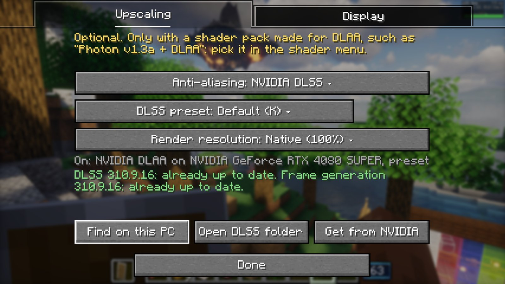
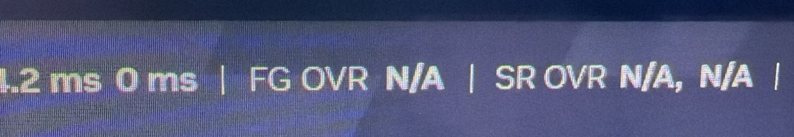
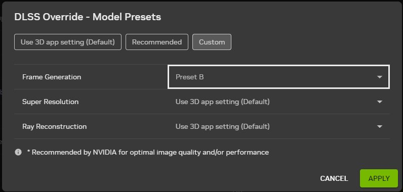

# Frame generation 3 on the RTX 4080 SUPER: leaving full screen, the far terrain, the FSR cap and NVIDIA's presets

A PC session on 2026-10-27, 09:24–10:24, run by a Claude Code session in `C:\Users\coolm\Documents\Claude\MC-CREATE`
(`$T`).
- **What it followed:** "Frame generation 3" in `tools/dlss-testkit/PC-RUNBOOK.md` at `7449ffbf`, with Bridge 1.124.0
  (pack 0.5.15). The test kit is unchanged since Frame generation 2.
- **Steps 1–4** were run with Emre at the keyboard.
- **Step 5** ran on its own.
- **Step 6** was with Emre: the NVIDIA app's global Frame Generation override set to Preset B. At Emre's request it also
  had a third timed run with **Preset C**, which isn't in the runbook.
- **Setup:** Photon v1.3a + DLAA, DLSS at full resolution (preset K), 2560x1440, Perfect Presentation on, on Emre's
  ASUS XG27AQDMES (240 Hz, G-SYNC). Max Framerate Unlimited (260) and vsync off, as the runbook sets them.

## Summary

- **Every step passes.**
- **F11 works.** The game left and re-entered full screen 22 times, with DLSS, FSR, frame generation off and DirectX
  11. Each time out it came back as a normal window, with its title bar and the taskbar showing: 2544x1401 at (8, 31),
  fitted to the work area.
  - Emre: "I did a whole lot of F11s, and I see no issues, no distant terrain and no weirdness, and it works."
  - **A dragged window comes back** at its size and place: 1473x810 at (363, 311) with DLSS, 1307x659 at (592, 455)
    with FSR, 1680x891 at (58, 129) with frame generation off, and 1404x639 at (84, 70) on DirectX 11.
  - **After maximise it comes back `maximized`.**
- **The far terrain stayed where it belongs, every time.** Distant Horizons' depth buffer was handed back after each
  resize: `Distant Horizons: its own depth buffer goes back on its framebuffers (Iris gave them the world's new one at
  the resize)`, 49 times. Emre saw no overlay at any point.
- **No `Frame generation was on when the swap chain resized`** in any step. Frame generation 2 had 12 with DLSS and 1
  with FSR. Every mode change turned frame generation off, then back `on`.
- **No `RSYNC: Flip queue is empty`** anywhere (Frame generation 2: 256 in the game log).
- **Minimise works.** `off, the window is minimized` came at once, and the game came back in full screen with the
  picture right, with DLSS and with FSR.
- **The FSR cap is fixed.** With Max Framerate 120 the game's counter showed 60 and the NVIDIA overlay 120, with FSR as
  with DLSS. The log says `frame cap 120 fps on screen, 60 rendered (Reflex's)`. Frame generation 2 showed about 200
  with FSR at the same cap.
- **Find on this PC** now says one sentence per file: "DLSS 310.9.16: already up to date. Frame generation 310.9.16:
  already up to date."
- **NVIDIA's frame generation presets reach the game, though the overlay says they don't.**
  - With the global override on, NVIDIA's overlay reads `FG OVR N/A`.
  - But the game's Streamline log shows the override taking effect: `Read SL_DLSS_OVERRIDE DRS key (global profile):
    1`, `Feature dlssg override enabled`. NVIDIA's own copies of the Streamline plugins are loaded instead of ours, and
    the frame generation model comes from NVIDIA's folder.
  - **Preset B against NVIDIA's own pick:** no difference beyond run-to-run noise (fps −2.0% to +0.4%, latency −0.7
    to +0.05 ms, pacing the same).
  - **Preset C, which NVIDIA builds to cost less, is clearly faster:** **+5.6% to +6.2% rendered fps** in every mode
    and viewpoint, input to GPU end 0.6–1.6 ms shorter.
  - So the override does take hold. Preset B most likely ran too, and simply costs the same as the default.

## Update and settings

- **Repo and jars.**
  - Pulled `claude/project-thread-u2wmhh` (`7449ffbf`) and replaced `create-galore-bridge-1.122.0.jar` with
    `create-galore-bridge-1.124.0.jar` (3,258,359 bytes).
  - The test kit jar is unchanged (56,165 bytes).
- **Backups.** The old settings are in `$T\fg3\*.before`: `dlaa=true` and `perfectPresentation=false`; `options.txt`
  with `fullscreen:false`, `maxFps:120`, `enableVsync:true`; Distant Horizons 32 threads.
- **Display settings:** `dlaa=dlss`, `perfectPresentation=true`, `presenter=dx12`, `reflex=on`, `gpuPacing=off`,
  `fpsCounter=detailed`, `frameGen=dlss`, `frameGenType=dlss`, with no `frameGenCheck` or `frameGenUi` line.
- **`options.txt`:** `fullscreen:true`, `maxFps:260`, `enableVsync:false`.

How the `Perfect Presentation` lines' `from:` part read. Each path was the same every time (up to the `<`-chain's cut
at its 12th entry); the count is over steps 1–4:

| line | `from:` | count |
| --- | --- | --- |
| `borderless full screen, 2560x1440 at (0, 0)` (`, maximized` after a maximise) | `Window.wrapOperation$mlp000$create_galore_bridge$borderlessFullscreen < Window.setMode < Window.updateFullscreen < Window.updateDisplay < Minecraft.runTick < Minecraft.run < Main.main < CommonLaunchHandler.runTarget < CommonLaunchHandler.clientService < CommonClientLaunchHandler.runService < CommonLaunchHandler.lambda$launchService$4 < LaunchServiceHandlerDecorator.launch` | 25 |
| `a window, WxH at (x, y)` (F11 out) | `Window.wrapOperation$mlp000$create_galore_bridge$restoreBorder < Window.setMode < Window.updateFullscreen < Window.updateDisplay < Minecraft.runTick < Minecraft.run < Main.main < CommonLaunchHandler.runTarget < CommonLaunchHandler.clientService < CommonClientLaunchHandler.runService < CommonLaunchHandler.lambda$launchService$4 < LaunchServiceHandlerDecorator.launch` | 22 |
| `a window, 2544x1401 at (8, 31)` (at start, before full screen) | `Window.wrapOperation$mlp000$create_galore_bridge$restoreBorder < Window.setMode < Window.<init> < VirtualScreen.newWindow < Minecraft.<init> < Main.main < CommonLaunchHandler.runTarget < CommonLaunchHandler.clientService < CommonClientLaunchHandler.runService < CommonLaunchHandler.lambda$launchService$4 < LaunchServiceHandlerDecorator.launch < LaunchServiceHandler.launch` | 3 |
| `the window is now WxH, the game has it in full screen` (F11 in) | `Window.handler$mlp000$create_galore_bridge$watchSize < Window.onResize < GLFWWindowSizeCallbackI.callback < GLFW.glfwSetWindowAttrib < Window.wrapOperation$mlp000$create_galore_bridge$borderlessFullscreen < Window.setMode < Window.updateFullscreen < Window.updateDisplay < Minecraft.runTick < Minecraft.run < Main.main < CommonLaunchHandler.runTarget` | 22 |
| the same, from `glfwSetWindowMonitor` | `Window.handler$mlp000$create_galore_bridge$watchSize < Window.onResize < GLFWWindowSizeCallbackI.callback < GLFW.glfwSetWindowMonitor < Window.mixinextras$bridge$glfwSetWindowMonitor$102 < Window.wrapOperation$mlp000$create_galore_bridge$borderlessFullscreen < Window.setMode < Window.updateFullscreen < Window.updateDisplay < Minecraft.runTick < Minecraft.run < Main.main` | 11 |
| `the window is now WxH, the game has it as a window` (F11 out) | `Window.handler$mlp000$create_galore_bridge$watchSize < Window.onResize < GLFWWindowSizeCallbackI.callback < GLFW.glfwSetWindowMonitor < Window.mixinextras$bridge$glfwSetWindowMonitor$103 < Window.wrapOperation$mlp000$create_galore_bridge$restoreBorder < Window.setMode < Window.updateFullscreen < Window.updateDisplay < Minecraft.runTick < Minecraft.run < Main.main` | 10 |
| `the window is now WxH, the game has it as a window` (dragging) | `Window.handler$mlp000$create_galore_bridge$watchSize < Window.onResize < GLFWWindowSizeCallbackI.callback < GLFW.glfwPollEvents < RenderSystem.pollEvents < RenderSystem.flipFrame < Window.updateDisplay < Minecraft.runTick < Minecraft.run < Main.main < CommonLaunchHandler.runTarget < CommonLaunchHandler.clientService` | 12 |
| the same, from Reflex's frame start | `Window.handler$mlp000$create_galore_bridge$watchSize < Window.onResize < GLFWWindowSizeCallbackI.callback < GLFW.glfwPollEvents < FrameLatency.pollEvents < FrameLatency.reflexFrameStart < FrameLatency.frameStart < Minecraft.handler$mlf000$create_galore_bridge$frameStart < Minecraft.runTick < Minecraft.run < Main.main < CommonLaunchHandler.runTarget` | 6 |

`the window is now` lines end in `, DXGI windowed` on DirectX 12 and without it on DirectX 11.

## 1. Leaving full screen with DLSS (09:31–09:36): pass

- **Start (09:28).**
  - `Frame generation: NVIDIA DLSS Frame Generation through Streamline 2.14.16 from ...; nvngx_dlssg.dll 310.9.16
    (tested with 310.9.16) from ...\create-galore-dlss, on`, then `ready in the DirectX 12 presenter on NVIDIA GeForce
    RTX 4080 SUPER, on; Reflex goes through Streamline`.
  - While the window is made, before full screen applies: `Perfect Presentation: the window to come back after full
    screen, 2560x1440, is bigger than the screen's work area; it comes back as 2544x1401 at (8, 31)`.
  - Then `Perfect Presentation: borderless full screen, 2560x1440 at (0, 0)`: the game started in full screen.
  - `Reflex: low latency on, boost off, frame cap none` (Unlimited).
  - At about 108 rendered fps uncapped, Emre asked whether a cap was on; it wasn't (`frame cap none`). The NVIDIA
    overlay showed twice that.
- **F11 out and in, six times, then three more with the tests below: 9 out, 9 in, all as expected.**
  - Each out: `Perfect Presentation: a window, 2544x1401 at (8, 31)`.
  - Each in: `Perfect Presentation: borderless full screen, 2560x1440 at (0, 0)`.
  - Each with the Distant Horizons line, `Frame generation: off, the window is resizing` and `on` 20–60 ms later.
  - The first out logged `the window to come back after full screen, 2560x1440, is bigger than the screen's work area;
    it comes back as 2544x1401 at (8, 31)`.
  - **`the window is now` lines didn't come on the first out and in;** from the second they did.
  - **On every F11 in the size flips twice within about 45 ms:** `the window is now 2560x1440, the game has it in full
    screen` (`glfwSetWindowAttrib`), then `2544x1401` (`glfwSetWindowAttrib`), then `2560x1440` (`glfwSetWindowMonitor`).
    Frame generation only turned off once each time, and Emre saw nothing, so it is harmless. It's one size change more
    than needed, which the Bridge side may want to know about.
  - Emre: "Yeah, I did a whole lot of F11s, and I see no issues, no distant terrain and no weirdness, and it works."
- **Drag (09:34:30–09:34:56).**
  - Out, drag to about half size with the pause menu open, in, out: `a window, 1473x810 at (363, 311)`, with no `bigger
    than the screen's work area` line.
- **Maximise (09:34:59–09:35:31).**
  - Maximised with the title bar button, then in: `borderless full screen, 2560x1440 at (0, 0), maximized`.
  - Then out: `the window to come back after full screen, 2560x1417, is bigger than the screen's work area; it comes
    back as 2544x1401 at (8, 31)` and `a window, 2544x1401 at (8, 31), maximized`.
  - So it comes back maximised. Emre "didn't notice anything weird".
- **Minimise from full screen** (Win+D, 09:35:12): `Frame generation: off, the window is minimized` at once. Back 7 s
  later: `off, the window is resizing`, then `on`.
  - From a window, the title bar's minimise was done with the pause menu open: frame generation was already off, so it
    logged no line.
  - Emre: "I did all the steps and in all of them nothing weird happened, all as expected".
- **Streamline (`Frame generation (native)`) WARN lines, steps 1–2:**
  - 23x `flipMetering.cpp:182[setFlipConfig] FC feedback: 1` (one per mode change);
  - 7x `dlfgPresent.cpp:1323[presentCommon] Frame rate over 100.00ms, reseting frame timer`;
  - one each of `Invalid backbuffer resource extent`, `unsupported alignment` and `Repeated slDLSSGSetOptions() call`
    (the switch to FSR);
  - `167 log lines dropped`.
  - **No ERROR.**

## 2. The cap and the Find text with DLSS (09:37–09:39): pass

- **Find on this PC.** Emre's screenshot shows, word for word: **"DLSS 310.9.16: already up to date. Frame generation
  310.9.16: already up to date."** Nothing was copied, so nothing was logged.
  - The status line above it reads `On: NVIDIA DLAA on NVIDIA GeForce RTX 4080 SUPER, preset` and stops after `preset`.
    The rest seems cut off or hidden.
- **The cap.**
  - Max Framerate 120 (09:38:23): `Reflex: low latency on, boost off, frame cap 120 fps (Reflex's); Streamline, low
    latency available, latency report available`.
  - Counter 60, overlay 120. Emre: "the in-game counter showed 60 with a 120fps limit but the displayed fps (nvidia
    overlay) showed 120 after fg".
  - Back to Unlimited (09:38:53): `frame cap none`.

## 3. FSR (09:43–09:48): pass

- **Start.** FSR picked in the Display tab: `Frame generation: off, turned off`. The game was closed and launched
  again.
  - `Frame generation: AMD FSR 3.1 frame generation (FidelityFX SDK 2.0.0) from ...\fidelityfx-2.0.0, on`;
    `ready in the DirectX 12 presenter on NVIDIA GeForce RTX 4080 SUPER, on`;
    `Reflex: started on Perfect Presentation's DirectX 12 device (NVIDIA NVAPI)`.
  - **It started in full screen,** as the last session left it.
  - In the world: `running, 2 frames shown per rendered one (most it can generate: 1, smallest size 0)`.
- **F11 out and in three times, one drag, in and out: 5 out, 5 in, all right.**
  - Each resize re-created FSR at the new size (`Frame generation (native): FSR frame generation 3.1.5 at 2544x1401`,
    `... at 2560x1440`, `... at 1307x659`).
  - The dragged window came back as `a window, 1307x659 at (592, 455)`.
  - Emre: "I did steps 1 and 2 and noticed no weird far terrain, and everything worked as you would expect with a
    window. I even did the dragging and stuff."
- **The cap.**
  - Max Framerate 120. While the menu was open, with frame generation off: `Reflex: low latency on, boost off, frame
    cap 120 fps (Reflex's); driver low latency on, last sleep 800 us, game Sleep used, G-SYNC fullscreen`.
  - Once it turned on: **`Reflex: low latency on, boost off, frame cap 120 fps on screen, 60 rendered (Reflex's);
    driver low latency on, last sleep 8333 us, game Sleep used, G-SYNC fullscreen`**.
  - Emre: "At 120 FPS cap, the in-game counter reads 60 and the NVIDIA overlay reads 120 as expected."
  - Back to Unlimited: `frame cap none`.
- **Win+D (09:48:26):** `off, the window is minimized`, then back after 14 s. Emre: "nothing odd happened and it all
  appears to work."
- **No Bridge WARN** in this launch.

## 4. Frame generation off, and DirectX 11 (09:49–09:55): pass

- **Frame generation Off without a restart (09:49:17):** `Frame generation: off, turned off`, then `turned off`.
  - Then 4 out and 4 in, with a drag to `a window, 1680x891 at (58, 129)`. The same `Perfect Presentation` lines, with
    the Distant Horizons line each time.
- **DirectX 11** (restart, Perfect Presentation still on): `Perfect Presentation: DXGI swap chain ready on DirectX 11
  (OpenGL on a hidden context)`, `Reflex: started on Perfect Presentation's DirectX 11 device (NVIDIA NVAPI)`. It
  started in full screen.
  - **Out:** `the window to come back after full screen, 2560x1440, is bigger than the screen's work area; it comes
    back as 2544x1401 at (8, 31)`. The 1680x891 window from before the restart isn't kept: the launch sets 2560x1440.
  - Then 4 out and 4 in, and a drag to `a window, 1404x639 at (84, 70)` that came back right.
  - **Without `DXGI windowed`:** `the window is now ...` lines read `the game has it in full screen` / `as a window`
    with nothing after, as the runbook allows.
  - Emre: "at every point it behaved normally with no weird terrain bugs or anything."
  - No `Mod loading issue` in any start: main's lock held through 7 starts.
- **WARN in steps 3–4:** only `Create Galore: something registered texture irons_lib:steve off the render thread`
  (every launch, harmless). There was one `Perfect Presentation: swap chain wait timed out` at 09:43:13, while the game
  closed after FSR was picked.

## 5. Timed run with NVIDIA's own frame generation model (B0)

- **Launch.** The step 5 settings (DirectX 12, DLSS frame generation, Reflex on, pacer off, Unlimited, full screen),
  with `autorun=dlaa-test` and `runs=G1`. NVIDIA app overrides all off.
  - Run `20261027-095826-G1`, 09:58:26–10:00:15.
  - `Frame generation: running, 2 frames shown per rendered one`, `Reflex: started through Streamline`, the pacer lines
    in the pacing modes.
- **PresentMon,** elevated, with `--set_circular_buffer_size 4096` added: no overflow warning.
  - It recorded 21,531 shown frames inside the run, against 2 x 10,780 = 21,560.
  - **That corrects Frame generation 2's report.** About the same shortfall came back with the bigger buffer and no
    warning (29 here, 27 in B1, 23 in B2, against Frame generation 2's 30), so they aren't lost events. They are the
    frames that go out without a generated partner while frame generation is off after each of the run's 6 shader
    reloads.
- **Streamline's log:** `Read SL_DLSS_OVERRIDE DRS key (global profile): 0`, and the dlssg model from the instance's
  `create-galore-dlss\nvngx_dlssg.dll` (310.9.16).
- **Against Frame generation 2's DLSS launch** (same settings, the day before), the run reproduces: 117.3 / 108.4 fps
  against 117.1 / 109.1, and 12.4 / 14.1 ms against 12.7 / 13.7.

## 6. NVIDIA's Frame Generation presets

- **The override (10:01).** Emre set it in the NVIDIA app: Graphics, Global Settings, `DLSS Override - Model Presets`,
  Custom: Frame Generation **Preset B**, Super Resolution and Ray Reconstruction `Use 3D app setting (Default)`.
- **The look (10:02).** The game launched without autorun.
  - **NVIDIA's overlay: `FG OVR N/A | SR OVR N/A, N/A`.** SR N/A is expected, since no SR override was set.
  - **The game's Streamline log disagrees on frame generation.** Against B0:
    - `Read SL_DLSS_OVERRIDE DRS key (global profile): 1`, then `OTA override enabled via DRS key, will use CMSID
      0xE658700`;
    - NVIDIA's own copies of the Streamline plugins (`sl.common`, `sl.dlss_g`, `sl.reflex`, `sl.pcl`, also 2.14.16)
      load from `C:\ProgramData\NVIDIA\NGX\models\sl_*_override_0\versions\134672`. Ours are logged as ignored: five
      WARN `Ignoring plugin 'sl.dlss_g' v2.14.16 (...) - duplicate of already-loaded v2.14.16 (...)` and the like;
    - `Feature dlssg override enabled` (not in B0);
    - the dlssg model from NVIDIA's folder: `dlssg snippet: C:\ProgramData\NVIDIA\NGX\models\dlssg\versions\20318480\files/160_E658700.bin
      version: 310.9.16`.
  - **No line in either log names a preset.** The four frame generation driver keys Streamline reads (`271614616`,
    `273507943`, `274083087`, `282018085`) read `0x0` with and without the override.
  - **Emre on the overlay:** "we can't fully verify that because we don't know how Minecraft sees the game once frame
    generation is on ... It could be hooking over OpenGL, in which case there is no frame generation to override in the
    first place."
  - **The suggestions, picture and feel with Preset B:** "I can't visually tell the difference. Honestly, preset B is
    very close to preset A ... Preset B in all of my use though ... always is just marginally better, but not in a
    clear way."
- **B1 (Preset B), run anyway.** The runbook skips the timed launch when the overlay says N/A. Emre chose to run it:
  "If we can notice a statistical difference in performance or frame pacing, then a different model is likely
  running. If not ... having a override is probably just harmless."
  - Run `20261027-101125-G1`. Its log has the same override lines.
- **B2 (Preset C), at Emre's request** (not in the runbook): "C is specifically designed to look a little bit worse
  than B, but perform better ... If we see a clear uptick in performance here, then we know that the model overrides
  are taking hold."
  - Run `20261027-101839-G1`, the override set to Preset C, everything else the same. Its log has the same override
    lines.
- Afterwards Emre set the NVIDIA app back to all overrides off ("alr I set the app back").

### Numbers

From `latency.py` (rendered fps, input to GPU end, GPU queue, the driver's frame start to GPU end) and `frametimes.py`
(shown every, pair ratio), one launch at a time. Two columns are mine, from the same PresentMon frames:
- **shown per s:** frames reaching the screen over the path's time;
- **pairs at 2x or more:** the share of neighbouring shown frames where one stayed at least twice as long as the other.

| mode | viewpoint | launch | rendered fps (plays) | input to GPU end ms, median (plays) / p90 | GPU queue ms | driver frame start to GPU end ms | shown per s | shown every ms (median / p10 / p90) | pair ratio (median / p90) | pairs at 2x or more |
| --- | --- | --- | --- | --- | --- | --- | --- | --- | --- | --- |
| `lat-reflex` | shore | B0 | 117.3 (117, 117) | 12.4 (12.8, 12.1) / 14.5 | 4.1 | 21.2 | 234 | 4.37 / 2.63 / 5.58 | 1.41 / 2.68 | 20% |
| `lat-reflex` | shore | B1 (Preset B) | 115.0 (113, 117) | 12.5 (12.9, 12.0) / 14.5 | 4.0 | 22.1 | 230 | 4.36 / 2.57 / 5.65 | 1.37 / 2.84 | 21% |
| `lat-reflex` | shore | B2 (Preset C) | 124.0 (123, 125) | 11.8 (12.0, 11.6) / 13.4 | 3.6 | 18.9 | 248 | 4.06 / 2.20 / 5.56 | 1.44 / 3.09 | 24% |
| `lat-reflex` | canopy | B0 | 108.4 (108, 109) | 14.1 (14.5, 13.7) / 16.0 | 5.2 | 23.8 | 217 | 4.84 / 3.04 / 5.85 | 1.36 / 3.14 | 21% |
| `lat-reflex` | canopy | B1 (Preset B) | 108.5 (108, 109) | 13.9 (14.4, 13.4) / 16.0 | 4.9 | 23.9 | 217 | 4.87 / 3.04 / 5.87 | 1.34 / 3.18 | 20% |
| `lat-reflex` | canopy | B2 (Preset C) | 114.5 (114, 115) | 12.8 (13.4, 12.3) / 14.9 | 4.4 | 22.5 | 229 | 4.64 / 2.70 / 5.70 | 1.44 / 2.81 | 22% |
| `lat-pacing-on` | shore | B0 | 118.2 (118, 118) | 12.6 (12.5, 12.7) / 14.5 | 4.3 | 21.6 | 236 | 4.34 / 2.60 / 5.43 | 1.38 / 2.58 | 18% |
| `lat-pacing-on` | shore | B1 (Preset B) | 117.8 (117, 118) | 12.5 (12.4, 12.7) / 14.5 | 4.3 | 21.2 | 236 | 4.33 / 2.53 / 5.47 | 1.35 / 2.70 | 20% |
| `lat-pacing-on` | shore | B2 (Preset C) | 124.8 (124, 126) | 11.8 (11.7, 11.8) / 13.3 | 3.9 | 19.7 | 249 | 4.07 / 2.33 / 5.39 | 1.39 / 2.83 | 22% |
| `lat-pacing-on` | canopy | B0 | 108.4 (108, 108) | 14.1 (13.8, 14.3) / 16.0 | 5.2 | 23.6 | 217 | 4.93 / 2.88 / 5.84 | 1.37 / 3.00 | 21% |
| `lat-pacing-on` | canopy | B1 (Preset B) | 108.6 (109, 109) | 13.7 (13.7, 13.7) / 16.0 | 4.7 | 23.6 | 217 | 4.83 / 2.85 / 5.87 | 1.39 / 3.24 | 22% |
| `lat-pacing-on` | canopy | B2 (Preset C) | 115.2 (115, 115) | 12.9 (13.2, 12.7) / 14.9 | 4.4 | 22.2 | 230 | 4.61 / 2.79 / 5.66 | 1.44 / 2.54 | 22% |
| `lat-reflex-pacing-on` | shore | B0 | 118.7 (119, 119) | 12.4 (12.5, 12.3) / 14.5 | 4.2 | 21.6 | 238 | 4.31 / 2.62 / 5.42 | 1.36 / 2.61 | 18% |
| `lat-reflex-pacing-on` | shore | B1 (Preset B) | 118.4 (118, 119) | 12.5 (12.6, 12.4) / 14.5 | 4.2 | 21.9 | 237 | 4.32 / 2.96 / 5.41 | 1.34 / 2.67 | 19% |
| `lat-reflex-pacing-on` | shore | B2 (Preset C) | 126.0 (126, 126) | 11.7 (11.7, 11.6) / 13.4 | 3.9 | 19.8 | 252 | 4.05 / 2.50 / 5.24 | 1.36 / 2.66 | 20% |
| `lat-reflex-pacing-on` | canopy | B0 | 108.6 (108, 109) | 14.2 (14.1, 14.3) / 16.0 | 5.3 | 23.6 | 217 | 4.84 / 2.90 / 5.82 | 1.37 / 3.14 | 21% |
| `lat-reflex-pacing-on` | canopy | B1 (Preset B) | 109.1 (109, 109) | 13.5 (13.6, 13.4) / 16.0 | 4.5 | 23.5 | 218 | 4.75 / 3.04 / 5.82 | 1.41 / 3.08 | 21% |
| `lat-reflex-pacing-on` | canopy | B2 (Preset C) | 115.4 (115, 115) | 12.7 (12.8, 12.5) / 14.9 | 4.0 | 22.1 | 231 | 4.59 / 2.83 / 5.64 | 1.43 / 2.55 | 21% |

**How much the numbers move anyway.** These are the same differences for two launches with identical settings: B0
against Frame generation 2's DLSS launch, a day apart.

| | B1 (Preset B) against B0 | B2 (Preset C) against B0 | B0 against Frame generation 2 (noise) |
| --- | --- | --- | --- |
| rendered fps | −2.0% to +0.4% (−2.0% is one 113 fps play) | **+5.6% to +6.2%** | −0.8% to +0.2% |
| input to GPU end | −0.73 to +0.05 ms | **−0.64 to −1.55 ms** | −0.30 to +1.07 ms |
| pair ratio p90 | −0.07 to +0.24 | −0.59 to +0.41 | −0.14 to +0.27 |
| pairs at 2x or more | −0.5 to +2.1 points | 0 to +4.3 points | −1.7 to +2.1 points |
| how even over 2 / 8 shown frames (p90 over p10) | 1.48–1.56 / 1.11–1.15, the same as B0's 1.48–1.55 / 1.11–1.15 | 1.46–1.88 / 1.12–1.21 | — |

The two plays inside each launch differ by at most 2.8% (B1, shore) and 1.8% (B2) in fps.

### The lines

- **Preset B against NVIDIA's own model:** **no difference beyond noise.** Fps, latency and pacing all move less than
  between two identical launches. Either the same model ran, or Preset B costs the same as the default; the second fits
  B2.
- **Preset C:**
  - **It costs less:** +5.6% to +6.2% rendered fps everywhere (124.0 / 114.5 against 117.3 / 108.4), about 0.5 ms
    less GPU time per rendered frame. Input to GPU end is 0.6–1.6 ms shorter, and the driver's frame start to GPU end
    1.3–2.3 ms shorter.
  - **That means the override takes hold,** whatever the overlay says.
- **Preset C's pacing:**
  - **At the canopy it's the same or a little better** (pair ratio p90 2.54–2.81 against 3.00–3.14).
  - **At the shore it's a little less even** (p90 2.66–3.09 against 2.58–2.68; over 2 frames up to 1.88 against
    1.55). But there the screen gets 248–252 frames a second, above the panel's 240 Hz. Frames that come faster than
    the refresh tear in or wait, which explains it better than the model.

## Choices that aren't in the runbook

- **One elevated PresentMon helper for the timed launches.**
  - `$T\profiling\scripts\fg3-pm.ps1` is Frame generation 2's `fg2-pm.ps1` with the runbook's
    `--set_circular_buffer_size 4096`, the fg3 folder, and a stop file to end it early.
  - One administrator prompt (Emre, 09:28) covered B0 and B1; a second one (10:16) covered B2.
- **The launch script for the timed launches:** `fg2-run.ps1` (Pacer 3's window fix plus the pid hand-off). In each it
  moved the window once during start-up, before the game went full screen. Each run then started with `client at (0,
  0) size 2560x1440, foreground True`.
- **Distant Horizons on 2 threads in the timed launches** (B0, B1, B2 and the step 6 look), as in every latency run
  since Reflex 1. It was 32 in steps 1–4.
- **B1 ran although the overlay said N/A,** on Emre's call.
- **B2 (Preset C)** is Emre's addition.
- **The analysis.**
  - frametimes.py ran once per launch (it pools runs with the same mode names).
  - Shown per s, pairs at 2x or more, evenness over 2 and 8 frames, and the launch-to-launch comparison are my own
    measures, from the same PresentMon frames with frametimes.py's segment logic.
  - Frame generation 2's DLSS launch is the noise reference.
- **Emre's NVIDIA app screenshot** is not committed, because it shows his account. The dialog is cropped out of it.
  His overlay photo is cropped to the overlay line.

## Afterwards

- **Settings put back.**
  - `create_galore_bridge-display.properties`, `options.txt`, `DistantHorizons.toml`, `iris.properties`, `fml.toml` and
    `sodium-options.json` were copied back from `$T\fg3\*.before`, and each was checked with `cmp`.
  - That leaves frame generation off, Perfect Presentation off, windowed, 120 fps cap with vsync, and Distant Horizons
    on 32 threads. The test kit's json was deleted.
- **The NVIDIA app** is back to all overrides off (Emre).
- **What stays on the PC, in `$T\fg3`:**
  - the PresentMon CSVs (`B0.csv`, `B1.csv`, `B2.csv`);
  - the game logs of each step;
  - the Streamline logs (`sl-step12.log`, `sl-B0.log`, `sl-step6.log`, `sl-B1.log`, `sl-B2.log`);
  - the unedited photos and screenshots, and the session notes.
  - The timed runs' game logs are in `$T\profiling\scripts\proflogs\FG3-B0`, `-B1` and `-B2`.

What comes of it: every step passed, so by the runbook the PR can merge once Emre says so.
