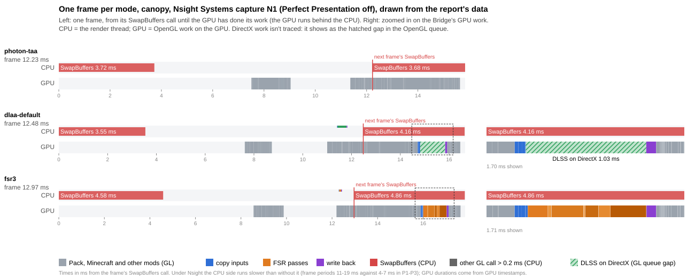
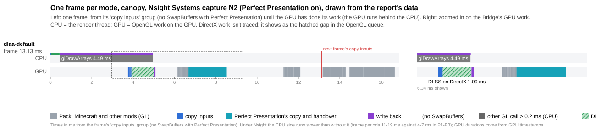

# Profiling 1 on the RTX 4080 SUPER: where the time goes

PC session on 2026-10-25, 09:20–11:45, by a Claude Code session in `C:\Users\<user>\Documents\Claude\MC-CREATE`
(`$T`). It followed "Profiling 1: where the time goes" in `tools/dlss-testkit/PC-RUNBOOK.md` at `11365d5`, with
Bridge 1.91.0 and the test kit from that commit. Captures:

- P1–P3 and P5 with PresentMon;
- P4, plus P4b, an extra one, with Java Flight Recorder;
- N1 and N2 with Nsight Systems.

This is a report only. No code was changed, and nothing here is a fix.

All captures ran at 2560x1440 with vsync off and the frame cap at 260. The PC was quiet: no game server, and no
other game or launcher (see Method).

## Summary

### 1. Frame time per mode: the PC is GPU-bound, not CPU-bound

| viewpoint | photon-taa | dlaa-default | dlaa-camera | fsr3 |
| --- | --- | --- | --- | --- |
| shore | 5.43 ms (GPU 4.76, 45% GPU-bound) | 6.20 (6.20, 85%) | 6.19 (6.17, 91%) | 6.17 (6.16, 98%) |
| glass | 4.35 (4.18, 60%) | 5.60 (5.60, 83%) | 5.60 (5.58, 82%) | 5.55 (5.54, 93%) |
| canopy | 5.87 (5.60, 62%) | 7.31 (7.24, 90%) | 7.31 (7.20, 93%) | 7.20 (7.19, 97%) |
| moving | 6.88 (5.99, 45%) | 6.79 (7.34, 80%) | 6.79 (7.34, 85%) | 6.95 (7.33, 84%) |

How to read the table:
- The cells give the median frame time over P1–P3, with PresentMon's median GPU busy time and the share of
  GPU-bound frames in brackets. A frame counts as GPU-bound when the GPU was busy for more than 90% of it.
- The full table, with p90 and the spread between repeats, is in [frametimes-P1-P3.md](frametimes-P1-P3.md).

What it shows:
- **DLSS and FSR 3.1 are GPU-bound** in 80–98% of frames.
- **Photon's TAA is about half CPU-bound and half GPU-bound** (45–62% of frames GPU-bound).
- So work that only costs the GPU is not free on this PC. In the static views, DLSS and FSR add 0.7–1.4 ms per frame
  over photon-taa. Only in the moving scene, which is CPU-heavy, does that extra GPU time disappear: there TAA's
  frames wait on the CPU (6.88 ms against 5.99 ms of GPU work), and DLSS fills that wait.
- **DLSS and FSR cost the same** (they differ by at most 0.16 ms), and so do dlaa-default and dlaa-camera (at most
  0.01 ms apart).
- Earlier rounds saw about 110–120 fps and called the PC "not GPU-bound". That was most likely the old frame cap of 120
  with vsync on in `options.txt`, not a CPU limit.

How sure:
- The medians of the three repeats lie within 0.07–0.76 ms of each other per row; P1 was the slowest run in most rows.
- In the glass and canopy views, the gap between TAA and DLSS or FSR (1.2–1.4 ms) is larger than that spread.
- At the shore the gap (0.7–0.8 ms) is about the size of the spread there (0.6–0.7 ms). Still, every DLSS and FSR
  repeat at the shore was slower than every TAA repeat.
- The differences between DLSS and FSR, and between dlaa-default and dlaa-camera, are well inside the spread.
- PresentMon's "CPU busy" equals the frame time with this present path (`Composed: Copy with GPU GDI`), so it can't
  show how much slack the CPU has. The GPU-bound share is the measure used here.

### 2. What the Bridge's work costs

**On the GPU (N1, Nsight, the canopy and moving views), in ms per frame:**

| Bridge work | DLSS (`dlaa-default`) | FSR 3.1 (`fsr3`) |
| --- | --- | --- |
| copy inputs (colour, motion, depth, exposure; FSR also copies the mask) | 0.08–0.09 | 0.10–0.11 |
| DLSS on DirectX (the OpenGL queue waits for it) | **1.06–1.07** (p10–p90 1.03–1.14) | – |
| FSR's passes, all together | – | **1.00** |
| write back | 0.08 | 0.08 |
| **all of the Bridge's work** | **about 1.23** | **about 1.19** |

FSR's passes, in ms:

| pass | ms |
| --- | --- |
| accumulate | 0.30–0.31 |
| shading_change_pyramid | 0.27–0.28 |
| clears + prepare_inputs (they share a timing row) | 0.17 |
| prepare_reactivity | 0.11 |
| luma_instability | 0.09–0.10 |
| luma_pyramid | 0.03 |
| shading_change | 0.01 |

- **DLSS's DirectX work isn't traced.** Nsight's DirectX 11 tracing crashed the game (see Method), so DLSS shows up as
  a gap in the OpenGL queue, from the last input copy to the write back.
  - During that gap the GPU's graphics engine was busy 93–94% of the time, and its tensor cores 18%. That's DLSS's
    work, not a wait.
  - The gap was 1.03–1.14 ms in 80% of frames.
- **PresentMon's view (P1–P3):** DLSS and FSR add 1.35–1.64 ms of GPU busy time per frame over photon-taa.
  - The Bridge's groups account for about 1.2 ms of that.
  - Photon's own work was the same in all three modes in the canopy view (5.36–5.40 ms, N1).
  - The other 0.2–0.4 ms aren't placed by these captures. They come from different runs, and Nsight's timing queries
    and GPU clocks differ from an untraced run.

**On the CPU (P4b, Java Flight Recorder without Nsight, moving scene; share of the render thread's samples, about
1,600 per mode):**

| What | photon-taa | dlaa-default | dlaa-camera |
| --- | --- | --- | --- |
| The Bridge's DLAA code (`cpuprofile.py`) | 0.3% | 3.3% | 1.6% |
| ... of it the motion vector code | 0.2% | 1.6% | 0.3% |
| The Bridge anywhere on the stack (DLAA and the ship rendering) | 2.8% | 6.1% | 4.5% |

- **The motion of mobs, the hand, machines and ships costs about 1.3–1.6% of the render thread.** That's the
  difference between dlaa-default and dlaa-camera, about 0.1 ms of a 6.8 ms frame.
  - It is mostly `EntityMotion.write` (1.3%) and the `prevPos` mixin on `BufferBuilder` (0.5–0.7%).
  - dlaa-camera still shows a little of both (0.3% and 0.5%).
- **DLSS's CPU side** (`DlssDevice.lock` and `unlock`, NGX's `Ffi.call`) is about 1.3–1.6% of the render thread, in
  both DLAA modes, so about 0.1 ms per frame.
  - Under Nsight, the DirectX group (unlock, NGX's evaluate call, lock) took 0.41–0.52 ms of the render thread per
    frame, and FSR's seven dispatches together 0.09 ms.
  - Both are inflated by tracing.
- **The Bridge's ship rendering costs about 1.5–2.5% in every mode, DLAA or not.** That's
  `ShipAnimatedSprites.seen` at 0.9–1.4%, `ShipWaterCutaway` at 0.3–0.6%, and `popOnShipHull` on particles at
  0.2–0.3%.
- **How sure:** with about 1,600 samples, a share near 3% is good to about ±0.8 points (95%). So the motion work is
  about twice that noise: likely, but not settled. It is free on this PC: dlaa-camera and dlaa-default have the same
  frame times, because the GPU is the limit.

**The interop handover (N1, Nsight only):**
- In 18 of 119 DLSS frames in the canopy view, and 25 of 119 in the moving view, the first OpenGL call after DLSS
  blocked the render thread for about 3.9 ms (median). That call is the write back's draw.
- In those frames the GPU then sat idle for about 0.75 ms, until the CPU sent more work.
- FSR frames did this in 2 of 119 and 0 of 119.
- **This looks like an effect of tracing.** The CPU ran about twice as slowly under Nsight (frames every 11–19 ms
  instead of 4–7 ms), and the untraced JFR capture P4b doesn't show the write back at all (under 0.2% of samples). It
  isn't proven either way.

### 3. Where a frame's time goes

**The render thread (P4b, moving scene):**
- "Self" is the first frame that isn't JDK or LWJGL glue, so a GL call counts for the code that made it.
- "Anywhere" is the share of samples with that owner on the stack at all.
- Full tables: [owners-P4b.md](owners-P4b.md) and [cpuprofile-P4b.md](cpuprofile-P4b.md).

| owner | self: photon-taa / dlaa-default / dlaa-camera | anywhere on the stack |
| --- | --- | --- |
| Minecraft (incl. the GL calls it makes) | 35.2 / 36.1 / 36.4% | about 100% |
| Iris (Photon's programs run through it) | 12.8 / 11.5 / 14.4% | 42–47% |
| Sodium | 10.5 / 10.0 / 9.2% | 23–27% |
| NeoForge | 4.5 / 2.8 / 3.7% | – |
| Entity Model Features | 3.4 / 3.0 / 1.7% | 7–8% |
| Distant Horizons | 2.0 / 2.7 / 3.0% | 4–6% |
| Sable | 2.4 / 1.9 / 2.6% | 31–35% |
| the Bridge, DLAA | 0.3 / 2.8 / 1.2% | 0.3–3.2% |
| the Bridge, other (ships; its mixins also carry the motion code) | 1.8 / 2.4 / 2.7% | 2.8 / 6.1 / 4.4% |
| Xaero's World Map | 1.7 / 1.8 / 2.3% | 3–4% |
| Accessories, GeckoLib, Naturalist, Subtle Effects, Simulated Coasters and others | under 2.5% each | under 5.5% each |
| Colorwheel, Flywheel, Create | 0.3–0.8% each | 1.7–3.0% each |
| **the graphics driver (top frame native)** | **10.1 / 14.4 / 16.7%** | – |

- The driver's share rises by 4–7 points in the DLAA modes.
  - It is mostly `JNI.invokePV` (2.4% in dlaa-default, 4.2% in dlaa-camera). That's the Bridge's interop lock and
    unlock and its calls into NGX.
  - It also includes `glBindFramebuffer` (2.7%) and `nglDrawElements` (1.7%).
- The busiest single methods, each 1–3%:
  - `ArrayDeque.addLast` and `HashMap.getNode` (Minecraft's and the mods' render code);
  - `SingleQuadParticle.getRenderBoundingBox` (particles, 1.2–2.4%);
  - Iris's `BufferBuilder` mixin `beforeNext` (1.7–3.7%);
  - `BiomeManager.getBiome`;
  - Sable's `getChunk` mixin (about 1.1%);
  - Xaero's `LeafRegionTexture.postUpload` (1.1%).
- Sable is on 31–35% of the stacks: its mixins wrap the level rendering, so this looks like a wrapper, not where the
  time is spent (its own code is about 2%).

**The GPU (N1, canopy, ms per frame):**

| part | photon-taa | dlaa-default | fsr3 |
| --- | --- | --- | --- |
| the pack, Minecraft and other mods, before the Bridge's part | – | 4.91 | 4.86 |
| the same, after the Bridge's part (Photon's later passes, the hand, the GUI, the blit to the window) | – | 0.50 | 0.49 |
| the pack, Minecraft and other mods, all of it | 5.38 | 5.40 | 5.36 |
| the Bridge (table above) | – | 1.23 | 1.19 |

The pack's part, split by the OpenGL call that starts each timing row (canopy, about the same in all modes):

| call | ms | this looks like |
| --- | --- | --- |
| `glDrawElements` | 1.9–2.0 | entities, particles, and Iris's full-screen deferred and composite passes |
| `glMultiDrawElementsBaseVertex` | 1.4–1.5 | Sodium's terrain: the shadow map and the world |
| `glDispatchCompute` | 0.6–1.0 | Photon's compute passes |
| framebuffer binds, clears, copies, mipmaps | 1.3–1.6 | |
| `glMultiDrawElementsIndirect` | 0.04–0.07 | Distant Horizons or Sodium |

- **The split into shadow, the world's programs, and Photon's deferred and composite passes isn't possible from this
  capture.** In it, neither Iris nor Photon named its passes. "Optional follow-ups" below has a way to get it if it's
  wanted.
- In the moving view, the pack's GPU work differs from mode to mode (8.84 / 7.29 / 5.53 ms) because the scene played
  differently in each traced run, so only the canopy view is compared across modes.

### 4. Perfect Presentation

**In short:**
- With Perfect Presentation on, frames were 0.3–1.0 ms faster and the GPU worked up to 0.9 ms less per frame (P5, a
  single run).
- The GPU didn't clock down.
- DLSS's own handover didn't change.
- Its DirectX present path holds the OpenGL queue for about 1.5 ms per frame, but the GPU is mostly idle during that
  time.
- The CPU's waits move from `SwapBuffers` into other OpenGL calls.

**What changes on the way out (N2, on, against N1, off; dlaa-default, canopy, under Nsight):**

| | off (N1) | on (N2) |
| --- | --- | --- |
| present path (PresentMon) | `Composed: Copy with GPU GDI` | `Hardware Composed: Independent Flip` |
| how the frame leaves OpenGL | a blit to the window, then `SwapBuffers` | Perfect Presentation's `glCopyImageSubData` into its shared DirectX texture and a fence, then its DirectX copy and present; no `SwapBuffers` |
| the OpenGL queue at that step | 0.03 ms | **1.46 ms** median (p10 0.05, p90 2.71), with the graphics engine 14% busy |
| GL calls holding the render thread more than 0.2 ms, per frame | about 4.1 ms: `SwapBuffers` 2.5, the write back 0.6, binds and clears 0.7 | about 3.8 ms: binds 1.2, the write back 1.15, clears 0.8, the rest 0.6 |
| the write back blocked for more than 1 ms | 18 of 119 frames, 3.9 ms | 30 of 119 frames, 4.6 ms |
| DLSS on DirectX (the OpenGL queue's gap) | 1.06 ms | 1.04 ms |
| copy inputs on the GPU | 0.09 ms | 0.16 ms |
| GPU clock while busy | 2,721 MHz | 2,713 MHz |
| frame period under Nsight | 12.9 ms | 10.3 ms |

- **GPU clocks:** no clocking down with Perfect Presentation, so the NVIDIA power setting didn't need a second look.
- **Its DirectX copy:** Perfect Presentation's handover holds the OpenGL queue for about 1.5 ms per frame, but the
  graphics engine is only 14% busy during it. This looks like the OpenGL queue waiting for the DirectX side (its copy
  and the flip), not work. The copy itself is small.
- **Interop waits:**
  - DLSS's handover is the same with and without it (a gap of 1.04 against 1.06 ms).
  - The CPU's waits move from `SwapBuffers` into framebuffer binds, clears and the write back's draw. The write back
    blocked more often (30 against 18 of 119 frames), but under Nsight (see 2.).
  - Without Perfect Presentation, `SwapBuffers` holds the render thread 2.5–3.5 ms per frame in every mode. That's
    even with TAA, where the GPU was busy only half the time. This looks like the GDI copy path, and it matches
    PresentMon's "CPU busy" equalling the frame time.
- **How it fits with faster frames:** the GPU time of the GDI copy path isn't in the game's OpenGL queue, so these
  captures can't put a number on it. That P5 is faster with Perfect Presentation on, despite its 1.5 ms wait at low
  GPU activity, looks like that copy path costing more than Perfect Presentation's handover.
- **Frame pacing (P5):**
  - The 90th percentiles are lower or the same with Perfect Presentation on, in every row.
  - The spread around the median didn't narrow consistently. For TAA, p90 minus the median went from 2.5–3.0 to
    2.0–2.5 ms. For FSR it went from 0.6 to 1.0–1.2 ms. For DLSS it moved both ways (1.34 → 1.09 at the shore,
    0.66 → 0.99 at the canopy).
  - It is a single run, so there's no clear change in pacing.

**Frame times (P5, Perfect Presentation on, against P1–P3 with it off):**

| viewpoint | mode | off (P1–P3) | on (P5) | GPU busy off → on |
| --- | --- | --- | --- | --- |
| shore | photon-taa | 5.43 | 4.99 | 4.76 → 4.62 |
| shore | dlaa-default | 6.20 | 5.65 | 6.20 → 5.64 |
| shore | fsr3 | 6.17 | 5.60 | 6.16 → 5.39 |
| canopy | photon-taa | 5.87 | 5.54 | 5.60 → 5.35 |
| canopy | dlaa-default | 7.31 | 6.31 | 7.24 → 6.37 |
| canopy | fsr3 | 7.20 | 6.31 | 7.19 → 6.36 |

- **Presents:** PresentMon sees `Hardware Composed: Independent Flip` with Perfect Presentation on, and
  `Composed: Copy with GPU GDI` with it off.
- **Frames:** frames are 0.3–1.0 ms faster with it on, and the GPU works up to 0.9 ms less per frame. DLSS gains the
  most (0.6–1.0 ms), then FSR (0.6–0.9 ms), then TAA (0.3–0.4 ms).
- **How sure:**
  - P5 is a single run, and the repeats with it off already spread by up to 0.76 ms.
  - So the canopy gains for DLSS and FSR (0.9–1.0 ms) are beyond the noise; the shore gains (0.4–0.6 ms) are not
    clearly beyond it.
- With it on, DLSS runs on Perfect Presentation's DirectX device instead of its own
  (`NGX ready on ... (Perfect Presentation's DirectX device)`).

## Hot paths

### The render thread (P4b, moving scene, JFR without Nsight)

1. **Minecraft's own rendering**
   - 35–36% self, in every mode. That's the level renderer, entities, particles and chunk access, including the GL
     calls made from it.
   - Owner: Minecraft and NeoForge, with mods' mixins inside.
   - The same in every mode; caused by the game.
2. **Iris**
   - 11.5–14.4% self, 42–47% anywhere. That's its shader program setup and state, and its `BufferBuilder` mixin
     (`beforeNext`, 1.7–3.7%).
   - Owner: Iris (Photon's programs run through it).
   - About the same in every mode; caused by the pack.
3. **Sodium**
   - 9–10.5% self, 23–27% anywhere: chunk rendering and its vertex formats.
   - The same in every mode; caused by the pack.
4. **The graphics driver**
   - 10.1% (TAA), 14.4% (DLSS) and 16.7% (DLSS without object motion) of samples are in native code.
   - **It changes with the mode.** The extra 4–7 points this looks like is the Bridge's interop lock and unlock and its
     calls into NGX (`JNI.invokePV` 2.4–4.2%, `DlssDevice.lock`/`unlock` about 1.2%), on top of the GL calls every
     mode makes (`glBindFramebuffer` 2.7%, `nglDrawElements` 1.7%).
   - Caused by the Bridge (the handover) and the driver.
5. **Particles**
   - `SingleQuadParticle.getRenderBoundingBox` is at 1.2–2.4%; Subtle Effects is on 1.6–3.1% of stacks.
   - Owner: Minecraft and the particle mods. About the same in every mode; caused by the pack.
6. **Sable**
   - 1.9–2.6% self, on 31–35% of stacks; its `getChunk` mixin is about 1.1%.
   - Owner: Sable. The same in every mode.
   - This looks like a wrapper around the level rendering: it is on many stacks, but little of the time is its own.
7. **Entity Model Features:** 1.7–3.4% self; about the same in every mode; caused by the pack.
8. **Distant Horizons:** 2.0–3.0% self, 4–6% anywhere; about the same in every mode; caused by the pack.
9. **The Bridge, not DLAA:** 1.8–2.7% self, in every mode. That's the ship rendering (`ShipAnimatedSprites.seen`,
   `ShipWaterCutaway`, `popOnShipHull`). Caused by the Bridge, but not by DLAA.
10. **The Bridge's DLAA code**
    - 0.3% (TAA), 3.3% (DLSS) and 1.6% (DLSS without object motion).
    - That's the motion vector code (about 1.3–1.6 points) and the DirectX handover (about 1.3–1.6 points, partly
      counted under the driver above).
    - It changes with the mode; caused by the Bridge.
11. **Xaero's World Map:** 1.7–2.2% self; `LeafRegionTexture.postUpload` is 1.1%. The same in every mode; caused by
    the pack.
12. **Colorwheel, Flywheel and Create:** each 0.3–0.8% self and under 3% anywhere. About the same in every mode.

### The GPU (N1, canopy, Nsight)

1. **The pack's geometry**
   - About 3.4 ms: `glDrawElements` (1.9–2.0 ms) and Sodium's terrain (1.4–1.5 ms).
   - That's the shadow map and the world: terrain, entities, particles. Iris's full-screen passes also draw with
     `glDrawElements`, so part of the 1.9 ms is theirs.
   - The same in every mode; caused by the pack.
2. **Binds, clears, copies and mipmaps:** 1.3–1.6 ms, inside the pack's passes. About the same in every mode.
3. **DLSS:** 1.06 ms of DirectX work in dlaa-default only; caused by the Bridge (NVIDIA's DLSS).
4. **FSR 3.1:** 1.00 ms in fsr3 only (accumulate 0.31, shading_change_pyramid 0.28, prepare_inputs with its clears
   0.17, prepare_reactivity 0.11, luma_instability 0.10); caused by the Bridge.
5. **Photon's compute passes:** 0.6–1.0 ms. It varies a little with the mode (0.73 / 0.95 / 0.57 ms); this looks like
   noise between frames more than a cost of DLAA.
6. **The Bridge's copies and write back:** 0.16–0.19 ms in the DLAA modes (0.25 ms with Perfect Presentation on);
   caused by the Bridge.
7. **Perfect Presentation's handover (N2, on only)**
   - The OpenGL queue spends 1.46 ms per frame (median) from its copy to the next command, with the GPU mostly idle.
   - Caused by Perfect Presentation's DirectX present path and the interop between OpenGL and DirectX.
   - With it off, the blit to the window takes 0.03 ms instead, and the wait is on the CPU in `SwapBuffers`.

## Optional follow-ups

These are optional. They can be sent back to profiling if the DLAA thread wants the answers. Neither needs a new tool:
both use the tools and captures of this session. Times are estimates.

1. **What DLAA saves on Photon's side.** From N1 as it is, without a new capture; about 15–20 minutes.
   - The Bridge's work runs where Photon's TAA pass is in the frame. While DLSS runs, that pass only copies the scene
     and hands DLSS its inputs (`PhotonPatcher`).
   - Lining up the photon-taa and dlaa-default frames in N1 and comparing that pass's GPU time would show how much of
     Photon's TAA cost DLAA removes.
   - It answers an open point from this report. Photon's own work costs the same in both modes (5.38 against 5.40 ms
     in the canopy view). So either the TAA pass was cheap to begin with, or Photon still does most of its work with
     DLAA on.
2. **The pack's GPU time split by pass, with names.** One more Nsight Systems capture; about 30 minutes, if Iris can
   do it.
   - Iris may have a debug option that names its passes for profilers. This wasn't checked; a look in the Iris jar of
     the test instance would show it.
   - If it has one:
     - turn it on in the test instance;
     - repeat N1 with the same command;
     - read the passes (shadow, the world, deferred, composite) the way the Bridge's groups were read here;
     - turn it off again.
   - If it doesn't, the split needs Nsight Graphics (see below).

**Not planned: Nsight Graphics.**
- It would take about 1–1.5 hours, and it may not capture this game at all.
- It intercepts the graphics API much as Nsight Systems' DirectX 11 tracing does, which crashed the game (Method,
  point 5).
- This game is a hard case: OpenGL with NVIDIA-only extensions, plus the Bridge's link between OpenGL and its own
  DirectX device.

## Method

**Tools:**
- PresentMon 2.6.0 console build, `$T\tools\presentmon\PresentMon-2.6.0-x64.exe` (portable).
- NVIDIA Nsight Systems 2026.5.1.161 (installer, system-wide).
- Java Flight Recorder in Temurin 21.0.12.1, `$T\tools\jdk21` (portable).
- Python 3.13 through uv 0.13.5 for the analysis: the test kit's `frametimes.py` and `cpuprofile.py`, plus small
  scripts of this session that read the captures. Those are kept on the PC (see "Data").
- The game: Minecraft 1.21.1, NeoForge 21.1.262, launched by portablemc 5.0.6 as in step 4, offline as `CGTester`.
- Nsight Graphics wasn't used (see "Optional follow-ups").

**Commands:**
- **PresentMon (P1–P3, P5):** after the game's own `java.exe` had run for 8 s:
  `PresentMon-2.6.0-x64.exe --process_id <pid> --output_file $T\profiling\<P>.csv --qpc_time_ms --timed 240 --terminate_after_timed --stop_existing_session --no_console_stats`.
  It ran elevated (the player clicked the prompt). P5 used `--timed 170`. Analysis:
  `frametimes.py <run> <P>.ft.csv ...` (see below for the `.ft.csv`).
- **JFR:**
  - P4 ran with `$env:JDK_JAVA_OPTIONS = "-XX:StartFlightRecording=filename=$T\profiling\P4.jfr,settings=profile"`.
  - P4b added `,jdk.ExecutionSample#period=1ms,jdk.NativeMethodSample#period=1ms`. The setting was checked in the
    recording's `jdk.ActiveSetting`.
  - The variable was removed after each capture.
  - Analysis: `cpuprofile.py <run> <P>.jfr $T\tools\jdk21\bin\jfr.exe`, plus a by-owner grouping of the same samples
    (`owners-P4b.md`).
- **Nsight (N1, N2), elevated:**

  ```
  nsys profile --trace=opengl,opengl-annotations,wddm --opengl-gpu-workload=true --sample=process-tree
  --cpuctxsw=process-tree --gpu-metrics-devices=all --delay=<s> --duration=<s> --wait=all
  --output=$T\profiling\<N> uv tool run --python 3.13 portablemc@5.0.6 ... start ... neoforge::21.1.262
  ```

  - N1 used delay 80 s and duration 75 s; N2 used 85 s and 50 s. So only the run itself was recorded, not the loading.
  - Nsight followed `java.exe` as portablemc's child process.
  - Analysis: `nsys export` to SQLite, then queries over the OpenGL calls, the GPU timing rows, the debug group
    pushes, and the GPU metrics (`gpu-N1.md`, `gpu-N2.md`).
- **Test kit JVM arguments, in every capture:** `-Dcreate_galore_dlss_testkit.autorun=dlaa-test`, `...modes=` and
  `...viewpoints=` as in the brief's table. N1 and N2 also had `-Dcreate_galore_bridge.dlss.markers=true`.

| Capture | Run folder | Perfect Presentation | Modes | Viewpoints | Paths |
| --- | --- | --- | --- | --- | --- |
| P1 | 20261025-094526 | off | photon-taa+dlaa-default+dlaa-camera+fsr3 | shore+glass+canopy+moving | all |
| P2 | 20261025-095242 | off | same | same | all |
| P3 | 20261025-095712 | off | same | same | all |
| P4 | 20261025-100205 | off | photon-taa+dlaa-default+dlaa-camera | moving | all |
| P4b (extra) | 20261025-100622 | off | same | moving | still, flick, pan, strafe, three times each |
| P5 | 20261025-101009 | on | photon-taa+dlaa-default+fsr3 | shore+canopy | all |
| N1 | 20261025-104904 | off | photon-taa+dlaa-default+fsr3 | canopy+moving | still |
| N2 | 20261025-111620 | on | dlaa-default | canopy | still |

**Settings, and what they were before:**
- `options.txt`: `enableVsync` true → false, `maxFps` 120 → 260.
- `config\DistantHorizons.toml`: `numberOfThreads` 32 → 2 (the pack's value).
- `config\create_galore_dlss_testkit.json` didn't exist before. It was written as `{"screenshots": false}`, with
  `"paths"` added for P4b and the Nsight captures.
- `config\create_galore_bridge-display.properties`: `perfectPresentation=false`, and true for P5 and N2 only.
- All of these are put back at the end of the session (see "Afterwards").

**The PC:**
- RTX 4080 SUPER, driver 32.0.16.2101 (621.01); Ryzen 9 9950X3D; Windows 11 Home 10.0.26200.
- Power plan Balanced (`381b4222-f694-41f0-9685-ff5bb260df2e`).
- NVIDIA Control Panel power management "Normal" (the player's setting, left as it was).
- During the Nsight captures the GPU clock was 2,720 MHz while the GPU was busy, and 2,713 MHz with Perfect
  Presentation on (N2). The one lower average, 1,967 MHz in photon-taa's moving view in N1, came where the GPU was
  idle 60% of the time under Nsight.

**What was open:**
- No game server, and no other game or launcher.
- Still running in the background: NZXT CAM, FanControl, OneDrive, Razer's app engine, PowerToys, the NVIDIA overlay,
  a Settings window and the Claude app.
- Windows Update installed the Malicious Software Removal Tool (KB890830) just before the captures. They started after
  the player said it had finished.
- The player allows this session computer use (since round 1), to look at the screen. Administrator prompts were his to
  click.

**Every `DLAA:` line.** In every launch, the Bridge's own lines were these (the folder is shortened to `$T`):
- `DLAA: on for this shader pack, preset default`: 3–4 times per launch, at each shader reload.
- `DLAA: NGX ready on NVIDIA GeForce RTX 4080 SUPER (its own DirectX device), nvngx_dlss.dll from $T\instance\create-galore-dlss`.
  With Perfect Presentation on (P5, N2) it says `(Perfect Presentation's DirectX device)` instead.
- `DLAA: DLSS running at 2560x1440, preset default`.
- In the captures with fsr3:
  - `DLAA: on for this shader pack, AMD FSR 3.1 in place of DLSS (testing)`
  - `DLAA: FSR 3.1 ready on NVIDIA GeForce RTX 4080 SUPER/PCIe/SSE2`
  - `DLAA: FSR 3.1 running at 2560x1440`
- `DLAA: closed its DirectX device` at the end. It isn't printed with Perfect Presentation on, where the device is
  Perfect Presentation's.
- 225 `DLAA: NGX:` lines per launch, the same set each time. They are NGX's own log, including its search for NGXCore
  and for cached features (`failed to load NGXCore: 126`, `Feature dlss failed to load ... from cache`) before it
  loads the DLL from the instance. DLSS ran every time.
- No `DLAA:` warnings or errors otherwise.

**What didn't go to plan:**
1. **Installing Nsight Systems.**
   - The portable unpack (`msiexec /a` into the test folder) failed on Windows' 260-character path limit (error 1304).
   - My session wasn't allowed to start the system installer (the safety check stopped it), so the player ran the MSI
     himself.
2. **PresentMon as the brief has it** (`--process_name java.exe --terminate_on_proc_exit`) stopped before the game
   started.
   - portablemc first runs a short-lived `java.exe`, and its exit ended the capture. The first P1 launch
     (20261025-094044) has no CSV.
   - For P1, PresentMon was then attached by hand to the game's process ID. It didn't stop when the game closed, so it
     was stopped with `--terminate_existing_session`.
   - From P2 on, a wrapper waited for the game's own `java.exe` and attached PresentMon with
     `--process_id <pid> --timed 240 --terminate_after_timed`.
3. **`frametimes.py` doesn't know PresentMon 2.6's column name.**
   - With `--qpc_time_ms`, the start column is called `CPUStartQPCTimeInMs`. The script looks for `CPUStartQPCTime`,
     fell back to `TimeInSeconds`, and found only 6 of 14,857 frames inside the run.
   - The clocks do line up: the timeline's start, 1305984.9, lies inside the CSV's range of 1256851.7–1408073.9, and
     12,860 frames fall inside the run, the test kit's own count.
   - Without changing the script, each CSV was copied to `<P>.ft.csv` with that one header renamed (the values are
     already ms).
4. **P4 had too few samples.** JFR's `profile` setting samples every 10–20 ms, which gave only 196 render thread
   samples inside the camera paths. So P4b was added, with 1 ms sampling and the camera paths three times over (still,
   flick, pan, strafe), which gave about 1,600 per mode. The viewpoints can't be repeated in the test kit, so the paths
   were.
5. **Nsight needed four tries for N1.**
   - **Try 1**, tracing OpenGL, DirectX 11, WDDM and CPU sampling: the game crashed at 10:15:07 in `bifrost_loader.2.dll`
     (Nsight's API interception, 0xc0000409). It was after the shader pack had loaded, about where the Bridge makes its
     DirectX 11 device. Windows logged it as Application Error 1000/1001.
   - **Try 2:** a batch file split the comma-separated trace list, so only OpenGL was traced. The run finished, but the
     1 GB raw trace made Nsight's importer grow to about 48 GB of memory (the PC's commit limit is 70 GB), so it was
     stopped.
   - **Try 3:** short recording windows with `nsys launch`, `start` and `stop`. The modes ran about twice as fast as
     guessed, so the windows missed them, and `nsys stop` hung.
   - **Try 4 (N1)** traced OpenGL with its GPU work, OpenGL annotations (the debug groups), WDDM, CPU sampling and GPU
     metrics, without DirectX 11. It used the still path only, and `--delay`/`--duration` to keep the file small. That
     worked.
   - So **DirectX 11 wasn't traced**, and DLSS shows as the gap in the OpenGL queue. The crash came with DirectX 11
     tracing on, and the runs without it went fine, so DirectX 11 tracing looks like the cause.
6. **Nsight's own reports didn't read the debug groups.**
   - `nsys stats` skipped `opengl_khr_gpu_range_sum`, `opengl_khr_range_sum` and `wddm_queue_sum`. It said it found no
     KHR_debug data and no WDDM context data, although the groups are in the trace.
   - The SQLite export has the group pushes and their names, but doesn't link them. So the groups were named by their
     place, in the order the Bridge pushes them. That order is in `DlssPass.copyAndEvaluate`, `Dlss` and
     `Fsr3Upscaler.dispatch`.
   - A GPU timing row is charged to the group its first call is in.
   - There was also one more unnamed, empty group near the end of every frame in every mode, without GPU work. It isn't
     the Bridge's DLAA code (its `Markers` calls are all accounted for).
7. **Nsight slows the CPU side.** Frames came every 11–19 ms under Nsight, against 4–7 ms without it. So Nsight's
   numbers are used for GPU durations and for what happens in which order, not for frame times. The frame times come
   from PresentMon.
8. **Paths:** the Nsight captures used only the still path, which the brief allows ("shorter paths are fine").

## Data

Everything under `results/profiling-1/`:

| File | What |
| --- | --- |
| [frametimes-P1-P3.md](frametimes-P1-P3.md) | `frametimes.py` over P1–P3: median, p90, repeats, CPU and GPU busy, GPU-bound share per viewpoint and mode |
| [frametimes-P5.md](frametimes-P5.md) | the same for P5 (Perfect Presentation on) |
| [cpuprofile-P4b.md](cpuprofile-P4b.md) | `cpuprofile.py` over P4b: the Bridge's DLAA and motion vector shares, top packages and methods per mode |
| [cpuprofile-P4.md](cpuprofile-P4.md) | the same for P4 (too few samples, kept for completeness) |
| [owners-P4b.md](owners-P4b.md) | P4b's render thread samples grouped by owner (mod), self and anywhere on the stack |
| [gpu-N1.md](gpu-N1.md) | N1: per mode and view, GPU ms per frame by part, CPU blocking, GPU clock and activity |
| [gpu-N2.md](gpu-N2.md) | N2: the same with Perfect Presentation on |
| [timeline-N1.svg](timeline-N1.svg) | one canopy frame per mode from N1, drawn from the capture's data |
| [timeline-N2.svg](timeline-N2.svg) | one canopy frame from N2 |



**The timelines are drawn from Nsight's data, not screenshots of Nsight's window.** For these captures, Nsight's
window can't show the Bridge's groups by name (see point 6 above), and it shows DLSS's DirectX work as nothing at all.
The drawing colours each piece by its group and marks the DirectX gap. Hover over a bar for its name and duration.



The `gpu-N*.md` files end with the present step, as measured by `ppcopy.py`.

**Raw captures, on the PC only,** in `$T\profiling`:
- PresentMon CSVs, 3–4 MB each: `P1.csv`, `P2.csv`, `P3.csv`, `P5.csv`, plus the `.ft.csv` copies.
- JFR recordings: `P4.jfr` (39 MB), `P4b.jfr` (55 MB).
- Nsight reports and their SQLite exports: `N1.nsys-rep` (849 MB), `N1.sqlite` (18 GB), `N2.nsys-rep` (647 MB),
  `N2.sqlite` (14 GB).
- The failed tries: `N1-try1-crash.nsys-rep` (526 MB) and the unimported `N1-try2-opengl-only.qdstrm` (1 GB).
- The analysis scripts, kept on the PC rather than added to the repo: `$T\profiling\scripts`. They are `n1gpu.py`,
  `ppcopy.py`, `timeline_svg.py`, `owners.py`, and the capture wrappers `profile-run.ps1`, `nsys-profile.ps1` and
  `launch.ps1`.
- Each capture's game log is kept on the PC too.

## Afterwards

The settings were put back as they were:
- `options.txt` is the copy saved before profiling, byte for byte (`enableVsync:true`, `maxFps:120`).
- `DistantHorizons.toml` has `numberOfThreads = 32` again.
- `perfectPresentation=false`.
- `create_galore_dlss_testkit.json` was deleted, as it didn't exist before. A later round that needs
  `"screenshots": false` writes it again.

The Bridge and test kit jars from `11365d5` stay in the instance.
