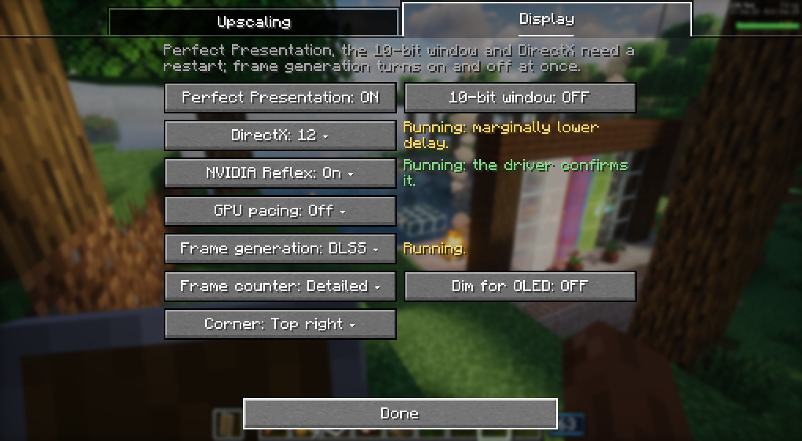

# Ray Reconstruction 1 on the RTX 4080 SUPER: step 0 passes, Ray Reconstruction crashes on its first frame

A PC session on 2026-10-27, 16:10–16:37, run by a Claude Code session in `C:\Users\coolm\Documents\Claude\MC-CREATE`
(`$T`), with Emre at the keyboard.
- **What it followed:** "Ray Reconstruction 1" in `tools/dlss-testkit/PC-RUNBOOK.md` at `6e830c96`.
  - **Step 0** ran with Bridge 1.125.0 (pack 0.6.1) from `claude/fg-streamline-decides` (`88880966`), checked out
    beside the repo.
  - **Then the pilot:** Bridge 1.124.0-rr.1 (pack 0.6.0-rr.1) with the branch's test kit.
- **Setup:** Photon v1.3a + DLAA, 2560x1440 windowed (`fullscreen:false`), Max Framerate Unlimited, vsync off,
  Perfect Presentation on DirectX 12, Reflex on.
- **It stopped in step 1 at Emre's call.** Ray Reconstruction crashed the game on its first frame, with NVIDIA's dev
  DLL and again with the release one. Steps 1 (the overlay layers) to 5 did not run.

## Summary

- **Step 0, Streamline decides (pack 0.6.1): every part matches the runbook.**
  - **With FSR picked:** Streamline says yes, FSR loads, Reflex on NVAPI. The Display tab offers Off, DLSS and FSR,
    and DLSS `Switches after a restart.`
  - **After the restart:** DLSS frame generation through Streamline, Reflex through Streamline, the tab says
    `Running.`
  - **With `frameGenStreamlineSays=no`:** the forced no hands over to FSR, the hover text "reads correctly" to Emre,
    FSR turns on at once without a restart, and DLSS then drops out of the list.
  - **Asking Streamline and handing over takes 0.2–0.3 s** from the game's first `Frame generation` line to `ready`
    (1.9 s when DLSS frame generation itself loads).
- **The pilot's set-up worked.**
  - NVIDIA's two RR DLLs came from the runbook's second address (the first gave 404), with the right hashes.
  - The driver is 621.01 (RR 4.5 needs 580 or newer).
  - RR was found and set up: `DLAA: DLSS Ray Reconstruction can run, nvngx_dlssd.dll 310.9.16 (made with 310.9.16)`,
    NGX chose preset F for every mode, and the game logged `DLAA: DLSS Ray Reconstruction running at 1272x701 to
    2544x1401 (Performance, 50%), preset F, exposed colour`.
- **Then the first RR evaluate crashed the JVM, twice.**
  - The crash: `EXCEPTION_ACCESS_VIOLATION ... reading address 0x0000000000000034`, inside
    `NgxLibrary.evaluateRayReconstruction`, in code that isn't in any loaded module's list.
  - **It made no difference which DLL was used:** NVIDIA's dev DLL (step 1) and release DLL gave the same fault,
    with the same registers.
  - **Nothing in the logs warned before it:** no Bridge line, no NGX error. NGX's own RR log stops right after
    choosing the preset.
  - **The Bridge's start guard worked:** the next start logged `the game closed while DLSS was starting last time,
    so DLSS stays off (settings screen: Try again)`.
- **Emre's feedback on the Upscaling tab:** with Ray Reconstruction on, the anti-aliasing engine and the DLSS preset
  can still be clicked. They should be greyed out, with a hover saying no other upscaler can run while Ray
  Reconstruction is active.

## Step 0: Streamline decides (pack 0.6.1)

**Set-up.**
- **The Bridge.** `git worktree add --force --detach $T\fg061 origin/claude/fg-streamline-decides` (`88880966`), then
  `create-galore-bridge-1.125.0.jar` (3,259,052 bytes) in the instance in place of 1.124.0.
- **Backups.** The old settings are in `$T\rr1\*.before`: `dlaa=true` and `perfectPresentation=false`; `options.txt`
  with `fullscreen:false`, `maxFps:120`, `enableVsync:true`; Distant Horizons 32 threads. These are the same as
  Frame generation 3 left.
- **Display settings:** `dlaa=dlss`, `perfectPresentation=true`, `presenter=dx12`, `reflex=on`, `gpuPacing=off`,
  `fpsCounter=detailed`, `frameGen=fsr`.
- **`options.txt`:** `maxFps:260`, `enableVsync:false`.

**NVIDIA's driver override in part a.** Part a started with NVIDIA's global Frame Generation override still on
Preset B (Emre's own setting since Frame generation 3).
- So Streamline read `SL_DLSS_OVERRIDE DRS key (global profile): 1` and loaded NVIDIA's copies of its plugins
  (same version, 2.14.16) in place of ours. That shows as five `Ignoring plugin` WARN lines.
- Emre then set every override to "Use 3D app setting". Parts b and c ran with the override off (`... : 0`) and our
  own plugins. He chose to keep part a as it was.

| part | start | lines (time) | first `Frame generation` line → `ready` |
| --- | --- | --- | --- |
| a | FSR picked (16:12) | `Frame generation: Streamline says NVIDIA DLSS Frame Generation runs on this card` (16:12:44.094); `Frame generation: AMD FSR 3.1 frame generation (FidelityFX SDK 2.0.0) from ...\fidelityfx-2.0.0, on` (.108); `Frame generation: ready in the DirectX 12 presenter on NVIDIA GeForce RTX 4080 SUPER, on` (.394); `Reflex: started on Perfect Presentation's DirectX 12 device (NVIDIA NVAPI)` (16:12:57.787) | 0.30 s |
| b | after the restart, `frameGen=dlss` (16:16) | `Streamline says ... runs on this card` (16:17:02.746); `Frame generation: NVIDIA DLSS Frame Generation through Streamline 2.14.16 from ...; nvngx_dlssg.dll 310.9.16 (tested with 310.9.16) ...` (.749); `Frame generation: ready in the DirectX 12 presenter on NVIDIA GeForce RTX 4080 SUPER, on; Reflex goes through Streamline` (16:17:04.606); `Reflex: started through Streamline, as DLSS Frame Generation needs (Streamline, low latency available, latency report available)` (16:17:17.925) | 1.86 s (DLSS frame generation loads) |
| c | `frameGenStreamlineSays=no` (16:19) | `Frame generation: Streamline says NVIDIA DLSS Frame Generation can't run here: frameGenStreamlineSays=no in the settings file (testing)` (16:19:53.979); `Frame generation: NVIDIA's can't run (Streamline says no); AMD's loads instead, off` (.981); `Frame generation: AMD FSR 3.1 frame generation (FidelityFX SDK 2.0.0) from ..., off until turned on` (.990); `Frame generation: ready in the DirectX 12 presenter on NVIDIA GeForce RTX 4080 SUPER, off` (16:19:54.195); `Reflex: started on Perfect Presentation's DirectX 12 device (NVIDIA NVAPI)` (16:20:05.705) | 0.22 s |

The times are measured from the Bridge's first `Frame generation` line. Streamline's own log starts about 2 s earlier
(16:12:42, 16:17:01, 16:19:52), because its first lines reach the game log in a batch. Under Wine the whole hand-over
took about 0.6 s.

- **a. FSR picked: matches.**
  - In `dlaa-test` FSR frame generation ran: `running, 2 frames shown per rendered one (most it can generate: 1,
    smallest size 0)`.
  - Picking DLSS logged `Frame generation: off, turned off` and `turned off`.
  - Emre: "Yep, it allowed me to pick off DLSS or FSR, and it said switches after a restart."
- **b. DLSS after the restart: matches.**
  - `running, 2 frames shown per rendered one (most it can generate: 1, smallest size 100)` in the world.
  - Emre: "Yep, it says running." (His screenshot is below.)
- **c. Streamline says no: matches.**
  - Emre: "DLSS stays, but when I hover, it says that it cannot start. Everything reads correctly. Then when I switch
    to FSR, it applies immediately and the option for DLSS is no longer in the dropdown."
  - He picked FSR from the main menu, before the world: `Frame generation (native): FSR frame generation 3.1.5 at
    2544x1401`, `Frame generation: turned on`, `off, no world`.
- **d.** The `frameGenStreamlineSays` line was removed and the extra checkout taken away (`git worktree remove`).
- **WARN lines.**
  - Part a: the five `Ignoring plugin` lines (the override, above).
  - Part b: Streamline's usual start-up WARN lines (9x `Frame rate over 100.00ms, reseting frame timer`, and one each
    of `Invalid backbuffer resource extent`, `unsupported alignment` and `167 log lines dropped`).
  - Part c: none.
  - Each start also had `something registered texture irons_lib:steve off the render thread` (harmless, every
    session).

## The pilot's update

- **Jars:** `create-galore-bridge-1.124.0-rr.1.jar` (3,271,609 bytes) and the branch's test kit (56,850 bytes, new
  since Frame generation 3).
- **NVIDIA's RR DLLs.**
  - `https://media.githubusercontent.com/media/NVIDIA/DLSS/v310.9.16/...` gave **404** for both.
  - The runbook's other address, `https://github.com/NVIDIA/DLSS/raw/v310.9.16/lib/Windows_x86_64/{rel,dev}/nvngx_dlssd.dll`,
    worked.
  - Both hashes match the runbook: release 48,343,664 bytes `B49435AE...6CEE`, dev 93,504,624 bytes `C81BBF92...2120`.
- **Driver:** `nvidia-smi` reports 621.01.
- **Display settings for steps 1–3:** `dlaa=dlss`, `dlaaPreset=default`, `perfectPresentation=true`,
  `presenter=dx12`, `reflex=on`, `gpuPacing=off`, `fpsCounter=detailed`, `frameGen=off`, `frameGenType=dlss`.
- **`options.txt`:** `fullscreen:false`, `maxFps:260`, `enableVsync:false`.

## Step 1: Ray Reconstruction starts, then crashes the game

- **Dev DLL (16:24 launch).**
  - DLSS frame generation was loaded and off (`ready ..., off; Reflex goes through Streamline`).
  - In the Upscaling tab Emre turned Ray Reconstruction on, at Performance: `DLAA: DLSS Ray Reconstruction asked for
    (dev build): preset F, exposed colour, left noisy for it: rough reflections, soft shadows` (16:27:54), and `DLAA:
    on for this shader pack, engine dlss, DLSS preset K (set to default), upscaling from 50% of the window`.
  - Opening `dlaa-test`:
    - **NGX loaded our DLL:** `feature dlssd snippet: ...\create-galore-dlss/nvngx_dlssd.dll version: 310.9.16`, then
      `Built with APP_NAME = app_transformer_dlssd`.
    - `DLAA: DLSS Ray Reconstruction can run, nvngx_dlssd.dll 310.9.16 (made with 310.9.16)` (16:28:02.717).
    - **NGX chose preset F for every mode:** `NgxRayReconstruction::FillCreationParams ... Info: (DLAA) Using Default
      Overriden Preset Preset_F`, and the same for Quality, Balanced, Perf, UltraPerf and UltraQuality.
    - `DLAA: DLSS Ray Reconstruction running at 1272x701 to 2544x1401 (Performance, 50%), preset F, exposed colour`
      (16:28:04.808).
  - **Then the game crashed (16:28:04),** on the first frame RR was evaluated.
- **The crash** (`hs_err_pid33596.log`, on the PC in `$T\rr1\crash1`):
  - `EXCEPTION_ACCESS_VIOLATION (0xc0000005) at pc=0x00007ffffa77afe2`, `reading address 0x0000000000000034`, on the
    `Render thread`, `_thread_in_native`.
  - **The crashing address isn't in any module Java lists.** That fits code NGX maps in itself, i.e. NVIDIA's
    `nvngx_dlssd.dll`. Our `cg_ngx-*.dll` isn't in the list either.
  - Registers: `RAX=1`, `RBX=0`, `RSI=0`, `RDI=0`. That is a field at offset 0x34 read through a null pointer.
  - Java frames, from the top: `LibFFI.nffi_call` < `bridge.present.Ffi.call` <
    `bridge.dlss.NgxLibrary.evaluateRayReconstruction(J[JFFFFF[F[FZII)I` < `Dlss.lambda$runRayReconstruction$4` <
    `DlssPass.copyAndEvaluate` < `Dlss.runRayReconstruction` < `Dlss.afterPass` < Iris
    `CompositeRenderer.renderAll` < `IrisRenderingPipeline.finalizeLevelRendering` < `LevelRenderer.renderLevel`.
  - **NGX's RR log** (`nvngx_dlssd_310_9_16.log`) ends with the preset lines. NGX logged no error or warning.
  - The Bridge's start guard left `dlss-starting.txt` ("DLSS started at ... and had not run 120 frames yet").
- **With the release DLL (16:31 launch), at Emre's OK** (not in the runbook; step 1's overlay can't be done without
  RR running anyway).
  - The start logged `DLAA: the game closed while DLSS was starting last time, so DLSS stays off (settings screen: Try
    again)`.
  - Emre pressed Try again, with RR on at Performance. The same lines followed (16:34:23): `can run`, then `running
    at 1272x701 to 2544x1401 (Performance, 50%), preset F, exposed colour`.
  - **The same crash** (`hs_err_pid32792.log`, in `$T\rr1\crash2`): `reading address 0x0000000000000034`, the same
    registers (`RAX=1`, `RBX=0`, `RSI=0`, `RDI=0`), the same Java frames.
  - **So it isn't NVIDIA's dev overlay.** RR can't get past its first evaluate on this build.
- **Not checked:**
  - Whether plain DLSS K (Ray Reconstruction off) runs on the pilot build. On both launches the first frame in the
    world was RR's.
  - The overlay layers, steps 2–5, the Upscaling tab's hover texts for the new row, and the status line.
- **Emre on the Upscaling tab** (a UX point, regardless of the crash): "when you turn Ray Reconstruction on, you're
  still able to click the anti-aliasing settings, like FSR, DLSS, Super Resolution, Preset ... Those should get
  grayed out. Ray Reconstruction takes over the upscaling stack as well in a single model ... when Ray Reconstruction
  is on, the other modes ... get grayed out, and if you hover them, it says that while Ray Reconstruction is active,
  no other upscaler can run."
- **An aside from step 0b's log:** at a plain DLSS start (16:18:14, Bridge 1.125.0, no RR DLL in the instance), NGX
  also loads the driver's built-in RR: `ngx-builtins/nvngx_dlssd.dll`, `Build v310.9.0`, `APP_NAME =
  ngx_driver_builtin`. There's a driver fallback RR, 310.9.0, alongside the SDK's 310.9.16.

## Choices that aren't in the runbook

- **`frameGenType=dlss` for steps 1–3.** The runbook sets `frameGen=off` and says nothing about `frameGenType`, which
  part c had left on `fsr`. `dlss` makes DLSS frame generation the loaded one, so step 3's "turns on at once" would
  hold.
- **Part a ran with NVIDIA's Frame Generation override on** (see step 0); parts b and c without.
- **The release DLL was tried in step 1** after the dev DLL crashed, at Emre's OK.
- **The PresentMon helper for step 4.**
  - `$T\profiling\scripts\rr1-pm.ps1` (Frame generation 3's helper for T1 and T2) was started elevated at 16:11
    (Emre clicked the prompt).
  - It wasn't needed and was stopped with its stop file at 16:36.

## Afterwards

- **Settings put back.**
  - `create_galore_bridge-display.properties`, `options.txt`, `DistantHorizons.toml`, `iris.properties`, `fml.toml` and
    `sodium-options.json` were copied back from `$T\rr1\*.before`, and each was checked with `cmp`.
  - That leaves frame generation off, Perfect Presentation off, windowed, 120 fps cap with vsync. The test kit's json
    was deleted.
- **Cleaned out of the instance:**
  - the start guard's `dlss-starting.txt` (moved to `$T\rr1\crash2`), so the next start doesn't keep DLSS off;
  - NVIDIA's `nvngx_dlssd.dll`. NVIDIA's DLLs stay in `$T\rr1`, never in the repo.
- **The instance keeps the pilot Bridge 1.124.0-rr.1 and its test kit.** Ray Reconstruction is off in the restored
  settings.
- **NVIDIA app:** all overrides on "Use 3D app setting" (Emre, during step 0).
- **What stays on the PC, in `$T\rr1`:**
  - both crash files (`crash1\`, `crash2\`), each with its game log, the log's last 100 lines and NGX's logs. They
    name the user folder, so they aren't committed;
  - the game logs of step 0 and the Streamline logs;
  - Emre's screenshot, and the session notes.

What comes of it: the pilot doesn't run yet. The crash is on the Bridge side's first `evaluateRayReconstruction`, a
null read inside NGX's RR. A likely place to look is an input the RR evaluate needs that came through as null (one of
the guides, or the specular motion vectors we don't hand over).
