# Ray Reconstruction 2: Ray Reconstruction runs on DirectX 12, beside frame generation too

A PC session on 2026-10-27, 17:33–18:01, run by a Claude Code session in `C:\Users\coolm\Documents\Claude\MC-CREATE`
(`$T`).
- **What it followed:** "Ray Reconstruction 2" in `tools/dlss-testkit/PC-RUNBOOK.md` at `f3c69b58`, with the dev
  build Bridge 1.125.0-rr.2 (pack 0.6.1-rr.2) and that commit's `rr-probe.exe` and `cg_ngx.dll`.
- **Part 1** (the probe) ran on its own; **part 2** with Emre at the keyboard.
- **Not run:**
  - **part 3** (timed runs and pictures);
  - **step c's by-eye and by-feel comparisons.**
  - Both were skipped at Emre's call, until the two black guide views below are fixed or shown to be right.
- NVIDIA's DLLs are the ones Ray Reconstruction 1 fetched. The NVIDIA app had no overrides on.

## Summary

- **Ray Reconstruction runs in the game.** On its own DirectX 12 device, RR got past the first frame that crashed
  every DirectX 11 attempt, and kept running: `DLAA: DLSS Ray Reconstruction running at 1280x720 to 2560x1440
  (Performance, 50%), preset F, exposed colour`. Emre: "Yep, the image looks sane, definitely."
- **Part 1, the probe:** exactly as the runbook expects. RR and DLSS through the Bridge's own `cg_ngx.dll` run
  (`dll-d3d12-game` OK, output mean 0.4964 release / 0.4961 dev; `dll-d3d12-dlss` OK, 0.4982). The DirectX 11 RR
  variants crash as in Ray Reconstruction 1b.
- **NVIDIA's debug overlay has 11 views. Nine look right:** colour, motion vectors (as colours and as arrows),
  depth, diffuse albedo, specular albedo, normals, roughness and jitter.
- **Two views are black, and are reported for a fix:**
  - **The likely specular hit distance:** black everywhere, the sky included, with only faint blue lines along some
    block edges. The runbook expects it bright far away and white on the sky.
  - **The likely specular motion vectors:** pure black. We don't hand those over, so that is as expected.
  - **Emre's call:** test performance and feel only once these are fixed or shown to be right, "because we're not
    seeing ray reconstruction at its best."
- **NVIDIA's notice text is drawn upside down.** "DLSSD SDK - DO NOT DISTRIBUTE - CONTACT NVIDIA TO OBTAIN DLL FOR
  YOUR TITLE" appears flipped top to bottom at the top right. So NGX sees the picture's rows in the opposite order from
  the screen. The views themselves look the right way up.
- **Switching RR off and on works,** in about 2 s each way. Off moves DLSS to DirectX 11 and closes the DirectX 12
  device; on goes back. Emre: "They both came back right, and neither hitch was unreasonably long."
- **RR beside Perfect Presentation and DLSS frame generation works:** two DirectX 12 users at once (Streamline's
  presenter and RR's own device).
  - The log: `Frame generation: running, 2 frames shown per rendered one` with `Ray Reconstruction running at ...`.
  - Emre: "frame generation is definitely running. I noticed nothing odd. The game looks stable. Visually it looks
    good." The NVIDIA overlay showed double the game's counter.

## Set-up

- **Jars:** `create-galore-bridge-1.125.0-rr.2.jar` (3,288,271 bytes) and the test kit (56,850 bytes, unchanged).
- **Backups:** everything the runbook lists, copied to `$T\rr2\*.before`. That now includes the shader pack's options
  file `shaderpacks\Photon v1.3a + DLAA.txt`, which held the original full-resolution setting (TAAU off).
- **PresentMon helper for part 3:** started elevated at 17:35 (Emre clicked the prompt), and stopped unused with its
  stop file at 17:59.

## Part 1: the probe

Run as written, about 24 s each. `cg_ngx.dll` (238,080 bytes) came from the branch's resources.

**Release DLL** (`summary.txt`, whole; the paths are under `$T`):

```
rr-probe: DLSS Ray Reconstruction alone, nvngx DLLs from $T\rr2\rel
d3d11-dlss               OK: ran 3 frames; output red mean 0.4977 over 2544x1401, 0 pixels not finite
d3d11-game               CRASHED at: evaluate frame 1; code 0xC0000005 at 00007FF8156C0EA2, reading address 0000000000000034 ($T\rr2\rel\nvngx_dlssd.dll)
d3d11-no-hit-distance    CRASHED at: evaluate frame 1; code 0xC0000005 at 00007FF8156C0EA2, reading address 0000000000000034 ($T\rr2\rel\nvngx_dlssd.dll)
d3d11-roughness-apart    CRASHED at: evaluate frame 1; code 0xC0000005 at 00007FF8156C0EA2, reading address 0000000000000034 ($T\rr2\rel\nvngx_dlssd.dll)
d3d11-own-parameters     CRASHED at: evaluate frame 1; code 0xC0000005 at 00007FF8156C0EA2, reading address 0000000000000034 ($T\rr2\rel\nvngx_dlssd.dll)
d3d11-even-size          CRASHED at: evaluate frame 1; code 0xC0000005 at 00007FF8156C0EA2, reading address 0000000000000034 ($T\rr2\rel\nvngx_dlssd.dll)
d3d11-level-11-1         CRASHED at: evaluate frame 1; code 0xC0000005 at 00007FF8156C0EA2, reading address 0000000000000034 ($T\rr2\rel\nvngx_dlssd.dll)
d3d12-dlss               OK: ran 3 frames; output red mean 0.4977 over 2544x1401, 0 pixels not finite
d3d12-game               OK: ran 3 frames; output red mean 0.4964 over 2544x1401, 0 pixels not finite
dll-d3d12-dlss           OK: ran 3 frames; output red mean 0.4982 over 2544x1401, 0 pixels not finite
dll-d3d12-game           OK: ran 3 frames; output red mean 0.4964 over 2544x1401, 0 pixels not finite
```

**Dev DLL** (`summary.txt`, whole):

```
rr-probe: DLSS Ray Reconstruction alone, nvngx DLLs from $T\rr2\dev
d3d11-dlss               OK: ran 3 frames; output red mean 0.4977 over 2544x1401, 0 pixels not finite
d3d11-game               CRASHED at: evaluate frame 1; code 0xC0000005 at 00007FFFFA77AFE2, reading address 0000000000000034 ($T\rr2\dev\nvngx_dlssd.dll)
d3d11-no-hit-distance    CRASHED at: evaluate frame 1; code 0xC0000005 at 00007FFFFA77AFE2, reading address 0000000000000034 ($T\rr2\dev\nvngx_dlssd.dll)
d3d11-roughness-apart    CRASHED at: evaluate frame 1; code 0xC0000005 at 00007FFFFA77AFE2, reading address 0000000000000034 ($T\rr2\dev\nvngx_dlssd.dll)
d3d11-own-parameters     CRASHED at: evaluate frame 1; code 0xC0000005 at 00007FFFFA77AFE2, reading address 0000000000000034 ($T\rr2\dev\nvngx_dlssd.dll)
d3d11-even-size          CRASHED at: evaluate frame 1; code 0xC0000005 at 00007FFFFA77AFE2, reading address 0000000000000034 ($T\rr2\dev\nvngx_dlssd.dll)
d3d11-level-11-1         CRASHED at: evaluate frame 1; code 0xC0000005 at 00007FFFFA77AFE2, reading address 0000000000000034 ($T\rr2\dev\nvngx_dlssd.dll)
d3d12-dlss               OK: ran 3 frames; output red mean 0.4977 over 2544x1401, 0 pixels not finite
d3d12-game               OK: ran 3 frames; output red mean 0.4961 over 2544x1401, 0 pixels not finite
dll-d3d12-dlss           OK: ran 3 frames; output red mean 0.4982 over 2544x1401, 0 pixels not finite
dll-d3d12-game           OK: ran 3 frames; output red mean 0.4961 over 2544x1401, 0 pixels not finite
```

Every `dll-` and `d3d12-` variant is `OK`, so there are no failed lines to list.

## Part 2: in the game

The settings for all of part 2: `dlaa=dlss`, `dlaaPreset=default`, `dlaaRayReconstruction=true`, `reflex=on`,
`gpuPacing=off`, `fpsCounter=detailed`. `options.txt`: `fullscreen:false`, `maxFps:260`, `enableVsync:false`. 2560x1440,
windowed.

### a. RR on its own (dev DLL, `perfectPresentation=false`, `frameGen=off`): runs

- **Start (17:36).** `Reflex: can't run, it needs Perfect Presentation, which starts after a restart` (WARN, expected
  with Perfect Presentation off).
- **Performance in the Upscaling tab:** `DLAA: DLSS Ray Reconstruction asked for (dev build): preset F, exposed
  colour, left noisy for it: rough reflections, soft shadows`, then `DLAA: on for this shader pack, engine dlss, DLSS
  preset K (set to default), upscaling from 50% of the window` (17:37:48).
- **In `dlaa-test`:**
  - `DLAA: DLSS Ray Reconstruction can run, nvngx_dlssd.dll 310.9.16 (made with 310.9.16)` (17:37:58.405);
  - `DLAA: NGX ready on NVIDIA GeForce RTX 4080 SUPER (its own DirectX 12 device, for Ray Reconstruction; OpenGL on
    NVIDIA GeForce RTX 4080 SUPER/PCIe/SSE2), nvngx_dlss.dll 310.9.16 from ...` (.406);
  - `DLAA: DLSS Ray Reconstruction running at 1280x720 to 2560x1440 (Performance, 50%), preset F, exposed colour`
    (17:38:00.662). This window was 2560x1440, against Ray Reconstruction 1's 2544x1401.
  - **No crash.** The start guard's marker was cleared once RR had run.
  - Emre on the picture: "Yep, the image looks sane, definitely."
  - The tab's status line wasn't read out word for word.
- **NVIDIA's debug overlay** (CTRL+ALT+F12, full screen with CTRL+ALT+F11), at the lakeshore, with F2 screenshots.
  - F2 does capture the views. The HUD always sits on top, because the game draws it after RR.
  - The dev DLL's order isn't the runbook's list, so each view was judged by what it shows.

| # | view | what it shows | right? |
| --- | --- | --- | --- |
| 1 | colour (RR's input) | the lit scene; live, "the world is just jittering aggressively" (Emre), which is the input's per-frame jitter | yes |
| 2 | motion vectors, as colours | all black standing still; turning, smooth sweeps of colour over the whole picture, the held item and hand dark (no screen motion) | yes |
| 3 | motion vectors, as arrows | white dots with short lines along the turn over the picture, dots without lines on the held item. Emre: "It doesn't appear to be depth. Instead, I'm seeing a whole bunch of dots across the screen." | yes |
| 4 | depth | hand black, near ground and wall blue, then purple to pink further back, white specks of sky | yes, the right way up |
| 5 | diffuse albedo | textures without light or shadow (darker than the game's picture, probably raw linear values), glass and water edges bright, torches in their own colours. Emre: "the sky is gray as expected." | yes |
| 6 | specular albedo | almost black, brighter on the iron bars and chain and on the water at a grazing angle | yes |
| 7 | normals | one flat colour per face: everything facing up green (the whole floor one colour), sides red or blue, faces pointing the other way black | yes |
| 8 | roughness | water and glass black (smooth), stone, dirt, wood and leaves light grey to white (rough). The sky wasn't in view | yes |
| 9 | most likely the **specular hit distance** | black everywhere, sky and near water too ("it's just pitch black", Emre), with faint blue lines along some block edges (under 0.1% of pixels) | **no**: expected bright far away and a white sky |
| 10 | most likely the **specular motion vectors** | pure black | as expected (not handed over) |
| 11 | jitter | a cloud of white points in the middle rectangle, one green (this frame), none yellow. Looking straight up the points glow ("They light up a lot when I look directly up", Emre), because Photon's exposure and bloom run after RR on the overlay too | yes |

One more press turned the overlay off.

| colour | motion (still) | motion (turning) | motion arrows |
| --- | --- | --- | --- |
| 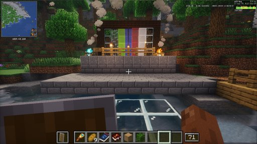 | 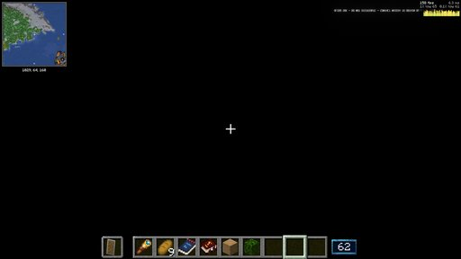 | 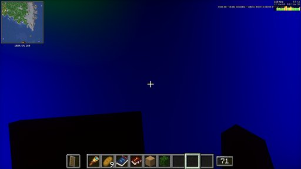 | 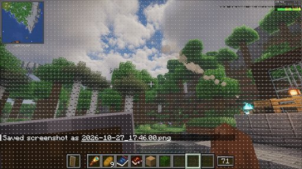 |

| depth | diffuse albedo | specular albedo | normals |
| --- | --- | --- | --- |
| 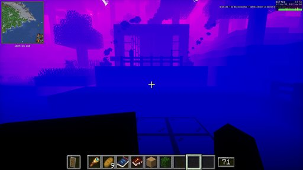 | 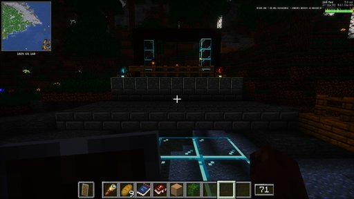 | 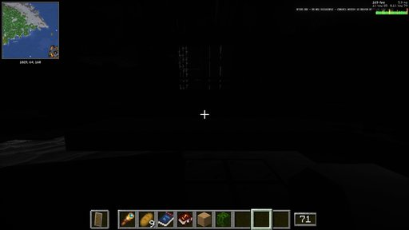 | 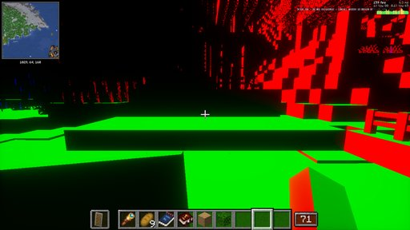 |

| roughness | 9: black, edge lines | 10: black | jitter |
| --- | --- | --- | --- |
| 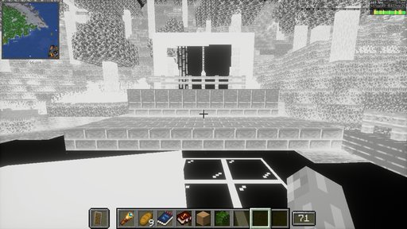 | 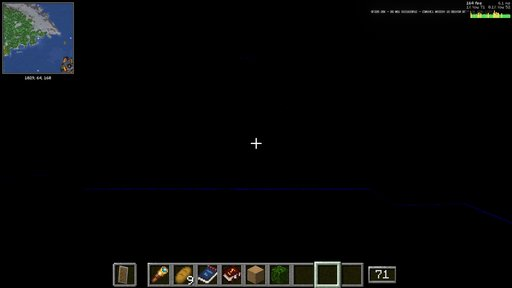 | 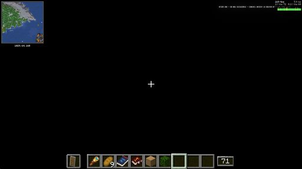 | 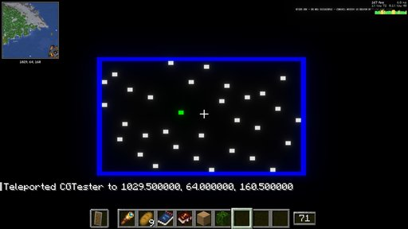 |

**NVIDIA's notice, upside down** (top right of every frame, at full size):

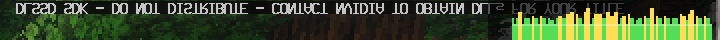

- **What it shows:** the text NGX draws reaches the screen flipped top to bottom. So NGX's idea of up is the screen's
  down. That fits OpenGL counting rows from the bottom and DirectX from the top.
- **Why it might matter:** it changes nothing for plain DLSS. For RR it could matter wherever up and down count, for
  example the hit distance's two matrices or the sign of vertical motion. Worth checking together with the black hit
  distance.

### b. Switching: works

| switch | lines (time) | Done → running |
| --- | --- | --- |
| RR off | `DLAA: DLSS starts again on DirectX 11` (17:55:48.208); `DLAA: closed its DirectX 12 device` (.325); `NGX ready on ... (its own DirectX 11 device; ...)` (17:55:49.901); `DLAA: DLSS running at 1280x720 to 2560x1440 (Performance, 50%), preset K, the pack's exposure` (17:55:50.435) | 2.2 s |
| RR on | `DLAA: DLSS starts again on DirectX 12, for Ray Reconstruction` (17:56:11.951); `DLAA: closed its DirectX device` (12.063); `NGX ready on ... (its own DirectX 12 device, for Ray Reconstruction; ...)` (13.726); `DLAA: DLSS Ray Reconstruction running at 1280x720 to 2560x1440 (Performance, 50%), preset F, exposed colour` (13.947) | 2.0 s |

Emre: "Yep. They both came back right, and neither hitch was unreasonably long."

### c. With Perfect Presentation and frame generation (release DLL): runs

- **Settings:** `perfectPresentation=true`, `presenter=dx12`, `frameGen=dlss`, `frameGenType=dlss`.
  - While Perfect Presentation was off, the Bridge had saved `presenter=dx11` and `dlaaRrPreset=F`. I removed both,
    so the file matches the runbook.
- **Start (17:57).**
  - `Frame generation: Streamline says NVIDIA DLSS Frame Generation runs on this card` (17:57:46.010);
  - `Frame generation: NVIDIA DLSS Frame Generation through Streamline 2.14.16 from ...` (.013);
  - `Frame generation: ready in the DirectX 12 presenter on NVIDIA GeForce RTX 4080 SUPER, on; Reflex goes through
    Streamline` (17:57:47.863);
  - `Reflex: started through Streamline, as DLSS Frame Generation needs (...)` (17:57:59.615).
- **In `dlaa-test`:**
  - `DLAA: DLSS Ray Reconstruction can run ...` (17:58:56.963);
  - `NGX ready on ... (its own DirectX 12 device, for Ray Reconstruction; ...)` (.964);
  - `DLAA: DLSS Ray Reconstruction running at 1280x720 to 2560x1440 (Performance, 50%), preset F, exposed colour`
    (17:59:00.573);
  - **`Frame generation: running, 2 frames shown per rendered one (most it can generate: 1, smallest size 100)`**
    (17:59:04.516).
- **Stable.** No crash. The only WARN lines were Streamline's usual start-up ones (`Frame rate over 100.00ms,
  reseting frame timer`, `unsupported alignment`).
- Emre: "Yep, frame generation is definitely running. I noticed nothing odd. The game looks stable. Visually it looks
  good." The NVIDIA overlay read double the game's counter.
- **Ray Reconstruction 1's steps 2 and 3** (by eye and by feel, and the frame generation numbers) were skipped, at
  Emre's call (below).

## Part 3: not run

Emre: "I don't want to do the performance profiling because it takes a while before ... the two black ones. Either
they're proven to look like that, or they're fixed, because they might affect the performance and the by-feel test,
because we're not seeing ray reconstruction at its best. So once our checks are done here, I think we can skip the
performance tests and just send the report back for the fix."

## Afterwards

- **Every file from `$T\rr2\*.before` was put back and checked with `cmp`:**
  - `create_galore_bridge-display.properties`, `options.txt`;
  - `DistantHorizons.toml`, `iris.properties`, `fml.toml`, `sodium-options.json`;
  - the shader pack's options file.
- **NVIDIA's `nvngx_dlssd.dll` was removed from the instance.** The test kit's json was deleted.
- **The instance keeps** the pilot Bridge 1.125.0-rr.2. Ray Reconstruction is off in the restored settings.
- **On the PC in `$T\rr2`:** the probe outputs with NGX's logs, the game and Streamline logs of part 2, the full-size
  screenshots and the session notes. NVIDIA's DLLs stay in `$T\rr1`.

What comes of it: RR runs, alone and beside frame generation, so the pilot is at the start Ray Reconstruction 1
meant. Before judging the look and the cost, two things want checking on the Bridge side:
- the specular hit distance arriving black, sky included;
- the upside-down rows NGX sees.
