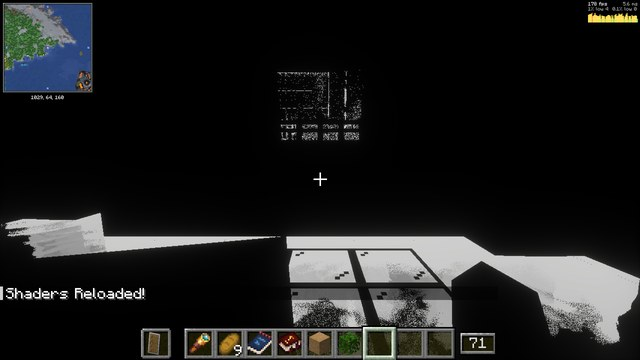
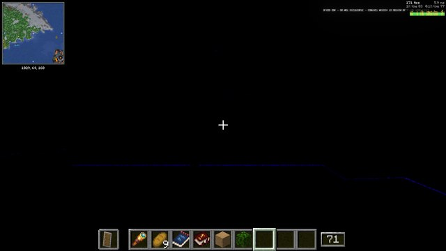
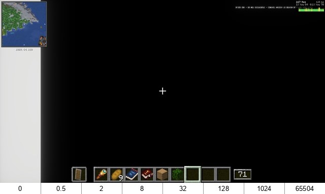
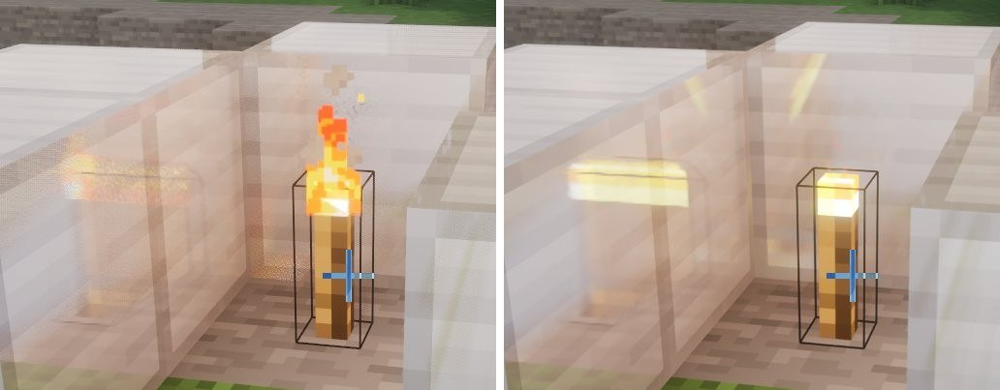
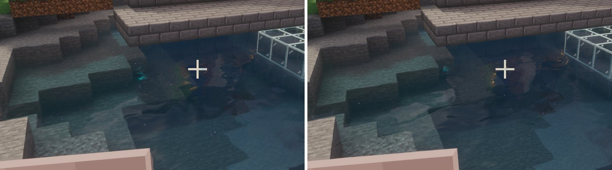
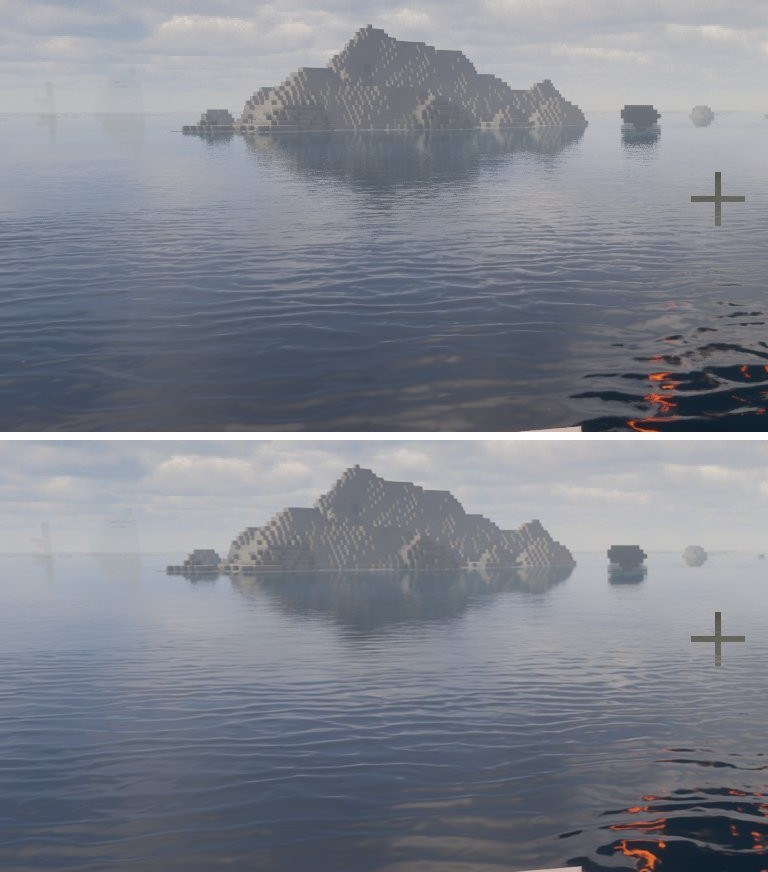
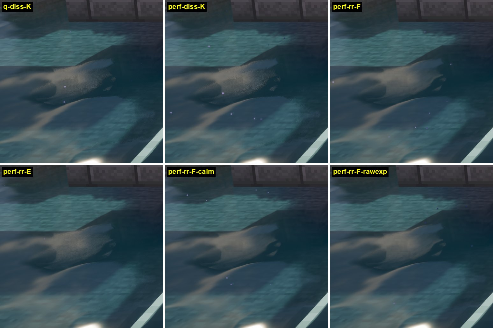
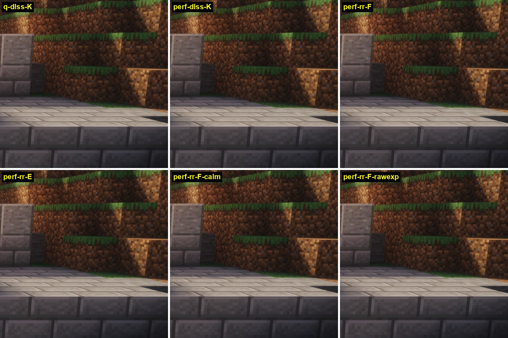
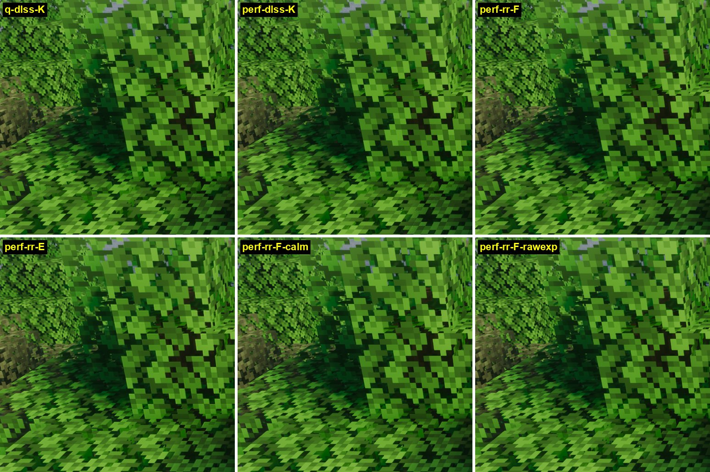
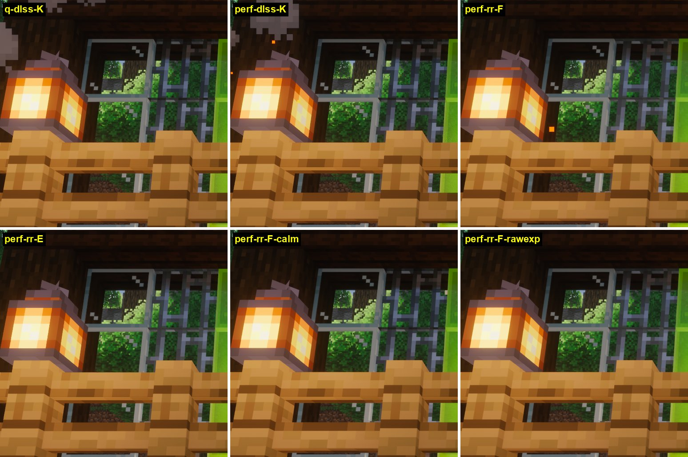

# Ray Reconstruction 2b: the hit distance guide arrives, RR looks much better, and RR off breaks frame generation

A PC session on 2026-10-27, 18:31–19:30, run by a Claude Code session in `C:\Users\<user>\Documents\Claude\MC-CREATE`
(`$T`).
- **What it followed:** "Ray Reconstruction 2b" in `tools/dlss-testkit/PC-RUNBOOK.md` at `d79d2cf5`, with the dev
  build Bridge 1.125.0-rr.3 (pack 0.6.1-rr.3).
- **Parts 1 and 2** ran with the player at the keyboard; **part 3** on its own.
- **Not run, both because of the frame generation bug below:**
  - Ray Reconstruction 1's **step 3** (RR Performance against DLSS Quality with frame generation);
  - part 3's **second timed launch** (T2, with frame generation). The player chose to skip it.
- NVIDIA's DLLs are the ones Ray Reconstruction 1 fetched. The NVIDIA app had no overrides on.

## Summary

- **The hit distance guide arrives.** The test bands show NVIDIA's overlay draws hit distance on a very short scale:
  - white at 0 blocks;
  - a faint shade at 0.5;
  - black from 2 blocks on, and black for 65504 ("no hit").
  - So Ray Reconstruction 2's all-black view was the overlay's scale, not a missing guide. By the runbook's reading,
    go on to part 2.
- **By eye, the player rates RR far ahead of DLSS on lighting and reflections**, at the cost of slightly softer distant
  geometry he doesn't notice in play:
  - "Lighting is just beautifully crisp." The player's shadow is "crystal sharp", with "no jitter in it".
  - Water reflections go from a "dotty mess" to "like a glass", and an island's reflection far out is now "actually
    on the water".
  - A torch between iron blocks: "pin drop sharp", embers included, where DLSS smeared it into dots.
  - At Quality, RR becomes "set it and forget it". At Performance there is still "some flicker sometimes in distant
    geometry".
  - "If it turns out that it's not ridiculously expensive for the GPU, I would literally use this even with Photon."
- **Bug: turning RR off while DLSS frame generation runs breaks frame generation, and the second time it crashed the
  game.**
  - **First time:** Streamline's NGX calls for frame generation failed on every frame
    (`NGX evaluate feature failed 0xbad00004`, then `NGX create feature failed 0xbad0000b`) until RR came back on.
  - **Second time:** a GPU fence timeout and a frame generation worker thread timeout, then a freeze and a hard crash.
    No Java crash report.
  - **Likely cause:** closing RR's DirectX 12 NGX takes Streamline's NGX state with it.
  - With frame generation off, RR switched on and off 8 more times by hand, and 4 more in part 3's runs, without a
    problem.
- **Cost (part 3, T1, frame generation off, 2544x1401).** RR adds GPU time in step with the render resolution:
  - +0.8 ms over DLSS at Performance (13–14% fewer frames);
  - +1.7 ms at Quality (24% fewer);
  - +4.1 ms at full resolution (39% fewer).
  - **RR Performance comes about 7% short of DLSS Quality:** 174 against 187 fps at `shore`, 166 against 179 at
    `canopy`.
- **Pictures (part 3, step 5):**
  - RR Performance shimmers no more than DLSS, and leaves less residue after a flick at 3 of 4 viewpoints.
  - On water it draws the reflection smooth where DLSS shows grain.
  - Preset E is the steadiest on the numbers, but keeps more grain on water than F.

## Set-up

- **Branch:** `claude/project-thread-u2wmhh` at `d79d2cf5`.
- **Jars:** `create-galore-bridge-1.125.0-rr.3.jar` (3,288,766 bytes) and the test kit (56,850 bytes, unchanged).
- **Backups:** everything the runbook lists, copied to `$T\rr2b\*.before`, including the shader pack's options file.
  All matched Ray Reconstruction 2's backups (the originals).
- **PresentMon helper for part 3:**
  - `$T\profiling\scripts\rr2b-pm.ps1`, a copy of Ray Reconstruction 2's helper writing to `$T\rr2b`;
  - started elevated at 18:32 (the player clicked the prompt).

## Part 1: the hit distance

- **Settings as written:**
  - `dlaa=dlss`, `dlaaPreset=default`, `dlaaRayReconstruction=true`, `perfectPresentation=false`, `frameGen=off`,
    `fpsCounter=detailed`;
  - windowed, 260 fps cap, no vsync;
  - the dev DLL in the instance.
- **Render resolution** set to Performance in the shader pack's options file (`TAAU=true`, `TAAU_RENDER_SCALE=0.50`),
  the same values the Upscaling tab wrote in Ray Reconstruction 2.
- **Start:** `DLAA: DLSS Ray Reconstruction running at 1280x720 to 2560x1440 (Performance, 50%), preset F, exposed
  colour` (18:34:19.196), at the lakeshore.

### a. The pack's guide, through the Bridge

`DLAA: on for this shader pack, debug view hit_distance (DLSS itself not used), upscaling from 50% of the window`
(18:35:21.840).

- **As the runbook expects:** most of the picture black (no hit). The water is white to light grey, noisier toward the
  bottom.
- **The glass and iron bars in the build** are speckled white.
- The player: "Taken, I see white on water".

### b. NVIDIA's view of the same guide

- **After F8:** `DLAA: DLSS Ray Reconstruction asked for (dev build): ...` (18:36:42.151). No new `running at` line
  was logged; RR kept running from before.
- **NVIDIA's two dark views** (9 and 10 in the overlay's order, full screen):
  - one is black with a few faint edge lines;
  - the other is pure black (only the crosshair).
- **Still black although a. shows white on the water.**
- The player: "I took a screenshot of the last 2 screens that were fully black".

### c. NVIDIA's view of known distances

- **After F8 with `dlaaRrTest=hit-distance-bands`:** `asked for` again (18:39:18.309).
  - Again no new `running at` line, so the line ending `test: hit distance bands ...` never appeared.
  - The bands show in the overlay, so the switch took effect.
- **NVIDIA's hit distance view, full screen** (18:40:05). The band values are written under the picture:

**Mean brightness per band** (0–255, the middle rows, from the full-size screenshot):

| band (blocks) | 0 | 0.5 | 2 | 8 | 32 | 128 | 1024 | 65504 |
| --- | --- | --- | --- | --- | --- | --- | --- | --- |
| mean | 225.3 | 11.3 | 0 | 0.2 | 0.2 | 0 | 0 | 0 |
| looks | white | a shade, 63 at its left edge fading to 0 | black | black | black | black | black | black |

- **The other dark view** (18:40:08) is 0 everywhere.
- I read the bands out to the player. He: "It matches what u say".

**Reading:** the 8th band (65504) is black like b, and the first two show shades. That is the runbook's first case:
the overlay draws "no hit" as black, and the guide is right. NVIDIA's view only shows distances under about a block,
which is why b looks black: the water's reflections hit things further away than that.

## Part 2: by eye and by feel

### With frame generation (release DLL)

- **Settings as written:** `perfectPresentation=true`, `presenter=dx12`, `reflex=on`, `gpuPacing=off`,
  `frameGen=dlss`, `frameGenType=dlss`.
- **Start (game launched 18:42:41):**
  - `Frame generation: Streamline says NVIDIA DLSS Frame Generation runs on this card` (18:43:00.832);
  - `Frame generation: ready in the DirectX 12 presenter on NVIDIA GeForce RTX 4080 SUPER, on; Reflex goes through
    Streamline` (18:43:02.814);
  - `DLAA: DLSS Ray Reconstruction running at 1280x720 to 2560x1440 (Performance, 50%), preset F, exposed colour`
    (18:44:20.766);
  - **`Frame generation: running, 2 frames shown per rendered one (most it can generate: 1, smallest size 100)`**
    (18:44:27.435).
- The player played step 2 for about 4 minutes, until he turned RR off.

### The bug: RR off breaks frame generation

**First RR off (18:48):**

| time | what happened |
| --- | --- |
| 18:48:05.774 | RR off: `DLAA: DLSS starts again on DirectX 11`, `closed its DirectX 12 device` |
| 18:48:07.739 | `DLAA: DLSS running at 1280x720 to 2560x1440 (Performance, 50%), preset K` |
| 18:48:08.624 | Frame generation on (the menu closed) |
| 18:48:08.641 on | every frame: `[sl.dlss_g] NGX evaluate feature failed 0xbad00004` (FeatureNotFound), 1,132 lines in all |
| 18:48:17.630, 18:48:18.094 | the player pressed F11 twice (`Frame generation: off, the window is resizing`): `release feature failed 0xbad00004` once |
| 18:48:17.679 on | every frame: `NGX create feature failed 0xbad0000b` (UnableToInitializeFeature), 3,459 lines in all |
| 18:48:38.176 | a screen opened (the player went to turn RR back on); the errors stop |
| 18:48:46.410 | RR running again on DirectX 12; frame generation on at 18:48:47.996, no errors |

- **The player:** "it happended once when you first saw the flood, pressing f11 twice fixed it". The log shows F11 changed
  the error, but frame generation's NGX calls kept failing on every frame until RR was back.
- **The NVIDIA overlay kept showing frame generation doubling.** The player: "also the overlay shows fg working as expected".
  So the screen still got twice the frames, but Streamline couldn't create DLSS-G's own NGX feature. What it showed
  in its place isn't known.

**Second RR off (18:49), the crash:**

| time | what happened |
| --- | --- |
| 18:49:20.157 | RR off (from the menu): `DLSS starts again on DirectX 11`, `closed its DirectX 12 device` |
| 18:49:21.764 | `DLAA: DLSS running at ... preset K` |
| 18:49:23.387 | frame generation on (the menu closed); Streamline: DLSS-G interpolation enabled |
| 18:49:24 | the pause menu (frame generation off); the world saved |
| `sl.log` 384.59 s | `d3d12.cpp:1427[waitCPUFence] Wait on gpu fence timed out after 500ms value 35432` |
| `sl.log` 390.21 s | `Worker thread 'nv.sl.dlss_g.thread.dlssg' timed out`; `dlfgPresent.cpp:1603[presentFrame] DLSS-G worker thread timed out during present` |
| 18:49:29.648 | the game log ends; the game froze, then closed |

- **No NGX error lines this time.**
- **No crash files:** no `hs_err` file, no Minecraft crash report, and no start guard file (`dlss-starting.txt`).
- The player: "um the game crashed after turning rr off".
- The game log, its last 100 lines without the error flood, the debug log's end and Streamline's log are in
  `$T\rr2b\crash1`. They name the user folder, so they aren't committed.

**Likely cause:** NGX state is shared by the whole process. When the Bridge shuts down RR's DirectX 12 NGX (its
`closed its DirectX 12 device`), it seems to take Streamline's NGX state with it:
- the first time, DLSS-G's feature was gone ("not found") and couldn't be made again;
- the second time, Streamline's DLSS-G worker hung on the GPU.

Turning RR on (DirectX 11 to 12) with frame generation on caused no errors. The problem is only RR off.

### The by-eye test, finished without frame generation

- **The player's call:** "I wanna finish the by eye, it was going good outside of this". I restarted the game at 18:52:29
  with `frameGen=off` and nothing else changed.
- **The player switched RR 8 times** in 4 minutes, at Quality (67%) and Performance (50%). Each switch took about 1.5 s
  from the menu to running, with no errors:
  - RR on at 18:54:43 (Performance), 18:55:49 (Quality), 18:56:32 (Performance) and 18:57:52 (Performance, then
    Quality);
  - RR off at 18:55:31, 18:55:58, 18:57:34 and 18:58:22.
- **Ray Reconstruction 1's step 2, by eye.** The player's verdict in his own words (lightly trimmed):

  > I did a bunch of stuff. I, you know, moved all around. I used quality. I used performance. I looked at both
  > ends. I did not expect it to look like this. Photon was just a correctness test, and so I was never expecting it
  > to look particularly better. [...] The shader pack is not even designed for it. But now using it, it is kind of
  > crazy.
  >
  > The reconstruction of the geometry, I would say, is marginally worse than pure super resolution. Super resolution
  > keeps blocks and stuff like that a bit sharper in the distance, stuff like leaves. However, Minecraft's geometry
  > is already so simple that even thin geometry like fences is not thin compared to an actual AAA style game that
  > has like wire mesh and stuff. [...] In that case, ray reconstruction's marginal weakness when it comes to
  > geometry is basically non-existent. I don't see it.
  >
  > What I do see is the improvement in the lighting and reflections. Lighting is just beautifully crisp. [...] The
  > player's shadow, I've never seen look like this. I can literally count the pixels on it. That's how crystal sharp
  > it is. And I mean that positively. I can see the quality setting of the shadow itself because it's so
  > unbelievably stable that there's no jitter in it. [...] You can literally see your graphic setting on in the
  > shadow.
  >
  > Then water. Water, any reflection on water would turn into this dotty mess. Tons of little dots that would all
  > like sit there basically. That's smoothed to perfection. Not blotchy smooth, but like water where it's meant to be
  > reflective looks like a glass now. So much reflection detail that was just getting completely eaten by preset
  > [K] is now there and sharper. So the existing detail looks better, and detail that was never originally recovered
  > is now visible. Especially what I noticed is there's this island in the world, and I could see the reflection in
  > the water in the distance of the island. Without ray reconstruction, it would be like this blocky thing where you
  > would see tons of these little pixels sprinkled all across it, almost like spray paint. Now it's actually on the
  > water. And that applies to everything. All the reflections look better.
  >
  > I put a bunch of iron blocks around and put a torch in the middle. They're facing each other. And in the non-ray
  > reconstruction version, the torch became this smeary thing, and whenever it emitted particles, like those little
  > fire embers, those smeared, and it became, again, a bunch of small dots. With ray reconstruction, it's pin drop
  > sharp. You can see that it's a torch, and you also can see particles emit from it in real time without turning
  > into blotches.
  >
  > In performance mode, you can still see some flicker sometimes in distant geometry. At quality mode, I would say
  > it's so good that [...] it kind of turns into set it and forget it. For me, if it turns out that it's not
  > ridiculously expensive for the GPU, I would literally use this even with Photon. [...] Compared to its marginal
  > loss in the quality of geometry, it gains so much more from the lighting and reflections that the overall image's
  > feel and texture far supersedes what super resolution alone can do.
  >
  > And honestly, what it leaves me thinking is how exciting it would be [...] to build a shader pack that leverages
  > the strengths of this from the very start, because ray reconstruction can squeeze so much out of the lighting.
  > It's ridiculous. As I said, in almost every lighting effect now, I am seeing the limits of what the effect itself
  > can do, presented perfectly. It truly is striking.

- **The items he didn't name** (night, the hand and HUD, the effects scene): "I checked fire and it looked great, same
  with basically everything else. This feels like a rr best case, geometry is simple in mc but shader lighting is
  intense, that's a rr dream".

**Per item, from what he said:**

| item | better | his words |
| --- | --- | --- |
| metal blocks (iron, with a torch) | RR | "pin drop sharp", embers "without turning into blotches"; DLSS: "this smeary thing" |
| shadow edges | RR | "crystal sharp", "no jitter in it" |
| water, near and far | RR | "looks like a glass now"; DLSS: "dotty mess", "spray paint" |
| effects scene (fire) | RR | "I checked fire and it looked great" |
| fast turns past leaves and fences | DLSS, slightly | DLSS keeps distant blocks and leaves "a bit sharper"; with RR he doesn't see it in play |
| night, the hand and the HUD | not singled out | "same with basically everything else" |
| Performance against Quality (RR) | Quality | Performance: "some flicker sometimes in distant geometry"; Quality: "set it and forget it" |

**The player's screenshots** (F2). These are crops at full size, DLSS on the left or top, RR on the right or bottom. Each
pair is a few seconds apart, from the same spot.

Iron blocks with a torch, Performance (DLSS 18:54:34, RR 18:54:45):

- **With RR, the torch's reflection** in the left block is a sharp bright shape. With DLSS it's an orange smear.
- **In these two frames, DLSS shows the flame's pixels and two embers.** With RR the torch's head is a bright
  white-yellow square, with no embers in the frame. The player saw embers with RR in motion; one frame can't settle it.

The pool by the effects scene, Quality (RR 18:55:52, DLSS 18:56:02; the view moved slightly):

- **DLSS:** the reflections in the water carry coloured speckles (teal and rainbow dots at the left).
- **RR:** the same reflections are smooth.

The lake and the island, Performance (DLSS 18:56:23, RR 18:56:35):

The difference is small at this size; the ripples look a little calmer with RR. The player's point about the island's
reflection is about motion: the "spray paint" pixels he describes don't show in a single frame.

### Step 3 (with frame generation): not run

Its comparison switches RR off with frame generation on (RR Performance, then RR off at Quality, then RR Balanced),
which is the bug above. Recorded as skipped.

## Part 3: timed runs and pictures

### Step 4: timed runs (T1 only, frame generation off)

- **Launch:** Ray Reconstruction 1's run `RR1`, frame generation off, the release DLL. The other settings were as part
  2 left them: Perfect Presentation on DirectX 12, Reflex on, GPU pacing off.
- **Window:** windowed, drawing 2544x1401 (`fullscreen:false`, as part 1 sets it).
- **Run:** `20261027-190930-RR1`, 19:09:30–19:13:07. It covered 8 modes, each at `shore`, then each at `canopy`, over
  the `still`, `flick`, `pan` and `strafe` paths.
- **PresentMon** (`--set_circular_buffer_size 4096`) caught all 26,940 of the run's frames, from the elevated
  helper.
- **Start lines:** all 10 RR plays logged `DLAA: DLSS Ray Reconstruction running at ...`, and all 6 DLSS plays
  `DLAA: DLSS running at ...`. No crash, and no errors.
  - The only Bridge warning was `Perfect Presentation: swap chain wait timed out`, once, while the world loaded.
- **T2 (frame generation on): not run**, at the player's choice (see the bug above).

`frametimes.py` over the camera paths. Frame ms is the median (fps = 1000 / median). GPU busy is PresentMon's
median. "Until shown" is the median time from Present to the screen.

| mode | render scale | shore fps (frame ms) | canopy fps (frame ms) | GPU busy ms (shore / canopy) | GPU-bound (shore / canopy) | until shown ms (shore / canopy) |
| --- | --- | --- | --- | --- | --- | --- |
| `dlaa-default` (DLSS K) | 100% | 160 (6.24) | 150 (6.66) | 6.00 / 6.60 | 61% / 66% | 6.96 / 8.13 |
| `dlaa-rr-F` | 100% | 97 (10.30) | 92 (10.83) | 10.34 / 10.93 | 91% / 89% | 16.58 / 17.47 |
| `q-dlss-K` | 67% | 187 (5.36) | 179 (5.59) | 5.16 / 5.53 | 62% / 70% | 5.98 / 6.61 |
| `q-rr-F` | 67% | 142 (7.03) | 136 (7.34) | 7.03 / 7.41 | 88% / 88% | 10.43 / 10.98 |
| `bal-rr-F` | 58% | 156 (6.42) | 149 (6.71) | 6.41 / 6.74 | 83% / 84% | 9.08 / 9.33 |
| `perf-dlss-K` | 50% | 201 (4.97) | 193 (5.19) | 4.78 / 5.08 | 60% / 65% | 5.19 / 5.85 |
| `perf-rr-F` | 50% | 174 (5.74) | 166 (6.02) | 5.70 / 6.03 | 79% / 80% | 7.71 / 8.04 |
| `ultra-rr-F` | 33% | 203 (4.93) | 193 (5.18) | 4.82 / 5.07 | 66% / 70% | 5.52 / 6.19 |

- **The p90 frame times** and the shown-frame intervals (median, p10, p90) are in `T1-frametimes.txt` on the PC.
  - With RR the intervals are tighter, because the GPU sets the pace: for example `q-rr-F` at shore 7.04 / 6.86 /
    7.30 ms, against `q-dlss-K`'s 5.28 / 3.78 / 7.68.
  - The present mode was Hardware Composed: Independent Flip for every frame.
- **What RR costs over DLSS at the same scale**, in frame time (GPU busy in brackets), shore / canopy:
  - 100%: +4.06 / +4.17 ms (+4.34 / +4.33), 39% fewer frames;
  - Quality: +1.67 / +1.75 ms (+1.87 / +1.88), 24% fewer;
  - Performance: +0.77 / +0.83 ms (+0.92 / +0.95), 13–14% fewer.
  - The cost scales with the render resolution, as expected for a GPU pass at render size.
- **RR Performance almost reaches DLSS Quality's rate, but not quite:** 174 against 187 fps at shore, 166 against
  179 at canopy. That's 0.38 / 0.43 ms slower, about 7% fewer frames. RR Ultra Performance matches DLSS Performance.
- **RR's frames wait longer to be shown, in step with how GPU-bound they are.** From Present to the screen took:
  - 1.3–1.6 frame times for RR at 50–100% (79–91% GPU-bound), for example 10.43 ms at a 7.03 ms frame for `q-rr-F`;
  - 1.1–1.2 for RR Ultra Performance (66–70% GPU-bound);
  - 1.0–1.2 for DLSS (60–70% GPU-bound), for example 5.98 ms at 5.36 for `q-dlss-K`.
  - So this looks like the usual queue of a GPU-bound game rather than something RR adds itself. It isn't input
    latency as such; the latency meter would settle it.

### Step 5: pictures

- **Launch:** frame generation off, run `RR2` (`20261027-191552-RR2`, 19:15:52–19:20:06): 10 modes at `shore`,
  `glass`, `canopy` and `moving`, with screenshots.
- **Start lines:** every RR mode logged its `asked for` line, with what the Bridge sends:
  - `perf-rr-E`: `running at 1272x701 to 2544x1401 (Performance, 50%), preset E, exposed colour`;
  - `perf-rr-F-rawexp`: `... preset F, raw colour`;
  - `perf-rr-F-calm`: `asked for (dev build): preset F, exposed colour, left noisy for it: nothing`, with no new
    `running at` line. Only the pack's smoothing changes there, so RR keeps running as it was (the same as F8 in part
    1).
- **No errors.** The same `swap chain wait timed out` warning appeared once while loading.

**`metrics.py`, from the still frames.**
- Shimmer is the change between still frames, in levels and as the share of pixels changing by more than 8.
- Residue is how far the picture still is from settled, two frames after the flick stops.
- Lower is better for both. Edge contrast only means something next to the pictures.
- The frame ms here include saving the screenshots; part 3's T1 has the timings.

| mode | shore shimmer | glass shimmer | canopy shimmer | moving shimmer | shore residue | glass residue | canopy residue | moving residue | shore edge contrast |
| --- | --- | --- | --- | --- | --- | --- | --- | --- | --- |
| `photon-taa` | 1.11 / 2.08% | 0.73 / 1.36% | 1.55 / 3.85% | 2.60 / 5.97% | 3.29 / 3.00 | 2.67 / 1.83 | 2.84 / 7.08 | 9.57 / 15.92 | 6.26 |
| `dlaa-default` | 0.15 / 0.11% | 0.05 / 0.00% | 0.22 / 0.06% | 1.20 / 2.73% | 2.55 / 2.32 | 1.53 / 1.19 | 1.98 / 4.70 | 9.39 / 13.48 | 4.28 |
| `dlaa-rr-F` | 0.23 / 0.15% | 0.19 / 0.13% | 0.39 / 0.36% | 1.43 / 2.57% | 2.60 / 2.28 | 1.33 / 1.13 | 2.05 / 4.83 | 9.58 / 16.59 | 4.42 |
| `q-dlss-K` | 0.18 / 0.16% | 0.07 / 0.01% | 0.26 / 0.08% | 1.30 / 2.89% | 2.56 / 2.90 | 1.77 / 1.41 | 2.08 / 4.93 | 8.88 / 11.99 | 4.34 |
| `perf-dlss-K` | 0.18 / 0.16% | 0.08 / 0.02% | 0.28 / 0.11% | 1.45 / 3.02% | 2.94 / 3.04 | 1.91 / 1.48 | 2.19 / 5.08 | 8.08 / 10.21 | 4.41 |
| `perf-rr-F` | 0.18 / 0.11% | 0.08 / 0.01% | 0.26 / 0.09% | 1.27 / 2.73% | 2.69 / 2.70 | 1.33 / 1.11 | 1.86 / 4.61 | 8.39 / 10.98 | 4.14 |
| `perf-rr-E` | **0.11 / 0.05%** | **0.06 / 0.00%** | **0.22 / 0.02%** | 1.24 / 2.66% | **2.42 / 2.49** | **1.20 / 1.12** | 1.84 / 4.53 | 8.03 / 11.05 | 4.11 |
| `perf-rr-F-rawexp` | 0.18 / 0.11% | 0.07 / 0.01% | 0.26 / 0.09% | 1.45 / 2.84% | 2.74 / 2.70 | 1.32 / 1.10 | 1.87 / 4.60 | 7.73 / 10.52 | 4.10 |
| `perf-rr-F-calm` | 0.18 / 0.11% | 0.06 / 0.01% | 0.26 / 0.09% | 1.24 / 2.66% | 2.74 / 2.69 | 1.29 / 1.02 | 1.86 / 4.62 | 9.00 / 10.99 | 4.12 |
| `ultra-rr-F` | 0.20 / 0.13% | 0.09 / 0.01% | 0.26 / 0.09% | 1.33 / 2.62% | 2.88 / 2.82 | 1.60 / 1.23 | 1.83 / 4.47 | 7.25 / 10.37 | 3.86 |

All 4 viewpoints, with each mode's frame ms, are in `P-metrics.txt` on the PC.

- **RR Performance against DLSS at the same scale:**
  - shimmers the same or a little less (0.11% against 0.16% of pixels at `shore`);
  - leaves less residue after a flick at `shore`, `glass` and `canopy` (`glass` 1.33 / 1.11 against 1.91 / 1.48);
  - is about level at `moving`.
  - Its lower edge contrast (4.14 against 4.41 at `shore`) fits the player's "marginally" softer geometry.
- **RR Performance against DLSS Quality:**
  - about the same shimmer;
  - less residue at `glass` and `canopy`, mixed at `shore` (2.69 / 2.70 against 2.56 / 2.90).
- **RR at full resolution (`dlaa-rr-F`) shimmers more than DLSS at full resolution** (`canopy` 0.36% against 0.06%,
  `glass` 0.13% against 0.00%). Its residue is about the same.
- **Preset E is the steadiest RR** on these numbers: the lowest shimmer and residue at `shore` and `glass`. But the
  water crop below shows it keeps more grain in the reflections than F.
- **`rawexp` and `calm` are within noise of plain F** on every number.

**Crops** (512x512 at full size, the settled still frame `f119`). There is no metal row in the test kit's scenes, so
"metal" is the lantern and iron bars of the `glass` build.

Water at `shore` (the reflection under the glass panes):

This is the clearest difference:
- both DLSS modes draw the reflected sky as grainy dots;
- RR F (plain, calm and raw colour) draws it smooth;
- RR E sits between, still grainy.

It's the still-frame form of the "dotty mess" the player describes.

A shadow edge at `shore` (sun and shade on the stone floor and the dirt):

Close to identical. There's a faint grain on the sunlit stone with DLSS Performance, and none with RR.

Leaves at `canopy`:

- **Near leaves:** the same in all six.
- **The far leaves at the top left:** a little more broken up with DLSS Performance.

Metal at `glass` (lantern, iron bars, fence):

Close to identical when still. The iron bars are a touch softer with RR. The lone orange dots are torch embers caught
mid-air.

## Choices that aren't in the runbook

- **Render resolution set in the pack's options file** in part 1 (`TAAU=true`, `TAAU_RENDER_SCALE=0.50`) instead of
  in the Upscaling tab. These are the same values the tab wrote in Ray Reconstruction 2.
- **Frame generation off for the rest of the by-eye test** after the crash, with the player's agreement. Step 2's
  verdicts therefore compare RR and DLSS without frame generation, except for the first 4 minutes.
- **Step 3 skipped**, because its RR-off switch with frame generation on is the bug.
- **Part 3 without T2** (frame generation on), at the player's choice: its run switches between RR and DLSS modes many
  times, and would most likely freeze or crash at the first RR-to-DLSS switch.
- **Part 3 windowed** (`fullscreen:false`, as part 1 sets it). The player had pressed F11 for full screen during part 2.
  The game drew 2544x1401 in the window.
- **A failed first T1 launch** (19:07:27): I passed the JVM arguments with a `--jvm-arg=` prefix the launch script
  adds itself. Java refused to start, so nothing ran and PresentMon didn't attach. Relaunched at 19:07:58.
- **Step 5's "metal row"** is the `glass` build's lantern and iron bars, since the test kit's scenes have no row of
  metal blocks. The crop spots are my picks: one each for metal, a shadow edge, leaves and water.
- **The player's screenshots from part 2** are compared in pairs I matched by time to the log's mode lines. They aren't
  frames the test kit lined up.
- **Closing the game** between launches was a normal window close (`CloseMainWindow`), as the player allowed in earlier
  rounds.

## Afterwards

- **Every file from `$T\rr2b\*.before` was put back and checked with `cmp`:**
  - `create_galore_bridge-display.properties`, `options.txt`;
  - `DistantHorizons.toml`, `iris.properties`, `fml.toml`, `sodium-options.json`;
  - the shader pack's options file.
- **NVIDIA's `nvngx_dlssd.dll` was removed from the instance.** It was checked with `cmp` against the release copy in
  `$T\rr1` first. The test kit's json was deleted, and there was no start guard file.
- **The PresentMon helper** recorded T1, then stopped by its stop file at 19:13 (no T2).
- **The instance keeps** the pilot Bridge 1.125.0-rr.3. Ray Reconstruction is off in the restored settings.
- **On the PC in `$T\rr2b`:**
  - the session notes;
  - the game logs of each launch, the crash folder (`crash1\`, not committed: it names the user folder);
  - `T1.csv` and its PresentMon logs, `T1-frametimes.txt`, `P-metrics.txt`;
  - every screenshot at full size (`shots\`).
  - The test kit's runs are in `instance\screenshots\dlaa-test\20261027-190930-RR1` and `...-191552-RR2`.
  - NVIDIA's DLLs stay in `$T\rr1`.

**What comes of it:**
- **The guide is right**, and RR's look is what the player hoped for. He would use it, "if it turns out that it's not
  ridiculously expensive for the GPU". The cost is +0.8 ms at Performance and +1.7 ms at Quality on this card, so
  RR Performance runs at about 93% of DLSS Quality's rate.
- **One bug to fix before RR goes further:** turning RR off while DLSS frame generation runs must not take
  Streamline's NGX state down with RR's DirectX 12 NGX. Until then, RR and frame generation can't be switched
  freely together, and T2 and step 3 wait on that fix.
