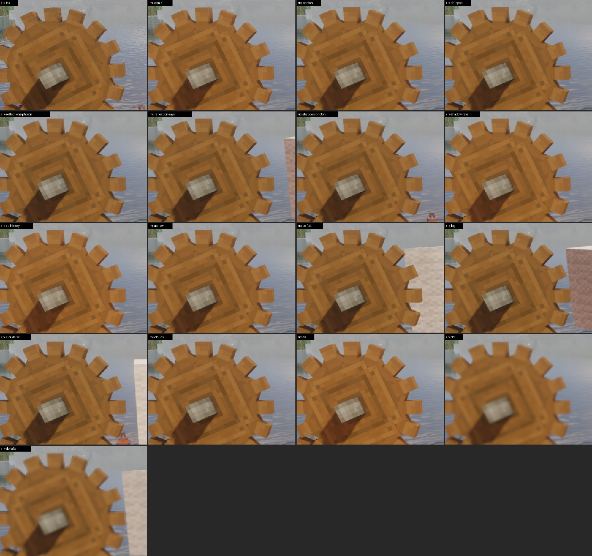
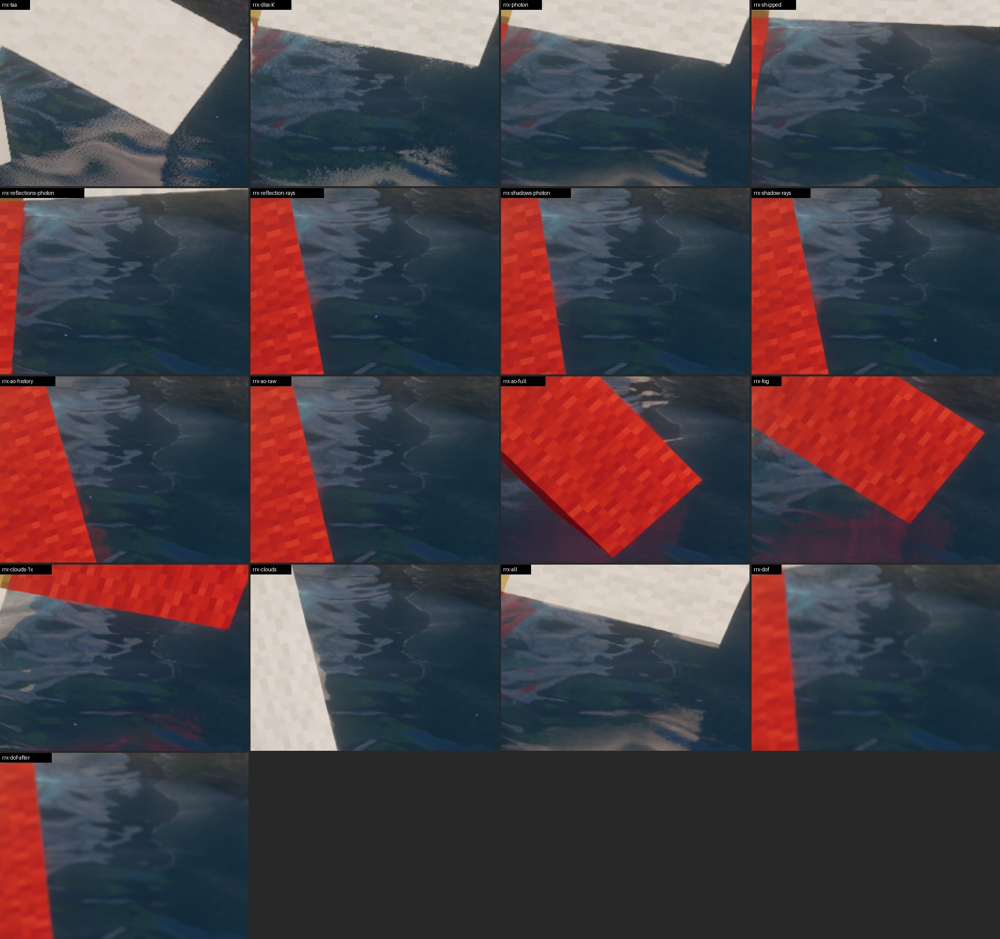
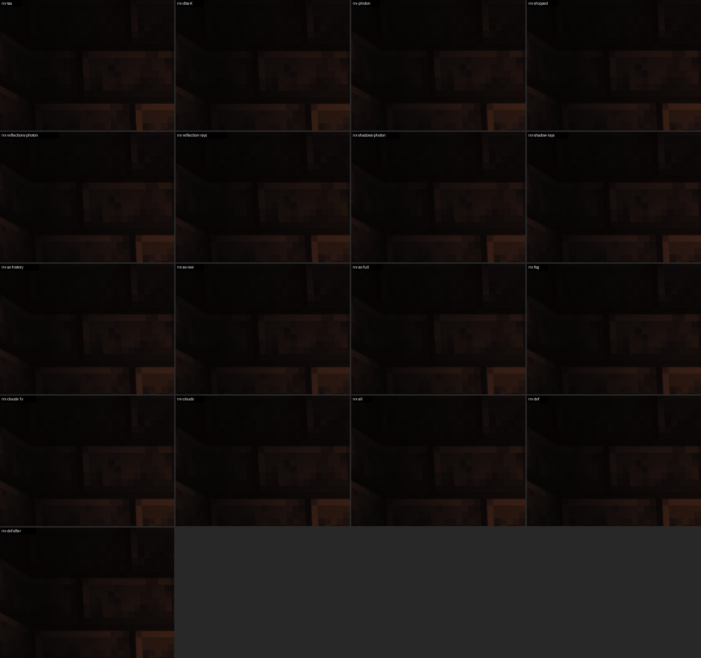
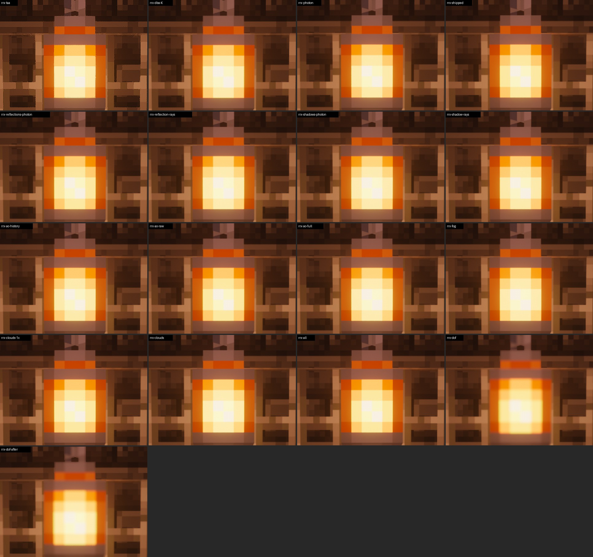
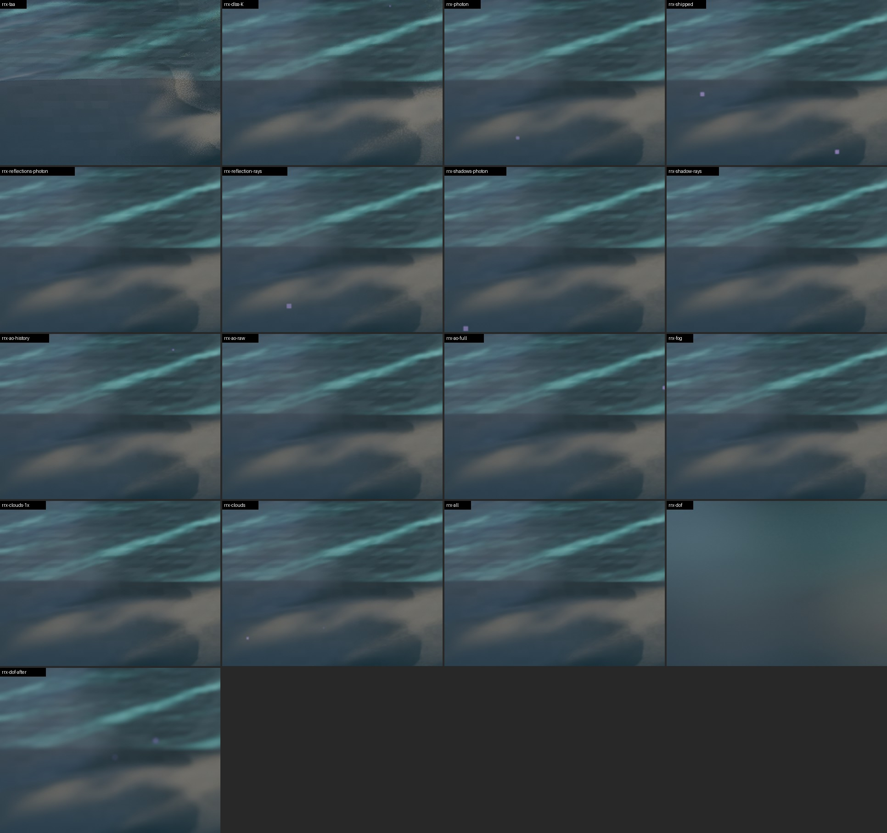
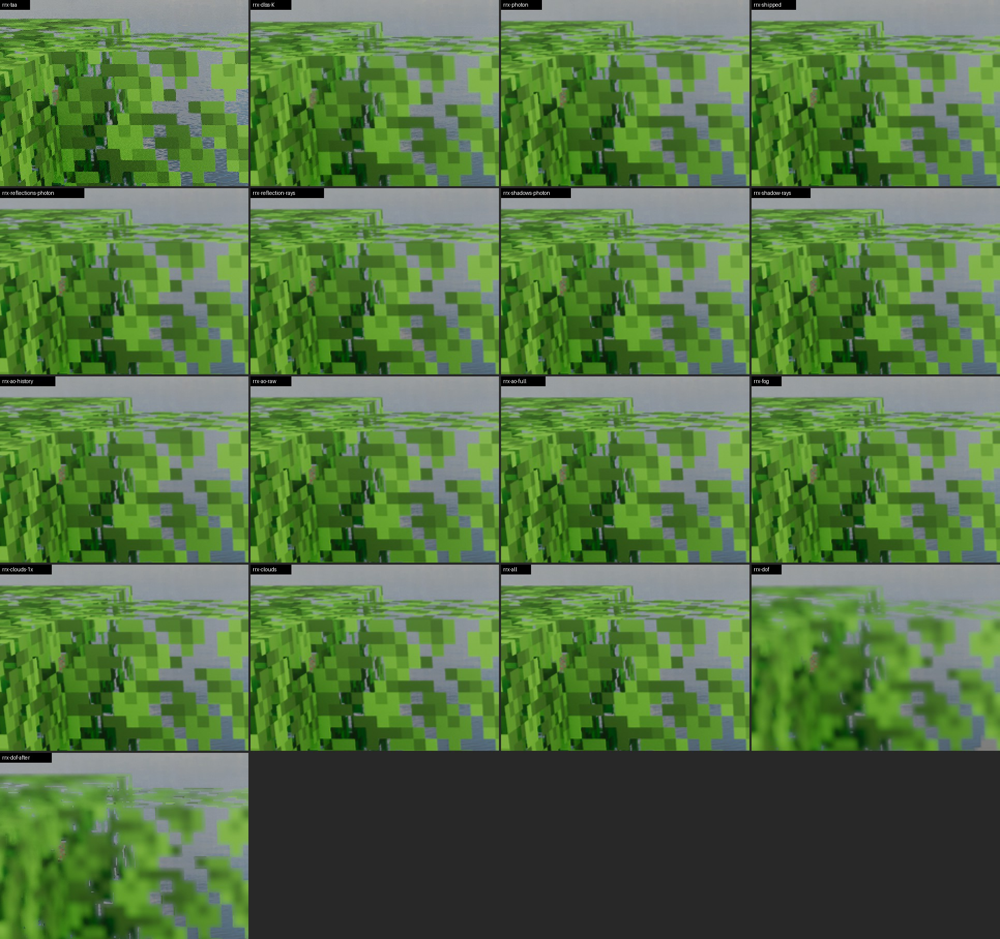

# Ray Reconstruction research 1: how much RR transforms Photon, effect by effect

A PC session on 2026-10-28, 10:40–12:30, run by a Claude Code session in `C:\Users\coolm\Documents\Claude\MC-CREATE`
(`$T`).
- **What it followed:** "Ray Reconstruction research 1" in `tools/dlss-testkit/PC-RUNBOOK.md` at `63344f80` on
  `claude/project-thread-u2wmhh-rr`, with the dev build Bridge 1.139.0-rrx.1 (pack 0.6.16-rrx.1).
- **Part 1** (the runs) ran on its own; **part 2** (by eye with the hotkeys) with Emre at the keyboard.
- NVIDIA's release `nvngx_dlssd.dll` from `$T\rr1`. The NVIDIA app had no overrides on.

## Summary

- **Both launches ran clean.**
  - Every research mode logged its `Ray Reconstruction research: raw: ...` line with exactly the switches the runbook
    lists.
  - There was no `Failed to create shader rendering pipeline` and no shader compile error, including after
    `rrx-ao-full`, `rrx-clouds*`, `rrx-all`, `rrx-dof*`, `rrx-dlaa-*` and `rrx-perf-all`. Iris only printed compiler
    warnings.
  - Emre's monitor slept for a while during launch 2 (the PC didn't). Every screenshot was still saved, at the
    right size, with no stall.
- **What the switches cost**, at Quality over `rrx-shipped`, from launch 1:
  - most single switches: +0.0 to +0.6 ms;
  - Photon's clouds at 1x: +0.3 to +1.1 ms;
  - **AO and fog at full resolution** (`CG_RR_FULL_RES_AMBIENT`): **+1.2 to +1.4 ms**, and the same at 100% render
    scale;
  - **depth of field after RR:** +0.4 to +1.7 ms;
  - **everything raw:** +1.5 to +2.2 ms;
  - **RR as released over plain DLSS K:** +1.2 to +1.8 ms.
- **Emre's verdicts, in short:**
  - **Kept as released:** `reflections` raw. It's clearly better on the dark room's metal blocks ("sharp and stable",
    where Photon's own "freaks out into a flicker"). `shadows` raw looks about the same.
  - **A minor gain raw:** `shadow-rays` on fine geometry (no fizz left on the gears).
  - **Clearly better as Photon's own:**
    - `ao-noise` ("the clearest one yet");
    - `clouds`. Raw turns them into a smooth blob that **wobbles while the camera moves**, which looks like a bug.
  - **No visible difference:** `fog` (outside, in the Nether and in the dark room), `reflection-rays`.
  - **`ao-history` depends on the scene:**
    - Photon's own is steadier on moving things outdoors;
    - raw "absolutely destroys it" in the closed dark room.
  - **All at once:** RR as released looks best, then all of Photon's own (very close), then everything raw
    ("significantly worse ... very noticeably").
  - **Depth of field:** after RR is clearly better ("before ... It's like you need glasses constantly").
- **The resolution finding:**
  - At native and Quality, AO at full resolution is "incomparable": the fast-spinning cog goes from "a messy blob" to
    "perfectly sharp".
  - At Performance, where Photon's half-resolution AO is already one sample per pixel, raw AO and Photon's own look the
    same.
  - Emre: "whatever was making ray reconstruction perform worse could partially be tied to the effect not being
    one-to-one on screen size."
  - Photon's clouds at 1x look far better under RR than the shipped 4x ("very grainy" against "almost like lifelike").
- **Emre's pick:**
  - Keep the released raw set.
  - Want a high-end option where Photon's effects (AO, clouds and so on) render **at the render resolution**,
    following the chosen DLSS scale.
  - He also notes that **our Photon patch currently breaks parallax and PBR resource pack support**. Those reflections
    would push RR harder and show more clearly where it wins or loses.

## Set-up

- **Branch:** `claude/project-thread-u2wmhh-rr` at `63344f80`.
- **Jars:** `create-galore-bridge-1.139.0-rrx.1.jar` (3,440,334 bytes) and the new test kit (65,806 bytes).
- **Backups:** everything the runbook lists, in `$T\rrx1\*.before`. All equal the originals (2c's backups).
  - `config\create_galore_dlss_testkit.json` didn't exist, so there was nothing to back up; the runs made it, and it
    was deleted at the end.
  - No Photon settings files (`create_galore_bridge-photon-*.txt`) existed or were made.
- **Settings file:** `dlaa=dlss`, `dlaaPreset=default`, `dlaaRayReconstruction=false`, `perfectPresentation=true`,
  `presenter=dx12`, `reflex=on`, `gpuPacing=off`, `frameGen=off`, `fpsCounter=off`. Windowed (2544x1401 drawn), 260 fps
  cap, no vsync.
- **Launches:** Frame generation 3's 2560x1440 launch with `autorun=dlaa-test`, through `fg2-run.ps1`, which moves the
  window so its picture starts at the screen's corner.

## Part 1: the runs

### Launch 1: `RRX3` (frame times)

- **Photon's copy** was made again at the first start (10:43:39): `DLAA: made shaderpacks/Photon v1.3a + DLAA from
  photon_v1.3a + Clrwl_1.0.5.zip`.
- **Run:** `20261028-104519-RRX3`, 10:45:19–10:55:53, 46 mode plays (23 modes, each twice) at 4 viewpoints, the still
  path.
- **Every mode** logged `DLAA: Ray Reconstruction research: raw: ...; Photon's own: ...` just before its mode line. The
  lists match the runbook for all 23. For example:
  - `rrx-photon`: `raw: nothing`;
  - `rrx-all`: `raw: reflections, shadows, shadow-rays, ao-history, ao-noise, fog, clouds; Photon's own:
    reflection-rays, dof-after`.
- **`DLAA: DLSS Ray Reconstruction running at ...` appears 6 times, not once per mode.**
  - It's logged when RR starts at a new scale: Quality at `rrx-photon`, full resolution at `rrx-dlaa-shipped`,
    Performance at `rrx-perf-shipped`, in each of the 2 cycles.
  - Between RR modes at the same scale only the switches change, so no new line comes, as in 2b and 2c.
- **Shader checks:** no pipeline failure and no compile error.
  - Iris's warnings are compiler warnings only: `warning C7050: "..." might be used before being initialized`,
    `Program link log for deferred4/composite`, and `Type is VERTEX/FRAGMENT` (63 each).
- **Bridge warnings, all during loading:**
  - `Perfect Presentation: swap chain wait timed out`;
  - 2 × `FrameFreezeWatch: The game stopped drawing for 10 s` (at 10:44:35 and 10:45:06).

### Launch 2: `RRX1+RRX2+RRX4` (pictures, then clips)

- **Runs:**
  - `20261028-105845-RRX1` (17 Quality modes, still and flick paths), 10:58:45–11:04:11;
  - `20261028-110412-RRX2` (the 6 full-resolution and Performance modes), 11:04:12–11:06:42;
  - `20261028-110642-RRX4` (64-frame clips of 6 modes at `moving` and `dark`), 11:06:42–11:07:47.
- **Log:** 29 mode lines, each with its research line. No pipeline failure, no compile error, and only the load-time
  swap chain warning.
- **Screenshots:** 1,428 + 504 + 768, all present, all 2544x1401, about 15.4 GB in all (the runbook guessed 10). They
  stay on the PC.
- **The display slept** for a while during launch 2. Emre: "the screen slept for a little while, but not the PC." I
  checked RRX1, the run in progress then:
  - all 1,428 shots are on disk and the right size;
  - no segment ran slower than 4 times the median frame time;
  - each still frame's brightness agrees across all 17 modes at all 4 viewpoints, and frame 118 differs from 119, so
    nothing froze or went black;
  - the log shows no resize.
  - So the run was kept; performance wasn't measured in this launch anyway. RRX2 and RRX4 pass the same checks.

### `rrx.py table` on RRX1 (frame times from RRX3)

Run 20261028-105845-RRX1 at 2544x1401, Photon v1.3a + DLAA; frame times from 20261028-104519-RRX3

### shore

| mode | raw (options) | frame ms (vs shipped) | shimmer (levels / >8) | residue | vs shipped |
| --- | --- | --- | --- | --- | --- |
| rrx-taa | - | 6.07 | 1.17 / 2.3% | 3.89 / 3.67 | - |
| rrx-dlss-K | - | 6.39 (-1.84) | 0.22 / 0.2% | 3.50 / 3.51 | 3.27 |
| rrx-photon | none | 8.24 (+0.01) | 0.22 / 0.1% | 3.20 / 3.24 | 1.62 |
| rrx-shipped | reflections+shadows | 8.23 | 0.22 / 0.1% | 3.15 / 3.26 | - |
| rrx-reflections-photon | shadows | 8.25 (+0.02) | 0.22 / 0.1% | 3.17 / 3.25 | 1.27 |
| rrx-reflection-rays | reflections+shadows+reflection-rays | 8.29 (+0.06) | 0.22 / 0.2% | 3.15 / 3.25 | 1.45 |
| rrx-shadows-photon | reflections | 8.39 (+0.16) | 0.22 / 0.1% | 3.17 / 3.27 | 1.19 |
| rrx-shadow-rays | reflections+shadows+shadow-rays | 8.40 (+0.17) | 0.22 / 0.2% | 3.15 / 3.25 | 1.55 |
| rrx-ao-history | reflections+shadows+ao-history | 8.39 (+0.16) | 0.23 / 0.2% | 3.09 / 3.19 | 1.97 |
| rrx-ao-raw | reflections+shadows+ao-history+ao-noise | 8.40 (+0.17) | 0.23 / 0.2% | 3.10 / 3.20 | 1.95 |
| rrx-ao-full | reflections+shadows+ao-history+ao-noise (CG_RR_FULL_RES_AMBIENT=true) | 9.64 (+1.41) | 0.23 / 0.1% | 3.09 / 3.17 | 2.36 |
| rrx-fog | reflections+shadows+fog | 8.40 (+0.17) | 0.22 / 0.1% | 3.20 / 3.26 | 1.36 |
| rrx-clouds-1x | reflections+shadows (CLOUDS_TEMPORAL_UPSCALING=1) | 8.60 (+0.37) | 0.22 / 0.1% | 2.99 / 3.24 | 1.39 |
| rrx-clouds | reflections+shadows+clouds (CLOUDS_TEMPORAL_UPSCALING=1) | 8.58 (+0.35) | 0.22 / 0.1% | 3.00 / 3.24 | 1.67 |
| rrx-all | reflections+shadows+shadow-rays+ao-history+ao-noise+fog+clouds (CLOUDS_TEMPORAL_UPSCALING=1,CG_RR_FULL_RES_AMBIENT=true) | 9.83 (+1.60) | 0.22 / 0.2% | 2.96 / 3.18 | 1.80 |
| rrx-dof | reflections+shadows (DOF=true) | 8.50 (+0.27) | 0.10 / 0.1% | 0.87 / 9.11 | 19.85 |
| rrx-dof-after | reflections+shadows+dof-after (DOF=true) | 9.95 (+1.72) | 0.20 / 0.1% | 3.20 / 3.24 | 3.13 |

### canopy

| mode | raw (options) | frame ms (vs shipped) | shimmer (levels / >8) | residue | vs shipped |
| --- | --- | --- | --- | --- | --- |
| rrx-taa | - | 6.67 | 1.52 / 3.7% | 2.73 / 6.36 | - |
| rrx-dlss-K | - | 6.73 (-1.84) | 0.24 / 0.1% | 1.75 / 5.85 | 2.46 |
| rrx-photon | none | 8.58 (+0.01) | 0.25 / 0.1% | 1.60 / 5.69 | 0.39 |
| rrx-shipped | reflections+shadows | 8.57 | 0.26 / 0.1% | 1.61 / 5.69 | - |
| rrx-reflections-photon | shadows | 8.58 (+0.01) | 0.26 / 0.1% | 1.61 / 5.68 | 0.21 |
| rrx-reflection-rays | reflections+shadows+reflection-rays | 8.60 (+0.03) | 0.26 / 0.1% | 1.60 / 5.67 | 0.26 |
| rrx-shadows-photon | reflections | 8.72 (+0.15) | 0.26 / 0.1% | 1.60 / 5.68 | 0.40 |
| rrx-shadow-rays | reflections+shadows+shadow-rays | 8.73 (+0.16) | 0.25 / 0.1% | 1.61 / 5.69 | 0.25 |
| rrx-ao-history | reflections+shadows+ao-history | 8.75 (+0.18) | 0.26 / 0.1% | 1.60 / 5.72 | 0.46 |
| rrx-ao-raw | reflections+shadows+ao-history+ao-noise | 8.73 (+0.16) | 0.26 / 0.1% | 1.61 / 5.74 | 0.51 |
| rrx-ao-full | reflections+shadows+ao-history+ao-noise (CG_RR_FULL_RES_AMBIENT=true) | 10.00 (+1.43) | 0.26 / 0.1% | 1.61 / 5.73 | 0.59 |
| rrx-fog | reflections+shadows+fog | 8.76 (+0.19) | 0.25 / 0.1% | 1.61 / 5.69 | 0.23 |
| rrx-clouds-1x | reflections+shadows (CLOUDS_TEMPORAL_UPSCALING=1) | 9.54 (+0.97) | 0.25 / 0.1% | 1.56 / 5.54 | 0.38 |
| rrx-clouds | reflections+shadows+clouds (CLOUDS_TEMPORAL_UPSCALING=1) | 9.52 (+0.95) | 0.25 / 0.1% | 1.55 / 5.53 | 0.39 |
| rrx-all | reflections+shadows+shadow-rays+ao-history+ao-noise+fog+clouds (CLOUDS_TEMPORAL_UPSCALING=1,CG_RR_FULL_RES_AMBIENT=true) | 10.77 (+2.20) | 0.25 / 0.1% | 1.55 / 5.57 | 0.78 |
| rrx-dof | reflections+shadows (DOF=true) | 8.86 (+0.29) | 0.14 / 0.0% | 2.78 / 5.69 | 4.44 |
| rrx-dof-after | reflections+shadows+dof-after (DOF=true) | 10.18 (+1.61) | 0.30 / 0.6% | 2.65 / 5.54 | 4.20 |

### moving

| mode | raw (options) | frame ms (vs shipped) | shimmer (levels / >8) | residue | vs shipped |
| --- | --- | --- | --- | --- | --- |
| rrx-taa | - | 7.01 | 2.15 / 4.7% | 14.07 / 16.06 | - |
| rrx-dlss-K | - | 7.39 (-1.24) | 1.64 / 3.6% | 9.43 / 12.51 | - |
| rrx-photon | none | 8.44 (-0.19) | 1.43 / 2.8% | 9.32 / 12.99 | - |
| rrx-shipped | reflections+shadows | 8.63 | 1.54 / 3.0% | 9.27 / 12.83 | - |
| rrx-reflections-photon | shadows | 8.52 (-0.11) | 1.61 / 3.0% | 9.16 / 13.60 | - |
| rrx-reflection-rays | reflections+shadows+reflection-rays | 8.67 (+0.04) | 1.50 / 2.8% | 8.88 / 13.56 | - |
| rrx-shadows-photon | reflections | 8.86 (+0.23) | 1.66 / 3.3% | 8.97 / 13.50 | - |
| rrx-shadow-rays | reflections+shadows+shadow-rays | 9.07 (+0.44) | 1.58 / 3.2% | 8.83 / 13.58 | - |
| rrx-ao-history | reflections+shadows+ao-history | 8.98 (+0.35) | 1.62 / 3.1% | 8.74 / 13.56 | - |
| rrx-ao-raw | reflections+shadows+ao-history+ao-noise | 8.69 (+0.06) | 1.63 / 3.3% | 8.79 / 13.53 | - |
| rrx-ao-full | reflections+shadows+ao-history+ao-noise (CG_RR_FULL_RES_AMBIENT=true) | 9.85 (+1.22) | 1.64 / 3.2% | 9.92 / 16.19 | - |
| rrx-fog | reflections+shadows+fog | 8.77 (+0.14) | 1.68 / 3.5% | 8.90 / 14.54 | - |
| rrx-clouds-1x | reflections+shadows (CLOUDS_TEMPORAL_UPSCALING=1) | 9.72 (+1.09) | 1.38 / 2.7% | 10.50 / 14.97 | - |
| rrx-clouds | reflections+shadows+clouds (CLOUDS_TEMPORAL_UPSCALING=1) | 9.57 (+0.94) | 1.31 / 2.7% | 10.35 / 14.08 | - |
| rrx-all | reflections+shadows+shadow-rays+ao-history+ao-noise+fog+clouds (CLOUDS_TEMPORAL_UPSCALING=1,CG_RR_FULL_RES_AMBIENT=true) | 10.63 (+2.00) | 1.53 / 2.9% | 10.58 / 15.61 | - |
| rrx-dof | reflections+shadows (DOF=true) | 8.92 (+0.29) | 1.35 / 2.9% | 8.50 / 12.97 | - |
| rrx-dof-after | reflections+shadows+dof-after (DOF=true) | 9.07 (+0.44) | 1.40 / 3.0% | 8.65 / 13.26 | - |

### dark

| mode | raw (options) | frame ms (vs shipped) | shimmer (levels / >8) | residue | vs shipped |
| --- | --- | --- | --- | --- | --- |
| rrx-taa | - | 5.66 | 0.32 / 0.6% | 0.47 / 0.59 | - |
| rrx-dlss-K | - | 6.07 (-1.61) | 0.02 / 0.0% | 0.38 / 0.48 | 0.68 |
| rrx-photon | none | 7.77 (+0.09) | 0.04 / 0.0% | 0.23 / 0.37 | 0.16 |
| rrx-shipped | reflections+shadows | 7.68 | 0.04 / 0.0% | 0.24 / 0.39 | - |
| rrx-reflections-photon | shadows | 7.62 (-0.06) | 0.04 / 0.0% | 0.24 / 0.35 | 0.16 |
| rrx-reflection-rays | reflections+shadows+reflection-rays | 8.04 (+0.36) | 0.04 / 0.0% | 0.24 / 0.37 | 0.12 |
| rrx-shadows-photon | reflections | 7.95 (+0.27) | 0.04 / 0.0% | 0.23 / 0.35 | 0.12 |
| rrx-shadow-rays | reflections+shadows+shadow-rays | 7.85 (+0.17) | 0.04 / 0.0% | 0.23 / 0.36 | 0.10 |
| rrx-ao-history | reflections+shadows+ao-history | 7.81 (+0.13) | 0.04 / 0.0% | 0.18 / 0.33 | 0.13 |
| rrx-ao-raw | reflections+shadows+ao-history+ao-noise | 8.24 (+0.56) | 0.04 / 0.0% | 0.19 / 0.31 | 0.12 |
| rrx-ao-full | reflections+shadows+ao-history+ao-noise (CG_RR_FULL_RES_AMBIENT=true) | 9.03 (+1.35) | 0.04 / 0.0% | 0.18 / 0.31 | 0.22 |
| rrx-fog | reflections+shadows+fog | 7.86 (+0.18) | 0.04 / 0.0% | 0.23 / 0.35 | 0.12 |
| rrx-clouds-1x | reflections+shadows (CLOUDS_TEMPORAL_UPSCALING=1) | 7.98 (+0.30) | 0.04 / 0.0% | 0.23 / 0.35 | 0.09 |
| rrx-clouds | reflections+shadows+clouds (CLOUDS_TEMPORAL_UPSCALING=1) | 8.04 (+0.36) | 0.04 / 0.0% | 0.23 / 0.36 | 0.16 |
| rrx-all | reflections+shadows+shadow-rays+ao-history+ao-noise+fog+clouds (CLOUDS_TEMPORAL_UPSCALING=1,CG_RR_FULL_RES_AMBIENT=true) | 9.21 (+1.53) | 0.05 / 0.0% | 0.17 / 0.31 | 0.20 |
| rrx-dof | reflections+shadows (DOF=true) | 7.94 (+0.26) | 0.04 / 0.0% | 0.39 / 0.79 | 1.31 |
| rrx-dof-after | reflections+shadows+dof-after (DOF=true) | 8.11 (+0.43) | 0.03 / 0.0% | 0.47 / 0.82 | 1.24 |

### `rrx.py table` on RRX2 (frame times from RRX3)

Run 20261028-110412-RRX2 at 2544x1401, Photon v1.3a + DLAA; frame times from 20261028-104519-RRX3

### shore

| mode | raw (options) | frame ms (vs shipped) | shimmer (levels / >8) | residue | vs shipped |
| --- | --- | --- | --- | --- | --- |
| rrx-dlaa-shipped | reflections+shadows | 11.61 | 0.25 / 0.2% | 2.80 / 2.83 | - |
| rrx-dlaa-ao-raw | reflections+shadows+ao-history+ao-noise | 11.61 (+0.00) | 0.25 / 0.2% | 3.24 / 2.87 | 3.23 |
| rrx-dlaa-ao-full | reflections+shadows+ao-history+ao-noise (CG_RR_FULL_RES_AMBIENT=true) | 12.94 (+1.33) | 0.25 / 0.2% | 3.19 / 2.81 | 3.53 |
| rrx-dlaa-all | reflections+shadows+shadow-rays+ao-history+ao-noise+fog+clouds (CLOUDS_TEMPORAL_UPSCALING=1,CG_RR_FULL_RES_AMBIENT=true) | 13.14 (+1.53) | 0.25 / 0.2% | 2.88 / 2.82 | 3.86 |
| rrx-perf-shipped | reflections+shadows | 7.02 | 0.21 / 0.1% | 3.13 / 3.32 | - |
| rrx-perf-all | reflections+shadows+shadow-rays+ao-history+ao-noise+fog+clouds (CLOUDS_TEMPORAL_UPSCALING=1) | 7.14 (+0.12) | 0.22 / 0.1% | 3.03 / 3.28 | 1.23 |

### canopy

| mode | raw (options) | frame ms (vs shipped) | shimmer (levels / >8) | residue | vs shipped |
| --- | --- | --- | --- | --- | --- |
| rrx-dlaa-shipped | reflections+shadows | 12.28 | 0.37 / 0.3% | 1.86 / 4.83 | - |
| rrx-dlaa-ao-raw | reflections+shadows+ao-history+ao-noise | 12.31 (+0.03) | 0.42 / 0.4% | 1.77 / 5.94 | 7.13 |
| rrx-dlaa-ao-full | reflections+shadows+ao-history+ao-noise (CG_RR_FULL_RES_AMBIENT=true) | 13.64 (+1.36) | 0.35 / 0.3% | 1.72 / 5.87 | 7.14 |
| rrx-dlaa-all | reflections+shadows+shadow-rays+ao-history+ao-noise+fog+clouds (CLOUDS_TEMPORAL_UPSCALING=1,CG_RR_FULL_RES_AMBIENT=true) | 15.30 (+3.02) | 0.35 / 0.3% | 1.68 / 5.73 | 7.18 |
| rrx-perf-shipped | reflections+shadows | 7.32 | 0.25 / 0.1% | 1.55 / 5.56 | - |
| rrx-perf-all | reflections+shadows+shadow-rays+ao-history+ao-noise+fog+clouds (CLOUDS_TEMPORAL_UPSCALING=1) | 7.88 (+0.56) | 0.24 / 0.1% | 1.50 / 5.42 | 0.75 |

### moving

| mode | raw (options) | frame ms (vs shipped) | shimmer (levels / >8) | residue | vs shipped |
| --- | --- | --- | --- | --- | --- |
| rrx-dlaa-shipped | reflections+shadows | 12.33 | 1.91 / 3.8% | 14.24 / 17.43 | - |
| rrx-dlaa-ao-raw | reflections+shadows+ao-history+ao-noise | 12.39 (+0.06) | 1.57 / 3.0% | 12.80 / 17.85 | - |
| rrx-dlaa-ao-full | reflections+shadows+ao-history+ao-noise (CG_RR_FULL_RES_AMBIENT=true) | 13.63 (+1.30) | 1.94 / 3.8% | 13.43 / 16.66 | - |
| rrx-dlaa-all | reflections+shadows+shadow-rays+ao-history+ao-noise+fog+clouds (CLOUDS_TEMPORAL_UPSCALING=1,CG_RR_FULL_RES_AMBIENT=true) | 15.31 (+2.98) | 2.25 / 4.7% | 11.54 / 17.39 | - |
| rrx-perf-shipped | reflections+shadows | 7.37 | 1.57 / 3.1% | 8.45 / 13.58 | - |
| rrx-perf-all | reflections+shadows+shadow-rays+ao-history+ao-noise+fog+clouds (CLOUDS_TEMPORAL_UPSCALING=1) | 7.71 (+0.34) | 1.63 / 3.4% | 8.61 / 13.86 | - |

### dark

| mode | raw (options) | frame ms (vs shipped) | shimmer (levels / >8) | residue | vs shipped |
| --- | --- | --- | --- | --- | --- |
| rrx-dlaa-shipped | reflections+shadows | 11.11 | 0.06 / 0.0% | 0.23 / 0.36 | - |
| rrx-dlaa-ao-raw | reflections+shadows+ao-history+ao-noise | 11.12 (+0.01) | 0.09 / 0.0% | 0.20 / 0.34 | 0.27 |
| rrx-dlaa-ao-full | reflections+shadows+ao-history+ao-noise (CG_RR_FULL_RES_AMBIENT=true) | 12.50 (+1.39) | 0.07 / 0.0% | 0.18 / 0.31 | 0.23 |
| rrx-dlaa-all | reflections+shadows+shadow-rays+ao-history+ao-noise+fog+clouds (CLOUDS_TEMPORAL_UPSCALING=1,CG_RR_FULL_RES_AMBIENT=true) | 12.68 (+1.57) | 0.07 / 0.0% | 0.18 / 0.31 | 0.26 |
| rrx-perf-shipped | reflections+shadows | 6.65 | 0.05 / 0.0% | 0.24 / 0.37 | - |
| rrx-perf-all | reflections+shadows+shadow-rays+ao-history+ao-noise+fog+clouds (CLOUDS_TEMPORAL_UPSCALING=1) | 6.74 (+0.09) | 0.05 / 0.0% | 0.21 / 0.36 | 0.25 |

### Crops

Made with `rrx.py crops` on RRX1: the settled still frame (`f119`), 240x180-pixel boxes at 2x zoom, every mode, in rows
of four. I picked the boxes from the frames themselves:

| sheet | viewpoint, box | what |
| --- | --- | --- |
| [moving-840-460.jpg](moving-840-460.jpg) | `moving` 840,460–1080,640 | the big gear's notches (it turns, so its angle differs per mode) |
| [moving-1760-740.jpg](moving-1760-740.jpg) | `moving` 1760,740–2000,920 | the fan blades' shadow on the water |
| [dark-600-120.jpg](dark-600-120.jpg) | `dark` 600,120–840,300 | the room's back left corner |
| [dark-1150-300.jpg](dark-1150-300.jpg) | `dark` 1150,300–1390,480 | the lantern |
| [shore-60-1000.jpg](shore-60-1000.jpg) | `shore` 60,1000–300,1180 | the water near the shore |
| [canopy-940-370.jpg](canopy-940-370.jpg) | `canopy` 940,370–1180,550 | leaves against the sky |

- **In still frames, the RR modes look nearly alike at these spots.** Photon's TAA (`rrx-taa`) has its rough edges, and
  depth of field blurs `rrx-dof` and `rrx-dof-after`.
- **What Emre saw differ** (noise, crawl, wobble, smear) is motion, which the clips show better.

### Clips

`rrx.py clips` on RRX4, 60 fps, the 64 frames in a row. The modes are side by side in two columns at half size, each
labelled: `rrx-taa`, `rrx-dlss-K`, `rrx-photon`, `rrx-shipped`, `rrx-ao-raw`, `rrx-all`.
- [dark-side-by-side.mp4](dark-side-by-side.mp4): the whole picture, 8.0 MB.
- [moving-side-by-side.mp4](moving-side-by-side.mp4): 11.3 MB.
  - The whole picture came to 19.8 MB, so, as the runbook says, I ran `clips` again with `--box 372,200,2172,1200`,
    the middle 1800x1000 where the machines are.
- The single-mode MP4s and the uncropped moving clip stay on the PC in `$T\rrx1\clips`.

## Part 2: by eye with the hotkeys

- **Set-up:**
  - launched without `autorun`;
  - in `dlaa-test`: `/gamemode creative`, `/time set 3000`, `/dlaatest scene build` (`built the moving scene`);
  - `/tp @s 1029.5 66 162.5 180 14`;
  - `/dlaatest mode rrx-shipped`: `DLSS Ray Reconstruction running at 1707x960 to 2560x1440 (Quality, 67%)`, 11:14:51.
- **I typed the commands and hotkeys** into the game window only while it had focus.
- **Every flip** shows in the log (`DLAA: Ray Reconstruction research: <switch> raw / Photon's own`): 335 of them. No
  shader errors and no Bridge warnings in this launch.
- **Emre's words below are as he said them, lightly trimmed.** Where he asked, I gave him what to look for before each
  switch.

### a. Each switch at the moving scene

| switch (released state) | Emre |
| --- | --- |
| `reflection-rays` (Photon's own: one ray) | "it's extremely subtle. I can't really tell the difference. I can only notice a difference sometimes in like the inside of objects that are reflecting as they move. Not really the edges, but their inner detail sometimes is a bit more crisp with ray reconstruction handling all of it. But honestly ... I couldn't tell unless they were side by side." |
| `reflections` (raw) | "The effect is still very, very subtle. ... the reflections are basically the same. The only thing I can tell is that stuff like iron blocks with ray reconstruction, the lighting on them looks a bit more natural and it goes all the way to the edges. Meanwhile, photons on kind of cuts them off weirdly." |
| `shadows` (raw) | "It looks basically the same on both. The only thing I can see is that sometimes the raw version allows newly ... unoccluded objects to resolve a bit faster, like the shadow cast by newly unoccluded objects. I mean in the penumbra, but it's so subtle." |
| `shadow-rays` (Photon's own) | "Raw looks as good, and I think it's actually better in fine geometry. Can't really tell in large geometry, but in fine geometry, stuff like gears and stuff, I can no longer see any fizz on them at all. But even without raw, ray reconstruction in general is very good at it ... But it is still a minor improvement, I would say." |
| `ao-history` (Photon's own) | "Photon's own looks more stable here in motion. Objects that are moving look better. Cogs spinning, and distant objects that cover a small amount of screen space. Raw ray reconstruction actually still does better on static objects that are covering a large amount of your screen. ... I do suspect that Photon's own method is producing a blurrier image, but in Minecraft's lighting, you really can't tell, so it's a fair compromise to make. Unless maybe you are running like one of those [texture packs] that are like 512 by 512, then maybe you'll prefer ray reconstruction. It trades a bit of stability to remain sharper overall." |
| `ao-noise` (Photon's own) | "Here it's kind of no contest, honestly. Photons own looks better. NVIDIA's guidance might say raw white noise is better, and possibly in some games, but Minecraft's shader style and graphics are pretty unique, and in moving objects, I see a lot more clarity. ... foliage looks a bit better with white noise, but overall it's a minor improvement, and blue noise is significantly better looking in like basically everything else. ... It's significantly more stable. Like, this is the clearest one yet." |
| `fog` (Photon's own) | Little fog in this weather, so at Emre's request I sent him to the Nether (`/execute in minecraft:the_nether run tp @s 128 70 20`) and back: "I can tell no perceivable difference in either. They look basically the same to me." |
| `clouds` (Photon's own; Photon's 4x clouds here) | "Photons own looks way better. ... ray reconstruction wins in one narrow band, and that's when a cloud is obstructed by like a tree and you move around the tree to see the cloud. It's better at handling the [occlusion], but overall all the clouds are significantly more noisy. ... Photon was built from the ground up for this. The fact that Photon's versions of these effects don't translate well to ray reconstruction doesn't mean that they cannot be attempted on our own shader, but it is still good information." |

`dof-after` is in f.

### b. Everything at once

- **The order:** Shift+`\` (everything raw, 11:46:55), then `/dlaatest rr use none` (11:49:51), then `/dlaatest rr use
  shipped` (11:50:45).
- Emre: "if I had to rank them, I would say our shipped one looks the best, followed by Photon's own, followed by
  everything raw. Photon's own and our shipped version are very similar. I don't think I'd be able to tell them if they
  were not side by side. Meanwhile, everything raw is significantly worse than both and very noticeably worse."

### c. The dark room

`/dlaatest scene build dark` (`built the dark scene`), `/tp @s 1060.5 64 121.5 180 6`, RR as released.

| switch | Emre |
| --- | --- |
| `fog` | "Once again, with fog, I really can't tell a difference. I don't think Photon's fog effects are really aggressive enough to bring it out." |
| `ao-noise` | "Photons own looks better, you can especially tell behind the iron bars" |
| `ao-history` | "Okay, weird turnaround here. Raw absolutely destroys it. In the closed environment, it absolutely destroys it. ... like the bars, like, even better with raw here, significantly so. Without raw, there's always this minor noise to it. With raw, it's just pin drop sharp. The image looks perfect in terms of AO with raw in this dark room." |
| `shadow-rays` | "I cannot tell a difference here" |
| `reflections` | "raw is significantly better, and the metal blocks that reflect, you can see way sharper and more stable detail. Meanwhile, Photon's own is jittery and occasionally like freaks out into a flicker and then sharpens, freaks out into a flicker and then sharpens. Meanwhile, ray reconstruction stays sharp and stable throughout." |

### d. Water, leaves and sky

- **The shore and the canopy:** "I already looked at this scene a lot with the first walkthrough, so my stance stands."
- **The sky at sunset** (`/time set 12500`):
  - **`/dlaatest mode rrx-clouds-1x`, flipping `clouds`:** "Photon's own looks way better. Ray reconstruction makes
    it all into a smooth blob, and you can't really see the detail in the clouds anymore. And it does this odd thing
    where the clouds kind of, when you move, they start wobbling until you stop. That almost seems like a bug, like they
    wobble pretty aggressively."
  - **Then `/dlaatest mode rrx-shipped` (Photon's 4x clouds):** "Photon's own at 1x looks significantly better. You
    can really tell that the clouds are being upscaled. They're very grainy at this setting. At 1x, Photon's only looked
    almost like lifelike."
  - Back to `/time set 3000`.

### e. Resolution

- **Modes, at the moving scene:**
  - `rrx-dlaa-ao-raw`, then `rrx-dlaa-ao-full` (100% render scale);
  - `rrx-ao-raw`, then `rrx-ao-full` (Quality).
- **Emre's addition: Performance.** "can we switch to performance mode? ... photons own at performance mode and like
  one-to-one at performance mode." There are no Performance AO modes in the kit, so I used `rrx-perf-shipped`, then
  `/dlaatest rr ao-history raw` and `/dlaatest rr ao-noise raw`.
- **He skipped the dark room for this step:** "We don't need the dark room. This is very clear."

| what Emre compared | render | AO | pixels per AO sample | cost (launch 1) |
| --- | --- | --- | --- | --- |
| `rrx-dlaa-ao-raw` | 100% | raw, half the window | 4 | as `rrx-dlaa-shipped` |
| `rrx-dlaa-ao-full` | 100% | raw, full window | 1 | +1.3 to +1.4 ms |
| `rrx-ao-raw` | Quality | raw, half the window | ~1.8 | +0.1 to +0.6 ms over `rrx-shipped` |
| `rrx-ao-full` | Quality | raw, full window | < 1 | +1.2 to +1.4 ms |
| `rrx-perf-shipped` | Performance | Photon's own, half the window | 1 | - |
| `rrx-perf-shipped` + AO raw | Performance | raw, half the window | 1 | about the same |

Emre: "With RR, full resolution is so clear at native and quality that like it is incomparable. It goes from like mild
jitter in places, and like I have a cogwheel right now spinning as fast as it goes. That turns into a messy blob. It
just becomes perfectly sharp. Then here's the odd part, which I think here's the real wrench. Good thing we tested
performance. In performance, when both modes are one-to-one, I can't tell the difference. Suddenly, ray reconstruction
doesn't look worse anymore. It looks basically as good as Photon, perhaps reacting a bit faster. So whatever was making
ray reconstruction perform worse could partially be tied to the effect not being one-to-one on screen size. Maybe it's
not what ray reconstruction expects. Maybe it expects some sort of per pixel effect."

### f. Depth of field

`/dlaatest mode rrx-dof` (depth of field before RR), then `/dlaatest rr dof-after raw`. Emre: "After definitely looks
better. Applying depth of field before leaves this effect where like the depth of field almost never goes away. It's
like you need glasses constantly. Depth of field after makes it actually work as you would expect depth of field to
work. I personally don't like the effect at all. I always have it disabled, but for people who enjoy the effect, after
is definitely better."

### g. Emre's pick

"Honestly, keeping them all in my head, it's kind of difficult. However, I think I wouldn't really put any of them on
raw apart from the ones that already come raw in the shipped version. What I would be interested in is having effects
at higher resolutions in general, like how we were able to set ambient occlusion to being 1:1 instead of half of the
display resolution, or the clouds, for example, stuff like that. And I would want them to scale with the choice we make.
So if we make, if we choose quality DLSS, it doesn't go to 1440p as its ... AO resolution. AO stays at whatever quality
is, like chases the number basically. That's what I would consider like the high end option, honestly. One thing
though, which you should put in the report too, right now, our modification of Photon breaks a bunch of parallax and
support for PBR texture packs. Those kinds of reflections and effects, I think, would really push the renderer more to
where we may be able to spot where ray reconstruction wins or loses more clearly."

No F2 screenshots were taken in part 2.

## Choices that aren't in the runbook

- **The crop boxes** were picked from the frames themselves (half-size views), not in `compare.html`. All are 240x180
  at 2x zoom, so the 17-mode sheets stay under 0.6 MB each.
- **The moving clip** is the `--box` run (the middle 1800x1000), because the whole picture was over 15 MB. The runbook
  allows this.
- **Launch 2 was kept** although Emre's monitor slept during it, after the checks above showed every frame was
  recorded. Emre: "If they are, we can leave it as is, because we're not really caring about performance here."
- **Part 2's commands and hotkeys** were sent by small helper scripts that type into the game only while its window has
  focus: `game-commands.ps1` for slash commands, `game-keys.ps1` for hotkeys.
  - The runbook says the session types the commands. Emre also flipped switches himself with Ctrl+`\`.
  - **Two slips:**
    - My Shift+`\` for step b left Windows' Shift key state stuck, so Emre's next Ctrl+`\` presses flipped every
      effect at once (11:53, 14 times). I released the modifier keys, sent `/dlaatest rr use shipped`, and he redid the
      step.
    - One command was mixed with Emre's movement keys (`wadlaatest mode rrx-ao-raw`, unknown command). I retyped it.
  - In both cases the state was put back before he judged anything.
- **Detours at Emre's request:**
  - the Nether for fog;
  - skipping the dark room in step e;
  - the extra Performance comparison in e;
  - in d, not going through the switches again at the shore and the canopy ("my stance stands").
- **The clouds in step a** were flipped at Photon's 4x upscaling, which the runbook only lists for step d. That's a
  partial test; d's 1x test is the fair one.

## Afterwards

- **Every file from `$T\rrx1\*.before` was put back and checked with `cmp`:**
  - `create_galore_bridge-display.properties`, `options.txt`;
  - `DistantHorizons.toml`, `iris.properties`, `fml.toml`, `sodium-options.json`;
  - the shader pack's options file.
- **`config\create_galore_dlss_testkit.json` was deleted:** the runs made it, and it wasn't there before. There are no
  Photon settings files.
- **NVIDIA's `nvngx_dlssd.dll` was removed from the instance,** after a `cmp` against the release copy in `$T\rr1`. No
  start guard file.
- **The instance keeps** Bridge 1.139.0-rrx.1 and the new test kit. Ray Reconstruction is off in the restored settings.
- **On the PC:**
  - the runs' screenshots, about 15.4 GB, in `instance\screenshots\dlaa-test\20261028-104519-RRX3`, `...-105845-RRX1`,
    `...-110412-RRX2` and `...-110642-RRX4`;
  - the full clips in `$T\rrx1\clips` and `$T\rrx1\clips-box`;
  - the game logs of each launch and the session notes, in `$T\rrx1`.
