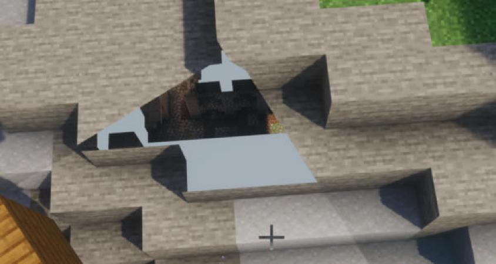

# Upscaling 1 on the RTX 4080 SUPER: DLSS and FSR from a lower render resolution

PC session on 2026-10-25, 13:20–14:30, by a Claude Code session in `C:\Users\<user>\Documents\Claude\MC-CREATE`
(`$T`). It followed "Upscaling 1" in `tools/dlss-testkit/PC-RUNBOOK.md` at `3711337`, with Bridge 1.96.0 and the test
kit from that commit.
- One game launch played all nine runs, F1 to U7, in 23 minutes. Then about 30 minutes by eye with the player.
- Every run ended with `run finished`. There was no `DLAA: stopped`, `DLSS could not start` or
  `Failed to create shader rendering pipeline`.
- This is a test, not a fix: no code was changed.

All captures ran at 2560x1440, with vsync off and the frame cap at 260. The PC was quiet for F1 and F2.

## Summary

- **DLSS at Quality is "the free FPS button" (the player).**
  - DLSS K at Quality (1707x960) looked native to him, and as sharp as preset L at Performance.
  - It runs 15–20% faster than DLAA, and about as fast as Photon's native TAA (5.28 against 5.21 ms in the canopy
    view).
- **At Performance (1280x720), DLSS is far ahead by eye.**
  - DLSS K looked like "a softer 1440p", and better than native TAA did. Its only tell is that reflections and shadows
    under moving things take a moment longer to resolve than with DLAA.
  - FSR 3.1 is "a significant step down": smooth, but "consistently unresolved", with crawling far leaves and particles
    trailing.
  - Photon's own TAAU is "unusable": soft, smeary and still pixelated.
- **Preset L is "the underdog".**
  - At Performance it is much sharper than K, "ground truth level", like a supersampled image, with a little more
    flicker on shadows.
  - At Ultra Performance (853x480) it stays sharp but "interpretive". It throws away some lighting, never fully resolves
    reflections, and garbles newly visible block faces for a moment. Interesting, but not recommended.
- **FSR holds up at Quality.** Geometry is stable again, with only effects (glass transparency, fine particles) a
  little unsteady. That's about where DLSS is at Performance. The player would recommend it for cards without DLSS.
- **The numbers miss what the player saw.**
  - On the still views, `metrics.py` rates FSR as the steadiest at every scale, with the least smear. DLSS K is close;
    both are about 3× steadier than Photon's TAAU.
  - But shimmer and smear on still frames don't measure resolve or sharpness. That's where FSR at Performance fell
    behind by eye, and where L pulled ahead.
- **Frame rates.**
  - DLSS K costs a fixed 0.86–0.91 ms over Photon's TAAU at every scale. M and L cost more at the higher render sizes
    (up to 1.27 and 1.57 ms at Balanced). FSR costs 0.32–0.51 ms.
  - So DLSS gains less from lower scales than FSR does. Against DLAA, DLSS K is 15–20% faster at Quality, 21–25% at
    Balanced, 25–31% at Performance and 35–41% at Ultra Performance.
  - The PC stays GPU-bound in 85–99% of frames in every DLSS and FSR mode, even at 33%.
- **Profiling 1's open point:** without a tracer, there's no p90 gap between DLSS and FSR beyond the difference in
  their medians. In F2, every mode's p90 sits within 0.5 ms of its median.
- **Side finding, to look into:** next to the moving ship, at one precise downward angle, you see through the ground
  blocks. The see-through window rotates with the ship (see "Side finding").

## Frame rate (F1 and F2, PresentMon)

`frametimes.py` with one PresentMon capture (`F.csv`) over both runs. F1 holds 21,980 frames inside the run and F2
18,700, the test kit's own counts. Each cell gives the median / p90 frame time in ms, then fps and the share of
GPU-bound frames. Full tables: [frametimes-F1.md](frametimes-F1.md), [frametimes-F2.md](frametimes-F2.md).

### The native baselines, and how they line up with profiling 1

| mode | shore F1 | shore F2 | canopy F1 | canopy F2 |
| --- | --- | --- | --- | --- |
| `photon-taa` | 4.70 / 7.08 (213 fps, 55%) | 4.50 / 4.70 (222 fps, 94%) | 5.21 / 7.04 (192 fps, 77%) | 5.21 / 5.32 (192 fps, 94%) |
| `dlaa-default` | 5.56 / 6.67 (180 fps, 81%) | 5.55 / 5.71 (180 fps, 98%) | 6.31 / 6.44 (158 fps, 93%) | 6.32 / 6.40 (158 fps, 98%) |
| `fsr3` | 5.53 / 5.87 (181 fps, 93%) | 5.55 / 5.73 (180 fps, 99%) | 6.27 / 6.40 (159 fps, 96%) | 6.30 / 6.39 (159 fps, 99%) |

- **Within this session the runs compare:** the native medians of F1 and F2 agree to 0.2 ms.
- **Against profiling 1 they don't quite** (shore 5.43 / 6.20 / 6.17 ms, canopy 5.87 / 7.31 / 7.20 ms then). The
  natives here are 0.6–1.0 ms faster: up to 0.93 ms for TAA at the shore, and 0.90–1.00 ms for DLAA and FSR at the
  canopy. That's more than the runbook's 0.8 ms.
  - Since then the Bridge (1.96.0) and the pack (0.4.81) changed, and the Photon copy was remade at the first start.
  - The run plan differs too: two viewpoints here, four then.
  - What made the difference isn't known. So compare this report's numbers among themselves, not with profiling 1's.
- F1's first mode (`photon-taa`) has the session's worst p90 (7.04–7.08 ms). That looks like the start of the first
  run, not TAA.

### Per scale, against Photon's TAAU at that scale and the native mode

The "fps against native" column compares DLSS with `dlaa-default`, FSR with `fsr3` and TAAU with `photon-taa`.

**Quality (67%, 1707x960), F2**

| mode | shore | canopy | fps against native (shore / canopy) | ms over `q-taau` |
| --- | --- | --- | --- | --- |
| `q-taau` | 3.95 / 4.28 (253 fps, 91%) | 4.40 / 4.51 (227 fps, 95%) | +14% / +18% | – |
| `q-dlss-K` | 4.81 / 4.92 (208 fps, 97%) | 5.28 / 5.37 (189 fps, 96%) | +15% / +20% | +0.86 / +0.88 |
| `q-fsr3` | 4.46 / 4.62 (224 fps, 95%) | 4.90 / 5.00 (204 fps, 98%) | +24% / +29% | +0.51 / +0.50 |

**Balanced (58%, 1485x835), F2**

| mode | shore | canopy | fps against native | ms over `bal-taau` |
| --- | --- | --- | --- | --- |
| `bal-taau` | 3.73 / 4.20 (268 fps, 88%) | 4.18 / 4.28 (239 fps, 94%) | +21% / +25% | – |
| `bal-dlss-K` | 4.59 / 4.73 (218 fps, 94%) | 5.04 / 5.13 (198 fps, 96%) | +21% / +25% | +0.86 / +0.86 |
| `bal-dlss-M` | 5.00 / 5.11 (200 fps, 98%) | 5.45 / 5.52 (183 fps, 99%) | +11% / +16% | +1.27 / +1.27 |
| `bal-dlss-L` | 5.30 / 5.38 (189 fps, 98%) | 5.73 / 5.81 (175 fps, 98%) | +5% / +10% | +1.57 / +1.55 |
| `bal-fsr3` | 4.18 / 4.48 (239 fps, 92%) | 4.61 / 4.70 (217 fps, 96%) | +33% / +37% | +0.45 / +0.43 |

**Performance (50%, 1280x720), F1**

| mode | shore | canopy | fps against native | ms over `perf-taau` |
| --- | --- | --- | --- | --- |
| `perf-taau` | 3.55 / 5.19 (282 fps, 68%) | 3.95 / 4.81 (253 fps, 83%) | +32% / +32% | – |
| `perf-dlss-K` | 4.44 / 5.13 (225 fps, 88%) | 4.83 / 5.23 (207 fps, 89%) | +25% / +31% | +0.89 / +0.88 |
| `perf-dlss-M` | 4.64 / 5.07 (216 fps, 91%) | 5.03 / 5.14 (199 fps, 95%) | +20% / +25% | +1.09 / +1.08 |
| `perf-dlss-L` | 4.85 / 4.97 (206 fps, 94%) | 5.25 / 5.34 (190 fps, 97%) | +15% / +20% | +1.30 / +1.30 |
| `perf-fsr3` | 3.93 / 4.77 (254 fps, 85%) | 4.34 / 4.47 (230 fps, 92%) | +41% / +44% | +0.38 / +0.39 |

**Ultra Performance (33%, 853x480), F1**

| mode | shore | canopy | fps against native | ms over `ultra-taau` |
| --- | --- | --- | --- | --- |
| `ultra-taau` | 3.22 / 4.25 (311 fps, 77%) | 3.58 / 4.21 (279 fps, 85%) | +46% / +46% | – |
| `ultra-dlss-K` | 4.13 / 4.67 (242 fps, 88%) | 4.46 / 4.87 (224 fps, 90%) | +35% / +41% | +0.91 / +0.88 |
| `ultra-dlss-M` | 4.10 / 4.84 (244 fps, 85%) | 4.43 / 4.78 (226 fps, 90%) | +36% / +42% | +0.88 / +0.85 |
| `ultra-dlss-L` | 4.15 / 4.65 (241 fps, 89%) | 4.53 / 6.00 (221 fps, 80%) | +34% / +39% | +0.93 / +0.95 |
| `ultra-fsr3` | 3.55 / 3.94 (282 fps, 88%) | 3.90 / 4.24 (256 fps, 90%) | +56% / +61% | +0.33 / +0.32 |

What the tables show:
- **DLSS K's cost is fixed.** It is 0.86–0.91 ms over TAAU at every scale, which looks like work at the window's size.
  M and L cost more the larger the render size (Balanced 1.27 and 1.57 ms, Performance 1.09 and 1.30 ms), and all
  three meet at about 0.9 ms at Ultra Performance.
- **So the lower scales gain DLSS less:**
  - Ultra Performance is only 0.3 ms faster than Performance with K.
  - Quality is 0.4 ms slower than Performance.
- **DLSS against Photon's native TAA:**
  - K at Performance is 0.26–0.38 ms faster than Photon's native TAA (F1).
  - K at Quality is within 0.31 ms of it (F2: shore 4.81 against 4.50, canopy 5.28 against 5.21).
- **Still GPU-bound.**
  - Every DLSS and FSR mode is GPU-bound in 85–99% of frames.
  - Only Photon's TAAU at the low scales starts to meet the CPU (68–85% GPU-bound in F1).
- L and M run fast on this Ada card. NVIDIA says they cost much more on RTX 20 and 30 cards (no FP8), so these numbers
  say nothing about those.

### p90 against the median: profiling 1's open point

p90 minus median in ms (spikes), shore / canopy:

| scale | DLSS K | DLSS M | DLSS L | FSR 3.1 | Photon (TAA or TAAU) |
| --- | --- | --- | --- | --- | --- |
| native (F1) | 1.11 / 0.13 | – | – | 0.34 / 0.13 | 2.38 / 1.83 |
| native (F2) | 0.16 / 0.08 | – | – | 0.18 / 0.09 | 0.20 / 0.11 |
| Quality (F2) | 0.11 / 0.09 | – | – | 0.16 / 0.10 | 0.33 / 0.11 |
| Balanced (F2) | 0.14 / 0.09 | 0.11 / 0.07 | 0.08 / 0.08 | 0.30 / 0.09 | 0.47 / 0.10 |
| Performance (F1) | 0.69 / 0.40 | 0.43 / 0.11 | 0.12 / 0.09 | 0.84 / 0.13 | 1.64 / 0.86 |
| Ultra Performance (F1) | 0.54 / 0.41 | 0.74 / 0.35 | 0.50 / 1.47 | 0.39 / 0.34 | 1.03 / 0.63 |

- **In F2, every mode is within 0.5 ms**, and DLSS's spread is the same as FSR's or smaller.
- **F1, the first run of the launch, has spikes in every family**, and the largest are Photon's own (up to 2.4 ms).
  DLSS's p90 sits above FSR's at a scale only by about the gap in their medians. Two cases stand out: DLAA at the shore
  in F1 (1.11 against FSR's 0.34) and L at the Ultra Performance canopy (1.47).
- So without a tracer, there's no DLSS-specific p90 gap left. Profiling 1's gap of 0.2–0.8 ms, and the write back
  blocking for 3.9 ms under Nsight, look like run noise and an effect of tracing. That fits what profiling 1 already
  suspected.

## Metrics (U1 to U4, U6, U7)

`metrics.py` per run. The still views are shore, glass and canopy. Lower shimmer is steadier; lower residue is less
smear left after the flick. Higher edge contrast isn't sharper on its own: aliasing, grain and halos raise it too. Full
tables per viewpoint: [metrics-U1.md](metrics-U1.md), [U2](metrics-U2.md), [U3](metrics-U3.md),
[U4](metrics-U4.md), [U6](metrics-U6.md), [U7](metrics-U7.md). Their `frame ms` is rough, because saving screenshots
holds up frames.

**Quality (U4)**

| mode | shimmer: shore / glass / canopy | residue (70 v 99): shore / glass / canopy | edge contrast: shore / glass / canopy | shimmer: moving / effects |
| --- | --- | --- | --- | --- |
| `q-taau` | 0.50 / 0.30 / 0.60 | 3.05 / 2.32 / 2.19 | 5.24 / 3.76 / 6.78 | 1.63 / 2.81 |
| `q-dlss-K` | 0.18 / 0.07 / 0.26 | 2.97 / 1.73 / 2.05 | 4.31 / 3.18 / 5.81 | 1.33 / 5.42 |
| `q-fsr3` | 0.15 / 0.09 / 0.22 | 2.54 / 1.39 / 1.87 | 4.28 / 3.10 / 5.27 | 1.11 / 3.54 |

**Balanced (U3)**

| mode | shimmer | residue | edge contrast | shimmer: moving / effects |
| --- | --- | --- | --- | --- |
| `bal-taau` | 0.50 / 0.31 / 0.61 | 3.18 / 2.39 / 2.22 | 5.04 / 3.66 / 6.60 | 1.42 / 2.56 |
| `bal-dlss-K` | 0.18 / 0.07 / 0.27 | 3.01 / 1.80 / 2.10 | 4.36 / 3.22 / 5.86 | 1.32 / 4.67 |
| `bal-dlss-M` | 0.32 / 0.19 / 0.43 | 3.16 / 1.86 / 2.25 | 4.29 / 3.20 / 5.96 | 1.64 / 5.23 |
| `bal-dlss-L` | 0.25 / 0.13 / 0.34 | 2.88 / 1.89 / 2.20 | 4.27 / 3.19 / 5.91 | 1.65 / 5.11 |
| `bal-fsr3` | 0.14 / 0.07 / 0.21 | 2.36 / 1.36 / 1.81 | 4.12 / 2.98 / 5.08 | 1.06 / 3.27 |

**Performance (U1, with DLAA at full resolution for reference)**

| mode | shimmer | residue | edge contrast | shimmer: moving / effects |
| --- | --- | --- | --- | --- |
| `dlaa-default` | 0.13 / 0.06 / 0.19 | 2.36 / 1.51 / 1.85 | 4.23 / 3.13 / 5.71 | 1.71 / 5.05 |
| `perf-taau` | 0.55 / 0.33 / 0.65 | 3.84 / 2.71 / 2.59 | 5.16 / 3.62 / 6.44 | 1.10 / 4.08 |
| `perf-dlss-K` | 0.18 / 0.08 / 0.28 | 3.05 / 1.95 / 2.21 | 4.44 / 3.27 / 6.02 | 1.38 / 4.56 |
| `perf-dlss-M` | 0.33 / 0.20 / 0.43 | 3.28 / 2.03 / 2.33 | 4.31 / 3.16 / 6.00 | 1.42 / 3.96 |
| `perf-dlss-L` | 0.24 / 0.13 / 0.35 | 3.14 / 1.96 / 2.27 | 4.26 / 3.04 / 5.93 | 1.57 / 5.09 |
| `perf-fsr3` | 0.14 / 0.08 / 0.20 | 2.44 / 1.39 / 1.79 | 3.99 / 2.87 / 4.85 | 0.87 / 3.31 |

**Ultra Performance (U2)**

| mode | shimmer | residue | edge contrast | shimmer: moving / effects |
| --- | --- | --- | --- | --- |
| `ultra-taau` | 0.53 / 0.36 / 0.63 | 3.49 / 2.84 / 2.42 | 4.39 / 3.28 / 5.62 | 1.25 / 1.89 |
| `ultra-dlss-K` | 0.17 / 0.07 / 0.25 | 2.95 / 1.87 / 1.98 | 4.26 / 3.10 / 5.62 | 1.45 / 4.43 |
| `ultra-dlss-M` | 0.33 / 0.19 / 0.39 | 3.44 / 2.26 / 2.27 | 4.12 / 3.18 / 5.63 | 1.40 / 3.47 |
| `ultra-dlss-L` | 0.25 / 0.14 / 0.36 | 3.29 / 2.20 / 2.27 | 4.16 / 3.11 / 5.72 | 1.46 / 4.87 |
| `ultra-fsr3` | 0.15 / 0.09 / 0.20 | 2.46 / 1.52 / 1.69 | 3.54 / 2.72 / 4.35 | 2.05 / 2.54 |

What they show, and where they part from what the player saw:
- **On the still views, the order is the same at every scale:**
  - FSR and DLSS K are the steadiest (shimmer 0.07–0.28), about 3× steadier than Photon's TAAU (0.30–0.65), and
    close to DLAA at full resolution (0.06–0.19).
  - M shimmers the most of the DLSS presets, with L in between.
  - FSR leaves the least smear after the flick, then K, and TAAU the most.
- **The scale barely changes these numbers for DLSS and FSR.** K at 33% scores like K at 67%. What changes with the
  scale is resolve and sharpness, which these numbers don't measure.
- **FSR has the lowest edge contrast at every scale** (3.5–4.3 at the shore, against about 4.3 for DLSS). By eye,
  that's the softness and "unresolved" look the player saw at Performance, though it reads as steadiness here. L's extra
  sharpness doesn't show in the numbers either.
- **The moving and effects views are noisy.** The moving scene plays in real time, so each mode sees a different
  moment. In the effects view (rain, particles), DLSS K and L flicker the most (4.4–5.4) and Photon's TAAU the least
  at the low scales (1.9 at 33%). The player found the same on particles; part of TAAU's calm there looks like blur.
- **U5 (things that move, with the hand)** has no `metrics.py` table: it has only the brief path at the moving scene.
  - In its frames, the hand is sharp and doesn't trail in DLSS K or FSR.
  - Because the scene runs in real time, each mode caught the sword at a different point of its swing. TAAU and M
    caught it edge-on mid-swing, so the frames don't compare side by side.
  - The kit's chat lines show over the lower left in these frames, as the HUD shows with the hand.
- **U6 (NVIDIA's full mip bias, -1 more):**
  - The log confirms it was set (`... upscaling from 50% of the window, mip bias -1.0 more (testing)`).
  - Its metrics match the scale's own bias within noise (shimmer 0.18 against 0.18 for K, 0.15 against 0.15 for FSR).
  - FSR's frames with and without it are almost pixel-identical: a mean difference of 0.09 brightness levels, against
    2.0 between two runs of the same FSR mode.
  - So in this view the extra bias makes no visible difference, sharper or shimmerier. DLSS's frames differ between
    any two runs (3.6 levels), so it can't be told apart there.
  - Whether the bias reaches the block textures at all would be worth a look.
  - **Checked afterwards (cloud, llvmpipe, 1280x720, FSR at native):** it does. Against bias 0, an extra -4 changed the
    far leaves in the canopy view (mean 0.78 levels, 2.0% of pixels by more than 8, against 0.45 / 0.46% between two
    frames of the same mode), and left everything close by alone. Close textures already sample their sharpest mip, so
    an extra bias can only show at a distance; in the shore view nearly every textured block is near and the far
    terrain is Distant Horizons' (no block textures), which is why U6 saw no change.
- **U7 (what DLSS gets):**
  - `perf-debug-color` shows the whole view, stretched from the 1280x720 corner to the window, with no black or doubled
    edges.
  - `perf-debug-motion` is black on still frames. During the flick (f064, f068, f104, f108), it fills the window with a
    pattern centred on the window's middle. So the motion vectors line up with the stretched frame.

## the player's notes (by eye, moving scene)

The player's words, tidied and grouped as he asked, with everything he mentioned kept. The modes are in the order he looked
at them, from 13:46 to 14:16.

**`perf-dlss-K` (DLSS K, Performance, 1280x720)**
- Pretty good: "I can't really tell that it looks upscaled." It looks better than native TAA did. "It's really
  remarkable."
- Sharpness is about on par with native, with "a tad more softness".
- The lower resolution only shows on moving objects. They don't really ghost, but at native, DLAA resolved
  screen-space reflections and shadows under moving entities almost instantly as they moved. Here DLSS needs a bit
  longer of staring at something before it resolves into the clearest image.
- "If you didn't tell me that this was 720p, and you just said that it was a normal Minecraft shader's default native
  with temporal anti-aliasing, I would believe you."

**`perf-fsr3` (FSR 3.1, Performance)**
- "A significant step down." The metrics are proxies and don't measure the by-eye look. FSR looks much worse than at
  native; he wouldn't use it, and would rather go higher, to FSR Quality.
- "It's as if the whole image can never resolve." With DLSS at Performance, only the noisy effects took a moment; here
  it's everything. "It's smooth and consistent, but it's smooth and consistently unresolved."
- The little particles from the fan trail through the opening and closing chest.
- Flying up and looking at distant trees: leaves "are crawling all over the place".
- At native, DLAA and FSR were much closer than they are at Performance. Here DLSS is clearly better in basically
  every way. How good FSR does depends on what Photon's own TAAU looks like.

**`perf-taau` (Photon's own TAAU, Performance)**
- "Unusable": obvious at a glance, not subtle at all, and he wouldn't recommend it.
- It looks pixelated: it isn't even trying to look like 1440p. DLSS tried and succeeded (a softer 1440p); FSR was
  almost there, "but you could see the seams".
- Very soft, moving entities are very smeary, and it's still jaggy and pixelated in the distance.
- At such aggressive ratios: DLSS if you have it, otherwise FSR, even if it isn't up to DLSS. Not TAAU.

**`perf-dlss-L` (DLSS L, Performance; the player asked)**
- "The weird underdog", much stronger than the numbers suggest.
- Marginally more artifacts than K, but K was so clean that it's hard to notice. Up close, shadows flicker a bit more
  before they resolve.
- The sharpness is "massively better", and not cheap sharpening. "Ground truth level sharp": what he'd expect from
  rendering above the monitor's resolution, not from upscaling. Sharper than native TAA.
- Not flawless, with slightly more flicker. For pure sharpness at aggressive ratios he'd choose L, and might prefer it
  himself.

**`q-fsr3` (FSR 3.1, Quality, 1707x960; the player asked)**
- FSR "definitely holds up at Quality". Blocks and textures look good, and the ghosting and crawling around trees is
  gone: geometry is stable again, which it wasn't at Performance.
- Effects are still a little unstable: transparency around glass, fine particles.
- FSR at Quality looks about how K and L looked at Performance. It reaches their stable geometry, but keeps some
  artifacts around the shader's effects.
- That may partly be Photon being rather noisy, as seen even at native. Other Photon settings, or a pack of our own,
  could reduce it.
- He'd be fine recommending it: it doesn't look bad unless it's next to DLSS, and it still looks better than TAA,
  even native TAA.

**`q-dlss-K` (DLSS K, Quality; the player asked)**
- "Free performance." It looks native to him; he can no longer tell it's upscaled.
- As sharp as L was at Performance, while keeping K's steadiness around effects.
- What you set with an NVIDIA card if you just want free performance: "the free FPS button", with basically no
  downside. F2 measured it at 15–20% faster than DLAA.
- He didn't try L at Quality, which would probably be even sharper, but with diminishing returns. "At quality, I'm
  pretty sure you can't really go wrong with any DLSS preset at 1440p."

**`ultra-dlss-L` (DLSS L, Ultra Performance, 853x480; the player asked, NVIDIA recommends L for this scale)**
- "Hilarious", and unlike a traditional upscaler. Still more viable than FSR at Performance: "that's not me glazing
  NVIDIA, that's just what I'm seeing". It behaves as L does in the AAA games he tests, which is odd to see in
  Minecraft.
- L doesn't go soft. It stays "ridiculously sharp", far sharper than the resolution suggests, and pays for it in
  flicker.
- Standing still, geometry resolves and looks native again.
- Effects take a plunge: even when you stare at them, nothing fully resolves, especially reflections. Some shadowing
  is thrown away entirely, "because it's just too noisy and it can't represent it anymore".
- Disocclusion: whenever a new block face appears, it "panics and garbles for a second" before resolving into a clean
  texture.
- "It's interpretive. It's as if the frame is being AI generated" (he knows that isn't how DLSS works). It commits to
  its own art style: geometry stays consistent, but some lighting data is thrown away and reflections never fully
  resolve.
- Not recommended: lower Photon's settings instead. Why keep high-resolution dynamic shadows when L eats them? A
  fascinating proof of concept, and not technically unviable, but he doesn't see the reason for it.

**What the player would recommend, from all of the above:**
- Quality with any DLSS preset, K by default, as free fps.
- At Performance, DLSS K, or L for sharpness.
- On cards without DLSS, FSR at Quality.
- Never Photon's TAAU at these scales.
- Not Ultra Performance.

## Side finding: seeing through the ground next to the moving ship

**What the player saw.**
- Standing next to the moving ship and looking down at one very precise angle, he sees through the ground blocks.
- "The window that I'm able to see through rotates with the ship. So it's clearly caused by the ship, and I can't get
  it to happen anywhere else."
- He first saw it in `perf-dlss-L`. It shows the same with Photon's TAAU, and it was in a screenshot of mine right after
  switching to `q-fsr3` (below). So it isn't DLSS or FSR.
- The player: it "should be hotfixed", a side finding that "definitely should be looked into".

*Straight-edged holes in the shore blocks show the scene below, next to the ship. The player's three photos of the monitor
stay on the PC (`$T\upscale1\emre-photo-ship-seethrough-*.jpg`).*

**Where it might come from.** This is a reading, not tested.
- The player took it for the shader pack, since it shows without DLSS. But a window that rotates with the ship and has
  straight edges also fits the Bridge's ship water cutaway.
- `ShipWaterCutaway` asks, for each pixel, whether the line of sight crosses the water's surface inside a hull. If it
  does, it cuts the water away there, through Sable's water occlusion. A grazing look past the hull at the shore could
  make that cut land on land pixels.
- One way to tell the two apart is to look at the same spot with the shader pack off.
- Its `ship_water_close` shader logs `could not find uniform named ModelViewMat` and `... ProjMat` at each shader
  load. That was already so in profiling 1, so it isn't new, and it may be unrelated.

**Resolved after the session (patch 11, Bridge 1.96.0).** It was the upscaling patch, not the water cutaway.
- Create Deep Seas culls the terrain and water inside ship hulls in the shader. It reads Sable's hull depth buffers at
  `gl_FragCoord`, and when the program has Photon's `taau_render_scale`, at `gl_FragCoord.xy / taau_render_scale`,
  because those buffers are window-sized while TAAU renders into the lower left corner.
- Patches 9 and 10 made `taau_render_scale` a `#define` for the Bridge's `cg_render_scale`. Iris's preprocessor
  expands that away before Deep Seas looks, so it read the buffers at the unscaled pixel. The hull's depth range then
  landed on terrain at twice (Performance) or three times (Ultra Performance) the hull's screen position, and cut
  holes there wherever that terrain sat at the hull's depth.
- Patch 11 declares `uniform vec2 taau_render_scale` under Photon's own name, and the Bridge sets that uniform. With
  upscaling off it stays Photon's `const float taau_render_scale = 1.0`, as before.

## Every `DLAA:` line

The folder is shortened to `$T`. Counts are over the whole launch, including the by-eye part. The runbook's lines
show up for every upscaling mode, with the right scale, render size and exposure:
- **Start:** `DLAA: made shaderpacks/Photon v1.3a + DLAA from photon_v1.3a + Clrwl_1.0.5.zip` (once; the new Bridge
  remade the copy).
- **DLSS:**
  - `DLAA: NGX ready on NVIDIA GeForce RTX 4080 SUPER (its own DirectX device; OpenGL on NVIDIA GeForce RTX 4080 SUPER/PCIe/SSE2), nvngx_dlss.dll 310.9.16 from $T\instance\create-galore-dlss`
  - per mode: `DLAA: on for this shader pack, engine dlss, DLSS preset K|M|L, upscaling from 67|58|50|33% of the window`
  - per mode: `DLAA: DLSS running at 1707x960 | 1485x835 | 1280x720 | 853x480 to 2560x1440 (Quality, 67% | Balanced, 58% | Performance, 50% | Ultra Performance, 33%), preset K, the pack's exposure`.
    M and L say `DLSS meters the exposure` instead.
  - at full resolution: `DLAA: on for this shader pack, engine dlss, DLSS preset K (set to default), full resolution`
    (6×) and `DLAA: DLSS running at 2560x1440 (full resolution), preset K, the pack's exposure` (4×).
- **FSR:**
  - `DLAA: AMD FSR 3.1 ready on NVIDIA GeForce RTX 4080 SUPER/PCIe/SSE2 (OpenGL 3.3.0 NVIDIA 621.01)`
  - `DLAA: on for this shader pack, engine fsr3, DLSS preset K (set to default), upscaling from 67|58|50|33% of the window`
    and `..., full resolution`
  - `DLAA: FSR 3.1 running at 1707x960 | 1485x835 | 1280x720 | 853x480 to 2560x1440 (...)` and
    `DLAA: FSR 3.1 running at 2560x1440 (full resolution)`
- **U6:** the same `on for` lines, with `, mip bias -1.0 more (testing)` added.
- **U7:** `DLAA: on for this shader pack, debug view color (DLSS itself not used)` and the same for `motion`.
- **The `X-taau` modes have no lines of their own**, as the runbook says. In the log, each mode's `on for` line comes
  just before the kit's `DLAA test: mode ...` line.
- **NGX's own log:** 644 `DLAA: NGX:` lines. They come from its one start and from each new DLSS feature, made
  whenever the preset or size changed. They include its usual search for NGXCore (`failed to load NGXCore: 126`,
  twice) before it loads the DLL from the instance.
- **No** `DLAA: stopped`, `DLSS could not start` or `Failed to create shader rendering pipeline`.

## Method

**Update.**
- `git pull` to `3711337`.
- `create-galore-bridge-1.91.0.jar` removed; `create-galore-bridge-1.96.0.jar` and the test kit jar (42,669 B) copied
  in.
- Checked: `dlaa=true` and `perfectPresentation=false`, and `nvngx_dlss.dll` 310.9.16.0 in the instance.

**Settings, and what they were before.** All are back at the end.
- `options.txt`: `enableVsync` true → false, `maxFps` 120 → 260.
- `config\DistantHorizons.toml`: `numberOfThreads` 32 → 2.
- `perfectPresentation=false` (unchanged).
- `config\create_galore_dlss_testkit.json` didn't exist, and was left that way. The kit wrote its defaults at the
  first start: no `"screenshots": false`, `sceneTickRate` 20, and the runs F1 to U7.

**The launch.**
- One launch, at 13:31, as in step 5, with `...autorun=dlaa-test`,
  `...runs=F1+F2+U1+U2+U3+U4+U5+U6+U7` and `...byEye=perf-dlss-K`.
- PresentMon 2.6.0 was attached, elevated (the player clicked the prompt), to the game's own `java.exe` at 13:31:20:
  `--process_id <pid> --output_file $T\profiling\F.csv --qpc_time_ms --timed 1800 --terminate_after_timed --stop_existing_session --no_console_stats`.

| Run | Folder (`screenshots\dlaa-test\`) | Time | Frames |
| --- | --- | --- | --- |
| F1 | `20261025-133250-F1` | 13:32:50–13:35:05 | 21,980 |
| F2 | `20261025-133506-F2` | 13:35:06–13:36:55 | 18,700 |
| U1 | `20261025-133655-U1` | 13:36:55–13:39:31 | 23,140 |
| U2 | `20261025-133931-U2` | 13:39:31–13:41:31 | 19,400 |
| U3 | `20261025-134131-U3` | 13:41:31–13:43:45 | 19,400 |
| U4 | `20261025-134345-U4` | 13:43:45–13:45:01 | 11,920 |
| U5 | `20261025-134501-U5` | 13:45:01–13:45:23 | 2,300 |
| U6 | `20261025-134523-U6` | 13:45:23–13:45:44 | 3,220 |
| U7 | `20261025-134545-U7` | 13:45:45–13:45:55 | 1,940 |
| by eye | (no folder) | 13:45:57–14:16:48 | – |

**What was open.**
- No game server, and no other game or launcher (the player: quiet).
- Still running in the background: the Claude app, FanControl, the NVIDIA overlay, PowerToys, Razer's app engine and
  elevation service, a Settings window, and a Codex sandbox service. PresentMon's minimised command window was also
  open.
- The player allows this session computer use (since round 1) to type the `/dlaatest` commands into the game. Administrator
  prompts were his to click.

**What didn't go to plan, or went beyond the runbook:**
1. **PresentMon was stopped early**, at 13:49:59, with an elevated `--terminate_existing_session`.
   - It locks its CSV while it records, so the frame rates couldn't be read until it stopped.
   - The player offered to stop it early, and clicked the prompt. Its capture covers F1 and F2 completely, which is all the
     runbook needs from it.
   - The CSV holds 39 MB, 162,141 frames.
2. **The by-eye part went beyond the runbook's three modes**, at the player's request: `perf-dlss-L`, `perf-taau` again (to
   check the side finding), `q-fsr3`, `q-dlss-K` and `ultra-dlss-L`. Each was switched with `/dlaatest mode NAME`.
3. **The player typed the closing commands himself.** At the end the game wouldn't take keyboard focus from the Claude
   window, and clicking into it might have hit something in creative mode. So he typed `/dlaatest scene remove` and
   `/dlaatest mode dlaa-default` himself, and closed the game.
   - The log shows `removed the test scenes` (14:16:43) and `now dlaa-default (the shaders reloaded)` (14:16:48).
4. **The pack's options file was left changed.** After the by-eye part, `shaderpacks\Photon v1.3a + DLAA.txt` held
   `TAAU_RENDER_SCALE=0.33`, from the last by-eye mode, with TAAU off.
   - Each run puts the pack's options back when it ends, but a `/dlaatest mode` switch while looking by eye doesn't.
   - The file didn't exist before, so it was deleted along with the kit's config. Copies are kept on the PC.
5. **U1 to U4 use every viewpoint, as the runbook says, which includes the effects scene with its rain.** That puts
   each mode's shore after the previous mode's rain. The crops show no wet look carried over.

## Crops

512x512 from the settled still frame (f119), at round 1's spots (corners (1021,146), (753,233), (1908,243)), for each
mode of U1. They are under `results/upscale1/U1/`, 5.6 MB in all: `shore-fence-glass-*`, `glass-panes-*` and
`canopy-leaves-*`, for each of `perf-taau`, `perf-dlss-K`, `perf-dlss-M`, `perf-dlss-L`, `perf-fsr3` and
`dlaa-default`. [U1-sheet.jpg](U1-sheet.jpg) shows all 18 side by side at half size.

On these still frames the modes look much closer than they did to the player in motion:
- TAAU is a little softer and grainier on the coloured glass.
- K and FSR are clean.
- L's bars and edges are a touch crisper.
- A campfire's smoke particle crosses the glass in the L and FSR frames.

The differences the player described are mostly in motion and resolve, which still frames can't show. `compare.html` on the
U1 to U4 folders lets you look at the full pictures, one scale at a time.

## Raw data, on the PC only

- PresentMon: `$T\profiling\F.csv` (39 MB).
- Screenshots: `$T\instance\screenshots\dlaa-test\20261025-13*-U*` and `-F*` (about 18 GB, mostly U1 to U4).
- Game log, the player's photos of the see-through spot, this session's notes, the settings backups and the kit's leftover
  files: `$T\upscale1\`.
