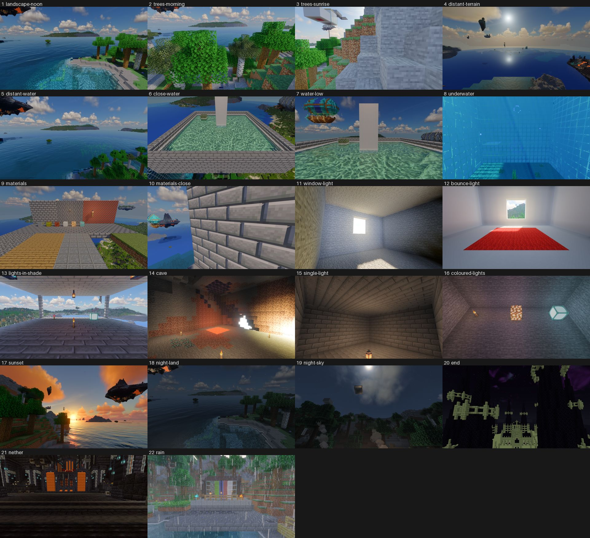

# Shader compare 1: our pack only (stopped early)

PC session on 2026-10-27, 18:04–18:30, by a Claude Code session in `C:\Users\coolm\Documents\Claude\MC-CREATE`
(`$T`). It followed sections 1 to 4 and "Shader compare 1" of `tools/shader-compare/PC-RUNBOOK.md` at `cc1ca29`, with
the shader pack from that commit (alpha 4 work), pack 0.6.1 (Bridge 1.125.0) and the compare kit from `dist/`.

**Stopped early at Emre's call.** Emre watched the run and saw problems in our pack's scenes as the camera went into
them, mostly a lot of jitter. Emre said the other packs weren't worth the remaining two hours. So the run stopped after
our pack's defaults pass, and this report has those 22 frames only.

**Alpha 4 needs some tweaks before it's ready.**
- The main problem Emre saw is jitter when the camera arrives at a scene. The stills can't show it: the kit saves one
  frame per scene, after the picture has settled (10 s and 90 frames). The frames from the moment of arrival are never
  saved, so none are here.
- The stills show other problems: room lighting that ignores how dark the room should be, a window with no beam
  through the air, a blocky haze edge over far land, and a blown-out patch in the cave (see "What the frames show").
- None of the 12 other packs ran, and neither did our pack's highest preset (ULTRA).

## The run

| | |
| --- | --- |
| Run | `20261027-181744` |
| `outcome` in `manifest.json` | `running`: the game was closed after our last shot, before the kit's own stop (see "Departures") |
| Time | Kit started 18:17:44. Our pack loaded 18:18:18. Shots 18:18:43–18:23:48 (22 scenes in 5.5 min). Game closed 18:24:09. The kit had estimated about 138 min for all 25 packs and passes. |
| GPU (`renderer`) | NVIDIA GeForce RTX 4080 SUPER/PCIe/SSE2 |
| Iris | 1.8.14-beta.1+mc1.21.1 |
| Resolution | 1920x1080, DLAA: `DLSS running at 1920x1080 (full resolution), preset K`, nvngx_dlss 310.9.16 |
| Packs that ran | `ours-defaults`: `loaded: true` |
| Packs that did not load | none of those that ran |
| Not run | the other 12 packs (both passes) and `ours-highest` (ULTRA) |
| Nether spot (`found`) | `[24.5, 36.0, 45.5]` |

Our pack's log during its 5.5 minutes is clean. The one shader message is a compiler warning when the pipeline is
made: `shadowcomp1`, `0(702) : warning C7050: "base" might be used before being initialized`. The rest is the usual
mod noise (Veil `Unsupported Uniform Type: bool`, unknown entity attributes).

## What the frames show

All 22 frames have shaders on. None is black, white or sky only. Problems by scene:

| Scene | `about` | What the frame shows | Whose |
| --- | --- | --- | --- |
| trees-sunrise | towards the low sun through the trees: light in the air | The camera faces a diorite hillside a few blocks away. Trees only at the left edge, no sun, nothing in the air. | Scene: the camera spot, the same for every pack |
| distant-terrain | high over the land towards the late sun: the haze over far terrain | Mostly open sea under the sun, little land. The haze above the land on the left has a blocky, stair-stepped outline. The horizon is a flat pale band with a hard top edge. | Scene (little land that way); the haze outline looks like our pack |
| window-light | a dark stone room with a window towards the morning sun: the beam through the air | The room isn't dark: the walls and ceiling are evenly lit. The window is blown out to white and there is a sunlit patch on the floor, but no beam in the air. | Our pack |
| cave | a chamber cut into the rock deep underground, lit by torches and a lava pool | Torches and the lava pool are there. On the right wall is a flat, pure-white patch with block-shaped edges, and the right edge of the frame is blown out by a bright glow. The still can't tell whether it's a hole to somewhere bright or blocks blown out to white. | Unclear |
| single-light | a closed stone brick room at night with one lantern on the floor | The whole room is lit almost evenly. The far walls and ceiling are about as bright as the floor next to the lantern, with little falloff. | Our pack |
| coloured-lights | a closed stone room at night: soul lantern, redstone torch, sea lantern, torch, amethyst, glowstone | Only the torch, glowstone and sea lantern are in frame. The coloured light on the walls is faint: some cyan on the right wall by the sea lantern. | Scene (three lights out of frame) and our pack (faint colour) |

The other 16 scenes show what their `about` says (or, for the scenes without one, what their name says):
landscape-noon, trees-morning, distant-water, close-water, water-low, underwater, materials, materials-close,
bounce-light, lights-in-shade, sunset, night-land, night-sky, end, nether and rain.

Seen in every outdoor scene: the pack's mods put floating islands, airships and other flying things in the sky (for
example landscape-noon, distant-terrain, water-low, materials-close, sunset). They aren't the scenes' vanilla blocks
and they'll be the same for every pack. Pick camera directions that avoid them if they get in the way.

The full screenshots stay on the PC in `$T\compare\screenshots\shader-compare\20261027-181744\` (open them with
`tools/dlss-testkit/compare.html`).

## Departures from the runbook

- **Stopped after our pack, at Emre's request** (see the top).
  - The kit's clean stop is `/shadercompare stop`, but the chat can't be opened during a run (the kit closes every
    screen). So I closed the game window normally after the last `ours-defaults` shot, while Complementary Reimagined
    was loading.
  - The kit's stop never ran. So the manifest's `outcome` is `running`, and Iris was left on Complementary with the
    kit's options file for it.
  - I did what the kit's stop does: put `shaderPack=Create-Galore-Shaders` back in `config\iris.properties` and
    deleted `shaderpacks\ComplementaryReimagined_r5.9.3.zip.txt` (the kit made it; it wasn't there before).
  - Closing mid-run logged shutdown errors: the kit trying to close a screen during disconnection, and world saves
    rejected while the server stopped. They only touch the compare instance's copy of the world.
- **One contact sheet instead of `sheet.py`'s per-scene sheets.** `sheet.py` makes one sheet per scene with every
  pack as a row. With one pack, that would be 22 sheets of a single tile above 12 empty rows. I used a small one-off
  script instead (same Pillow resize and JPEG quality 80, 480 px tiles, run order), kept outside the repo.
  `sheets/ours-defaults.jpg` is 1920x1752, 469 KB.
- **SPBR isn't the very top of the resource pack list.**
  - It's the top pack you can move. Above it the game pins the pack's own packs: SPRA ×2, Aeronautics Hot Air Fix,
    Moonlight Dynamic Resources, create-galore-guide, create-galore-fixes and Fragmentum Layer.
  - In the repo, create-galore-guide and create-galore-fixes have no vanilla block textures (the guide only has a
    `minecraft` font), so SPBR wins on the scenes' blocks. The first launch showed SPBR's bevelled stone bricks.
  - Closing the pack screen with Done wrote the pinned packs into `options.txt`, in the same order.
- **First launch:** my first try at closing the window clicked into the game instead (the mouse was captured), which
  turned the camera. In creative, that click may have broken a block in reach at the spawn point, in the compare
  instance's copy of the world only. I then closed the game with a normal window close.
- **Backups:** the pack's SimpleBackups mod (every 120 min, keeps 10) made a 277 MB backup to
  `$T\compare\simplebackups` when the first launch left the world.
- **Folder:** I cloned into `$T\repo-shaders` as the runbook says. `$T\instance` and `$T\repo` belong to the DLAA/RR
  sessions and were not changed. From `$T\instance`, only `nvngx_dlss.dll` and the `dlaa-test` world were copied.
